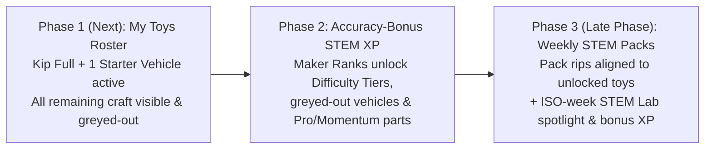

# Spec: App Continuation Roadmap (Kip & Craft Roster, Accuracy-Bonus STEM XP, Weekly STEM Packs)

Oct 30, 2026 · Post-Consolidation Phased Plan  
Builds on: [`world-first-spec.md`](world-first-spec.md) · [`parts-tu-spec.md`](parts-tu-spec.md) · [`flatpack-modular-craft-spec.md`](flatpack-modular-craft-spec.md) · [`progressive-power-system-spec.md`](progressive-power-system-spec.md) · [`parent-time-gate.md`](parent-time-gate.md)

---

## 1. Overview & Phase Order

With the single-stage World UI (`GameCanvas`) and Parent Time Gates live, app continuation is ordered into **three sequential phases** so content, progression, and weekly live-ops build on top of each other cleanly:

| Phase | Scope | Why This Order |
| --- | --- | --- |
| **Phase 1 (Immediate)** | **Kip & Modular Craft Roster in `My Toys`** (`Kip` full + `Roadster Racer` enabled; all remaining V2 Kip vehicles & flat-pack craft visible on the shelf as greyed-out progression previews) | Surfaces the 3D Kip heads/hairs/wardrobe and vehicle assets we already have in `public/kip/` & `sets/*.json` and gives kids an immediate visual goal on the `My Toys` shelf. |
| **Phase 2 (Core Loop)** | **Accuracy-Bonus STEM XP, Level Difficulty Tiers & Advanced Part Unlocks** | Connects STEM problem-solving accuracy in `lab1`..`lab6` & world missions to unlocking those greyed-out vehicles, `Tier 2`/`Tier 3` STEM difficulty, and `Pro` / `Momentum` mechanical parts. |
| **Phase 3 (Late Phase)** | **Toy-Aligned Weekly STEM Pack Rips** | Needs the unlocked toy roster (Phase 1) and Rank/Difficulty/Part gating (Phase 2) in place so weekly packs only drop fitting, rank-appropriate parts tied to that week's STEM Lab. |

---

## 2. Phase 1 — `My Toys` Roster: Enable Kip (Full) + One Vehicle, Grey Out the Rest

### 2.1 Goal
Replace the 3 emoji starter tiles in [`MyToySheet.tsx`](../src/features/game/world/MyToySheet.tsx) with the full ToyVentor hero and vehicle roster backed by existing assets in `public/kip/` (`kip-vehicles-wardrobe.js`, `public/kip/partspec/*.stl`) and `sets/*.json`.

### 2.2 Out-of-the-Box Unlocked Starters (`Rank 1`)
Only **two built-in hero starters** (plus real-world Meta SAM 3.1 scanning) are active and selectable on a fresh profile:

1. **`Kip` (`seed-kip` · Full Modular Hero · Default Starter #1)**
   - Default selected toy on first boot, rendered with a real Kip portrait thumbnail instead of a generic emoji.
   - Full Kip modular wardrobe & rig support surfaced directly from `My Toys` and `Build` (not buried solely in `⋯ -> Kip 3D Rig`):
     - **5 Swappable Heads:** `Kip Classic`, `Human Head` (with emotion faceplate), `Fox`, `Bear`, `Bolt Robot` (`WARDROBE_HEADS` in [`public/kip/kip-vehicles-wardrobe.js`](../public/kip/kip-vehicles-wardrobe.js)).
     - **8 Clip-On `2×1` Hairstyles:** 3 hat-ready (`Swept`, `Bob`, `Swoosh`) + 5 sculpted-top (`Spiky`, `Twin Pigtails`, `Sleek Ponytail`, `Cloud Curls`, `Crest Mohawk`).
     - **Hats, Back Docks & `Ø6.6 mm` Hand Props:** `Spark Buds`, `Wobble Hat`, `Pointy Ears`, `Bumper Horns`, `Explorer Pack`, `Bolt Jetpack`, `Cloud Wings`, `Pro Wrench`, `Star Shield`, `Skateboard`.
2. **`Roadster Racer` (`seed-car` / `Red Racer` · Starter Vehicle #2)**
   - The single unlocked built-in vehicle at `Rank 1`, paired with `sets/racer-garage.json` (`Spoiler`, `Bull Bar`, `Hood Scoop`, `Light Bar`, `Twin Exhaust`, `Racer Wheel`) and `veh_car_chassis` / `veh_car_hood_cover` / `veh_wheel_sport`.
3. **Scanned Real Toys (`Meta SAM 3.1` · Always Unlocked)**
   - Kids and parents can always scan any physical toy on the table via **`Scan a Real Toy (Meta SAM 3.1)`** at `Rank 1`; scanned uploads appear at the front of `My Toys`.

### 2.3 Greyed-Out Progression Roster (Visible in `My Toys`, Locked Until Earned)
All remaining built-in vehicles, flat-pack craft ([`flatpack-modular-craft-spec.md`](flatpack-modular-craft-spec.md)), and advanced frames appear right after the active starters in `My Toys` in a **greyed-out locked state** (`tv-toy-tile-locked`, `aria-disabled="true"`) with silhouette art and a clear Rank badge:

| Roster ID | Display Name | Asset / Spec Backing | Initial State | Unlock Gate (Phase 2) |
| --- | --- | --- | --- | --- |
| `seed-kip` | **Kip** | `public/kip/` full rig + `sets/kip-wardrobe.json` | **Enabled (Default)** | `Rank 1` (`0 XP`) |
| `seed-car` | **Roadster Racer** | `veh_car_chassis` + `sets/racer-garage.json` | **Enabled** | `Rank 1` (`0 XP`) |
| `veh-truck` | **Hauler Truck** | `veh_truck_chassis` + `veh_cab_roof_cover` + `veh_truck_bed_cover` + `veh_wheel_offroad` | **Greyed-out** | `Rank 2` (`250 XP`) |
| `veh-scooter` | **Motor Scooter** | `veh_scooter_frame` + `veh_scooter_fairing` + `veh_handlebar_fork` | **Greyed-out** | `Rank 2` (`250 XP`) |
| `seed-figure` | **Star Scout** | Built-in companion figure (`seed/toys/seed-figure.json`) | **Greyed-out** *(honored if loaded via `#toy=` link)* | `Rank 2` (`250 XP`) |
| `veh-moto` | **Sport Motorbike** | `veh_moto_cowling` + `veh_wheel_moto` + `kit_clevis_spine` | **Greyed-out** | `Rank 3` (`600 XP`) |
| `craft-tractor` | **Loader Tractor & Trailer** | Flat-pack `#1` Keel + `#2` Boom + `#5` Giant Wheels + `#12` Scoop | **Greyed-out** | `Rank 3` (`600 XP`) |
| `craft-plane` | **Prop Aeroplane** | Flat-pack `#1` Keel + `#6` Rotor + `3× #9` Swept Foils | **Greyed-out** | `Rank 4` (`1,100 XP`) |
| `craft-boat` | **Catamaran Boat** | Flat-pack `#1` Keel + `2× #10` Pontoons + `#13` Sponsons | **Greyed-out** | `Rank 4` (`1,100 XP`) |
| `craft-heli` | **Rescue Helicopter** | Flat-pack `#1` Keel + `#2` Tail Boom + `2× #6` Crossed Rotor + `#17` Canopy | **Greyed-out** | `Rank 5` (`1,800 XP`) |
| `craft-shuttle` | **Space Shuttle** | Flat-pack `#1` Keel + `3× #9` Delta Wings + `#13` Boosters + `#18` Payload Doors | **Greyed-out** | `Rank 5` (`1,800 XP`) |
| `mech-bolt` | **Bolt Power Mech** | `4×4×2 TU` Power Core frame ([`progressive-power-system-spec.md`](progressive-power-system-spec.md)) | **Greyed-out** | `Rank 6` (`2,700 XP`) |

- **Calm Locked Interaction (`docs/snap.md`):** Tapping a greyed-out tile never triggers an error buzzer or paywall. It shows an inline preview banner inside `MyToySheet`:
  > *"Hauler Truck unlocks at Rank 2 (250 XP). Finish STEM Lab missions with clean engineering to earn XP!"* + **`Play a STEM Lab`** CTA.

---

## 3. Phase 2 — Accuracy-Bonus STEM XP, Difficulty Tiers & Advanced Parts

### 3.1 Core Philosophy: Reward Precision Without Punishing Exploration
ToyVentor's under-8 calm rule (`docs/snap.md`) forbids red fail screens or losing progress when testing an idea (for example, watching an unbraced bridge sag on Test 1). Therefore:
- **Every completed STEM mission awards 100% of its Base XP**, no matter how many `Test it` iterations the child took.
- **High-accuracy engineering earns a positive Accuracy Bonus (`+25%` to `+50%` extra XP)** on top of Base XP, with `1★ / 2★ / 3★` mastery stars that can always be improved on replay.

### 3.2 Accuracy-Bonus XP Math (`shared/progression.ts`)
When a STEM mission (`bridge`, `measure`, `balance`, `logic`, `lift`, `raft`, `lever`, `circuit`, `code`, `pattern`, `clean`) completes in `ToyVentor-World`:

$$\text{XP}_{\text{award}} = \text{round}\!\left(\text{BaseXP}(\text{tier}) \times \left(1 + \text{AccuracyBonus} + \text{PartMatchBonus}\right) \times \text{ReplayFactor}\right)$$

1. **Base XP by STEM Difficulty Tier:**
   - **`Tier 1` (`★` Snap Starter):** `100 XP`
   - **`Tier 2` (`★★` Tinker Challenge):** `150 XP`
   - **`Tier 3` (`★★★` Pro Engineer):** `220 XP`
2. **Accuracy Bonus (measured from `#mp-go` test count & slot optimality during that mission):**
   | Mastery | Engineering Accuracy Criteria | Bonus | UI Celebration Copy (zero em dashes) |
   | --- | --- | --- | --- |
   | **`3★` Gold Precision** | Solved on **`1st` `Test it` attempt** with exact target / zero wasted parts (e.g. exact `Measure` sum, balanced `Lever` torque, braced `Bridge` on first run) | **`+50%`** | `Spot-On Engineering! +50% Accuracy XP` |
   | **`2★` Silver Fix** | Solved on **`2nd` `Test it` attempt** (tested once, diagnosed, and fixed cleanly) | **`+25%`** | `Smart Adjustment! +25% Accuracy XP` |
   | **`1★` Built & Solved** | Solved in `3+` `Test it` attempts | **`+0%`** *(full Base XP)* | `Mission Complete! +100 XP` |
3. **Equipped Part-Match Bonus (`+10%`):**
   - Awarded when the kid's active toy wears an equipped part matching the mission's mechanical stat (`armor` on `bridge`, `grip`/`torque` on `lift`/`lever`, `glow` on `circuit`, `speed`/`spin` on `raft`/`clean`).
4. **Anti-Grind & Star-Upgrade Rule:**
   - First solve of `(missionId, tier)` on a local day gets `ReplayFactor = 1.0`.
   - Improving an earlier `1★` solve to `2★` or `3★` always pays the full uncollected Accuracy Bonus delta immediately.
   - Repeating an already-`3★` `(missionId, tier)` on the same day pays `ReplayFactor = 0.25` practice XP so progression comes from tackling new labs or higher difficulty tiers rather than farming a single puzzle.

### 3.3 Unlockable STEM Level Difficulty Tiers (`★` -> `★★` -> `★★★`)
[`MissionPanel.tsx`](../src/features/game/world/MissionPanel.tsx) gains a compact 3-tier difficulty selector at the top of STEM Labs `1–6`:

| Difficulty Tier | Unlocks At | What Changes in the Mission | Target Age / Line |
| --- | --- | --- | --- |
| **`Tier 1 · Starter (★)`** | `Rank 1` (Default) | Forgiving slot tolerances, visual slot hints visible, generous part bin. | Ages `4–6` (`Snap`) |
| **`Tier 2 · Tinker (★★)`** | `Rank 2` (Labs `1–3`) & `Rank 4` (Labs `4–6`), or `2★+` on `Tier 1` | Wider gap / heavier load / 2-condition logic gate, tighter scrap budget, visual hints tucked behind a `Hint` tap. | Ages `6–8` (`Snap -> Pro`) |
| **`Tier 3 · Engineer (★★★)`** | `Rank 4` (Labs `1–2`) & `Rank 5` (Labs `3–6`) | Exact gear-ratio targets (`Z10:Z20` `2:1` torque vs. `1:2` speed), multi-step circuit/code patterns, and minimum-part efficiency goal for `3★`. | Ages `8+` (`Pro` & `Momentum`) |

### 3.4 Maker Ranks (`Rank 1`–`Rank 6`) & Advanced Part Unlocks
XP unlocks **both** the greyed-out vehicles in `My Toys` and advanced part families in `ToyCustomizer` / `PrintDrawer`:

| Rank | Title | XP Threshold | Unlocked Vehicles (`My Toys`) | Unlocked Parts (`Build` / `PrintDrawer`) & Difficulty |
| --- | --- | --- | --- | --- |
| **1** | **Snap Sprout** | `0 XP` | `Kip` (Full), `Roadster Racer`, SAM Scan | Core `Snap` parts (`sets/base.json`, `sets/kip-wardrobe.json`, starter `racer-garage.json`), `Tier 1 (★)` Labs `1–6` |
| **2** | **Workshop Builder** | `250 XP` | `Hauler Truck`, `Motor Scooter`, `Star Scout` | Heavy utility `Snap` add-ons (`Roof Rack`, `Bull Bar`, `Twin Exhaust`), `Tier 2 (★★)` Labs `1–3` |
| **3** | **Gearhead** | `600 XP` | `Sport Motorbike`, `Loader Tractor & Trailer` | **`Pro` Mechanical Line unlocked (`Pro` filter enabled):** `beam_str_tu05`, `pin_friction`, `gear_spur_z10`, `gear_spur_z20`, `adapter_snap_pro`, `prop_wrench` |
| **4** | **Sky & Sea Pilot** | `1,100 XP` | `Prop Aeroplane`, `Catamaran Boat` | Flat-pack Aero & Marine modules (`kit_foil_wing`, `kit_rotor_blade`, `kit_skid_pontoon`), `Tier 2 (★★)` Labs `4–6`, `Tier 3 (★★★)` Labs `1–2` |
| **5** | **Aero Captain** | `1,800 XP` | `Rescue Helicopter`, `Space Shuttle` | **`Momentum` Stored-Energy Modules** (`kit_booster_pod` balloon jet, elastic spool, hydraulic lift preview), `Tier 3 (★★★)` Labs `3–6` |
| **6** | **Mech Inventor** | `2,700 XP` | `Bolt Power Mech` | **`Mech` Robotics Preview** (`4×4×2 TU` Power Core brick + coaxial servo/sensor challenges) |

> [!TIP]
> **Grown-Ups / Demo Sandbox Toggle:** Inside `GrownUpsSheet` (`⋯ -> Grown-ups`), an optional **`Unlock All Toys & Pro Parts (Maker / Demo Mode)`** switch lets parents, educators, or hackathon judges test every craft, difficulty tier, and `Pro` gear immediately without waiting on XP thresholds.

### 3.5 Persistence & HUD Footprint
- **Zero HUD clutter on the 3D Stage:** No noisy RPG bars floating over the 3D canvas. The `[Toy Pill ▾]` shows a subtle rank pip (`R1`..`R6`), `MyToySheet` shows the clean Maker Rank progress bar (`320 / 600 XP to Rank 3 · Gearhead`), and completing a STEM mission pops a celebratory 2.5s toast (`Spot-On Engineering! +150 XP`).
- **Local-First + D1 Sync:** Stored in `localStorage["toyforge:progression:v1"]` (`totalXp`, `rank`, `missionStars`, `sandboxUnlockAll`) and synced to D1 via `/api/ownership` (`type: "progression"`, `id: "main"`).

---

## 4. Phase 3 (Late Phase) — Toy-Aligned Weekly STEM Pack Drops

Once Phases 1 and 2 are shipped and verified, [`shared/pack.ts`](../shared/pack.ts) and [`PackOverlay.tsx`](../src/features/game/world/PackOverlay.tsx) upgrade from generic date-hashed pulls to **Toy-Aligned Weekly STEM Drops**:

1. **Weekly STEM Lab Spotlight (`ISO Week` -> `lab1`..`lab6`):**
   - Each calendar week (`YYYY-Www`) spotlights one of the 6 World STEM Labs (`Bridges`, `Machines`, `Water`, `Levers & Lights`, `Code & Patterns`, `Clean-up`) at the player's highest unlocked Difficulty Tier (`★` / `★★` / `★★★`).
   - The `PackOverlay` header displays the week's theme: e.g. `Week 44 · Bridges & Balance Drop`.
2. **Toy-Fit & Rank-Gated Card Pool (Zero Dead Pulls):**
   - Pack candidates filter through `allPass(runChecks(part, activeToy))` (falling back across the player's other **unlocked** toys only when needed) and respect the player's current Maker Rank (`Snap` at `Rank 1–2`, `Snap + Pro` at `Rank 3+`).
   - At least 1 printable card is guaranteed and weighted toward the week's featured STEM physics stat (`armor` for Bridges, `torque` for Machines/Levers, `speed` for Water, `glow` for Circuits, `jump` for Sky Code).
3. **1-Tap `Equip & Play Weekly Lab` Loop:**
   - Ripping the pack offers a single primary action: **`Equip {part.name} & Try {Weekly Lab}`**, which equips the part onto `{toy.name}`, jumps directly into that week's STEM Lab via `engine.goWorld(labId)`, awards a **`+150 XP` Weekly STEM Bonus** on first completion (stacking with the Accuracy Bonus!), and credits `+5m` STEM Earned Play Time when Parent Time Gates are enabled.

---

## 5. Planned File Map Across Phases

| Phase | Files to Add / Update | Key Deliverables |
| --- | --- | --- |
| **Phase 1** | `shared/roster.ts` *(new)*, `src/features/game/world/MyToySheet.tsx`, `src/features/game/world/GameCanvas.tsx`, `tests/roster.test.ts` *(new)* | Full 12-entry `My Toys` roster (`Kip` full + `Roadster Racer` enabled; 10 greyed-out craft/frames with Kip/vehicle thumbnails & Rank badges); direct Kip wardrobe & rig access from `My Toys` / `Build`. |
| **Phase 2** | `shared/progression.ts` *(new)*, `src/lib/progression.ts` *(new)*, `src/features/game/world/engine.ts`, `src/features/game/world/MissionPanel.tsx`, `src/features/game/world/PrintDrawer.tsx`, `src/features/game/world/GrownUpsSheet.tsx`, `shared/ownership.ts`, `tests/progression.test.ts` *(new)* | `#mp-go` attempt & accuracy tracking, `1★–3★` Accuracy-Bonus XP formula, `Rank 1–6` unlocks for vehicles + `Pro` parts + `Tier 1–3` mission difficulty, D1 sync, and Grown-Ups Maker/Demo unlock toggle. |
| **Phase 3 *(Late)*** | `shared/pack.ts`, `src/features/game/world/PackOverlay.tsx`, `src/features/game/world/GameCanvas.tsx`, `tests/pack.test.ts` | ISO-week STEM Lab rotation, active-toy + rank fit-filtered pack pool, `Equip & Try Weekly Lab` CTA, and Weekly STEM Bonus XP. |
