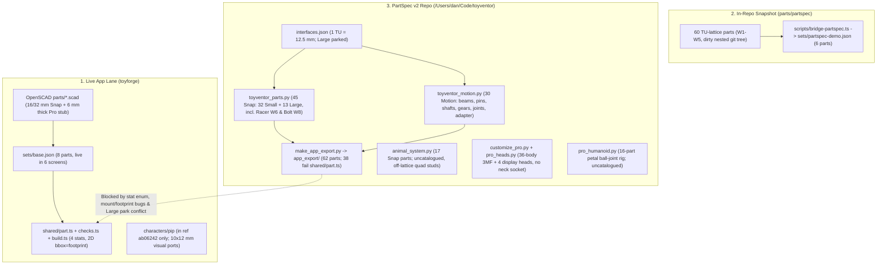

# Full Review: Snap & Pro Part Library and Parametric Design Specs

> Point-in-time review (2026-10-30). Links to files that are not in this repo (the standalone PartSpec v2 character systems) are shown as plain code, not links. Treat findings as history where [decision 0005](../decisions/0005-partspec-lattice-merge.md) or later work supersedes them.

**Scope audited:**
1. **App lane (`toyforge`)** — [snap.md](../parts/snap.md), [motion.md](../parts/motion.md), [snap-samples.md](snap-samples.md), [creating-parts.md](../parts/creating-parts.md), [0005-partspec-lattice-merge.md](../decisions/0005-partspec-lattice-merge.md), OpenSCAD library under `parts/`, [base.json](../../sets/base.json), `partspec-demo.json`, `shared/*.ts`, and character blockouts.
2. **In-repo PartSpec v1 snapshot** — `docs/parts/partspec/specs/01..11` and `parts/partspec/` (60 parts).
3. **PartSpec v2 standalone package (`toyventor`)** — [interfaces.json](../../parts/partspec/interfaces.json), [catalog.json](../../parts/partspec/catalog.json) (75 printable parts + 1 skin), [toyventor_parts.py](../../parts/partspec/toyventor_parts.py), [toyventor_motion.py](../../parts/partspec/toyventor_motion.py), [toyventor_fit.py](../../parts/partspec/toyventor_fit.py), [toyventor_assembly.py](../../parts/partspec/toyventor_assembly.py), [preprint_check.py](../../parts/partspec/preprint_check.py), [make_calibration.py](../../parts/partspec/make_calibration.py), [make_app_export.py](../../parts/partspec/make_app_export.py), and character systems (`animal_system.py`, `pro_humanoid.py`, `pro_heads.py`, `customize_pro.py`).

---

## 1. Executive Verdict & System Topology

PartSpec v2 (`toyventor`) is a major leap forward over both the legacy OpenSCAD app lane and the in-repo `docs/parts/partspec` v1 snapshot: it unifies **Snap** and **Pro** onto a single **12.5 mm ToyVentor Unit (`1 TU`)** lattice, enforces watertight manifold CSG, verifies fit geometrically on triangulated meshes, slices all 75 printable parts through PrusaSlicer 2.8.1 without supports, and ships an articulated Pro customizer that rigidly protects joint clearances under body scaling.

> [!WARNING]
> **Nothing in either lane is ready for blind user printing yet.** Our audit uncovered **two severe mechanical failures in Pro** (a closed-end friction pin whose half-beams hit ~30–61% bending strain before seating, and involute undercut interference on `Z10`/`Z15` gears masked by a collision exemption), **severe physical-mating bugs in the live OpenSCAD app STLs** (`top_studs` cone fillets jam against `socket` mouths, and `spoiler.scad` has zero sockets plus a 72 mm² mid-air overhang), **contract-breaking export bugs in `make_app_export.py`**, and **four disconnected character/humanoid connector architectures**.

---

## 2. Parametric Interface & Tolerance Review (Snap vs Pro)

### 2.1 Master Dimensional Comparison Across Lanes

| Parameter | App OpenSCAD (`parts/`) | PartSpec v2 (`interfaces.json`) | Assessment |
| --- | --- | --- | --- |
| **Base unit (`TU`)** | None (`16 mm` Snap / `12.5 mm` Pro) | **`12.5 mm`** (`0.5 / 0.25 / 0.125 TU` sub-steps) | v2 cleanly unifies Snap and Pro on one pitch. |
| **Snap Small pitch / stud Ø / stud H** | `16.0` / `9.5` / `5.0 mm` (`6.0` w/ cone) | **`12.5` / `6.6` / `2.8 mm`** (`0.6 mm` top fillet) | `6.6 mm` intentionally matches Pro shaft Ø. |
| **Snap Large pitch / stud Ø / stud H** | `32.0` / `19.0` / `8.0 mm` (`9.5` w/ cone) | **`25.0` / `13.2` / `5.6 mm`** (`1.0 mm` top fillet) | Large is `2×` Small (`2 TU`), **parked** in v2 (`interfaces.json:19`). |
| **Snap radial design gap** | `0.10 mm` (Small) / `0.15 mm` (Large) | **`0.05 mm`** (`0.10 mm` diametral) both sizes | **Tight** for uncalibrated home FDM (seam bulge alone is `0.05–0.10 mm`). |
| **Snap socket architecture** | Compliant 4-slot cone-roof (in docs; rigid `socket()` in parts) | Rigid **tube cage** (`2×2+` blocks) or **integrated flat-roof blind hole** (`addons/capsules`) | Flat roofs bridge cleanly (`≤6.7–13.3 mm`), but rigid PLA cages have **zero elastic compliance** (`±0.075 mm` surface-offset window). |
| **Snap vertical module (plate / brick)** | `4.0 mm` / `12.0 mm` (Small) | **`5.0 mm` / `15.0 mm`** (Small); **`10.0` / `30.0 mm`** (Large) | $3 \times \text{plate} = 1 \times \text{brick}$ works inside Snap, **but clashes with Pro `12.5 mm` Z-height** (see §3.2). |
| **Pro beam cross-section & max length** | `12.5 × 6.0 mm` sharp cube ([beam-tu05.scad](../../parts/scad/pro/beam-tu05.scad#L4-L8)) | **`12.5 × 12.5 mm`** (`1.5 mm` fillet, `0.5 mm` bed chamfer), max `14 TU = 175 mm` | v2 respects `180 mm` bed limit (`TU14`). |
| **Pro free bore / fixed bore** | `7.0 mm` round (`$fn=32`), no fixed bore | **`7.0 mm` round** (`0.4 mm` chamfer; teardrop sideways) / **`5.1 mm` double-D flats** | Sideways teardrop (`toyventor_motion.py:55-68`) is well-engineered for support-free FDM. |
| **Pro shaft / axle** | None | **`6.6 mm` round, `5.0 mm` flats**, `2.0 mm` teardrop centre hole | `0.20 mm` radial free clearance; `0.05 mm` radial press fit across flats (`LAY_FLAT` orientation). |
| **Pro gear system** | None | **Module `2.5 mm`, `PA = 20°`**, `0.20 mm` backlash, `6.25 mm` (`0.5 TU`) thick | $Z_1 + Z_2 \equiv 0 \pmod 5$ puts pitch centres on `0.5 / 1.0 TU` grid — **but `Z10` & `Z15` undercut/interfere** (§4.1). |
| **Circle tessellation (`FIT_SEG`)** | `$fn = 24..48` | **`96` segments** (`chord sagitta = 0.002 mm` on `6.6 mm` stud) | Eliminates polygon-inscribing error in catalog parts, though bypassed in `animal_system.py` / `pro_humanoid.py`. |

### 2.2 Critical Mechanical & Parametric Defects in PartSpec v2

#### M1. Pro Friction Pin (`pin_friction`, `pin_friction_long`) Exceeds PLA & PETG Fracture Strain by >10×
- **Where:** [interfaces.json](../../parts/partspec/interfaces.json#L91-L105) and [`friction_pin()`](../../parts/partspec/toyventor_motion.py#L577-L596).
- **The math:** `friction_pin` cuts a `1.6 mm` lengthwise slot starting at `slot_end_mm = 3.0 mm` from **both** ends (`z = 3.0..22.0 mm` on the `25.0 mm` pin), leaving **solid un-slotted bridges at both tips**. Each half is therefore a **doubly-clamped (`fixed-fixed`) `2.5 mm`-thick beam**, not an open cantilever. Worse, the retention fins (`fin_oversize_mm = 1.5 mm` diametral = **`0.75 mm` radial deflection per side**, consuming **93.8%** of the `0.80 mm` half-slot!) reach full height at `z = 5.20 mm` — just **`2.20 mm` away from the solid tip** (`zc = 6.25 mm` is `3.25 mm` from the solid tip).
- **Result:** Compressing the fin into a `7.0 mm` bore requires an outer-fibre bending strain of **~29.7% at mid-fin (`a = 3.25 mm`)** and **>60% at the fin shoulder (`a = 2.20 mm`)**. PLA fractures at **~2.0–2.5% strain** and PETG yields at **~3.5%**. In physical print, this pin will either refuse to enter the `7.0 mm` bore or crush/delaminate permanently on first insertion.
- **Fix:** Split the slot **open through the insertion ends** (cantilever split tips with a small `0.20–0.25 mm` radial retention ridge near the tip and a `0.15 mm` radial friction rib, or thin hollow cylindrical walls `t ≈ 1.1 mm`) so peak insertion strain stays `< 1.5%`.

#### M2. Involute Tip-to-Flank Interference on `gear_spur_z10` and `gear_spur_z15`
- **Where:** [`spur_section()`](../../parts/partspec/toyventor_motion.py#L451-L470), [`rack()`](../../parts/partspec/toyventor_motion.py#L525-L546), and [`validate()`](../../parts/partspec/toyventor_assembly.py#L249-L253).
- **The math:** Standard full-depth $20^\circ$ involute teeth ($h_a = 1.0 m$) suffer involute undercut below $Z_{\min} = \lceil 2 / \sin^2(20^\circ) \rceil = \mathbf{18\text{ teeth}}$. Below the base circle ($r_b = 11.746\text{ mm}$ for `Z10`, $17.619\text{ mm}$ for `Z15`), [`spur_section()`](../../parts/partspec/toyventor_motion.py#L458-L460) draws **straight radial flanks** down to $r_f = r - 1.25 m$ with zero profile shift ($x = 0$) and zero tip relief.
  - **`gear_spur_z10` (`r_b = 11.746 mm`, `r_f = 9.375 mm`):** Interferes radially with **every mating gear in the catalog** at nominal centre distance: **`+0.471 mm`** vs `Z10`, **`+0.642 mm`** vs `Z15`, **`+0.735 mm`** vs `Z20`, **`+0.792 mm`** vs `Z25`, **`+0.831 mm`** vs `Z30`, and **`+1.038 mm`** vs `gear_rack_tu05`.
  - **`gear_spur_z15`:** Clears `Z10–Z30` (`0.15–0.88 mm` margin), **but interferes by `+0.307 mm` with `gear_rack_tu05`**.
- **Why the gate missed it:** [`toyventor_assembly.py`](../../parts/partspec/toyventor_assembly.py#L251) marks meshing gears `exempt: True` from 3D mesh-overlap checks (because static teeth weren't phase-clocked), and `valid_pro_rack_drive` only tests `Z20` + rack!
- **Fix:** Either apply standard profile shift / stub addendum ($h_a = 0.8 m$ across the `m = 2.5` family, or conjugate rack-cut root trochoids + tip chamfer), **and** replace `exempt: True` in `toyventor_assembly.py` with a multi-angle clocked Boolean intersection check `(g1.rotate(a1) ^ g2.rotate(a2)).volume() == 0`.

#### M3. Pro Free Pin (`pin_free`) Prints Standing Upright (Weak Layer Orientation)
- **Where:** [`free_pin()`](../../parts/partspec/toyventor_motion.py#L564-L569) and [interfaces.json](../../parts/partspec/interfaces.json#L113).
- **Issue:** Unlike `shaft` and `friction_pin` (which rotate via `LAY_FLAT` so filament strands run along the pin axis), `pin_free` (`6.6 mm` Ø × `26.5 mm` tall, slenderness triggering a `3 mm` brim in PrusaSlicer) prints **vertically on its `9.0 mm` head**. Layer lines lie perpendicular to shear/bending loads across beam joints — the classic FDM pin-snap failure mode.
- **Fix:** Give `pin_free` double-D flats on its `9.0 mm` head (or a `45°` head shoulder) and print it `LAY_FLAT` (`[90, 0, 0]`) so all Pro pins/shafts have axial filament continuity.

#### M4. `pro_humanoid.py` Snap-In Petal Sockets Exceed PLA Yield (`4.6–5.6%` Strain)
- **Where:** `socket_cut()` in `pro_humanoid.py` (standalone package, not in repo) (`WALL = 1.4 mm`, `OPEN = 0.80`, `C_RAD = 0.25 mm`).
- **The math:** Snapping a `6.0 / 8.0 / 10.0 mm` ball through an `0.80 r` throat forces each `1.4 mm`-thick, `4.75–6.75 mm`-long petal outward by `0.60 / 0.80 / 1.00 mm`, producing **`5.58%` (neck/wrist), `5.08%` (shoulder/ankle), and `4.61%` (hip)** bending strain — roughly `2.5×` PLA's elastic limit (`~2.0%`), causing white-stress crazing or cracked petals on assembly unless printed in TPU/PETG or relaxed to `OPEN ≈ 0.88–0.90` (one of the test cells already included in [`make_calibration.py`](../../parts/partspec/make_calibration.py#L101)).

### 2.3 Critical Parametric Bugs in the OpenSCAD App Lane (`toyforge/parts/`)

Even though [0005-partspec-lattice-merge.md](../decisions/0005-partspec-lattice-merge.md) freezes new `16/32 mm` parts, **these 9 STLs are what `toyforge` currently serves for download today**:

1. **`top_studs()` vs `socket()` Cannot Physically Seat ([stud_profile_small.scad](../../parts/scad/profiles/stud_profile_small.scad#L30-L37) & [#L91-L98](../../parts/scad/profiles/stud_profile_small.scad#L91-L98), [stud_profile_large.scad](../../parts/scad/profiles/stud_profile_large.scad#L33-L40) & [#L71-L78](../../parts/scad/profiles/stud_profile_large.scad#L71-L78)):**
   - `top_studs()` places a `1.5 mm` tall cone fillet (`d1 = 11.5 -> d2 = 9.5 mm`, flaring to `10.83 mm` above the plate) **under** the `5.0 mm` stud (`6.0 mm` total protrusion on `brick-2x2-small`; `9.5 mm` on `brick-2x2-large`).
   - `socket()` is a straight `9.70 mm` bore of depth `4.00 mm` with **zero mouth chamfer/counterbore**. Stacking two bricks collides with the base cone (`1.13 mm` interference) and bottoms out on the cone roof, leaving a **2.00 mm gap (Small)** and **3.45 mm gap (Large)**! Even `forge-mount.scad` (`5.0 mm` studs) bottoms out `1.0 mm` early.
2. **Flagship Demo `spoiler.scad` Cannot Snap & Needs Supports ([spoiler.scad](../../parts/scad/snap/spoiler.scad#L1-L6)):**
   - Solid `cube([32, 16, 3])` base with **zero sockets**, sharp `90°` corners, and **`72.0 mm²` of unsupported horizontal 90° mid-air overhang** at `z = 12 mm` (contradicting `"supportFree": true` in [base.json](../../sets/base.json#L16)).
3. **`forge-mount.scad` Has Zero Toy-Attachment Geometry ([forge-mount.scad](../../parts/scad/mount/forge-mount.scad#L1-L4)):**
   - Literally `stud_plate(3, 2)` — a flat `48 × 32 × 4 mm` rectangular slab with 6 studs and no peg hole, clip, or shoe.
4. **`forge-mount-first-print.scad` Selector Cannot Flex & Has `0.575 mm` Walls ([forge-mount-first-print.scad](../../parts/scad/mount/forge-mount-first-print.scad#L30-L53)):**
   - `compliant_socket()` cuts 4 radial slots into a solid `16 × 48 × 8 mm` slab with no annular moat around the socket, so the rim cannot flex; the `+X/-X` slots pierce to within **`0.575 mm`** of the outer wall (`< 1.2 mm` min wall) and **`0.675 mm`** under the top dots, while the loose `16 × 16 × 10 mm` 1×1 token is an unmarked small-parts hazard whose cone-filleted stud doesn't match the plain studs on the mount beside it.
5. **`calibration-piece.scad` Exports 5 Disconnected Unmarked Cubes ([calibration-piece.scad](../../parts/scad/calibration/calibration-piece.scad#L5-L12)):**
   - `14 mm` cubes translated by `i * 16 mm` leave `2.0 mm` air gaps (`5` separate bodies with zero markings to tell `-0.2 mm` from `+0.2 mm` once popped off the bed).

---

## 3. Part Library Coverage, Interoperability & Safety Audit

### 3.1 Catalog Inventory (PartSpec v2: 75 Printable Parts + 1 Digital Skin)

| Line / Size | Count | Waves & Families | Preprint Gate (`fdm_pla_0.4`) | ASTM F963 / EN 71 Small-Part Screen |
| --- | --- | --- | --- | --- |
| **Snap Small** (`12.5 mm`) | **32** | Base/W1 blocks, tiles, slopes, dome (`6`); W3/W7 character add-ons & capsules (`12`); W6 Racer (`9`); W8 Bolt robot (`5`); Small Forge Mount (`1` shared) | `24` pass as-is, `8` `pass_with_settings` (`3–5 mm` brim) | **`25` `small_part`**, `7` `above_cylinder` |
| **Snap Large** (`25.0 mm`, *parked*) | **13** | Base/W1 bricks, plates, tile, slope (`6`); W3/base add-ons & capsules (`6`); Large Forge Mount (`1` shared) | `13` pass as-is (`0` brims) | **`0` `small_part`**, **`13` `above_cylinder` (100%)** |
| **Pro** (`12.5 mm` hole/pin) | **30** | W2 straight beams (`5`), pins (`3`), shafts (`3`), bushings (`2`); W4 spur/ring gears & rack (`7`), L/T/45° beams (`4`), Pro Mount (`1`), Snap-to-Pro adapter (`1`); W5 wheels (`2`), hinge (`1`), cross connector (`1`) | `24` pass as-is, `6` `pass_with_settings` (`3 mm` brim on pins/shafts) | **`10` `small_part`**, `20` `above_cylinder` |

> [!IMPORTANT]
> **Safety & Age-Grading Implication of Parking Snap Large:** Because `1 TU = 12.5 mm`, a `2×2` Snap Small footprint is only `24.8 × 24.8 mm` — smaller than the `31.7 mm` small-parts choke-test cylinder. Consequently, **25 out of 32 Snap Small parts (78%) are legally `small_part` choking hazards** (mandatory 3+ warning, banned for under-3s), whereas **13 out of 13 Snap Large parts clear the cylinder**. Meanwhile, [snap-samples.md](snap-samples.md#L57) and [02_snap_spec.md](../parts/partspec/specs/02_snap_spec.md#L67-L68) still reference under-3 / ages 1–3 use, and the web app's download UI (`AugmentScreen.tsx`) currently displays **zero CPSC small-parts warnings**.

### 3.2 Snap ↔ Pro Interoperability ("One Modular System" Gaps)

1. **Unidirectional Adapter Only (`adapter_snap_motion`):**
   - `adapter_snap_motion` (`3×3 TU` Pro free-bore plate with `2×2` Small studs shifted by `0.5 TU` onto inner corners) lets **Snap female add-ons mount onto a Pro build**.
   - **Missing reverse adapter (`adapter_pro_on_snap`):** There is **no** part with Snap `socket_grid` underneath and Pro `bore_grid` or pins on top! A child who puts a `forge_mount_ring_s` (Snap Small stud face) onto their scanned toy **cannot** attach any Pro beam, gear, wheel, or hinge to that toy without printing an entirely new `forge_mount_pro` base.
2. **Half-TU Phase Shift + Vertical Module Mismatch:**
   - Because `adapter_snap_motion` puts Small studs at `(±6.25, ±6.25 mm)` while Pro bores sit at `(0, ±12.5 mm)`, Snap and Pro grids are **offset by `0.5 TU` (`6.25 mm`) laterally**.
   - Vertically, Pro beams are **`12.5 mm` (`1 TU`)** and gears are **`6.25 mm` (`0.5 TU`)**, whereas Snap Small plates are **`5.0 mm`** and bricks are **`15.0 mm`**. Because $\gcd(5.0, 6.25) = 1.25\text{ mm}$ ($5\text{ plates} = 2\text{ Pro beams} = 25\text{ mm}$), mixed Snap+Pro assemblies cannot bridge across two towers at standard 1-plate or 1-brick heights.
3. **Racer Hybrid Parts Break the Line Boundary (`racer_axle_block`, `racer_axle`, `racer_wheel`):**
   - Catalogued as `line: "snap", size: "small"` (ages 3+/4+), yet `racer_axle` is a `6.6 × 37.5 mm` Pro `shaft_drive` (`small_part`) and `racer_wheel` (`17.9 mm` Ø × `6.0 mm`, `small_part`) uses a Pro `fixed` double-D hub bore. In `make_app_export.py`, both are mis-exported as `mount: "stud"` despite having zero stud/socket connectors.

### 3.3 Character & Humanoid Fragmentation (Four Unbridged Pipelines)

Both [snap.md](../parts/snap.md#L44-L50) and [motion.md](../parts/motion.md#L40-L58) state that Snap and Pro characters share one module vocabulary backed by typed connectors and fit-checked adapters. Today, **four separate systems exist and none share a head/accessory interface**:

| Pipeline | Location | Connector System | Spec & Parametric Issues |
| --- | --- | --- | --- |
| **1. Snap Robot (`Bolt`, W8)** | [`toyventor_parts.py`](../../parts/partspec/toyventor_parts.py#L798-L868) | Typed `stud_grid` / `socket_grid` (`12.5 mm` Small) | **Conforming.** Only character line in `catalog.json` passing fit & assembly checks. Note: `robot_head_visor` exposes a `2×1` male stud row on top (`18 mm` visor bridge). |
| **2. Snap Animals & Core Humanoid** | ``animal_system.py`#L1-L372` (17 STLs) | Untyped blind `6.7 × 3.2 mm` holes + `stud_small` | **Uncatalogued; bypasses gate.** Hardcodes `HOLE_D = 6.7, HOLE_H = 3.2` instead of reading `interfaces.json`; uses `48` cylinder segments instead of `FIT_SEG = 96`; places `torso_quad` neck studs at `y = -13.0` and tail stud at `y = +19.0` (`32.0 mm` span — **off the `12.5 mm` lattice**, so quad front + rear cannot align to any Snap plate!). |
| **3. Pro Base 3MF + Custom Heads** | ``customize_pro.py`` + ``pro_heads.py`` | Print-in-place ball joints (`full-assembly.3mf`) | `customize_pro.py` + `pro_deform.js` joint-protection math (`r_in = r + 2.5`, `r_out = r_in + 5.0 mm`) is **clean and verified**. However, `pro_heads.py` has **zero neck socket/connector** (solid display undersides), moulds 3D eyes/mouths and omits the two Snap Small crown studs mandated by [BRAND_STYLE.md](../../parts/partspec/BRAND_STYLE.md#L25-L45), and `robot()` uses a `32`-segment `6 mm` top ball. |
| **4. Alt Pro Humanoid & App `pip`** | ``pro_humanoid.py`` / `ab06242:characters/pip` | `6/8/10 mm` snap-in ball joints / visual-only `10×12 mm` discs | `pro_humanoid.py` has zero `bore_grid` or `stud_grid` ports and no stud-to-ball adapter; `pip` is missing from `toyforge` `HEAD` and has multi-body floating accessories with zero mechanical connectors. |

### 3.4 Validator Blind Spots in PartSpec v2

- **`P2_bridge_span` skips non-cavity bridges ([`toyventor_parts.py`](../../parts/partspec/toyventor_parts.py#L1225-L1230)):** Only inspects `part["cavity"]`, automatically reporting `"pass: no cavity"` on integrated-base parts like `racer_spoiler`, `racer_hood_scoop`, and `robot_head_visor` (`18 mm` visor bridge). Only Stage-1 `V6_bridge_span` in [`preprint_check.py`](../../parts/partspec/preprint_check.py#L241-L243) measures real flat ceilings.
- **`P3_wall_min` does not inspect mesh geometry ([`toyventor_parts.py`](../../parts/partspec/toyventor_parts.py#L1233-L1240)):** Checks `p["wall"] >= 1.2` from config JSON (`level: "info"`), not the actual Manifold/trimesh solid. Meanwhile [`thin_regions()`](../../parts/partspec/preprint_check.py#L195-L214) (`V8_wall_thickness`) is `warn`-only and suppresses any thin wall whose surfaces connect within `reach = 3.0 mm` along mesh edges.
- **Catalog `2×2` rule vs `2×1` / `1×1` reality ([catalog.json](../../parts/partspec/catalog.json#L12) & `selftest.py:91`):** `catalog.json` rule 1 still says *"Snap grids are at least 2x2"*, but `selftest.py` only regex-checks `_1x` inside part IDs — while W6/W8 ship nine `2×1`, `1×2`, and `1×1` parts using integrated bases, plus `robot_head_visor`'s male `2×1` stud row (which grips integrated add-ons cleanly, though a `2×2` tube-cage brick placed across a `2×1` stud row only touches one side of its centre tube).

---

## 4. App Bridge, Export & Documentation Drift Bugs

### 4.1 Bugs in `toyventor/make_app_export.py` (`app_export/`)

1. **`forge-mount-small` Exported as `2×2` (`25 × 25 mm`) Instead of `5×5` (`62.5 × 62.5 mm`):**
   - In [`units_for()`](../../parts/partspec/make_app_export.py#L60-L66), `row["build"].get("grid")` (`[2, 2]`, which is only the reference brick used for `seat_pair` check `I3`) is checked **before** `b.get("n")` (`5`). Result: `app_export/sets/base.json` and `catalog.json` tell the app `forge-mount-small` is `25 × 25 mm` while its STL/GLB is **`62.3 × 62.3 mm`**!
2. **Add-on Footprints Exported from Reference `build.grid` Instead of Actual Connector Grid:**
   - `snap-bumper-horns` (`29.6 × 11.9 mm`), `snap-pointy-ears` (`24.4 × 11.9 mm`), and `snap-ridge-fin` (`11.9 × 24.4 mm`) are exported as `units: [2, 2]`, `footprintMm: [25.0, 25.0]` instead of `[2, 1]` / `[1, 2]`. Conversely, wide overhanging parts like `snap-wing-01` (`58.2 × 42.2 mm` bbox) and `snap-glow-capsule-01` (`37.5 × 37.5 mm` bbox) export `footprintMm: [25.0, 25.0]` — causing 3D mesh collisions in [`canPlace()`](../../shared/build.ts#L60-L80) and false passes on `fits-toy` / `fits-bed` in [`runChecks()`](../../shared/checks.ts#L20-L39). (The same `footprintMm < bbox_mm` issue affects [`shared/partspec.ts`](../../shared/partspec.ts#L72-L92), where `1×1` capsules get `12.5 × 12.5 mm` footprints for `37.5 × 37.5 mm` domes!)
3. **38 of 62 Exported Catalog Parts Fail `validateSet()` in `toyforge/shared/part.ts`:**
   - [`set_schema()`](../../parts/partspec/make_app_export.py#L177-L179) validates `stat.name` as `{"type": "string"}`, missing [`shared/part.ts`](../../shared/part.ts#L8)'s `StatName = "speed" | "spin" | "torque" | "glow"`. As a result, **38/62** parts in `app_export/sets/catalog.json`, **6/9** in `racer.json`, **5/6** in `critters.json`, and **5/5 (100%)** in `robot-bolt.json` are rejected by the app's set validator.
4. **Grid Profile Naming Split Across Three Files:**
   - `sets/base.json`: `"stud_profile_small"`, `"stud_profile_large"`, `"tu_12.5"`.
   - `shared/partspec.ts` (`sets/partspec-demo.json`): `"tu_stud_small"`, `"tu_stud_large"`.
   - `make_app_export.py` (`app_export/sets/*.json`): `"stud_grid_12.5"`, `"hole_grid_12.5"`.
5. **`racer_axle` and `racer_wheel` Misclassified as `mount: "stud"`:**
   - [`mount_for()`](../../parts/partspec/make_app_export.py#L46-L50) assigns `"stud"` to every non-mount part in `line == "snap"`, even though `racer_axle` (`pin`) and `racer_wheel` (`bore_grid`) use Pro pin/bore connectors.

### 4.2 Stale / Conflicting Spec & Handover Banners

- **[interfaces.json](../../parts/partspec/interfaces.json#L4) & [01_interface_standard.md](../parts/partspec/specs/01_interface_standard.md#L3):** Still carry the `v0.4.0-draft` banner claiming *"add-ons and capsules still need re-proportioning to the TU lattice"*, contradicting `CATALOG.md` (all 75 parts verified on the TU lattice).
- **[catalog.json](../../parts/partspec/catalog.json#L3) & [#L64](../../parts/partspec/catalog.json#L64) / [creating-parts.md](../parts/creating-parts.md#L77):** `catalog.json` `goal` still says *"top 30 Snap parts and top 30 Pro parts"* (vs `targets: 45 / 30`), Wave `W4` still lists a `worm` gear (dropped and replaced by `gear_ring_z40` + `gear_spur_z25`), and `creating-parts.md` still points to the dirty 60-part nested `docs/parts/partspec/pkg` copy.
- **[PREPRINT_VALIDATION.md](../../parts/partspec/PREPRINT_VALIDATION.md#L98):** States *"all 60 parts in the catalog pass"*, whereas `validation/summary.json` actually contains all **75** parts (`61` `pass` + `14` `pass_with_settings`).
- **Calibration UX Conflict ([snap.md](../parts/snap.md#L19-L25) & [0005-partspec-lattice-merge.md](../decisions/0005-partspec-lattice-merge.md#L30-L36) vs [CALIBRATION.md](../../parts/partspec/CALIBRATION.md#L1-L40)):** Product docs promise *zero standalone user calibration* via a 3-dot breakaway selector on the first Forge Mount, whereas PartSpec v2 only implements a standalone 8-step engineering ladder requiring manual slicer XY compensation (`-s = -D/4`).

---

## 5. Prioritized Action Plan

### Tier 1 — Before Physical Demo Prints / App Integration (Nov 4 Critical Path)
1. **Fix `make_app_export.py` contract & footprint bugs:**
   - Check `b.get("n")` before `b.get("grid")` in `units_for()` so `forge-mount-small` exports as `[5, 5]` / `[62.5, 62.5 mm]`; derive add-on `units` from actual connector `grid` (`[2, 1]` / `[1, 2]`), add `bboxMm: [x, y, z]` to `Part` in `shared/part.ts` so `canPlace()` and `runChecks()` check physical overhang collisions separately from socket grid pitch, and classify `racer_axle` / `racer_wheel` as `mount: "hole"`.
   - Resolve the **4 vs 18 stat vocabulary** (`StatName` in `shared/part.ts`: either map all 18 PartSpec stats onto the 4 core game stats via a deterministic lookup table in `make_app_export.py` + `shared/partspec.ts`, or widen `StatName`).
2. **Fix Pro `pin_friction` & `pin_free` before printing any Pro assembly:**
   - Open `friction_pin()`'s slot through both ends (`slot_end_mm = 0` on insertion side with cantilevers + reduced `0.20–0.25 mm` radial fin bite) so PLA pins flex elastically instead of fracturing at `30%+` strain; orient `free_pin()` flat (`LAY_FLAT`) with flats on the head.
3. **Fix `gear_spur_z10` / `gear_spur_z15` involute undercut interference:**
   - Apply profile shift or stub addendum ($h_a = 0.8 m$) / rack-conjugate root clearance on `Z10` and `Z15`, and replace `exempt: True` in `toyventor_assembly.py` with clocked mesh-intersection verification.
4. **If keeping any OpenSCAD `sets/base.json` STLs live for Nov 4:**
   - Add a base-cone counterbore (`d1 = stud_d + 2.4, h = 1.2`) and `+2 mm` bore depth to `socket()` in `stud_profile_small.scad` / `stud_profile_large.scad`, and replace `spoiler.scad` + `forge-mount.scad` with PartSpec v2's `racer_spoiler` + `forge_mount_ring_s` (or retrofit `socket_plate(2, 1)` onto `spoiler.scad`).

### Tier 2 — Before Public / Kid Playtesting & Full Catalog Unification
5. **Decide Snap Large's status once (`interfaces.json` vs Decision `0005`):**
   - Reconcile whether Snap Large is parked (`make_app_export.py`) or required for under-4 / youngest playtesters (since 78% of Snap Small parts are `small_part` choke hazards), and surface `safety.print_page_warning` in `AugmentScreen.tsx` before STL download.
6. **Build the missing Cross-Line & Character Bridges:**
   - Add `adapter_pro_on_snap` (`2×2` Small socket bottom → Pro bores/pins on top) so scanned toys wearing a Snap Small Forge Mount can host Pro mechanisms.
   - Bring `animal_system.py` onto `interfaces.json` (`FIT_SEG = 96`, `torso_quad` studs snapped to `12.5 mm` pitch so front+rear align on plates, typed manifest entries).
   - Add the actual neck socket + [BRAND_STYLE.md](../../parts/partspec/BRAND_STYLE.md) Snap Small crown buds to `pro_heads.py` (or update `BRAND_STYLE.md` if moulded faces replaced decals).
7. **Rebuild the TU-Lattice First-Print Selector & Clean Up Stale Docs:**
   - Build `forge-mount-first-print` in `toyventor_parts.py` with compliant/stepped TU sockets (`D = -0.05, +0.10, +0.25 mm`), promote `P2_bridge_span` / `P3_wall_min` to use real mesh checks from `preprint_check.py`, retire or sync the stale `docs/parts/partspec/pkg` snapshot, and update the stale banners in `interfaces.json`, `catalog.json`, and `PREPRINT_VALIDATION.md`.
