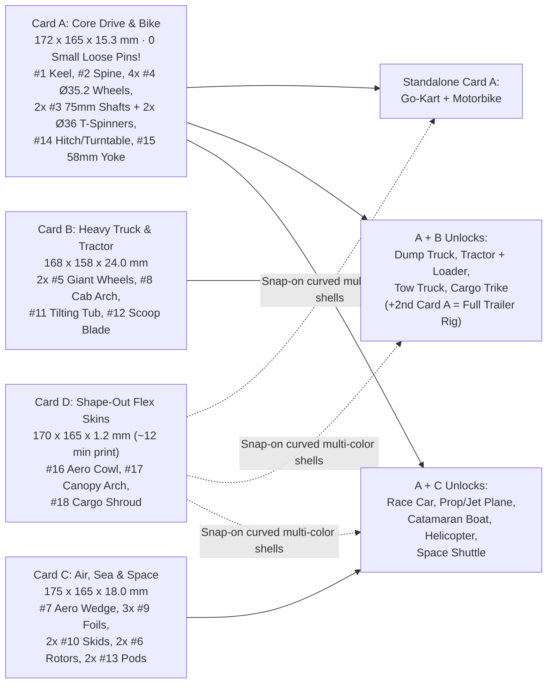

# Spec: Universal Flat-Pack Modular Vehicle & Craft System (Pass 4d Locked)

Oct 30, 2026 · Clean-Room Parametric Architecture on the `12.5 mm` TU Lattice (`50.0 mm` = `4 TU` Hull Standard)  
Reference Library: `/Users/dan/Code/parts/README.md` (external, not in repo) (`65` categorized open-source sets across `01`–`08`, `4` SHA-verified duplicates isolated in `_duplicates/`)  
Progressive Propulsion & Robotics Spec: [`progressive-power-system-spec.md`](progressive-power-system-spec.md) (`Snap → Pro → Momentum → Mech`)

---

## 1. Locked Design Decisions

| Decision | Locked Choice | Engineering & Play Rationale |
| --- | --- | --- |
| **1. Lattice & Fasteners** | **Hybrid `50.0 mm` (`4 TU`) Hull Grid** using `12.5 mm` Small (`stud_small`, `Ø6.6 mm`) studs + Pro `Ø7.0 mm` free bores / `5.1 mm` fixed flats | Preserves chunky `50 mm` (`ModuTown` / `2×2 Large`) toddler-friendly vehicle proportions while mating **100% natively** with Kip (`char_legs_seated` `2×2` Small feet), all `105` verified W1–W9 PartSpec parts, W6 racer add-ons, and W4 Pro gears/shafts without adapters. |
| **2. Core Module Count** | **`15` Universal Rigid Modules + `3` Universal "Shape-Out" Flex Skins** | Retains unmistakable silhouettes across all **9 craft categories** (dedicated Tilting Dump Tub, Loader Scoop, Skids/Pontoons, and Jet/Balloon Pods) while achieving **60%–85% cross-category part reuse**. |
| **3. Flat-Pack "Shape-Out" Mechanics** | **Dual-Layer Kit System:** • **Cards A–C:** Rigid flat-printed snap-out sprue cards (`--sprue` & `--loose` modes) for structural load-bearing bones, wheels, wings, and pinless `260°` C-clip hinges. • **Card D:** Thin (`1.2 mm` flat / `0.6 mm` hinge web) kerf-ribbed **Flex-Shell Skins** that print flat in ~12 min and fold/click by hand into 3D hoods, bubble canopies, and payload doors. | Structural chassis, barbell axles, and dump/loader C-jaws survive **hundreds of rebuild cycles** with **zero loose small pins**, while **1-Handed Book-Fold Rails** keep `< 1.2%` PLA bend strain and allow hinged canopies/doors to swing open without falling loose. |

---

## 2. Empirical Patterns Adapted from `/Users/dan/Code/parts`

> [!IMPORTANT]
> **Clean-Room Rule (`COMPLIANCE.md` / `LICENSING.md`):** `/Users/dan/Code/parts` is an external reference archive outside the git repository. Every ToyVentor part is authored cleanly from scratch in parametric `manifold3d` Python on the `12.5 mm` TU lattice with zero third-party mesh derivatives and zero third-party brand names in code, filenames, or UI strings.

| Reference Category & Set | Measured Reference Geometry | Clean-Room ToyVentor Adaptation |
| --- | --- | --- |
| `03-.../modutown-modular-construction-pack` (external, not in repo) | Exact **`50.0 mm` (`4 TU`)** shared hull width across `Truck_Front`, `DumpTruckBack`, `CementTruck_Base`, `BulldozerBase`, `ExcavatorBase`; `12.5 mm` (`1 TU`) track axles | Standardize universal hull width to **`4 TU = 50.0 mm`** (`49.8 mm` nominal outer width with `0.1 mm` PartSpec clearance gap) across `#1`, `#7`, `#8`, `#11`, and `#12`. |
| `03-.../modular-tractor-system-v1` (external, not in repo) & `minimod-core-vehicle-bulldozer` (external, not in repo) | Shared core rail chassis + staggered `Ø34 / Ø46 mm` front/rear wheels + front loader/blade clevis + rear 3-point hitch | Equip `#1 kit_keel_base` with **dual-tier (`low` `z = 6.25 mm` open-bottom `260°` C-clip jaw, `high` `z = 14.25 mm` bore)** X-axles: `4× Ø35.2 mm` in `high` = slammed **Race Car** (`3.35 mm` clearance); `2× Ø35.2 mm` front (`low`) + `2× Ø51.2 mm` rear (`high`) = **dead-level Tractor** (`11.35 mm` clearance)! |
| `01-.../tipper-trailer-wagon` (external, not in repo) & `geared-360-turntable` (external, not in repo) | Towable wagon chassis + rear dump hinge knuckle + `360°` slew turntable | Put **symmetrical `1 TU` Front & Rear Clevis/Hitch Ports** on `#1 kit_keel_base` so a second keel becomes a **Trailer**, and `#14 kit_turntable_hitch` adds both articulated towing and `360°` crane/loader rotation. |
| `04-.../osa-scooter-kit-card` (external, not in repo) & `minibike-kit-card` (external, not in repo) | Flat `8–11 mm` color-grouped sprue kit cards (`114–150 mm`) with twist-off gates | Pack Cards A–D inside **`<= 175 × 175 mm`** (fits Bambu A1 Mini `180 mm` bed) with V-notched chamfer gates recessed inside the `0.5 mm` bed chamfer so gate vestige never interferes with mating faces. |
| `05-.../duplo-helicopter-3part` (external, not in repo), `modular-prop-airplane-v12` (external, not in repo) & `duplo-space-shuttle` (external, not in repo) | Flat lower keel + snap-on upper cabin + plug-in wings, skids, rotors & cargo doors | Unify Car, Truck, Tractor, Trailer, Aeroplane, Boat, Helicopter, and Spaceship onto **one shared `#1 kit_keel_base`** by adding stadium flank wing/skid slots and Book-Fold flex-skin latch rails. |

---

## 3. Multi-Pass Part Reduction & Integer `TU` Mechanics (`52 -> 15 + 3`)

### 3.1 Pass-by-Pass Compression Trace
- **Pass 1 — Naive 1:1 Adaptation (`52` unique parts):** Separate chassis for car, truck, tractor, trailer, bike, plane fuselage, boat hull, helicopter body, and shuttle delta base (`< 15%` cross-category reuse).
- **Pass 2 — Unified Land & Air Keels (`23` unique parts):** Merged 4-wheel land vehicles onto a `50 mm` chassis and air/sea craft onto an aero keel, still duplicating booms, wings, and covers.
- **Pass 3 — Cross-Domain Structural Unification (`15` rigid modules):**
  1. **Single `4×10 TU` Keel (`#1 kit_keel_base`):** Serves **8 of 9 craft** directly (Race Car, Truck, Tractor, Trailer, Plane, Boat, Helicopter, Spaceship).
  2. **4-Role Clevis Spine (`#2 kit_clevis_spine`, `2×8 TU`):** Twin-fork slotted beam (`1 TU = 12.5 mm` center slot between `0.5 TU = 6.25 mm` fork cheeks) works as the **inline Motorbike Frame**, **Helicopter Tail Boom**, **Tractor/Truck Articulated Loader & Tow Boom**, and **Trailer Drawbar**.
  3. **Half-Lap Stackable Rotor (`#6 kit_rotor_blade`):** `50%` center lap notch lets `1×` spin as an **Aeroplane / Airboat 2-Blade Propeller**, while `2×` crossed at `90°` lock flush (`4.5 mm` total thickness, zero height growth) into a **4-Blade Helicopter Rotor**.
  4. **L/R Reversible Swept Foil (`#9 kit_foil_wing`):** Symmetric `5.0 mm` airfoil section flips left/right as **Plane & Shuttle Main Wings**, stands upright in the rear spine slot as a **Vertical Tail Fin**, bridges rear studs as a **Race Car GT Wing**, or clips onto the rear clevis as **Trailer Loading Ramps**.
- **Pass 4 / 4b — Integer `TU` Axle Math & Book-Fold Flex Skins (`+3` skins on `Card D`):**
  - **Exact `6 TU` Outboard Axle & `1 TU` Coaxial Clevis Geometry:**
    - **Outboard Wheel Barbell (`6 TU = 75.0 mm`):** `1 TU` (`12.5 mm`) left wheel hub + `4 TU` (`50.0 mm`) keel body + `1 TU` (`12.5 mm`) right wheel hub = **`6 TU` exact**. Wheels clear the full `50 mm` hull with zero wheel-well cutouts, so any wheel (`Ø35.2 mm`, `Ø51.2 mm`, or existing W5/W9 Pro wheels) can mount at **any** longitudinal bore along `#1`!
    - **Coaxial `1 TU` Clevis & `2 TU` Pro Upgrade Axis:** `0.5 TU` fork cheek + `1 TU` wheel/knuckle/rotor hub + `0.5 TU` fork cheek = **`2 TU` (`25.0 mm`) exact**. In `Snap`, compliant `260°` C-clip jaws and `Ø36 mm` flanged T-spinners eliminate loose `25 mm` pins; in `Pro / Momentum / Mech`, standard `Ø6.6 mm` shafts and servo horns engage the exact same coaxial `Ø7.0 mm` outer bores.
  - **Spring-Tuck "Book-Fold" Flex-Skin Retention (`< 1.20%` Elastic Strain):**
    - Each `Card D` flex skin is `1.20 mm` thick (`0.60 mm` continuous 3-layer outer skin + `0.60 mm` transverse stiffening ribs every `4.0 mm`). Bending `t = 0.60 mm` around the tightest `R = 25.0 mm` (`2 TU`) bulkhead gives outer-fiber strain $\varepsilon = \frac{t}{2R} = \frac{0.60}{50.0} = 1.20\% < 1.80\%$ PLA yield limit.
    - **1-Handed Book-Fold Latch:** Left edge hooks onto `2×` oversized lead-in hinge tabs with zero spring tension, folds smoothly over the bulkhead with one hand, and clicks down via a single chunky rounded thumb-tab on the right rail—letting canopies (`#17`) and Shuttle payload doors (`#18`) swing open on the left hinge without falling loose!
- **Pass 4d — `Snap`-First Pinless Simplification (`Zero Loose Small Pins on Cards A–D`, `100%` Coaxial `Pro/Mech` Ready):**
  1. **Coaxial `260°` C-Clip Jaws Replace Loose `25 mm` Hinge/Hitch Pins:** `#1` (front/rear clevis & `low` axle cradles) and `#2` (end forks) use compliant `LAY_FLAT` `260°` C-clip jaws (`5.6 mm` entry throat -> `Ø7.0 mm` coaxial Pro bore), while `#11` Dump Tub and `#12` Scoop carry integral `Ø6.6 mm` crossbars. In `Snap`, dump beds, scoops, and trailer hitches **click straight in with 1 hand and 0 loose pins**; in `Pro/Momentum/Mech`, standard `Ø6.6` shafts/servos pass coaxially through the outer ears!
  2. **Bottom-Click Barbell Wheelsets:** Pressing `2×` wheels onto a `75 mm` (`6 TU`) shaft once creates a 1-piece Duplo-style **wheel barbell** that clicks straight into `#1`'s bottom `260°` `low` axle jaws in `1 second` (no threading shafts through holes!), while gravity pushes the vehicle *into* the top bearing land.
  3. **1-Click Pop-Out Rotor Spinner (`#3`):** Propellers/rotors (`#6`) click onto a chunky `> 35 mm` flanged spinner post in `Snap` (`0` loose pins), which pops out when upgrading to a live `Pro/Momentum/Mech` drive shaft.
  4. **100% Choke-Cylinder Safe (`> 10%` Margin on Every `Cards A–D` Piece):** Sizing `kit_wheel_med = Ø35.2 mm` (`> 31.75 mm × 1.10 = 34.93 mm`) and `kit_wheel_giant = Ø51.2 mm` (`8.0 mm` radius step preserved!), keeping axles `75.0 mm` (`> 57.1 mm`), and moving the smaller `Pro` bellcrank steering knuckles + rack onto the `Pro / Card E` upgrade pack ensures **every single piece in the `Snap` starter kit (`Cards A–D`) passes `16 CFR 1501` small-parts screening with >10% margin**!
  5. **100% End-to-End Poka-Yoke Symmetry:** `#2 kit_clevis_spine`, `#9 kit_foil_wing`, and `#10 kit_skid_pontoon` are symmetric so a 4-year-old can never snap them on "backwards", while distinct connector shapes (`round stud` = stack, `crescent C-jaw` = swing/spin, `stadium flank slot` = wing/skid) prevent wrong-port jams.

---

## 4. Master Module Catalog (`15` Rigid Modules + `3` Flex Skins)

### 4A. Rigid Structural & Functional Modules (`Cards A, B, C` — Zero Loose Small Parts!)

| # | Part ID | Flat BBox (`mm`) | Key `12.5 mm` TU Interfaces (`Snap` Pinless + `Pro/Mech` Coaxial) | Car | Truck | Tractor | Trailer | Bike | Plane | Boat | Heli | Space |
| --- | --- | --- | --- | :---: | :---: | :---: | :---: | :---: | :---: | :---: | :---: | :---: |
| **1** | `kit_keel_base` | `49.8 × 124.8 × 15.3` | `4×10 TU` keel: tapered `2×3 TU` (`24.8 mm`) nose + `X = ±18.75 mm` kingpin ears + `row 2` rack slot, `4×4` Kip cockpit, `4×4` rear Power Bay (`2×2 TU` PTO window + `12.5 × 6.0 mm` conduit), bottom-click `260°` `low` axle jaws + enclosed `high` X-bores, stadium flank slots, F/R `260°` C-jaws + hitch post | `1` | `1` | `1` | `1` | — | `1` | `1` | `1` | `1` |
| **2** | `kit_clevis_spine` | `24.8 × 99.8 × 15.3` | `100%` end-symmetric `2×8 TU` beam: twin `1 TU` `260°` C-clip/coaxial-bore forks (click onto `#1`/`#12` crossbars or hold `#4` inline bike wheels) + `2×4` top `stud_small` + steering head bore | — | `◐` | `1` | `1` | `1` | — | — | `1` | — |
| **3** | `kit_barbell_shaft_pack` | `75.0 × 5.6` & `Ø36` spinner | Choke-safe `LAY_FLAT` `6 TU` (`75 mm > 57.1 mm`) barbell wheel shafts + flanged 1-click rotor/inline-wheel T-spinners (`Ø36 mm` flange clears choke tube!) | `2` | `2` | `2` | `2` | `2` | `2` | `1` | `2` | `1` |
| **4** | `kit_wheel_med` | `Ø35.2 × 12.3` | Choke-safe (`> 34.93 mm` `10%` margin!) `1 TU` tire (`R = 17.6 mm` gives `2.6 mm` clearance around `gear_spur_z10`!): center D-bore presses onto `#3` as a 1-click wheel barbell | `4` | `4` | `2` | `2–4` | `2` | `2` | — | — | `◐` |
| **5** | `kit_wheel_giant` | `Ø51.2 × 12.3` | `1 TU` wide deep-chevron tractor/monster tire: exact `8.0 mm` radius step (`(51.2 - 35.2)/2 = 8.0 mm`) matches `#1`'s `8.0 mm` (`high - low`) bore delta for `0.0°` level Tractor! | `◐` | `◐` | `2` | `◐` | `◐` | — | — | — | — |
| **6** | `kit_rotor_blade` | `100.0 × 16.0 × 4.5` | `2`-blade prop/rotor with D-bore + `2.25 mm` half-lap cross notch (clicks onto `#3` T-spinner in `Snap`; takes live `Pro/Momentum/Mech` drive shaft later) | — | — | — | — | — | `1` | `1` | `2+1` | — |
| **7** | `kit_aero_wedge` | `49.8 × 37.3 × 16.0` | `4×3 TU` `38°` swept nose/hood/bow (`socket_small` bottom, `2×2` `stud_small` top, front spinner bore, Book-Fold flex-cowl rails) | `1` | `◐` | — | — | `1` | `1` | `1` | `1` | `1` |
| **8** | `kit_cab_arch` | `49.8 × 37.3 × 24.0` | Flat-printed `4×3 TU` U-frame ROPS/cockpit cage (gunwale mount framing Kip, `2×2` roof `stud_small` + center rotor/steering bore + Book-Fold canopy rails) | `◐` | `1` | `1` | — | — | `1` | `1` | `1` | `1` |
| **9** | `kit_foil_wing` | `74.8 × 49.8 × 5.0` | Symmetric L/R reversible swept foil (stadium root tongue plugs into `#1` flank slots or rear tail slot; tip `stud_small`; doubles as GT wing / clip-on trailer ramp) | `1` | — | — | `◐` | — | `3` | `◐` | — | `3` |
| **10** | `kit_skid_pontoon` | `112.3 × 18.0 × 16.0` | End-symmetric hollow ski/catamaran float with stadium struts plugging into `#1` flank slots (`240 cm³` system buoyancy with `#13` sponsons!) | — | `◐` | — | — | — | `◐` | `2` | `2` | — |
| **11** | `kit_tilting_tub` | `49.8 × 62.3 × 18.0` | `4×5 TU` dump/cargo/payload bed with **integral `Ø6.6` rear hinge bar** (1-hand click into `#1` rear C-jaw for `55°` tipping + coaxial outer Pro servo/cam ears!) | — | `1` | — | `1` | `◐` | — | `1` | — | `1` |
| **12** | `kit_scoop_blade` | `49.8 × 37.3 × 20.0` | Curved loader bucket / snowplow with **integral `Ø6.6` crossbar** (1-hand click into `#1` front C-jaw or `#2` boom C-jaw + coaxial Pro linkage bores!) | — | `◐` | `1` | — | — | — | — | — | — |
| **13** | `kit_booster_pod` | `24.8 × 49.8 × 18.0` | `2×4 TU` sealed twin-nozzle jet/sponson pod (`socket_small` bottom + stadium wing peg + `Ø7.0` balloon-straw/valve throat; doubles as Boat trimaran float!) | `1` | `◐` | — | — | `◐` | `2` | `2` | — | `2` |
| **14** | `kit_turntable_hitch` | `Ø49.8 × 10.0` | Captive 1-piece snap-ring `360°` turntable (`4×4` `socket_small` base, `2×2` `stud_small` + `260°` C-jaw top): Crane slew ring & toddler articulated steering pivot! | — | `◐` | `1` | `1` | `◐` | — | — | — | — |
| **15** | `kit_yoke_hbar` | `58.0 × 38.0 × 5.6` | Choke-safe (`58 mm`) `LAY_FLAT` 1-piece steering wheel / Kip-grip handlebar stem (`Snap` dash spin & Bike steering; drives `Pro` steering rack when paired with `Pro/Card E` knuckles!) | `1` | `1` | `1` | — | `1` | `1` | `1` | `1` | `1` |

*(Legend: `1..6` = canonical build count · `◐` = optional variant/combo attachment · `—` = not required)*

### 4B. "Shape-Out" Curved Flex-Shell Skins (`Card D` · `1.2 mm` Flat Print)

| # | Skin ID | Flat Size (`mm`) | Curvature Target & Multi-Craft Roles (`Book-Fold` Left Hinge + Right Thumb Latch) |
| --- | --- | --- | --- |
| **16** | `skin_aero_cowl` | `96.0 × 49.8 × 1.2` | Folds over `#7 kit_aero_wedge` or `#2 kit_clevis_spine` Book-Fold rails into a **Formula Race Nose**, **Rounded Tractor Bonnet**, **Sportbike Front Fairing**, or **Speedboat Wave-Piercing Bow**. |
| **17** | `skin_canopy_arch` | `112.0 × 37.3 × 1.2` | Framed windshield cutouts; folds over `#8 kit_cab_arch` into an **Opening Helicopter Bubble Canopy**, **GT Fastback Roof**, **Truck Aero Sleeper**, or **Shuttle Flight Deck**. |
| **18** | `skin_cargo_shroud` | `116.0 × 62.3 × 1.2` | Folds over `#11 kit_tilting_tub` into **Hinged Space Shuttle Payload Doors** (unclick right thumb tab to swing open on left hinge!), **Covered Wagon / Camper Canopy**, **Tanker Drum**, or **Boat Cabin Cuddy**. |

---

## 5. Canonical 9-Craft Assembly Recipes & Functional Play Loops

| # | Craft | Core Bones | Wheels / Running Gear (`Snap` Pinless) | Aesthetic Shells & Wings | Functional Front / Rear Play Mechanisms |
| --- | --- | --- | --- | --- | --- |
| **1** | **Race Car** | `#1` Keel | `2×` `#4` Med barbells in **`high`** bores (`3.35 mm` slammed ride height) | `#7` Aero Wedge + `#16` Flex Cowl, rear `#9` GT Spoiler | `#15` Yoke spins in dash (`Pro/Mech`: rack steering!), `#13` rear twin exhaust (straw + balloon ready!), Kip in `2×2` cockpit |
| **2** | **Dump / Tow Truck** | `#1` Keel | `2×` `#4` Med barbells clicked into **`low`** bottom C-jaws (`11.35 mm` clearance) | `#8` Cab Arch + `#17` Hinged Flex Canopy | Rear **`55°` tipping `#11` Dump Bed** (1-hand C-jaw click, `0` pins!); front `#12` Snowplow option; rear post tows `#4` Trailer |
| **3** | **Farm / Loader Tractor** | `#1` Keel + `#2` Boom | `1× #4` Med barbell front (`low` C-jaw) + `1× #5` Giant barbell rear (`high` bore) = **`0.0°` level stance** | `#8` ROPS Roll Arch + `#16` Rounded Tractor Bonnet | **Articulated Front Loader** (`#2` Spine clicked onto `#14` Turntable C-jaw + `#12` C-click Loader Scoop) + rear tow hitch |
| **4** | **Modular Trailer** | 2nd `#1` Keel + `#2` Drawbar | `1×` or `2×` `#4` Med barbells (`low` C-jaws) | Configurable: `#11` Tipper Tub, `#18` Covered Wagon Shroud, or open Flatbed | `#2` Drawbar + `#14` Turntable Hitch gives **1-hand drop-on coupling + multi-axis pitch/yaw**; `2× #9` clip to rear C-jaw as Car-Hauler Ramps |
| **5** | **Motorbike (& Trike)** | `#2` Clevis Spine (solo!) | `2× #4` Med wheels held inline inside `#2`'s end forks via `2× #3` flanged `Ø36 mm` T-spinners | `#7` + `#16` Flex Sport Fairing on front studs | `#15` Handlebars steer front fork; Kip straddles center `2×4` studs (`+ #14` & `#11` on rear fork = **Cargo Trike**!) |
| **6** | **Prop / Jet Aeroplane** | `#1` Keel | `1× #4` Med barbell main gear (front `low` C-jaw) + rear tail skid | `#7` Nose + `#8` Canopy + `2× #9` Main Wings (stadium flank slots) + `1× #9` Tail Fin | Free-spinning `#6` **2-Blade Nose Propeller** on `#3` T-spinner + optional `2× #13` underwing Jet Pods |
| **7** | **Catamaran / Speedboat** | `#1` Keel | `2× #10` Hollow Pontoons plugged into stadium flank slots (`+ 2× #13` sponsons = `240 cm³` lift) | `#7` Bow + `#16` Foredeck Skin + `#8` Bridge + `#11` Aft Deck | Stern-mounted `#6` **Spinning Airboat Fan** on `#3` T-spinner (or `2× #13` balloon water/air jets!) |
| **8** | **Rescue Helicopter** | `#1` Keel + `#2` Tail Boom | `2× #10` Landing Skids in stadium flank slots | `#7` Chin + `#8` Arch + `#17` **Opening Bubble Canopy** | `2× #6` half-lap crossed on `#8` roof T-spinner = **spinning 4-Blade Main Rotor**; `#2` Boom clicks onto `#1` rear jaw carrying `1× #6` **Tail Rotor** |
| **9** | **Space Shuttle** | `#1` Keel | Retracted flat keel (or `2× #4` barbell landing gear) | `#7` Nose Cone + `#8`/`#17` Flight Deck + `2× #9` Delta Wings + `1× #9` Tail Fin | `#11` Payload Bay + `#18` **Book-Fold Hinged Payload Doors** (unclick right thumb tab to deploy satellite / Kip!) + `2× #13` Twin Thrusters |

---

## 6. Four-Card Flat-Pack Kit Layout (`<= 175 × 175 mm`, Bambu A1 Mini Ready)

### Sprue Gate Standard (`--sprue` vs. `--loose`)
- **Dual Export Modes:** Every kit card exports both as `card_<id>_loose.stl` (0-burr multi-body plate ready for Bambu Studio / PrusaSlicer per-object coloring) and `card_<id>_sprue.stl` (connected giftable flat-pack kit card).
- **Zero-Interference Gate Placement:** A `2.4 × 1.6 mm` rectangular perimeter runner connects parts strictly inside the bottom `z = 0.0..1.0 mm` zone via `1.4 mm`-wide V-notched gates (`0.55 mm` waist) recessed `0.3 mm` inside the `0.5 mm` bed chamfer — so twisting a part free leaves **zero raised nub** against any mating face, bore, or stud.

---

## 7. Next Step — Pass 5 Parametric CAD & 9-Craft Verification

1. **Author `parts/partspec/toyventor_kitcard.py`:** Parametric `manifold3d` generators for `#1`–`#15` rigid modules + `#16`–`#18` kerf-ribbed flex skins + `pack_kit_card(mode="sprue"|"loose")`, strictly importing `interfaces.json` (`stud_small`, `bore_grid`, `pin_free`, `shaft_drive`).
2. **Gate & Fit Verification (`selftest.py` + `preprint_check.py`):** Verify zero overhangs `> 45°`, zero unsupported bridges `> 20 mm`, small-parts compliance, and zero third-party brand strings.
3. **9-Craft Assembly Proofs (`toyventor_assembly.py`):** Assemble all 9 canonical craft programmatically with `0.000 mm³` collision overlap and export interactive flat-card vs. 3D-assembled preview GLBs/STLs.
