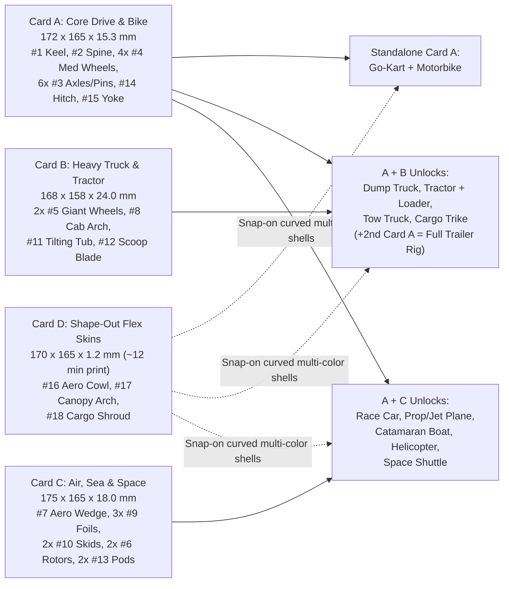

# Spec: Universal Flat-Pack Modular Vehicle & Craft System (Pass 4b Locked)

Oct 30, 2026 · Clean-Room Parametric Architecture on the `12.5 mm` TU Lattice (`50.0 mm` = `4 TU` Hull Standard)  
Reference Library: [`/Users/dan/Code/parts/README.md`](file:///Users/dan/Code/parts/README.md) (`65` categorized open-source sets across `01`–`08`, `4` SHA-verified duplicates isolated in `_duplicates/`)  
Progressive Propulsion & Robotics Spec: [`progressive-power-system-spec.md`](file:///Users/dan/Code/toyforge/docs/progressive-power-system-spec.md) (`Snap → Pro → Momentum → Mech`)

---

## 1. Locked Design Decisions

| Decision | Locked Choice | Engineering & Play Rationale |
| --- | --- | --- |
| **1. Lattice & Fasteners** | **Hybrid `50.0 mm` (`4 TU`) Hull Grid** using `12.5 mm` Small (`stud_small`, `Ø6.6 mm`) studs + Pro `Ø7.0 mm` free bores / `5.1 mm` fixed flats | Preserves chunky `50 mm` (`ModuTown` / `2×2 Large`) toddler-friendly vehicle proportions while mating **100% natively** with Kip (`char_legs_seated` `2×2` Small feet), all `105` verified W1–W9 PartSpec parts, W6 racer add-ons, and W4 Pro gears/shafts without adapters. |
| **2. Core Module Count** | **`15` Universal Rigid Modules + `3` Universal "Shape-Out" Flex Skins** | Retains unmistakable silhouettes across all **9 craft categories** (dedicated Tilting Dump Tub, Loader Scoop, Skids/Pontoons, and Jet/Balloon Pods) while achieving **60%–85% cross-category part reuse**. |
| **3. Flat-Pack "Shape-Out" Mechanics** | **Dual-Layer Kit System:** • **Cards A–C:** Rigid flat-printed snap-out sprue cards (`--sprue` & `--loose` modes) for structural load-bearing bones, wheels, wings, and hinges. • **Card D:** Thin (`1.2 mm` flat / `0.6 mm` hinge web) kerf-ribbed **Flex-Shell Skins** that print flat in ~12 min and curve by hand into 3D hoods, bubble canopies, and payload doors. | Structural chassis, axles, and dump/loader joints survive **hundreds of rebuild cycles** without living-hinge fatigue, while **Spring-Tuck Pocket Rails** harness PLA's `< 1.2%` elastic bend springback to lock curved 3D shells securely in place. |

---

## 2. Empirical Patterns Adapted from `/Users/dan/Code/parts`

> [!IMPORTANT]
> **Clean-Room Rule (`COMPLIANCE.md` / `LICENSING.md`):** `/Users/dan/Code/parts` is an external reference archive outside the git repository. Every ToyVentor part is authored cleanly from scratch in parametric `manifold3d` Python on the `12.5 mm` TU lattice with zero third-party mesh derivatives and zero third-party brand names in code, filenames, or UI strings.

| Reference Category & Set | Measured Reference Geometry | Clean-Room ToyVentor Adaptation |
| --- | --- | --- |
| [`03-.../modutown-modular-construction-pack`](file:///Users/dan/Code/parts/03-tractors-and-heavy-construction/modutown-modular-construction-pack) | Exact **`50.0 mm` (`4 TU`)** shared hull width across `Truck_Front`, `DumpTruckBack`, `CementTruck_Base`, `BulldozerBase`, `ExcavatorBase`; `12.5 mm` (`1 TU`) track axles | Standardize universal hull width to **`4 TU = 50.0 mm`** (`49.8 mm` nominal outer width with `0.1 mm` PartSpec clearance gap) across `#1`, `#7`, `#8`, `#11`, and `#12`. |
| [`03-.../modular-tractor-system-v1`](file:///Users/dan/Code/parts/03-tractors-and-heavy-construction/modular-tractor-system-v1) & [`minimod-core-vehicle-bulldozer`](file:///Users/dan/Code/parts/03-tractors-and-heavy-construction/minimod-core-vehicle-bulldozer) | Shared core rail chassis + staggered `Ø34 / Ø46 mm` front/rear wheels + front loader/blade clevis + rear 3-point hitch | Equip `#1 kit_keel_base` with **dual-tier (`low` `z = 6.25 mm`, `high` `z = 14.25 mm`) `Ø7.0 mm` X-axle bores**: `4× Ø34 mm` in `high` = slammed **Race Car** (`2.75 mm` ground clearance); `2× Ø34 mm` front (`low`) + `2× Ø50 mm` rear (`high`) = **dead-level Tractor** (`10.75 mm` clearance)! |
| [`01-.../tipper-trailer-wagon`](file:///Users/dan/Code/parts/01-modular-chassis-and-bases/tipper-trailer-wagon) & [`geared-360-turntable`](file:///Users/dan/Code/parts/01-modular-chassis-and-bases/geared-360-turntable) | Towable wagon chassis + rear dump hinge knuckle + `360°` slew turntable | Put **symmetrical `1 TU` Front & Rear Clevis/Hitch Ports** on `#1 kit_keel_base` so a second keel becomes a **Trailer**, and `#14 kit_turntable_hitch` adds both articulated towing and `360°` crane/loader rotation. |
| [`04-.../osa-scooter-kit-card`](file:///Users/dan/Code/parts/04-bikes-trikes-and-skates/osa-scooter-kit-card) & [`minibike-kit-card`](file:///Users/dan/Code/parts/04-bikes-trikes-and-skates/minibike-kit-card) | Flat `8–11 mm` color-grouped sprue kit cards (`114–150 mm`) with twist-off gates | Pack Cards A–D inside **`<= 175 × 175 mm`** (fits Bambu A1 Mini `180 mm` bed) with V-notched chamfer gates recessed inside the `0.5 mm` bed chamfer so gate vestige never interferes with mating faces. |
| [`05-.../duplo-helicopter-3part`](file:///Users/dan/Code/parts/05-aircraft-helicopters-and-space/duplo-helicopter-3part), [`modular-prop-airplane-v12`](file:///Users/dan/Code/parts/05-aircraft-helicopters-and-space/modular-prop-airplane-v12) & [`duplo-space-shuttle`](file:///Users/dan/Code/parts/05-aircraft-helicopters-and-space/duplo-space-shuttle) | Flat lower keel + snap-on upper cabin + plug-in wings, skids, rotors & cargo doors | Unify Car, Truck, Tractor, Trailer, Aeroplane, Boat, Helicopter, and Spaceship onto **one shared `#1 kit_keel_base`** by adding flank wing/skid sockets and Spring-Tuck flex-skin pocket rails. |

---

## 3. Multi-Pass Part Reduction & Integer `TU` Mechanics (`52 -> 15 + 3`)

### 3.1 Pass-by-Pass Compression Trace
- **Pass 1 — Naive 1:1 Adaptation (`52` unique parts):** Separate chassis for car, truck, tractor, trailer, bike, plane fuselage, boat hull, helicopter body, and shuttle delta base (`< 15%` cross-category reuse).
- **Pass 2 — Unified Land & Air Keels (`23` unique parts):** Merged 4-wheel land vehicles onto a `50 mm` chassis and air/sea craft onto an aero keel, still duplicating booms, wings, and covers.
- **Pass 3 — Cross-Domain Structural Unification (`15` rigid modules):**
  1. **Single `4×10 TU` Keel (`#1 kit_keel_base`):** Serves **8 of 9 craft** directly (Race Car, Truck, Tractor, Trailer, Plane, Boat, Helicopter, Spaceship).
  2. **4-Role Clevis Spine (`#2 kit_clevis_spine`, `2×8 TU`):** Twin-fork slotted beam (`1 TU = 12.5 mm` center slot between `0.5 TU = 6.25 mm` fork cheeks) works as the **inline Motorbike Frame**, **Helicopter Tail Boom**, **Tractor/Truck Articulated Loader & Tow Boom**, and **Trailer Drawbar**.
  3. **Half-Lap Stackable Rotor (`#6 kit_rotor_blade`):** `50%` center lap notch lets `1×` spin as an **Aeroplane / Airboat 2-Blade Propeller**, while `2×` crossed at `90°` lock flush (`4.5 mm` total thickness, zero height growth) into a **4-Blade Helicopter Rotor**.
  4. **L/R Reversible Swept Foil (`#9 kit_foil_wing`):** Symmetric `5.0 mm` airfoil section flips left/right as **Plane & Shuttle Main Wings**, stands upright in the rear spine slot as a **Vertical Tail Fin**, bridges rear studs as a **Race Car GT Wing**, or clips onto the rear clevis as **Trailer Loading Ramps**.
- **Pass 4 / 4b — Integer `TU` Axle Math & Spring-Tuck Flex Skins (`+3` skins on `Card D`):**
  - **Exact `6 TU` Outboard Axle & `2 TU` Clevis Pin Rule:**
    - **Outboard Wheel Axle (`6 TU = 75.0 mm`):** `1 TU` (`12.5 mm`) left wheel hub + `4 TU` (`50.0 mm`) keel body + `1 TU` (`12.5 mm`) right wheel hub = **`6 TU` exact**. Wheels clear the full `50 mm` hull with zero wheel-well cutouts, so any wheel (`Ø34 mm`, `Ø50 mm`, or existing W5/W9 Pro wheels) can mount at **any** longitudinal bore along `#1`!
    - **Inline / Hinge / Mast Pin (`2 TU = 25.0 mm`):** `0.5 TU` fork cheek + `1 TU` wheel/knuckle/rotor hub + `0.5 TU` fork cheek = **`2 TU` exact**. One pin length locks Motorbike inline wheels, Dump Tub tilt hinges, Loader Scoop pivots, Trailer hitches, and Helicopter rotors.
  - **Spring-Tuck Flex-Skin Retention (`< 1.20%` Elastic Strain):**
    - Each `Card D` flex skin is `1.20 mm` thick (`0.60 mm` continuous 3-layer outer skin + `0.60 mm` transverse stiffening ribs every `4.0 mm`). Bending `t = 0.60 mm` around the tightest `R = 25.0 mm` (`2 TU`) bulkhead gives outer-fiber strain $\varepsilon = \frac{t}{2R} = \frac{0.60}{50.0} = 1.20\% < 1.80\%$ PLA yield limit.
    - Instead of pulling upward against smooth vertical studs, curved skins squeeze slightly (`47 mm`) so their `2.0 mm` rolled edges tuck inside opposing **inward-facing `1.6 mm` Spring-Tuck Pocket Rails** (indexed on `12.5 mm` TU notches) along the flanks of `#1`, `#7`, `#8`, and `#11`. Elastic springback pushes **outward** into the pocket walls, locking the curved 3D shell tight until pinched by two fingers to release flat!

---

## 4. Master Module Catalog (`15` Rigid Modules + `3` Flex Skins)

### 4A. Rigid Structural & Functional Modules (`Cards A, B, C`)

| # | Part ID | Flat BBox (`mm`) | Key `12.5 mm` TU Interfaces | Car | Truck | Tractor | Trailer | Bike | Plane | Boat | Heli | Space |
| --- | --- | --- | --- | :---: | :---: | :---: | :---: | :---: | :---: | :---: | :---: | :---: |
| **1** | `kit_keel_base` | `49.8 × 124.8 × 15.3` | `4×10 TU` keel: tapered `2×3 TU` (`24.8 mm`) front nose tongue with `X = ±18.75 mm` kingpin ears (`+4.3 mm` tire-sweep clearance at `±28°` lock!) + `row 2` rack slot, `4×4` Kip cockpit, `4×4` rear Power Bay (`2×2 TU` PTO window + `12.5 × 6.0 mm` conduit), 2-tier `Ø7.0` X-bores, flank sockets, F/R clevis + hitch, Spring-Tuck rails | `1` | `1` | `1` | `1` | — | `1` | `1` | `1` | `1` |
| **2** | `kit_clevis_spine` | `24.8 × 99.8 × 15.3` | `2×8 TU` slotted twin-fork beam: `1 TU`-wide end clevis slots (`Ø7.0` X-bores fit `#4` wheel inline or `#1`/`#12` knuckles) + `2×4` top `stud_small` saddle + steering head bore | — | `◐` | `1` | `1` | `1` | — | — | `1` | — |
| **3** | `kit_axle_pin_pack` | `62.5/75.0` & `25.0` (`×5.6`) | `LAY_FLAT` `shaft_drive` (`6 TU = 75 mm` outboard through-axle) + `pin_free` (`2 TU = 25 mm` clevis/hinge/rotor pin with `Ø9.0` stop head) | `4` | `5` | `6` | `4` | `3` | `3` | `2` | `3` | `3` |
| **4** | `kit_wheel_med` | `Ø34.0 × 12.3` | `1 TU` wide street/landing tire (`R = 17.0 mm` gives `2.0 mm` ground clearance around a `r_a = 15.0 mm` `gear_spur_z10` rear axle gear!): center fixed D-hub + `4` lug holes | `4` | `4` | `2` | `2–4` | `2` | `2` | — | — | `◐` |
| **5** | `kit_wheel_giant` | `Ø50.0 × 12.3` | `1 TU` wide (`4 TU` dia) deep-chevron tractor/monster tire: `8.0 mm` radius step (`(50 - 34)/2 = 8.0 mm`) matches `#1`'s `8.0 mm` (`high - low`) bore delta so staggered Tractor sits `0.0°` level! | `◐` | `◐` | `2` | `◐` | `◐` | — | — | — | — |
| **6** | `kit_rotor_blade` | `100.0 × 16.0 × 4.5` | `2`-blade tapered prop/rotor with center bore + `2.25 mm` half-lap cross notch (`1×` = 2-blade prop; `2×` at `90°` = flush `4.5 mm` 4-blade heli rotor) | — | — | — | — | — | `1` | `1` | `2+1` | — |
| **7** | `kit_aero_wedge` | `49.8 × 37.3 × 16.0` | `4×3 TU` `38°` swept nose/hood/bow (`socket_small` bottom, `2×2` `stud_small` top, front prop bore, Spring-Tuck flex-cowl pocket rails) | `1` | `◐` | — | — | `1` | `1` | `1` | `1` | `1` |
| **8** | `kit_cab_arch` | `49.8 × 37.3 × 24.0` | Flat-printed `4×3 TU` U-frame ROPS/cockpit roll cage (mounts on gunwale studs framing Kip, `2×2` roof `stud_small` + center rotor mast bore + flex-canopy rails) | `◐` | `1` | `1` | — | — | `1` | `1` | `1` | `1` |
| **9** | `kit_foil_wing` | `74.8 × 49.8 × 5.0` | Symmetric L/R reversible swept foil (`2×1` root tongue plugs into `#1` flank slots or stands vertically as tail fin; tip `stud_small` + pod bore; doubles as GT wing / trailer ramp) | `1` | — | — | `◐` | — | `3` | `◐` | — | `3` |
| **10** | `kit_skid_pontoon` | `112.3 × 16.0 × 14.0` | Curved ski/catamaran float with twin `45°` struts plugging into `#1` flank bores (mounts low as Heli Skids / Catamaran Pontoons, or inverted high as Roof Safari Rails) | — | `◐` | — | — | — | `◐` | `2` | `2` | — |
| **11** | `kit_tilting_tub` | `49.8 × 62.3 × 18.0` | `4×5 TU` cargo/dump/payload bed: rear `1 TU` knuckle mates to `#1` rear clevis for `55°` tipping dump action (`socket_small` lock in down position, inner `2×4` cargo studs, Spring-Tuck shroud rails) | — | `1` | — | `1` | `◐` | — | `1` | — | `1` |
| **12** | `kit_scoop_blade` | `49.8 × 37.3 × 20.0` | Support-free curved front loader bucket / bulldozer / snowplow blade with rear `1 TU` clevis ears (pins directly to `#1` front clevis as Dozer Blade, or to `#2` boom end as Tractor Front Loader!) | — | `◐` | `1` | — | — | — | — | — | — |
| **13** | `kit_booster_pod` | `24.8 × 49.8 × 18.0` | `2×4 TU` twin-nozzle jet/rocket/exhaust pod (`socket_small` bottom + side wing peg; `Ø7.0 mm` through-throat accepts a standard drinking straw for real balloon-jet propulsion!) | `1` | `◐` | — | — | `◐` | `2` | `2` | — | `2` |
| **14** | `kit_turntable_hitch` | `Ø49.8 × 10.0` | Captive `360°` snap-ring turntable (`4×4` `socket_small` base, `2×2` `stud_small` + `1 TU` clevis ears on rotating top): acts as Crane/Loader slew ring OR articulated 5th-wheel Trailer Hitch | — | `◐` | `1` | `1` | `◐` | — | — | — | — |
| **15** | `kit_steer_pack` | `52 × 38` + knuckles/rack (`×5.6`) | `LAY_FLAT` steering stem/handlebars (`Ø6.6` Kip grips) **+** `2×` 3-point bellcrank steering knuckles (`kingpin` + `1 TU` stub + `1 TU` tie-rod arm) **+** detented module-`2.5` steering rack (`Snap` spin yoke -> `Pro` hand rack steering -> `Mech` `9g` servo rack!) | `1` | `1` | `1` | — | `1` | `1` | `1` | `1` | `1` |

*(Legend: `1..6` = canonical build count · `◐` = optional variant/combo attachment · `—` = not required)*

### 4B. "Shape-Out" Curved Flex-Shell Skins (`Card D` · `1.2 mm` Flat Print)

| # | Skin ID | Flat Size (`mm`) | Curvature Target & Multi-Craft Roles |
| --- | --- | --- | --- |
| **16** | `skin_aero_cowl` | `96.0 × 49.8 × 1.2` | Curves over `#7 kit_aero_wedge` or `#2 kit_clevis_spine` Spring-Tuck rails into a **Formula Race Nose**, **Rounded Tractor Bonnet**, **Sportbike Front Fairing**, or **Speedboat Wave-Piercing Bow**. |
| **17** | `skin_canopy_arch` | `112.0 × 37.3 × 1.2` | Framed windshield cutouts; arches over `#8 kit_cab_arch` into a **Helicopter Bubble Canopy**, **GT Fastback Roof**, **Truck Aero Sleeper**, or **Shuttle Flight Deck**. |
| **18** | `skin_cargo_shroud` | `116.0 × 62.3 × 1.2` | Arches over `#11 kit_tilting_tub` into **Opening Space Shuttle Payload Doors** (unclip one side rail to swing open!), **Covered Wagon / Camper Canopy**, **Tanker Drum**, or **Boat Cabin Cuddy**. |

---

## 5. Canonical 9-Craft Assembly Recipes & Functional Play Loops

| # | Craft | Core Bones | Wheels / Running Gear | Aesthetic Shells & Wings | Functional Front / Rear Play Mechanisms |
| --- | --- | --- | --- | --- | --- |
| **1** | **Race Car** | `#1` Keel | `4× #4` Med in **`high`** bores (`3.5 mm` slammed ride height) | `#7` Aero Wedge + `#16` Flex Cowl, rear `#9` GT Spoiler | `#15` Yoke, `#13` rear twin exhaust (insert straw + balloon for jet dragster!), Kip in `2×2` cockpit |
| **2** | **Dump / Tow Truck** | `#1` Keel | `4× #4` Med in **`low`** bores (`11.5 mm` high clearance) | `#8` Cab Arch + `#17` Flex Canopy | Rear **`55°` tipping `#11` Dump Bed** on `2 TU` hinge pin; front `#12` Snowplow option; rear hitch tows `#4` Trailer |
| **3** | **Farm / Loader Tractor** | `#1` Keel + `#2` Boom | `2× #4` Med front (`low`) + `2× #5` Giant rear (`high`) = **`0.0°` level stance** (`8 mm` bore step matches `8 mm` tire radius step!) | `#8` ROPS Roll Arch + `#16` Rounded Tractor Bonnet | **Articulated Front Loader** (`#2` Clevis Spine pivoted on `#14` Turntable/clevis + `#12` pivoting Loader Scoop) + rear tow hitch |
| **4** | **Modular Trailer** | 2nd `#1` Keel + `#2` Drawbar | `2×` or `4× #4` Med (`low` bores) | Configurable: `#11` Tipper Tub, `#18` Covered Wagon Shroud, or open Flatbed | `#2` Drawbar + `#14` Turntable Hitch gives **multi-axis pitch + yaw articulation** behind Truck or Tractor; `2× #9` clip to rear clevis as drive-on Car-Hauler Ramps |
| **5** | **Motorbike (& Trike)** | `#2` Clevis Spine (solo!) | `2× #4` Med inline inside `#2`'s front & rear `1 TU` clevis forks on `2 TU` free pins | `#7` + `#16` Flex Sport Fairing on front studs | `#15` Handlebars rotate in `#2` head bore; Kip straddles center `2×4` studs (`+ #14` & `#11` on rear fork = **Cargo Trike**!) |
| **6** | **Prop / Jet Aeroplane** | `#1` Keel | `2× #4` Med main gear (front `low` bore) + rear tail skid | `#7` Nose + `#8` Canopy + `2× #9` Main Wings (flank slots) + `1× #9` Vertical Tail Fin | Free-spinning `#6` **2-Blade Nose Propeller** on `2 TU` pin + optional `2× #13` underwing Jet Pods |
| **7** | **Catamaran / Speedboat** | `#1` Keel | `2× #10` Pontoons plugged into flank sockets (wide stable `82 mm` stance) | `#7` Bow + `#16` Foredeck Skin + `#8` Bridge + `#11` Aft Deck | Stern-mounted `#6` **Spinning Airboat Fan** (or `2× #13` balloon-straw waterjet thrusters!) |
| **8** | **Rescue Helicopter** | `#1` Keel + `#2` Tail Boom | `2× #10` Landing Skids in flank sockets | `#7` Chin + `#8` Arch + `#17` **Bubble Canopy Skin** | `2× #6` half-lap locked on `#8` roof pin = **spinning 4-Blade Main Rotor**; `#2` Tail Boom pinned to `#1` rear clevis carries `1× #6` **spinning Tail Rotor** |
| **9** | **Space Shuttle** | `#1` Keel | Retracted flat keel (or `3× #4` landing gear) | `#7` Nose Cone + `#8`/`#17` Flight Deck + `2× #9` Delta Wings + `1× #9` Tail Fin | `#11` Payload Bay + `#18` **Hinged Flex Payload Doors** (unclip one Spring-Tuck side rail to deploy satellite / Kip!) + `2× #13` Twin Orbital Thrusters |

---

## 6. Four-Card Flat-Pack Kit Layout (`<= 175 × 175 mm`, Bambu A1 Mini Ready)

### Sprue Gate Standard (`--sprue` vs. `--loose`)
- **Dual Export Modes:** Every kit card exports both as `card_<id>_loose.stl` (0-burr multi-body plate ready for Bambu Studio / PrusaSlicer per-object coloring) and `card_<id>_sprue.stl` (connected giftable flat-pack kit card).
- **Zero-Interference Gate Placement:** A `2.4 × 1.6 mm` rectangular perimeter runner connects parts strictly inside the bottom `z = 0.0..1.0 mm` zone via `1.4 mm`-wide V-notched gates (`0.55 mm` waist) recessed `0.3 mm` inside the `0.5 mm` bed chamfer — so twisting a part free leaves **zero raised nub** against any mating face, bore, or stud.

---

## 7. Next Step — Pass 5 Parametric CAD & 9-Craft Verification

1. **Author `parts/partspec/toyventor_kitcard.py`:** Parametric `manifold3d` generators for `#1`–`#15` rigid modules + `#16`–`#18` kerf-ribbed flex skins + `pack_kit_card(mode="sprue"|"loose")`, strictly importing `interfaces.json` (`stud_small`, `bore_grid`, `pin_free`, `shaft_drive`).
2. **Gate & Fit Verification (`selftest.py` + `preprint_check.py`):** Verify zero overhangs `> 45°`, zero unsupported bridges `> 20 mm`, small-parts compliance, and zero third-party brand strings.
3. **9-Craft Assembly Proofs (`toyventor_assembly.py`):** Assemble all 9 canonical craft programmatically with `0.000 mm³` collision overlap and export interactive flat-card vs. 3D-assembled preview GLBs/STLs.
