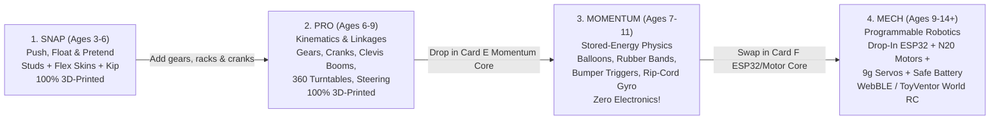
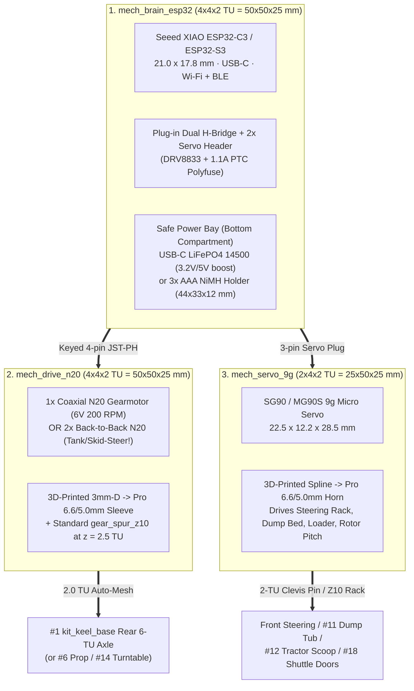

# Spec: Four-Stage Progressive Power & Robotics System (`Snap → Pro → Momentum → Mech`)

Oct 30, 2026 · Plan & Architecture Spec (No-Code Stage)  
Companion to: [`flatpack-modular-craft-spec.md`](file:///Users/dan/Code/toyforge/docs/flatpack-modular-craft-spec.md), [`snap.md`](file:///Users/dan/Code/toyforge/docs/snap.md), [`pro.md`](file:///Users/dan/Code/toyforge/docs/pro.md), and [`vision.md`](file:///Users/dan/Code/toyforge/docs/vision.md)

---

## 1. Core Thesis: One `50 mm` (`4 TU`) Form Factor from Age 4 to Age 14

> [!IMPORTANT]
> **Zero Throwaway Parts:** A child's first flat-pack **Race Car, Dump Truck, Tractor, Trailer, Bike, Aeroplane, Boat, Helicopter, or Space Shuttle** (`Cards A–D`) never becomes obsolete. By locking **one `4 × 4 × 2 TU` (`50.0 × 50.0 × 25.0 mm`) Power Core envelope** and **one `2.0 TU` (`25.0 mm`) Power Take-Off (PTO) gear/axle coordinate** into `kit_keel_base` today, every craft upgrades seamlessly across four progressive engineering tiers:

| Stage | Line Name | Energy Source | What Kids Master | Non-Printed Consumables / Hardware |
| --- | --- | --- | --- | --- |
| **1** | **Snap** | Hand push & gravity | Spatial assembly, silhouettes, balance, storytelling with Kip | None (`100%` printed) |
| **2** | **Pro** | Hand crank & finger linkages | Gear ratios (`Z10:Z20`), levers, dump hinges, `360°` slew rings, steering | None (`100%` printed) |
| **3** | **Momentum** | Air pressure, elasticity, gravity & angular momentum | Thrust vs nozzle area, pneumatic mechanical advantage (`P × A`), mechanical `IF-bump-THEN-fire` triggers, gyroscopic stability | Dry household items only: party balloons, `#32/#64` rubber bands, `6 mm` straw, string, `4×` coins (plus `100%` printed slam-launcher fallback!) |
| **4** | **Mech** | Low-voltage DC (`ESP32` + `N20` gearmotor + `9g` servo + battery) | Wi-Fi/BLE remote control, servo angles, differential steering, sensors, block/JS coding linked to `ToyVentor World` | Plug-and-play no-solder maker kit (`XIAO ESP32-C3/S3`, `DRV8833`, `N20` motors, `SG90/MG90S` `9g` servo, `USB-C LiFePO4` or `3× AAA`) |

---

## 2. The Universal `Power Core` Contract & 5-Gate "Phase 3 Guarantee"

Why electronics retrofits usually fail when deferred is that Phase 1 chassis forget front steering geometry, wire-plug clearance, electronics keep-out volumes, or battery weight. Locking **five hardware datums and test gates** into Phase 1–2 **guarantees Phase 3 (`Mech`) drops in on the first print** without building electronics today:

### 2.1 Five Zero-Cost Future-Proof Features Baked Into `#1 kit_keel_base` Today

1. **Rear `4 × 4 TU` Power Bay (`rows 6..9`, `49.8 × 49.8 mm`) with `2 × 2 TU` Center PTO Window:**
   - Outer `12` perimeter `stud_small` studs (`rows 6 & 9`, `cols 0 & 3`) hold any `4 × 4` cover, `#11 kit_tilting_tub`, `Momentum` Core, or `Mech` Motor/ESP32 Core rock-solid.
   - Center `2 × 2 TU` (`25.0 × 25.0 mm`) open deck window exposes the rear `6 TU` drive axle directly below (`row 8`, `z_axle = 6.25 mm = 0.5 TU`).
2. **Exact `2.0 TU` (`25.00 mm`) Automatic Gear-Mesh Datum:**
   - Every Power Core (`Pro` hand-crank box, `Momentum` rubber-band/flywheel core, `Mech` N20 motor brick) places its transverse `6.6 / 5.0 mm` output shaft at **`(row 8, z = 31.25 mm = 2.5 TU)`** (`18.75 mm` above the `12.5 mm` keel deck).
   - Vertical center-to-center distance to the rear wheel axle (`0.5 TU`) is **`2.5 TU - 0.5 TU = 2.0 TU = 25.00 mm` exact**.
   - A standard Module-`2.5` `gear_spur_z10` (`pitch Ø = 25.0 mm`, outer tip radius `15.0 mm`) on the Power Core shaft **automatically drops straight through the `2 × 2 TU` window into precision mesh** with an identical `gear_spur_z10` on the rear axle!
   - Setting `kit_wheel_med = Ø34.0 mm` (`R = 17.0 mm`) and `kit_wheel_giant = Ø50.0 mm` (`R = 25.0 mm`, `4 TU`) keeps `(50 - 34)/2 = 8.0 mm` exact Tractor level-stance math while giving the `r_a = 15.0 mm` axle gear **`2.0 mm` ground clearance** even in the `low` bore.
3. **Tapered `2 TU` Front Nose + Kingpin Ears (`row 1`) + Steering-Rack Slot (`row 2`):**
   - If `#1` stayed `49.8 mm` wide at the nose, a `Ø34 mm` (`R = 17 mm`) wheel turning `22°` would collide `6.3 mm` into the side wall. Stepping `rows 0..2` inward to a **`2 TU` (`24.8 mm`, `X = ±12.4 mm`) Formula/Tractor nose tongue** with outrigger kingpin ears at `X = ±18.75 mm` gives **`+4.33 mm` tire clearance at `±28°` lock** (`Ø34 mm` wheel) and clears even `Ø50 mm` monster tires (`+2.6 mm` at `±23°`) while keeping the exact `6 TU` (`75 mm`) track width!
   - **Progressive Steering Ladder Across All 4 Stages (using `#15 kit_steer_pack` on `Card A`):**
     - **`Snap` (Simple & Indestructible):** Straight `6 TU` axle through `row 1` horizontal bore for zero-fiddle push play while Kip's yoke spins in the dash—**plus** real pivot steering via `#15` handlebars on the Motorbike or `#14` `360°` Turntable Hitch on articulated Trucks/Tractors/Trailers.
     - **`Pro` (Working Mechanical Rack Steering):** Swap front straight axle for `#15`'s `2×` L-bellcrank knuckles (vertical kingpin + `1 TU` wheel stub + `1 TU` rear tie-rod pin) linked by the module-`2.5` steering rack and driven by a `gear_spur_z10` on `#15`'s steering column (or a "Hand-of-God" rooftop thumb gear on `#8` Cab Arch) for **true `±26°` synchronized front steering**.
     - **`Momentum` (Detented Curve-Preset Steering):** Light center/offset detents on the steering rack hold `0°` (straight dragster) or `±12° / ±24°` (curved slaloms & donuts) under balloon or rubber-band thrust.
     - **`Mech / Max` (Full Proportional RC & Differential Steering):** Unplug the hand stem and snap `mech_servo_9g` (`2×4×2 TU`) onto `rows 1..2`—its `Z10` spline pinion engages **the exact same steering rack** for `±26°` proportional WebBLE/code steering (`~22 cm` turning circle, aided by 1-wheel-free rear hub overrun so the locked axle never pushes straight), **plus** zero-turn **Dual-`N20` skid-steer** on Tractor/Rover and **`9g` `#9` air-rudder steering** on the Catamaran Boat!
4. **Plug-Ready Under-Keel Conduit (`12.5 mm` wide × `6.0 mm` tall + `10.0 × 6.5 mm` Deck Risers):**
   - Sized with clearance around pre-crimped `3-pin` servo plugs (`8.0 × 2.8 mm`) and `4-pin JST-PH` plugs (`9.8 × 4.5 mm`), plus a `6.0 mm` hitch cable notch. In Phase 2 it routes `#64` rubber bands; in Phase 3 pre-crimped cables thread straight from rear `ESP32` to front servo with **zero de-pinning or soldering**.
5. **Dual `4.0 mm` Teardrop Bearing Lands (`> 65%` Friction Reduction):**
   - Instead of dragging a `6.6 mm` printed shaft through `50 mm` of rough layer lines, `#1`'s axle tunnels relieve the inner `41.8 mm` to `Ø8.2 mm` so the shaft rides strictly on two crisp `4.0 mm` outer bearing lands (`X = ±20.9..24.9 mm`).

### 2.2 Two Standard Brick Envelopes Across `Pro`, `Momentum`, and `Mech`

| Standard Envelope | Outer BBox (`mm`) | Lattice Size | Role Across Stages |
| --- | --- | --- | --- |
| **Full Power Core** | `49.8 × 49.8 × 25.0` | `4 × 4 × 2 TU` | **Pro:** Hand-crank `3:1` gearbox · **Momentum:** Pull-back rubber-band / coin-flywheel core, or Balloon Bellows Jack · **Mech:** Single/Dual `N20` Drive Core OR stackable `XIAO ESP32 + Battery` Brain Core |
| **Actuator Half-Core** | `24.8 × 49.8 × 25.0` | `2 × 4 × 2 TU` | **Pro:** Rack steering / crank jack · **Momentum:** Balloon Thrust Valve Pod (`#13` compatible!) or Bumper-Trigger Band Ratchet · **Mech:** `9g` (`SG90/MG90S`) Steering & Accessory Servo Brick |

### 2.3 Verification Gates Run During Phase 1–2 to Prove Phase 3 Ahead of Time

| Verification Gate (Run in Phase 1–2) | What It Tests | Phase 3 Failure Prevented |
| --- | --- | --- |
| **G1. CAD "Ghost Solid" Keep-Outs (`toyventor_assembly.py`)** | Places exact parametric keep-out meshes (`ghost_xiao_esp32` + `18 mm` USB-C plug cone, `ghost_n20_motor` ×2, `ghost_servo_sg90`, `ghost_battery_3aaa`, `9.8 × 4.5 mm` JST-PH plug sweep) inside virtual `4×4×2` & `2×4×2 TU` bricks across all 9 craft (`0.000 mm³` collision required). | Prevents discovering later that a stud, cab arch, dump knuckle, or USB-C cable collides with the chassis. |
| **G2. `Pro` Hand-Rack Steering Proof** | Drives front kingpins + `gear_rack_tu05` via `#15` steering stem + `gear_spur_z10` on physical Phase 1 prints. | Proves full lock-to-lock tire clearance (`±22°`) and rack travel before mounting `SG90` servo. |
| **G3. `#64` Rubber-Band Torque Stress Test** | Applies `40–80 N·mm` burst torque through the `2.0 TU` `Z10:Z10` rear axle mesh and `5.0 mm` wheel D-hubs in Phase 2. | Exceeds `6V 200 RPM` `N20` continuous torque (`30 N·mm`), proving printed gear teeth and hubs won't strip. |
| **G4. `100 g` Coin-Ballast Physical Test** | Loads `~100 g` of coins (`20` nickels) into the Power Bay during Phase 2 rolling, tipping, and bathtub tests (`2× #10` hollow pontoons + sponsons sized for `>= 240 cm³` displacement). | Proves full `Mech` battery + motor mass won't bottom out axles, stall the dump hinge, or sink the Catamaran Boat. |

---

## 3. Stage 3 Deep Dive: `Momentum` (100% Kid-Safe, Dry, Zero-Syringe Physics!)

Dropping syringes keeps `Momentum` **100% dry, spill-free, and kid-safe** while expanding play value with five support-free printable modules on **`Card E: Momentum Pack` (`<= 175 × 175 mm`)**:

### 3.1 The Five Kid-Safe `Momentum` Mechanisms (`Card E`)

| Mode | Printable Module (`Card E`) | Household Item | Real Physics Output | Vehicle Propulsion Roles | Powered Accessory Roles |
| --- | --- | --- | --- | --- | --- |
| **M1a. Balloon Reaction Jet** | `mom_jet_valve` (fits `#13` Booster Pod or `2×4` studs + click-shut valve + 3 STEM nozzles) | `9"–12"` balloon + `6 mm` straw | `0.15–0.22 N` (`15–22 gf`) thrust for `8–12 s` (`> 6×` rolling drag on `4 mm` bearing lands!) | **Race Car**, **Bathtub Speedboat** (`45°` water/air jet!), **Uphill Zip-Line Space Shuttle / Jet Plane**! | Spinning reaction tip-jets on `#14` Turntable / Carousel |
| **M1b. Balloon Bellows Bladder** | `mom_bellows_hinge` (`4 × 4` hinged clamshell leaf under `#11` or `#2`) | `9"` balloon + straw (or dry squeeze bulb; `3 kPa × 30 cm²`) | **`~9.0 N` (`900 gf` / `2 lbs`!)** smooth pneumatic lift! | Pop-up stunt ramp / wheelie bar | **Lifts brick-loaded `#11` Dump Truck & Trailer beds `55°`**, **raises `#2 + #12` Tractor Loader**! |
| **M2. Pull-Back Band Engine** | `mom_band_core` (`4 × 4 × 2 TU` Power Core + auto-freewheel axle spool) | `#32` or `#64` rubber band (`100 mm` under-keel stretch) | High wheel torque (`40–80 N·mm`) + **one-way freewheel release** (`4–7 m` coast!) | **Tractor** (climbs rugs!), **Dump Truck + Trailer Rig**, **Taxiing Prop Plane** (`#6` prop drive) | **Motorized Tow-Truck Winch**, rotating `#14` Turntable |
| **M3. Mechanical `IF-Bump-THEN-Fire` Trigger** | `mom_bumper_trigger` (`LAY_FLAT` 1-click ratchet latch + front/rear bumper trip rod) | `1× #32` rubber band | Instant stored-elastic release triggered by physical bumper contact (or Kip cab lever)! | Automatic dock-release trailer uncoupler | **Auto-Scooping Tractor** (drives into brick pile -> bumper trips latch -> `#12` Scoop snaps UP!), **Auto-Dumping Truck** (backs into dock -> dumps `#11`!), **Spring-Opening `#18` Shuttle Payload Doors**! |
| **M4. Rip-Cord Gyro, Zip-Line & Slam Launcher** | `mom_ripcord_zipline` (`170 mm` module-`2.5` toothed rack + `Z10` flywheel/pulley cage + `LAY_FLAT` bow-limb slam launcher) | `4×` coins (gyro) or household string (zip-line) — **or `0` consumables** (bow launcher!) | `3,000 RPM` gyro stability · overhead string flight · `< 1.4%` momentary bow-spring launch | **Self-balancing 2-Wheel Gyro Motorbike (`#2`)** · **String-Flying Plane, Heli & Uphill Balloon Shuttle** · **Zero-Consumable Slam-Launch Car/Rocket**! | **High-RPM Spinning/Flying `4`-Blade Helicopter Rotor (`2× #6`)** on `#8` Cab Arch mast |

### 3.2 Why `Momentum` Prints & Works Reliably on Any Home FDM Printer
- **Hands-Free Balloon Slide Shutter (`mom_jet_valve`):** Kids inflate via a detachable washable straw mouthpiece, click the tapered dovetail slide valve **closed** (no pinched fingers while placing Kip or aiming the car!), and flick the top trigger lever to launch. Includes **3 snap-in nozzle orifices (`Ø4.5 mm` Endurance, `Ø6.0 mm` Sprint, `45°` Marine Vectored)** for real STEM experiments.
- **Physical Pre-Coding (`mom_bumper_trigger`):** Teaches **`IF bumper_pressed THEN lift_scoop()`** mechanically in Stage 3 (`Momentum`), directly mirroring the event-driven block/JS logic kids write on `ESP32` in Stage 4 (`Mech`).
- **Zero Sliding-Seal Air Leaks & Zero Static PLA Creep:** Balloon collars print upright (`Z`-concentric smooth `R = 2.0 mm` rolled bead, `3` perimeters); static energy lives in `$0.01` latex balloons/bands or coin inertia, while the `100%` printed `mom_bow_launcher` is flexed for `< 0.5 s` only at launch (`< 1.4%` strain, zero storage creep).

---

## 4. Stage 4 Deep Dive: `Mech` (Drop-In ESP32, Motors & Servos — Same Form Factor!)

Far from being a pipe dream, modern ultra-compact boards (`21 × 18 mm`) and micro metal gearmotors (`10 × 12 × 24 mm`) fit inside our **`4 × 4 × 2 TU` (`50 × 50 × 25 mm`)** brick with generous air-flow margins and **zero soldering**:

### 4.1 The Three Snap-Together `Mech` Bricks (`Card F` Printed Shells + Off-the-Shelf Electronics)

### 4.2 Exact Internal Packaging Audit (`45.8 × 45.8 × 21.0 mm` Cavity Inside `2.0 mm` Walls)

| `Mech` Module | Off-the-Shelf Component | Exact Component Size (`mm`) | Fits Inside `TU` Envelope? | Mechanical Output Interface |
| --- | --- | --- | --- | --- |
| **`mech_brain_esp32`** | `Seeed XIAO ESP32-C3/S3` + plug-in carrier + `500 mAh LiFePO4` / `3× AAA` | MCU `21 × 17.8 × 4.5` + Battery `44 × 33 × 12` | **Yes** (`4 × 4 × 2 TU` = `49.8 × 49.8 × 25.0 mm`, stacks directly on top of `mech_drive_n20` or rides in trailer/cab!) | `4×4` `socket_small` bottom, `4×4` `stud_small` top, recessed `USB-C` port, `2×` motor + `2×` servo sockets |
| **`mech_drive_n20`** | `1×` (RWD + Aux PTO) or `2×` (Differential Skid-Steer) `N20` metal gearmotors | `10.0 × 12.0 × 24.0` body (`+9 mm` `3 mm` D-shaft) | **Yes** (`4 × 4 × 2 TU`; transverse layout fits cleanly inside `45.8 mm` width!) | Printed `mech_coupler_n20` converts `3 mm` D-shaft to standard `6.6 / 5.0 mm` Pro shaft carrying `gear_spur_z10` at `z = 2.5 TU` |
| **`mech_servo_9g`** | `SG90` / `MG90S` `9g` servo | `22.5 × 12.2 × 28.5` | **Yes** (`2 × 4 × 2 TU` = `24.8 × 49.8 × 25.0 mm` laid horizontal!) | Printed `mech_horn_pro` outputs standard `1 TU` Pro clevis arm **or** `gear_spur_z10` driving `gear_rack_tu05` steering! |

### 4.3 Steering, Marine & Flight Realism in `Mech` (Honest Physics Boundaries)
- **Wheeled Craft (`Race Car`, `Dump Truck`, `Tractor`, `Trailer`):**
  - *Race Car & Truck:* `mech_drive_n20` on rear `4 × 4` bay + `mech_servo_9g` on front `2 × 4` bay driving a flat-printed `gear_rack_tu05` Ackermann steering bar (`100%` proportional RC driving!). Add a 2nd `mech_servo_9g` to **remotely tip `#11` Dump Tub** or **unhitch Trailer** from the app!
  - *Tractor / Skid-Steer:* Dual-N20 `mech_drive_n20` drives Left and Right giant wheels independently (`zero-turn` skid steering!) leaving the `9g` servo free to **raise and curl the `#2 + #12` Front Loader**!
- **Motorbike (`#2 Clevis Spine`):** `mech_servo_9g` tilts handlebars/weight while a rear hub N20 + `Momentum` gyro flywheel keeps it upright at speed (or runs stably as a **Motorized Cargo Trike** with `#14` rear axle).
- **Catamaran Boat:** Twin `kit_skid_pontoon` hulls displace `~180 g` (upgradeable with snap-on `2 TU` foam-noodle or hollow printed displacement pods to `> 350 g` payload!). Driven cleanly across a pool/pond with **zero submerged shaft seals** via a stern **Airboat Ducted Fan (`N20 + #6 Rotor`)** + `9g` servo air-rudder (`#9 Foil`)!
- **Aeroplane, Helicopter & Space Shuttle (Desk / Interactive STEM Rovers — Not Free-Flight Drones):**
  - PLA structural weight (`~120–180 g`) means `Mech` aircraft operate safely for kids as **RC Taxiing Prop Planes** (spinning `#6` prop + steerable tail/nose wheel), **Desk/Floor Rescue Helicopters** (motorized spinning main + tail rotors, motorized rescue winch, LED searchlight), and **RC Space Shuttle Crawlers** with **servo-opening `#18` Payload Bay Doors**—never hazardous high-RPM LiPo quadcopter blades!

### 4.4 Native Integration with `ToyVentor World` (Zero App Install!)
- Because `ToyVentor` already runs in mobile/desktop browsers, **WebBluetooth (`navigator.bluetooth` BLE GATT)** and local **Wi-Fi WebSocket** connect directly from the `ToyVentor World` HUD to `mech_brain_esp32`!
- Kids drive with the **exact same one-thumb touch controls** they already use in `ToyVentor World`, sequence block routines ("Drive forward `3 TU` → Lift Tractor Scoop → Tip into Trailer"), and sync physical/digital actions live.

---

## 5. Complete 9-Craft × 4-Stage Progression Matrix

| Craft (`Cards A–D`) | Stage 1: `Snap` (Push) | Stage 2: `Pro` (Geared/Linkage) | Stage 3: `Momentum` (`Card E`, No Electronics) | Stage 4: `Mech` (`Card F`, ESP32 RC) |
| --- | --- | --- | --- | --- |
| **1. Race Car** | Push slammed coupe (`high` bores) | Rack-and-pinion hand steering | **Balloon Jet Dragster** (`#13 + mom_jet_valve`) or **Pull-Back Band Racer** (`7 m` freewheel!) | Rear `N20` (`300 RPM`) + front `9g` rack steering + BLE speed telemetry |
| **2. Dump Truck** | Push truck + manual tipping `#11` tub | Worm/crank mechanical bed tipper | **Pull-Back Drive** + **`900 gf` Balloon Bellows** (or **Bumper-Trigger Auto-Dump**) **Bed**! | Rear `N20` high-torque (`100 RPM`) + `9g` servo **remote-tipping Dump Bed** |
| **3. Farm Tractor** | Level staggered wheels + manual scoop | Geared PTO + hand-lever loader | **Pull-Back Carpet Climber** + **`IF-Bump-THEN-Scoop` Trigger Front Loader (`#2 + #12`)** | **Dual-N20 Skid/Diff Drive** + `9g` servo **programmable Front Loader** |
| **4. Trailer System** | Hitch-towed tipper / flatbed wagon | `360°` `#14` crane / Car-hauler ramps | **Balloon Bellows Tipper** or **Dock-Bump Auto-Dumper** | Carries auxiliary battery / **ESP32 Servo Tipper** via hitch wire pass-through |
| **5. Motorbike / Trike** | Inline push bike / Cargo trike | Steerable fork + chain/gear mock | **Rip-Cord Coin-Flywheel Gyro Bike** (stays upright solo across the floor!) | **RC Cargo Trike** (`N20` drive + `9g` handlebar steering) |
| **6. Prop / Jet Plane** | Swoosh plane + free-spin `#6` prop | Geared axle-to-propeller taxi link | **Rubber-Band Nose Prop Taxi** or **Overhead String Zip-Line Balloon Jet** | **RC Taxiing Prop Plane** (`N20` prop/wheel drive + `9g` `#9` rudder) |
| **7. Catamaran Boat** | Bathtub float (`2× #10` pontoons) | Hand-cranked paddle / air fan | **Vectored Balloon Water/Air Jet Speedboat** (`45°` stern nozzle) | **RC Airboat** (`N20` stern `#6` fan + `9g` `#9` air rudder — `0` water seals!) |
| **8. Helicopter** | Landing skids + spin `4`-blade rotor | Geared coupled main + tail rotors | **Rip-Cord High-RPM Rotor** + **Overhead String Rescue Zip-Line** | **Motorized Dual-Rotor + Servo Rescue Winch** & searchlight |
| **9. Space Shuttle** | Orbiter + manual `#18` flex bay doors | Geared satellite deployment arm | **Uphill String Balloon Rocket** + **Trigger-Spring `#18` Payload Doors** + **Bow Slam Launch** | **ESP32 Mission Orbiter**: programmed **servo Payload Doors + robotic arm** |

---

## 6. 3D-Printing & Safety Rules Across All Stages

1. **Clamshell Pin-Locked Enclosures (`0` Supports, `0` Heat-Set Inserts):**
   - Every `Momentum` and `Mech` brick (`Card E` & `Card F`) splits horizontally into an open-top tray and a flat-top stud lid, printing flat at `0.20 mm` layer height (`0.4 mm` nozzle) with **zero supports** and locking via `2×` standard `pin_friction` pins.
   - Battery compartments include a captive M3 screw hole tab alongside friction pins to satisfy child battery-enclosure safety standards (`IEC 62115`).
2. **Thermal & Stall Protection (`Mech`):**
   - `mech_drive_n20` and `mech_brain_esp32` walls integrate `45°` support-free cooling louvers + `2.0 mm` internal PCB air-gap ribs + `1.1 A` resettable PTC polyfuse protection so stalled brushed motors never approach PLA's `55 °C` glass-transition temperature (`PETG` recommended for `Card F`).
3. **Filament Grain Alignment (`Momentum`):**
   - Rip-cord racks (`mom_ripcord_zipline`), bumper-trigger ratchets (`mom_bumper_trigger`), bow-launcher limbs, one-way freewheel pawls, shaft couplers (`mech_coupler_n20`), and servo horns (`mech_horn_pro`) **always print `LAY_FLAT`** so continuous XY perimeters carry tooth shear and bending loads without delaminating.

---

## 7. Phased Rollout Plan (Phase 1 + 2 Together, Phase 3 Guaranteed)

| Phase | Deliverable | How Phase 3 (`Mech`) Is Guaranteed |
| --- | --- | --- |
| **Phase 1 + 2 (First CAD Build: `Cards A–E`)** | • **`Cards A–D`:** `15` rigid modules + `3` shape-out flex skins with all `5` future-proof datums baked into `#1 kit_keel_base`. • **`Card E: Momentum Pack`:** `mom_jet_valve`, `mom_bellows_hinge`, `mom_band_core`, `mom_bumper_trigger`, and `mom_ripcord_zipline` (100% dry, kid-safe, zero syringes). | Runs **all 4 Phase-3 Verification Gates (`G1–G4`)**: CAD keep-out ghost solids (`XIAO ESP32`, `N20`, `SG90`, `3×AAA`, `USB-C` & `JST-PH` plug sweeps = `0.000 mm³` collision), `Pro` rack steering, `#64` band `Z10` torque test, and `100 g` coin-ballast rolling/buoyancy test. |
| **Phase 3 (Follow-On Pack: `Card F: Mech` + WebBLE)** | Parametric shells (`mech_brain_esp32`, `mech_drive_n20`, `mech_servo_9g`, `mech_coupler_n20`, `mech_horn_pro`) + `XIAO ESP32` WebBluetooth firmware + `ToyVentor World` live RC controller bridge. | Drops straight onto Phase 1–2 vehicles with **zero chassis edits** (`< 5 min` snap-in upgrade, zero soldering). |
