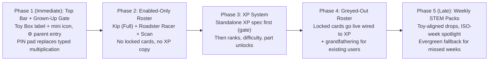

# Spec: App Continuation Roadmap (Top Bar & Parent Gate, Kip & Craft Roster, Accuracy-Bonus STEM XP, Weekly STEM Packs)

Oct 30, 2026 · Post-Consolidation Phased Plan (revised after brain-dump review)  
Source: [`brain-dump.md`](../archive/brain-dump.md)  
Builds on: [`world-first-spec.md`](../ux/world-first-spec.md) · [`parts-tu-spec.md`](../parts/parts-tu-spec.md) · [`flatpack-modular-craft-spec.md`](flatpack-modular-craft-spec.md) · [`progressive-power-system-spec.md`](progressive-power-system-spec.md) · [`parent-time-gate.md`](parent-time-gate.md)

> **Status of XP numbers in this doc:** all XP thresholds, rank costs, and bonus percentages in §4 are a **draft proposal**, not a commitment. They may not be referenced by roster locks until the standalone XP spec (§4.1) is signed off. No XP exists in `src/` today.

---

## 1. Overview & Phase Order

App continuation ships in **five sequential phases**. The ordering is the fix for the review's hidden dependency: the greyed-out roster promises an unlock path, so it cannot ship before the XP system that fulfils the promise exists.

| Phase | Scope | Why This Order |
| --- | --- | --- |
| **Phase 1 (Immediate)** | **Top Bar & Grown-Up Unlock** (brain-dump §1 + §2) | Small, builds on code that already exists (top dock, `GrownUpsSheet`, PIN, sitting window). Unblocks every later phase's parent surface. |
| **Phase 2** | **Enabled-Only `Toy Box` Roster** (brain-dump §3a) | Surfaces Kip's real assets and one starter vehicle with zero dependency on XP. Kids see only things they can actually play. |
| **Phase 3 (Core Loop)** | **Accuracy-Bonus STEM XP, Difficulty Tiers & Advanced Part Unlocks** (brain-dump §4) | A system, not a feature: starts with its own signed-off spec (§4.1 gate), then implementation. Produces the unlock currency Phase 4 spends. |
| **Phase 4** | **Greyed-Out Roster Wired to XP** (brain-dump §3b) | Locked cards ship only once tapping one has a true answer ("earn N XP in STEM Labs"). Includes the per-vehicle readiness audit and grandfathering. |
| **Phase 5 (Late Phase)** | **Toy-Aligned Weekly STEM Pack Rips** (brain-dump §5) | Needs the enabled roster (Phase 2), XP gating (Phase 3), and the full roster (Phase 4) so weekly packs only drop fitting, rank-appropriate parts. Correctly last. |

**Hard ordering rules:**

- No locked/greyed card, lock icon, or "unlocks at…" copy ships before Phase 4. The only pre-XP teaser allowed is a non-interactive "Coming soon" card with no lock and no XP promise.
- No roster lock cost is written into code or UI copy until the §4.1 XP spec is signed off.
- No vehicle enters the Phase 4 roster until its §5.1 readiness-audit row is complete.

---

## 2. Phase 1 — Top Bar & Grown-Up Unlock (brain-dump §1 + §2)

### 2.1 Top Bar

- **Left dropdown = `Toy Box` (`[mini toy image] Toy Box ▾`):** the label stays **"Toy Box"**; it does not swap to the active toy's text name.
- **Top-right = Settings (`⚙️`):** Grown-Ups / Play Time lives inside `⚙️`. Remove the `Grown-ups · Play Time` button from `My Toys` ([`MyToySheet.tsx`](../../src/features/game/world/MyToySheet.tsx)) completely — `Toy Box` stays 100% kid toys + scan.
- Remove the duplicate `Grown-ups` entry in the `⋯` menu ([`GameCanvas.tsx`](../../src/features/game/world/GameCanvas.tsx)) once `⚙️` ships, leaving one parent path in the top bar.

### 2.2 Mini-icon pipeline (never blocks the top bar)

The label is frozen as "Toy Box", so the mini icon alone carries active-toy identity. Fallback chain, cheapest first:

| Toy source | Icon | Cost / timing |
| --- | --- | --- |
| Built-in (Kip, vehicles) | Static built-in SVG icon | Free, instant, offline-safe |
| Scanned / custom | SAM cutout thumbnail from the scan photo (`imageDataUrl` already stored on the toy; same source as the `My Toys` tile thumbnail) | Already paid at scan time |
| Scanned, no usable cutout | Silhouette / glyph placeholder (cf. `glyphForToy` in `MyToySheet.tsx`) | Free, instant |
| Scanned, async upgrade | Meta Muse Image–generated mini icon | Generated **after** the bar renders; cached per toy id (at most once per toy); latency, cost, offline, and failure all fall back to the row above |

- The top bar renders immediately with the best already-local icon. No image-generation call is on the render path.
- **Accessibility (required):** the `Toy Box` button carries `aria-label="Toy Box — {active toy name} active"` and a `title`/tooltip with the active toy name for parents. The icon itself is decorative (`aria-hidden="true"`).

### 2.3 Grown-Up Unlock UX (keep one real barrier)

Current state in [`GrownUpsSheet.tsx`](../../src/features/game/world/GrownUpsSheet.tsx): 1.2s hold → challenge (4-digit PIN when `pinSet`, else typed two-digit multiplication such as `17 × 8`), with a 5-minute sitting window under `sitting_window` strictness (`src/lib/parentTime.ts`, `worker/parent.ts`). A pure tap-only unlock is not a gate — any kid can tap `⚙️` — and is **rejected**.

New flow:

1. Tap `⚙️` → **hold-to-open** (the existing 1.2s hold stays as the entry step / fallback).
2. → **4-tap PIN pad**: big tap targets, no keyboard, no hard mental math. Reuses the existing PIN (`pinSet` in `shared/parent-time.ts`) — no new credential store.
3. **5-minute sitting window unchanged:** inside the window, re-entry is a confirm tap; outside it, the PIN is required again. Backgrounding the app still revokes the sitting unlock.
4. **No PIN set yet:** first unlock offers "Set a PIN" (4 taps + confirm). The typed multiplication challenge survives only as a one-time bootstrap until a PIN exists, then never appears again.

Net change vs. today: drop typed multiplication as the standing challenge; keep hold + PIN + sitting window.

### 2.4 Sleep Curtain exception

[`SleepCurtain.tsx`](../../src/features/game/world/SleepCurtain.tsx) keeps its `Grown-ups` button. During quiet hours / time-ended the curtain covers the stage, so that button may be the only reachable parent path (`⚙️` sits behind it). It opens the same §2.3 gated sheet — it is a second door to the same gate, not a bypass.

---

## 3. Phase 2 — Enabled-Only `Toy Box` Roster (brain-dump §3a)

### 3.1 Goal

Replace the emoji starter tiles in [`MyToySheet.tsx`](../../src/features/game/world/MyToySheet.tsx) with the enabled roster below, backed by assets that exist today in `public/kip/` (`kip-vehicles-wardrobe.js`, `public/kip/partspec/*.stl`) and `sets/*.json`. **No locked cards, no XP language, no rank badges in this phase.**

### 3.2 Enabled starters (fresh profile)

1. **`Kip` (`seed-kip` · Full Modular Hero · Default Starter #1)**
   - Default selected toy on first boot, rendered with a real Kip portrait thumbnail instead of a generic emoji.
   - Full Kip modular wardrobe & rig support surfaced directly from `My Toys` and `Build` (not buried solely in `⋯ -> Kip 3D Rig`):
     - **5 Swappable Heads:** `Kip Classic`, `Human Head` (with emotion faceplate), `Fox`, `Bear`, `Bolt Robot` (`WARDROBE_HEADS` in [`kip-vehicles-wardrobe.js`](../../parts/kip/viewer/kip-vehicles-wardrobe.js)).
     - **8 Clip-On `2×1` Hairstyles:** 3 hat-ready (`Swept`, `Bob`, `Swoosh`) + 5 sculpted-top (`Spiky`, `Twin Pigtails`, `Sleek Ponytail`, `Cloud Curls`, `Crest Mohawk`).
     - **Hats, Back Docks & `Ø6.6 mm` Hand Props:** `Spark Buds`, `Wobble Hat`, `Pointy Ears`, `Bumper Horns`, `Explorer Pack`, `Bolt Jetpack`, `Cloud Wings`, `Pro Wrench`, `Star Shield`, `Skateboard`.
2. **`Roadster Racer` (`seed-car` · Starter Vehicle #2)** — canonical UI name; spec alias **Race Car** (see §5.2).
   - The single unlocked built-in vehicle, paired with `sets/racer-garage.json` (`Spoiler`, `Bull Bar`, `Hood Scoop`, `Light Bar`, `Twin Exhaust`, `Racer Wheel`) and `veh_car_chassis` / `veh_car_hood_cover` / `veh_wheel_sport`.
3. **Scanned Real Toys (`Meta SAM 3.1` · Always Unlocked)**
   - Kids and parents can always scan any physical toy via **`Scan a Real Toy (Meta SAM 3.1)`**; scanned uploads appear at the front of `My Toys`. Mini icons follow the §2.2 fallback chain.

---

## 4. Phase 3 — Accuracy-Bonus STEM XP, Difficulty Tiers & Advanced Parts (brain-dump §4)

### 4.1 Gate: standalone XP spec first (no code before sign-off)

XP is a system, not a feature, and none of it exists in `src/` today. Phase 3 starts by writing and signing off a standalone XP spec. **Implementation does not begin until the XP spec answers all seven items:**

1. **Accuracy, defined per mission type.** "Clean 1st/2nd try" and "exact measurement/balance/ratio" are different signals. The XP spec defines the metric per mission family (attempt count, exactness error, part efficiency, or a named mix) — the draft in §4.3 uses test-attempt count as a placeholder only.
2. **Anti-farming.** A replay rule with numbers (diminishing returns, daily caps, or new-content weighting) so replaying the easiest level forever is not the optimal strategy. §4.3's `ReplayFactor` is the draft shape.
3. **Persistence.** Device (`localStorage`, as the Toy Box uses today) vs. D1 sync — including new-device and cleared-storage behaviour.
4. **Multiple kids on one device.** One shared XP pool vs. per-kid profiles. Decided before (3), because it changes the data model.
5. **One currency, three gates.** XP gating difficulty, vehicles, **and** parts is a single bottleneck that can stall all three. The XP spec either justifies the single currency or splits it (e.g. vehicles on total XP, parts on mission-family mastery).
6. **Grandfathering (direction resolved, mechanics in XP spec).** Every toy a user already has unlocked when gating lands **stays unlocked** (see §5.3).
7. **Parent visibility (required).** A read-only XP summary inside the `⚙️` sheet: current XP/rank, recent unlocks, and a reset control, behind the §2.3 gate (see §4.6).

### 4.2 Core Philosophy: Reward Precision Without Punishing Exploration

ToyVentor's under-8 calm rule ([`snap.md`](../parts/snap.md)) forbids red fail screens or losing progress when testing an idea (for example, watching an unbraced bridge sag on Test 1). Therefore:

- **Every completed STEM mission awards 100% of its Base XP**, no matter how many `Test it` iterations the child took.
- **High-accuracy engineering earns a positive Accuracy Bonus (`+25%` to `+50%` extra XP)** on top of Base XP, with `1★ / 2★ / 3★` mastery stars that can always be improved on replay.

### 4.3 Draft XP Math (`shared/progression.ts`) — PROPOSAL, pending §4.1 sign-off

When a STEM mission (`bridge`, `measure`, `balance`, `logic`, `lift`, `raft`, `lever`, `circuit`, `code`, `pattern`, `clean`) completes in `ToyVentor-World`:

$$\text{XP}_{\text{award}} = \text{round}\!\left(\text{BaseXP}(\text{tier}) \times \left(1 + \text{AccuracyBonus} + \text{PartMatchBonus}\right) \times \text{ReplayFactor}\right)$$

1. **Base XP by STEM Difficulty Tier (draft):**
   - **`Tier 1` (`★` Snap Starter):** `100 XP`
   - **`Tier 2` (`★★` Tinker Challenge):** `150 XP`
   - **`Tier 3` (`★★★` Pro Engineer):** `220 XP`
2. **Accuracy Bonus (draft proxy: `#mp-go` test count & slot optimality — to be replaced by the per-mission-type definitions from §4.1 item 1):**
   | Mastery | Draft Criteria | Bonus | UI Celebration Copy (zero em dashes) |
   | --- | --- | --- | --- |
   | **`3★` Gold Precision** | Solved on **`1st` `Test it` attempt** with exact target / zero wasted parts | **`+50%`** | `Spot-On Engineering! +50% Accuracy XP` |
   | **`2★` Silver Fix** | Solved on **`2nd` `Test it` attempt** | **`+25%`** | `Smart Adjustment! +25% Accuracy XP` |
   | **`1★` Built & Solved** | Solved in `3+` `Test it` attempts | **`+0%`** *(full Base XP)* | `Mission Complete! +100 XP` |
3. **Equipped Part-Match Bonus (`+10%`, draft):**
   - Awarded when the kid's active toy wears an equipped part matching the mission's mechanical stat (`armor` on `bridge`, `grip`/`torque` on `lift`/`lever`, `glow` on `circuit`, `speed`/`spin` on `raft`/`clean`).
4. **Anti-Grind & Star-Upgrade Rule (draft shape for §4.1 item 2):**
   - First solve of `(missionId, tier)` on a local day gets `ReplayFactor = 1.0`.
   - Improving an earlier `1★` solve to `2★` or `3★` always pays the full uncollected Accuracy Bonus delta immediately.
   - Repeating an already-`3★` `(missionId, tier)` on the same day pays `ReplayFactor = 0.25` practice XP so progression comes from tackling new labs or higher difficulty tiers rather than farming a single puzzle.

### 4.4 Unlockable STEM Level Difficulty Tiers (`★` -> `★★` -> `★★★`)

[`MissionPanel.tsx`](../../src/features/game/world/MissionPanel.tsx) gains a compact 3-tier difficulty selector at the top of STEM Labs `1–6`. Unlock rows reference draft ranks (§4.5) and move if the XP spec splits the currency (§4.1 item 5).

| Difficulty Tier | Draft Unlock | What Changes in the Mission | Target Age / Line |
| --- | --- | --- | --- |
| **`Tier 1 · Starter (★)`** | Default | Forgiving slot tolerances, visual slot hints visible, generous part bin. | Ages `4–6` (`Snap`) |
| **`Tier 2 · Tinker (★★)`** | Draft `Rank 2` (Labs `1–3`) & `Rank 4` (Labs `4–6`), or `2★+` on `Tier 1` | Wider gap / heavier load / 2-condition logic gate, tighter scrap budget, visual hints tucked behind a `Hint` tap. | Ages `6–8` (`Snap -> Pro`) |
| **`Tier 3 · Engineer (★★★)`** | Draft `Rank 4` (Labs `1–2`) & `Rank 5` (Labs `3–6`) | Exact gear-ratio targets (`Z10:Z20` `2:1` torque vs. `1:2` speed), multi-step circuit/code patterns, and minimum-part efficiency goal for `3★`. | Ages `8+` (`Pro` & `Momentum`) |

### 4.5 Draft Maker Ranks (`Rank 1`–`Rank 6`) & Advanced Part Unlocks — PROPOSAL, pending §4.1 sign-off

XP unlocks vehicles (delivered as playable cards in Phase 4, §5) and advanced part families in `ToyCustomizer` / `PrintDrawer`. Thresholds below are the draft the XP spec must confirm, split, or replace; Phase 4 lock copy uses only the signed-off numbers.

| Rank | Title | Draft XP Threshold | Unlocked Vehicles (`My Toys`, live in Phase 4) | Unlocked Parts (`Build` / `PrintDrawer`) & Difficulty |
| --- | --- | --- | --- | --- |
| **1** | **Snap Sprout** | `0 XP` | `Kip` (Full), `Roadster Racer`, SAM Scan | Core `Snap` parts (`sets/base.json`, `sets/kip-wardrobe.json`, starter `racer-garage.json`), `Tier 1 (★)` Labs `1–6` |
| **2** | **Workshop Builder** | `250 XP` | `Hauler Truck`, `Motor Scooter`, `Star Scout` | Heavy utility `Snap` add-ons (`Roof Rack`, `Bull Bar`, `Twin Exhaust`), `Tier 2 (★★)` Labs `1–3` |
| **3** | **Gearhead** | `600 XP` | `Sport Motorbike`, `Loader Tractor & Trailer` | **`Pro` Mechanical Line unlocked (`Pro` filter enabled):** `beam_str_tu05`, `pin_friction`, `gear_spur_z10`, `gear_spur_z20`, `adapter_snap_pro`, `prop_wrench` |
| **4** | **Sky & Sea Pilot** | `1,100 XP` | `Prop Aeroplane`, `Catamaran Boat` | Flat-pack Aero & Marine modules (`kit_foil_wing`, `kit_rotor_blade`, `kit_skid_pontoon`), `Tier 2 (★★)` Labs `4–6`, `Tier 3 (★★★)` Labs `1–2` |
| **5** | **Aero Captain** | `1,800 XP` | `Rescue Helicopter`, `Space Shuttle` | **`Momentum` Stored-Energy Modules** (`kit_booster_pod` balloon jet, elastic spool, hydraulic lift preview), `Tier 3 (★★★)` Labs `3–6` |
| **6** | **Mech Inventor** | `2,700 XP` | `Bolt Power Mech` | **`Mech` Robotics Preview** (`4×4×2 TU` Power Core brick + coaxial servo/sensor challenges) |

> [!TIP]
> **Grown-Ups / Demo Sandbox Toggle:** Inside `GrownUpsSheet` (via `⚙️`), an optional **`Unlock All Toys & Pro Parts (Maker / Demo Mode)`** switch lets parents, educators, or hackathon judges test every craft, difficulty tier, and `Pro` gear immediately without waiting on XP thresholds. This toggle does not change earned XP; turning it off restores the earned state (grandfathered toys, §5.3, stay).

### 4.6 Persistence, HUD Footprint & Parent Visibility

- **Zero HUD clutter on the 3D Stage:** No noisy RPG bars floating over the 3D canvas. The `[Toy Box ▾]` button shows a subtle rank pip (`R1`..`R6`) next to the §2.2 mini icon, `My Toys` shows the Maker Rank progress bar (e.g. `320 / 600 XP to Rank 3 · Gearhead`), and completing a STEM mission pops a celebratory 2.5s toast (`Spot-On Engineering! +150 XP`).
- **Persistence (draft — final call in §4.1 items 3–4):** Local-first in `localStorage["toyforge:progression:v1"]` (`totalXp`, `rank`, `missionStars`, `sandboxUnlockAll`), synced to D1 via `/api/ownership` (`type: "progression"`, `id: "main"`) when an account/device identity exists.
- **Parent visibility (required):** the unlocked `⚙️` sheet gains a read-only **XP summary** — current XP and rank, recently unlocked vehicles/parts, and a parent-confirmed **Reset XP** control. It sits alongside the existing Play Time ledger in [`GrownUpsSheet.tsx`](../../src/features/game/world/GrownUpsSheet.tsx), behind the §2.3 PIN gate.

---

## 5. Phase 4 — Greyed-Out Roster Wired to XP (brain-dump §3b)

Ships only after Phase 3 is live. This is the first phase in which a locked card may exist, because tapping it now has a true answer.

### 5.1 Per-vehicle readiness audit (entry gate)

Kip has real parts (`parts/kip/`, `public/kip/`); the vehicle lineup otherwise lives in spec docs ([`flatpack-modular-craft-spec.md`](flatpack-modular-craft-spec.md)), not yet as playable `Toy Box` entries (today's built-ins are only the seed toys). A vehicle joins the roster below only when its audit row is fully checked: playable model, rig/animation, a parts set in `sets/*.json`, and at least one mission that uses it.

| Roster ID | Display Name (UI, canonical) | Spec alias | Model? | Rig? | Parts set? | Missions? | Unlock Gate |
| --- | --- | --- | --- | --- | --- | --- | --- |
| `seed-kip` | **Kip** | — | ☑ (Phase 2) | ☑ | ☑ | ☑ | Enabled (Phase 2) |
| `seed-car` | **Roadster Racer** | Race Car | ☑ (Phase 2) | ☐ verify | ☑ `racer-garage.json` | ☐ verify | Enabled (Phase 2) |
| `veh-truck` | **Hauler Truck** | Dump / Tow Truck | ☐ | ☐ | ☐ | ☐ | TBD — XP spec (§4.1) |
| `veh-scooter` | **Motor Scooter** | Scooter | ☐ | ☐ | ☐ | ☐ | TBD — XP spec (§4.1) |
| `seed-figure` | **Star Scout** | — | ☐ | ☐ | ☐ | ☐ | TBD — XP spec (§4.1) |
| `veh-moto` | **Sport Motorbike** | Motorbike (& Trike) | ☐ | ☐ | ☐ | ☐ | TBD — XP spec (§4.1) |
| `craft-tractor` | **Loader Tractor & Trailer** | Farm / Loader Tractor + Modular Trailer | ☐ | ☐ | ☐ | ☐ | TBD — XP spec (§4.1) |
| `craft-plane` | **Prop Aeroplane** | Prop / Jet Aeroplane | ☐ | ☐ | ☐ | ☐ | TBD — XP spec (§4.1) |
| `craft-boat` | **Catamaran Boat** | Catamaran / Speedboat | ☐ | ☐ | ☐ | ☐ | TBD — XP spec (§4.1) |
| `craft-heli` | **Rescue Helicopter** | Rescue Helicopter | ☐ | ☐ | ☐ | ☐ | TBD — XP spec (§4.1) |
| `craft-shuttle` | **Space Shuttle** | Space Shuttle | ☐ | ☐ | ☐ | ☐ | TBD — XP spec (§4.1) |
| `mech-bolt` | **Bolt Power Mech** | Bolt Power Mech | ☐ | ☐ | ☐ | ☐ | TBD — XP spec (§4.1) |

Draft rank mapping for the audited vehicles is in §4.5; it becomes binding only when the XP spec signs off and the audit row is complete. Asset backing per vehicle (chassis parts, flat-pack module numbers) is recorded in the audit row when checked, not assumed here.

### 5.2 Name alignment

UI display names are canonical; spec names are aliases for the same craft. `Roadster Racer` = spec `Race Car`; `Hauler Truck` = spec `Dump / Tow Truck`; `Loader Tractor & Trailer` = spec `Farm / Loader Tractor + Modular Trailer`. New specs use the UI name first with the alias in parentheses so the two stop drifting.

### 5.3 Locked-card behaviour & grandfathering

- Greyed cards render in `My Toys` after the enabled starters (`tv-toy-tile-locked`, `aria-disabled="true"`) with silhouette art and the signed-off rank/XP badge — never before Phase 3, never with draft numbers.
- **Calm Locked Interaction ([`snap.md`](../parts/snap.md)):** tapping a greyed tile never triggers an error buzzer or paywall. It shows an inline preview banner inside `MyToySheet` that answers "how do I open this?":
  > *"{Vehicle} unlocks at {signed-off rank} ({signed-off XP} XP). Finish STEM Lab missions with clean engineering to earn XP!"* + **`Play a STEM Lab`** CTA.
- **Grandfathering (required):** on the release that turns gating on, every toy already in a user's Toy Box (seed toys they have used, scanned toys, anything previously selectable) is recorded as unlocked and stays unlocked, regardless of XP. Scanned toys are always unlocked. Reset XP (§4.6) never re-locks a grandfathered or scanned toy.

---

## 6. Phase 5 (Late Phase) — Toy-Aligned Weekly STEM Pack Drops (brain-dump §5)

Once Phases 2–4 are shipped and verified, [`shared/pack.ts`](../../shared/pack.ts) and [`PackOverlay.tsx`](../../src/features/game/world/PackOverlay.tsx) upgrade from generic date-hashed pulls to **Toy-Aligned Weekly STEM Drops**:

- **Owner & evergreen fallback (required before launch):** "New STEM activities every week" is a forever content commitment. Name the owner in the launch checklist, and ship an **evergreen fallback pack** (rotating past spotlights) that auto-serves any missed week — the UI never shows a stale or empty week.
1. **Weekly STEM Lab Spotlight (`ISO Week` -> `lab1`..`lab6`):**
   - Each calendar week (`YYYY-Www`) spotlights one of the 6 World STEM Labs (`Bridges`, `Machines`, `Water`, `Levers & Lights`, `Code & Patterns`, `Clean-up`) at the player's highest unlocked Difficulty Tier (`★` / `★★` / `★★★`).
   - The `PackOverlay` header displays the week's theme: e.g. `Week 44 · Bridges & Balance Drop`. On a fallback week it displays the evergreen theme honestly (no fake "new" labelling).
2. **Toy-Fit & Rank-Gated Card Pool (Zero Dead Pulls):**
   - "Every pulled card fits" is enforceable with data that already exists: sets carry mount/grid compatibility (`shared/part.ts`), checked by `runChecks` in `shared/checks.ts` (`fits-toy`, `on-grid`). Pack candidates filter through `allPass(runChecks(part, activeToy))` (falling back across the player's other **unlocked** toys only when needed) and respect the player's current Maker Rank (`Snap` at `Rank 1–2`, `Snap + Pro` at `Rank 3+`).
   - At least 1 printable card is guaranteed and weighted toward the week's featured STEM physics stat (`armor` for Bridges, `torque` for Machines/Levers, `speed` for Water, `glow` for Circuits, `jump` for Sky Code).
3. **1-Tap `Equip & Play Weekly Lab` Loop:**
   - Ripping the pack offers a single primary action: **`Equip {part.name} & Try {Weekly Lab}`**, which equips the part onto `{toy.name}`, jumps directly into that week's STEM Lab via `engine.goWorld(labId)`, awards the Weekly STEM Bonus on first completion (amount set by the signed-off XP spec; draft `+150 XP`, stacking with the Accuracy Bonus), and credits `+5m` STEM Earned Play Time when Parent Time Gates are enabled.

---

## 7. Planned File Map Across Phases

| Phase | Files to Add / Update | Key Deliverables |
| --- | --- | --- |
| **Phase 1** | `src/features/game/world/GameCanvas.tsx`, `src/features/game/world/MyToySheet.tsx`, `src/features/game/world/GrownUpsSheet.tsx`, `src/features/game/world/SleepCurtain.tsx` *(verify only)*, `tests/` for gate + top-bar a11y | Frozen `Toy Box` label + §2.2 mini-icon fallback chain + accessible name; `⚙️` as the single top-bar parent path (`Toy Box` and `⋯` duplicates removed, Sleep Curtain door kept); 4-tap PIN pad replacing typed multiplication; sitting window untouched. |
| **Phase 2** | `shared/roster.ts` *(new, enabled entries only)*, `src/features/game/world/MyToySheet.tsx`, `src/features/game/world/GameCanvas.tsx`, `tests/roster.test.ts` *(new)* | Enabled-only roster: `Kip` (full) + `Roadster Racer` + Scan, real thumbnails, direct Kip wardrobe & rig access from `My Toys` / `Build`. No locked cards. |
| **Phase 3** | **XP spec doc (new, gate §4.1)**, then `shared/progression.ts` *(new)*, `src/lib/progression.ts` *(new)*, `src/features/game/world/engine.ts`, `src/features/game/world/MissionPanel.tsx`, `src/features/game/world/PrintDrawer.tsx`, `src/features/game/world/GrownUpsSheet.tsx`, `shared/ownership.ts`, `tests/progression.test.ts` *(new)* | Signed-off accuracy/anti-farming/persistence/profile/currency decisions; `#mp-go` attempt & accuracy tracking; signed-off XP formula and ranks; difficulty tiers; advanced part unlocks; parent XP summary + reset; Maker/Demo sandbox toggle. |
| **Phase 4** | `shared/roster.ts` (locked entries), `src/features/game/world/MyToySheet.tsx`, `tests/roster.test.ts` | Audited greyed roster (§5.1) live with signed-off XP costs, calm locked-card banner + `Play a STEM Lab` CTA, grandfathering migration for existing users. |
| **Phase 5 *(Late)*** | `shared/pack.ts`, `src/features/game/world/PackOverlay.tsx`, `src/features/game/world/GameCanvas.tsx`, `tests/pack.test.ts` | ISO-week STEM Lab rotation + evergreen fallback, active-toy + rank fit-filtered pack pool (mount/grid checks), `Equip & Try Weekly Lab` CTA, Weekly STEM Bonus. |

