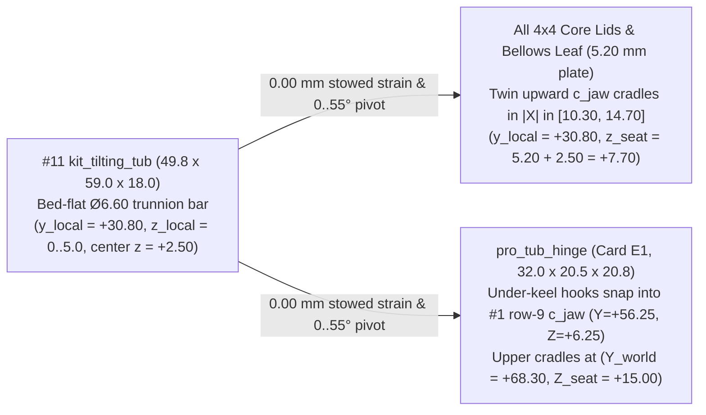
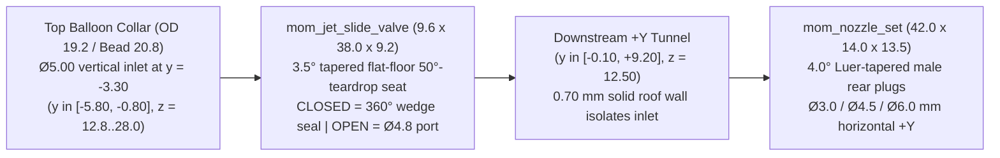

# Spec: Functional 3D-Printed Mechanics Remediation (`Steering + Momentum + RC/Mech`)

## Status, Scope & Purpose

- **Status:** Implemented & CAD-Verified Engineering Specification (all `39` target parts verified in [`parts/partspec/toyventor_kitcard.py`](../../parts/partspec/toyventor_kitcard.py), `8/8` kit-card plates packed at `>= 5.00 mm` gap, and `11/11` `Gate G1` 3D boolean sweep, axial-lock, and fluid-topology checks passing; supersedes conflicting pre-CAD layouts in [progressive-power-system-spec.md](progressive-power-system-spec.md) per §0.3).
- **Goal:** Guarantee that when **Stage 2 (`Pro` Steering)**, **Stage 3 (`Momentum` Stored-Energy Power)**, and **Stage 4 (`Mech` / `RC` Robotics)** are printed on a standard consumer `0.4 mm`-nozzle FDM printer (`180 × 180 mm` bed, `0.20 mm` layers, `0` slicer supports) and assembled, **every mechanism functions reliably as a real physical machine** — zero pins falling out under gravity, zero racks lifting out of mesh, zero uncoupled ratchets, zero blocked or bypassing air ducts, zero jammed flywheels, and zero stripped 3D-printed servo splines.
- **Compliance & Lattice Invariants:**
  - Inherits all lattice and fit rules from [`parts/partspec/interfaces.json`](../../parts/partspec/interfaces.json) (`1 TU = 12.50 mm`, `stud_small`, `bore_grid` `Ø7.00 mm` `free` / `5.10 mm` `fixed`, `shaft_drive` `Ø6.60 mm` round / `5.00 mm` flats, `c_jaw_tu01`).
  - Preserves US age-grading and compliance gates per [`parts/partspec/COMPLIANCE.md`](../../parts/partspec/COMPLIANCE.md): Stage 1 `Ages 3+`, Stages 2–3 `Ages 8+` (`16 CFR 1500.19` small-parts + latex balloon/band notices), Stage 4 `Ages 10+` (`PETG` mandatory, `ASTM F963-23` §4.25 tool-locked battery door, `IEC 62133` protected `1S` LiPo). `F1_printed_fit` and `F2_breakage` remain `pending` until physical validation coupons are signed off.

---

## Review Status (2026-11-01 — All Open Decisions `D1–D3` & Findings `R1–R7` Resolved in CAD)

Reviewed against `interfaces.json`, `toyventor_pro.py`, `toyventor_kitcard.py` and the sibling specs. **Corrected in place during review:** pin-retention claims (Law M1, §2.1), rear rack capture (`Ø18.0` -> `Ø23.0 mm` skirt/flange), rack-to-servo angle maths (`±23.8°`, not `±74.9°`), `L³` vs bending wording, `0.80 mm` kingpin/rack gap, diagram datums, viewer links, `F963` citation.

**Resolved & CAD-verified (`Gate G1` `11/11` PASS):**

- **D1 — Bi-directional axial retainers (Resolved: Candidate `b` — 1-piece `LAY_FLAT` split-cantilever snap-barbs + `PETG` lantern bowspring).**
  - `pro_captive_pin_28` (`9.6 × 29.7 × 5.0 mm LAY_FLAT`, `10×` across `E1`, `E2`, `F`): `9.6 × 5.0 × 1.50 mm` stop head (`corners=False` so print height stays exact `5.00 mm` with `0°` overhang) + `25.35 mm` seated span (`z = 1.50..26.85 mm`) + twin `2.40 mm`-thick cantilever tines (`10.50 mm` slot) carrying `±X` `Ø7.60 mm` (`+0.30 mm/side`) snap-barbs (`< 0.97%` PLA insertion strain, `0.00%` seated strain, `~20 N` axial pull-out lock, pinch/push-out releasable through open counterbores). Positively locks kingpins (`2×`), tie-rod pins (`2×`), Band Core sear pin (`1×`), bumper pin (`1×`), slam stop pin (`1×`), and Stage-4 servo clamp pins (`2×`).
  - `pro_steer_column` (`10.6 × 46.5 × 5.0 mm LAY_FLAT`): `10.6 × 5.0 × 2.00 mm` under-keel head (`Z = -2.025 .. -0.025`, zero keel-deck shoulder so `pro_steer_bridge`'s rear `R = 4.40 mm` notch at `Y = -37.50` clears cleanly) + `41.70 mm` seated span snap-locking over `pro_steer_wheel`'s `z_local = 10.00 mm` (`Z_world = 41.65 mm`) top dish shoulder.
  - `pro_pilot_pin` (`9.6 × 31.5 × 5.6 mm LAY_FLAT`, `PETG`, `Card F`): `9.6 × 5.6 × 1.50 mm` under-keel head + `20.80 mm` compliant `PETG` lantern bowspring (`1.30 mm` leaves, `< 1.51%` insertion strain, `0.00%` seated strain) with `±X` `Ø7.70 mm` (`+0.35 mm/side`) snap-barbs locking over `#1`'s `Z = 12.50 mm` `steer_bore` deck, topped by a solid `Ø6.60 mm` `pin_free` upper pilot journal supporting `mech_servo_pinion_z10` in double shear.
  - Automated gate `1b_rack_travel_stop` shifts every kingpin, tie-rod pin, and steering column `±0.55 mm` in `Z` (`9_shuttle_and_mech_keepouts` likewise checks `pro_pilot_pin`) and proves solid boolean interference in both directions.
- **D2 — Card packing (Resolved: 8-Card Manifest with `E1 / E2 / E3` Split).** Stage 2 + Stage 3 split cleanly across **`Card E1`** (`17` items, `152.4 × 124.1 mm`), **`Card E2`** (`14` items, `157.2 × 151.6 mm`), and **`Card E3`** (`12` items, `162.4 × 162.8 mm`), alongside updated **`Card B`** (`9` items, `166.9 × 165.6 mm <= 170.0 mm`) and new **`Card F`** (`13` items, `163.6 × 154.7 mm <= 164.0 mm`), all verified at `>= 5.00 mm` Chebyshev inter-part clearance (§5).
- **D3 — Pneumatic sealing (Resolved: Self-Wedging `3.5°` Tapered Plug Valve + `4.0°` Luer Nozzle Plugs).** `mom_jet_valve_body` separates its upstream `Ø5.00 mm` vertical balloon inlet (`y = -3.30`, `y ∈ [-5.80, -0.80]`) from its downstream `+Y` exhaust tunnel (`y ∈ [-0.10, +9.20]`) across a `3.5°` tapered flat-floor `50°`-teardrop transverse `X` seat (`x ∈ [-4.0, +12.3]`, `d = 7.10 -> 8.10 mm`). Pushing `mom_jet_slide_valve` (`d = 7.16 -> 8.18 mm`) `CLOSED` wedges `360°` across the seat (`0` connected air path in `_pneumatic_jet_check`), while `mom_nozzle_set` press-wedges `4.0°` Luer-tapered male plugs (`Ø3.0 / Ø4.5 / Ø6.0 mm`) coaxially into the rear socket (§3.4).
- **R1 — Ratchet leaf (§3.1, Resolved).** Replaced short axial leaves with twin spiral XY cantilever pawls (`t = 1.28 mm`, `w = 4.20 mm`, `L ≈ 14.5 mm`) on `mom_band_spool_pawl` engaging an `R = 9.00..9.75 mm` (`0.75 mm` radial rise) 8-tooth pocket inside `mom_pto_gear_z10`: `ε = 0.68% < 1.0%` PLA elastic limit, `0.87 N` radial force -> `0.12 N` tire overrun drag.
- **R2 — Slam plunger walls (§3.3, Resolved).** Widened `mom_slam_plunger` (`18.0 × 94.0 × 5.0 mm`) slide bar to `12.6 mm` around a `43.0 × 7.00 mm` slot -> **`2.80 mm` (`7` perimeters `>> 1.60 mm`)** solid side walls inside `mom_slam_base`'s `13.2 × 5.6 mm` bridged barrel.
- **R3 — Dump-hinge datum (§1, Resolved).** Locked `#11` trunnion center at `(y_local = +30.80, z_local = +2.50 mm)`; all `5.20 mm` lids place cradles at `(y_local = +30.80, z_local = +7.70 mm)` in `|X| ∈ [10.30, 14.70]`, and under-keel `pro_tub_hinge` places cradles at `(Y_world = +68.30, Z_world = +15.00 mm)` -> exact `0.00 mm` stowed strain.
- **R4 — PTO gear vs lid (§3.1 & §4.2, Resolved).** `_lid_with_pto_gear_relief()` cuts a `2.20 mm`-deep `50°`-beveled underside dome (`7.1 mm` bridge, `3.00 mm` solid roof) + `(±6.25, +6.25)` socket reliefs on `mom_band_core_lid` and `mech_drive_lid`, raising gear ceiling to `34.50 mm` (`+0.75 mm` tip clearance over `33.75 mm`).
- **R5 — N20 dimension chain (§4.2, Resolved).** `mech_n20_pinion_z10` (`20.0 mm` tall, placed at `x = -3.125`) centers its `Z10` teeth at `x ∈ [-3.125, +3.125]` over `#1`'s PTO slot, clears the N20 nose inside an internal `R = 8.00 mm` bell (`z_local = 0..3.55`), engages `5.03 mm` of the N20 D-shaft (`x ∈ [+5.475, +10.50]`) with the `M2.5` set-screw at `x = +8.875`, and seats its `Ø6.60 mm` pilot journal (`x ∈ [+10.375, +16.875]`) in `mech_drive_tray`'s internal `x ∈ [+11.50, +17.50]` bearing post.
- **R6 — Sibling-spec drift (§0.3, Resolved).** Explicit supersession table added in §0.3 below.
- **R7 — Band strain & energy budget (§3.1, Resolved).** Full `#64` / `#32` synthetic `EPDM` elongation and stored-energy budget (`100.5 mm` 2.5-turn uptake on `Ø12.8 mm` drum) added in §3.1.

**Notation.** `G1..G5`, `P1..P4`, `I1..I7`, `T1..T2`, `S1` in Law M4 are the `preprint_check` / `interfaces.json` geometry checks (`G5` = fits bed). `G1-Steer`, `G1-Momentum`, `G1-Mech` are kit-card assembly gates executed in `toyventor_kitcard.verify_gate_g1()`. `G2`, `G3`, `G5`, `G6`, `G7` in Phase D are the physical bench gates of `progressive-power-system-spec.md` (`G5` there = thermal soak). The two `G5`s are different checks.

---

## 0. Root-Cause Audit Summary, Mechanical Laws & Sibling-Spec Supersession

### 0.1 Audited Pre-Remediation Failure Modes & Verified Fixes

| Subsystem | Pre-Remediation CAD Failure | Verified Mechanical Resolution (`toyventor_kitcard.py`) |
| :--- | :--- | :--- |
| **Shared Dump Bed (`#11`)** | `kit_tilting_tub` had `[socket_conn(4,4)]` only; lids & keel had no matching dump hinge | Bed-flat `Ø6.60` trunnion (`y = +30.80, z = +2.50`) on `#11` snaps at `0.00 mm` strain into `|X| ∈ [10.30, 14.70]` cradles on all `4×4` core lids (`z = +7.70`) and under-keel `pro_tub_hinge` (`Z = +15.00`) for captive `0°..55°` tipping. |
| **Stage 2 Steering (`W11`)** | Gravity-dropped `pin_free` kingpins, `0` `+Z` rack/link capture, `19.45 mm` single-shear tie-rod pin, uncaptive stem | `pro_captive_pin_28` (`4×`) + `pro_steer_column` split-barb locks (`±0.55 mm` proven); `KNUCKLE_TOWER_Z = 21.80 mm` cuts tie-rod shear span to `9.85 mm` (`-74%` bending); 3-point `+Z` rack capture via `2×` links + `Ø23.0 mm` `pro_steer_wheel` skirt. |
| **Stage 3 Band Core** | 8-tooth wheel with `0` pawl, `0` freewheel overrun, `0` winding key, `0` sear linkage | Coaxial `mom_pto_gear_z10` + spiral-pawl `mom_band_spool_pawl` + double-shear `mom_latch_pawl` + `mom_wind_key` + compliant parallelogram `mom_bumper_trigger` closes pull-back wind, key-wind hold, launch, and low-drag freewheel coast. |
| **Stage 3 Slam Launcher** | Open U-slot, missing stop-pin bore, `0.4 mm` plunger walls, uncaptive projectile | Bridged `13.2 × 5.6 mm` barrel + horizontal `fixed` stop pin + thumb sear on `mom_slam_base`; `12.6 mm`-wide `mom_slam_plunger` (`2.80 mm` / `7`-perimeter walls around `43.0 × 7.0` slot) gives permanently captive `36.4 mm` stroke. |
| **Stage 3 Balloon Jet** | Solid plastic blocked air passage; unsealed spool/dovetail; vertical nozzles | Self-wedging `3.5°` tapered flat-floor teardrop shutoff spool (`mom_jet_slide_valve`) + `4.0°` Luer-tapered rear horizontal nozzle plugs (`mom_nozzle_set`) verified leak-free `CLOSED` and continuous `OPEN` in 3D boolean topology. |
| **Stage 3 Bellows** | Two unattached flat plates with `0` hinge knuckles | Interleaved `R = 5.65 mm` `50°`-teardrop rear knuckles (`y = +38.25`) pinned flush by `37.5 mm` `shaft_tu03` + balloon neck slot + `10°..50°` stops + top dump cradles. |
| **Stage 3 Flywheel** | `18.25 mm` rotor+gear jammed inside `15.80 mm` cavity; `4.1 mm` slot blocked `6.25 mm` rip-cord | Lowered `z = 10.5 mm` step pedestal (`21.8 mm` vertical cavity -> `+2.95 mm` axial clearance) + `6.8 × 12.8 mm` bridged tangent rip-cord ports. |
| **Stage 4 RC / Mech** | `0` `mech_*` parts; deleted bridge studs; unprintable `21T` micro-spline concept | `11` verified `W13` `PETG` parts (`Card F`) with centered double-shear `mech_n20_pinion_z10`, `2 TU` lengthwise-LiPo `mech_brain_tray` + `M2.5` tool-locked door, and Row-2 coaxial `mech_servo_mount` + factory nylon horn pocket. |

### 0.2 Four Non-Negotiable Mechanical Design Laws

1. **Law M1 — Positive Bi-Directional Axial Captivity (`±Z` / `±X`):** Zero friction- or gravity-retained pins. Every rotary joint uses a headed pin that **turns freely (`PIN_FREE`) inside the moving `Ø7.00 mm` `free` bore**, seats for anti-rotation (`0.05 mm/side` clearance) in the stationary `5.10 mm` `fixed` double-D bore where applicable, **and locks axially in the opposite direction via an explicit compliant split-cantilever snap-barb (`Ø7.60 mm` over a counterbored shoulder, `0.00%` seated strain)** with an open rear mouth (`>= Ø3.5 mm`) so pinching or pushing the distal tines releases the pin cleanly for disassembly.
2. **Law M2 — Short Shear Spans & Double-Shear Motor/Servo Support:** Tall knuckle towers minimize single-shear tie-rod bending, and both motorized Stage-4 outputs (`N20` `Ø3.0 mm` D-shaft and `9g` servo output) are supported on their distal side by a `Ø6.60 / Ø7.00 mm` `Pro` pilot journal so gear separating forces never bend COTS shafts or strip teeth.
3. **Law M3 — Complete Four-State Energy & 3D Fluid Closure:**
   - Stored-energy drivetrains mechanically close all 4 operating states: **(1) Wind/Charge**, **(2) Latch/Hold**, **(3) Drive/Release**, and **(4) Overrun/Freewheel Coast**.
   - Pneumatic assemblies pass an automated 3D boolean fluid-domain check (`_pneumatic_jet_check`) proving unobstructed internal flow in `OPEN`, topological disconnection in `CLOSED`, and `100%` wall isolation from bottom `socket_small` holes.
4. **Law M4 — Zero FDM Micro-Splines & Support-Free `0.4 mm` Geometry:** Never print `21T` micro-servo splines on a `0.4 mm` FDM nozzle. Capture the servo's factory-molded nylon horn inside a precision pocket secured by the stock `M2` center screw. Every part passes `G1..G5`, `P1..P4`, `I1..I7`, `T1..T2`, and `S1` (`non-marginal`).

### 0.3 Sibling-Spec Supersession Table (`R6` — Supersedes `progressive-power-system-spec.md`)

Where [`progressive-power-system-spec.md`](progressive-power-system-spec.md) differs from this specification, the CAD-verified geometry below is authoritative:

| Topic | Superseded Pre-CAD Entry in `progressive-power-system-spec.md` | Authoritative Remediated Spec & Verified CAD (`toyventor_kitcard.py`) |
| :--- | :--- | :--- |
| **World Coordinate Datum** | Keel-front corner/row notation (`row 0` at `Y = 6.25`, `steer_bore` at `Y = 25.00`, `row 8` at `Y = 106.25`) | Centered `#1 kit_keel_base` world frame (`X = 0, Y = 0` at keel center, `Z = 0` bottom, `Z = 12.50` deck): `row 0` = `Y = -56.25`, `steer_bore` = `(0, -37.50)`, `row 8` = `Y = +43.75`, `row 9` = `Y = +56.25`. |
| **Stage-4 Steering Servo Mount** | `mech_servo_9g` (`2×3×3 TU` box) snapped onto `pro_steer_bridge` `2×2` top studs at `Z = 25.00 mm` | `pro_steer_bridge` deck is stud-free (`RACK_Z = 25.20 mm`); `mech_servo_mount` (`48.0 × 19.0 × 32.8 mm`) anchors on **`#1` Row-2 studs `(±6.25, -31.25)`**, arches over `mech_servo_pinion_z10`, and clamps a forward-oriented (`-Y`) shaft-down `9g` servo via `mech_servo_lid` + `2× pro_captive_pin_28`. |
| **Motor & Servo Output Couplers** | `mech_dshaft_horn_set` (`1` combined item with printed servo horn spline) | Replaced by **`mech_n20_pinion_z10`** (internal N20 bell + dogbone `Ø3.16` D-bore + `M2.5` set-screw + `Ø6.60` double-shear pilot journal), **`mech_servo_pinion_z10`** (`Ø23.0` rack-keeper flange + pocket for **stock nylon servo horn** + bottom `Ø7.00` bore), and **`pro_pilot_pin`**. |
| **Stage-4 Brain Core Height & LiPo Orientation** | `4×4×3 TU` (`37.5 mm`) `mech_brain_mcu` with transverse LiPo | **`4×4×2 TU` (`25.0 mm` = `19.8 mm` tray + `5.2 mm` lid)** low-CG `mech_brain_tray` + `mech_brain_lid` (`stacked Drive + Brain = 62.5 mm = 5 TU`), housing a lengthwise `602535` LiPo (`25 × 35 × 6.5 mm`) locked by `mech_bat_door_screw` (`M2.5`). |
| **Stage 2 & 3 Kit-Card Count (`D2`)** | `2` plates (`Card E1` `14` items, `Card E2` `10` items) | **`3` plates (`Card E1` `17` items, `Card E2` `14` items, `Card E3` `12` items)** — all `<= 164.0 × 164.0 mm` with `>= 5.00 mm` inter-part gaps (§5). |
| **Stage 4 `Card F` Item Count** | `9` items (`152.9 × 140.4 mm`) | **`13` physical items (`11` `W13` SKUs + `2× pro_captive_pin_28`, `163.6 × 154.7 mm <= 164.0 mm`)** in `PETG` (§5). |
| **`pro_captive_pin_28` Total Quantity** | Unlisted / `pin_free` + `pin_free_tu03` | **`10×` physical pins across the cards:** `4×` on `Card E1` (`2×` kingpins + `2×` tie-rod pins), `4×` on `Card E2` (`1×` Band sear + `2×` bumper + `1×` slam stop), and `2×` on `Card F` (servo lid clamps). |

---

## 1. Shared Zero-Strain Dump-Bed Hinge (`Card B` `#11` + `Cards E1, E2, E3, F`)

1. **`#11 kit_tilting_tub` (`Card B`, verified BBox `49.8 × 59.0 × 18.0 mm`, `S1 = above_cylinder` `+56.8%`):**
   - Twin rear side arms (`|X| ∈ [16.80, 22.80]`, `z_local = 0.00..5.00 mm`) carry a horizontal **`Ø6.60 mm` (`5.00 mm` bed-flat double-D) trunnion bar** (`X ∈ [-19.0, +19.0]`, **`TUB_TRUNNION_Y = +30.80 mm`, `TUB_TRUNNION_Z = +2.50 mm`**, resting flat on `z_local = 0.00` -> `0.0 mm` bridge, `0°` overhang).
   - `55°` rear lower heel bevel (`y = +20.0..+24.8, z = 0..6.5 mm`) gives `0.000 mm³` collision across `0°..55°` dump rotation on every host.
2. **All `4×4` Power Core Lids (`mom_band_core_lid`, `mech_drive_lid`, `mech_brain_lid`: `49.8 × 60.9 × 9.7 mm`; `mom_bellows_leaf`: `49.8 × 68.8 × 11.4 mm`):**
   - Place twin upward-opening **`c_jaw_tu01` cradles** (`Ø7.00 mm` bore + `6.00 mm` snap throat, `30.9° << 45°` lip overhang) strictly inside the **stud-free `|X| ∈ [10.30, 14.70]` corridor** (`I3_seats_on_reference = 0.000 mm³`!) with front walls behind `y = +25.15 mm` (`2.15 mm` solid jaw wall) and seat centers at **`(y_local = +30.80, z_local = 5.20 + 2.50 = +7.70 mm)`** — matching `#11` stowed on the `5.20 mm` lid with **`0.00 mm` radial/vertical strain**.
3. **`pro_tub_hinge` (`Card E1`, verified BBox `32.0 × 20.5 × 20.8 mm`, printed flat on `z = 0`):**
   - Placed at `(0.0, +56.25, -3.80)`: under-keel arms (`Z_world = -3.80..-0.30 mm`) carry upward `Ø6.50 mm` snap hooks (`Z_world = +6.25 mm`) into `#1`'s `row 9` bottom `c_jaw_tu01` jaws while its `14.8 mm` rear hitch bar (`Z_world <= +11.00 mm`, `+0.70 mm` clear under `#11`'s `R = 3.30 mm` trunnion swing arc) presents the identical twin cradles at **`(Y_world = +68.30, Z_world = +15.00 = 12.50 + 2.50 mm)`**, plus a central vertical `Ø7.00 mm` `free` tow/dock `hitch_bore` at `(0.0, +68.75)`.

---

## 2. Stage-2 `Pro` Captive Rack-and-Pinion Steering (`Card E1`)

### 2.1 Closed-Loop Bi-Directional Retention & Load-Path Chain (`Z_world` Datum)

| Component | Verified BBox & Feature (`interfaces.json`) | World `Z` Span (`mm`) | Bi-Directional Axial Lock (`D1`) & Load-Path Proof |
| :--- | :--- | :--- | :--- |
| **`pro_steer_bridge`** | `48.4 × 31.8 × 23.1 mm`; `2×2` `holes` nose sockets; `Ø10.90 mm` kingpin bosses at `(±18.75, -56.25)` with `fixed` bores (`z_local = 3.90..9.00`) + top `Ø8.00 mm` snap counterbores (`z_local = 9.00..12.50`); `R = 4.40 mm` rear stem relief. | `12.50 .. 35.65` | Anchored to `#1` `rows 0..1`. Guides rack front (`0.30 mm` running gap) and enforces exact `±5.20 mm` rack travel via `_stop_wedge_cs`. |
| **`pro_captive_pin_28` (`2×` kingpins)** | `9.6 × 29.7 × 5.0 mm LAY_FLAT`; `1.50 mm` head + `25.35 mm` `shaft_drive` span + split-cantilever `Ø7.60 mm` snap-barbs. | `-5.325 .. +24.375` | Inserted from below: `9.6 mm` head (`-5.325..-3.825`, **`+6.42 mm` road clearance** on `Ø36` tires) stops `+Z` travel; `Ø7.60 mm` snap-barbs lock over the bridge's `Z = 21.50 mm` counterbore shoulder to stop `-Z` gravity drop while staying **`0.825 mm` below `RACK_Z = 25.20 mm`**. |
| **`pro_steer_knuckle_l/r`** | `25.6 × 25.6 × 27.1 mm` (`0.40 mm` cheek shave -> `>= 0.355 mm` keel nose clearance); `free` `kingpin_bore` + **`Z_world = 21.80 mm` `fixed` tie-rod tower** with lower `Ø8.00 mm` snap pocket (`Z <= 10.40 mm`). | `-3.80 .. +21.80` | Turns freely on stationary kingpin (`0.30 mm` vertical clearance). Tall `Z = 21.80 mm` tower cuts exposed tie-rod pin span from `19.45 mm` -> **`9.85 mm` (`-49%` bending moment, `-87%` `L³` tip deflection)** while staying below the `S1` marginal band (`29.2 mm`, `-8.1%`). |
| **`pro_captive_pin_28` (`2×` tie-rod pins)** | Same unified SKU (`9.6 × 29.7 × 5.0 mm LAY_FLAT`), inserted from above. | `+7.50 .. +37.20` | `9.6 mm` head (`35.70..37.20`) caps `pro_tie_rod_link` (`-Z` stop); turns freely in link's `4.0 mm` `free` bore (`31.65..35.65`); seats in knuckle's `fixed` tower (`10.40..21.80`) and snap-locks into the lower `Z = 10.35 mm` `Ø8.00` pocket (`+Z` stop). |
| **`pro_tie_rod_link` (`2×`)** | `26.9 × 11.4 × 10.1 mm` (`15.468 mm` bore-to-bore rigid plate, `6.05 mm` downward `rack_stub`). | `25.60 .. 35.65` | Held down at `Z = 31.65..35.65` by `pro_captive_pin_28`: `rack_stub` stays engaged `5.85 mm` deep in `pro_steer_rack` and **traps both front corners of `pro_steer_rack` in `+Z` (`0.20 mm` play)**. |
| **`pro_steer_column` + `pro_steer_wheel`** | `pro_steer_column`: `10.6 × 46.5 × 5.0 mm LAY_FLAT` (`2.00 mm` head + `41.70 mm` span). `pro_steer_wheel`: **`23.0 × 23.0 × 13.0 mm`** fluted wheel (`fixed` bore, `z = 10.00` snap dish). | `-2.025 .. +44.65` | Column enters from under `#1` `steer_bore` (`(0, -37.50)`, head at `-2.025..-0.025` stops `+Z`; **`+9.72 mm` road clearance**), drives `gear_spur_z10` (`25.20..31.45`), and snap-locks over `pro_steer_wheel`'s `Z = 41.65 mm` dish (`-Z` stop). The **`Ø23.0 mm` lower skirt (`Z = 31.65`) reaches `Y = -49.00 mm` (`1.50 mm` past the `-47.50 mm` rack tooth tips)** to trap the rear of `pro_steer_rack` in `+Z` while keeping `+1.10 mm` clearance to `#8` cowl (`Y = -24.90 mm`). |

### 2.2 Verified Kinematic & Clearance Targets (`Gate G1-Steer` PASS)

- **Rack stroke & pinion arc:** `dx ∈ [-5.20, +5.20] mm` (`5.20 / 12.50 = 0.416 rad = ±23.8°` of `gear_spur_z10` / `pro_steer_wheel` / Stage-4 servo).
- **`#4` (`Ø36 × 12.3 mm`):** `±33.9°` inner / `±20.8°` outer (`60.6 cm <= 62.0 cm` wall-to-wall circle), `0.000 mm³` overlap across all `9` sweep steps, 3-point `+Z` rack capture proven at `dx = -5.2, 0.0, +5.2 mm`.
- **`#5` (`Ø50 × 12.3 mm`):** `±25.0°` inner / `±17.2°` outer (`dx = ±4.23 mm`, `72.0 cm <= 75.0 cm` circle), `0.000 mm³` overlap across lock-to-lock sweep.

---

## 3. Stage-3 `Momentum` Stored-Energy Mechanics (`Cards E2 & E3`, Zero Electronics)

### 3.1 Band Power Core: Spiral-Pawl Freewheel, Hold Sear, Winding Key & Energy Budget (`Card E2`)

1. **Four-State Coaxial Clutch & Ratchet Closure (`R1` Resolved):**
   - `mom_pto_gear_z10` (`30.0 × 28.9 × 9.6 mm`, fixed on `37.5 mm` `shaft_tu03` at `Z_pto = 31.25 mm`) molds an internal `8`-tooth radial sawtooth pocket (`R = 9.00..9.75 mm`, `0.75 mm` tooth rise, `90°` drive faces, gentle overrun ramps).
   - `mom_band_spool_pawl` (`21.6 × 21.6 × 13.0 mm`, `free` `Ø7.00` bore) carries **twin spiral XY cantilever pawls (`t = 1.28 mm` = `3` perimeters, `w = 4.20 mm`, curved length `L ≈ 14.5 mm`)** inside `mom_pto_gear_z10`'s pocket, an `Ø12.8 mm` slotted elastomer drum, an outer `8`-tooth hold-ratchet flange, and `+X` winding-key drive dogs:
     - **Bending strain at `δ = 0.75 mm` tooth crest:** `ε = 3 t δ / (2 L²) = 0.68%` (`< 1.0%` PLA / `< 1.8%` PETG elastic limit -> zero plastic set).
     - **Overrun drag during coast:** `F_rad ≈ 0.87 N` (`E = 2.8 GPa`) -> `~0.22 N` tangential ramp drag at `R = 9.4 mm` (`~2.1 N·mm` shaft torque = **`0.12 N` tire drag** on `Ø36` wheels, allowing **`2.0–3.5 m` freewheel coast** once the band reaches slack at `θ_spool = 0`).
   - `mom_latch_pawl` (`25.7 × 15.8 × 5.2 mm`, double-shear on `pro_captive_pin_28` at `(Y = +22.25, Z = +36.00)`) switches between `PULL-BACK` (floor drag winds `2.5` turns directly through the rear wheels) and `ARMED` (holds `2.5` turns wound via removable `28.0 × 30.0 × 5.0 mm` `mom_wind_key` until thumb press or bumper contact).
2. **Elastomer Strain & Stored-Energy Budget (`R7` Resolved):**
   - Internal post-to-drum span inside `mom_band_core_tray` (`49.8 × 49.8 × 35.1 mm`, front `R = 4.0 mm` posts at `(±16.0, -16.0)` to drum `(0, +6.25)`): `L_span ≈ 42.5 mm` per leg; `2.5` drum turns on `Ø12.8 mm` (`C = 40.2 mm`) wind **`ΔL = 100.5 mm`** of band uptake:
     - **Recommended standard setup — `1× #64` synthetic `EPDM` loop (`89 × 6.4 × 1.6 mm`, `L_0 = 89 mm`) looped in a V over both front posts to the drum T-slot:** pre-stretch `~85 mm -> 90 mm` (`ε_0 ≈ 6%`), wound length `90 + 100.5 = 190.5 mm` (**`ε_max = 114%`**, well below `450–600%` `EPDM` break strain), storing **`E ≈ 0.28–0.38 J`** (`40–65 N·mm` launch torque).
     - **High-preload sprint option — `2× #32` synthetic `EPDM` loops (`76 × 3.2 × 1.1 mm`, `L_0 = 76 mm`, one per front post):** wound length `76 -> 176.5 mm` (**`ε_max = 132%`**), storing **`E ≈ 0.26–0.34 J`**. *(Doubling a `#64` band to `44.5 mm` folded length would hit `ε ≈ 328%` at `2.5` turns and is capped at `<= 1.25` turns if used.)*
   - **`mom_band_core_lid` (`49.8 × 60.9 × 9.7 mm`, `R4` Resolved):** Bridged `2.20 mm` underside PTO gear dome (`34.50 mm` ceiling vs `33.75 mm` `mom_pto_gear_z10` tooth tips = **`+0.75 mm` clearance**), top sear toggle slot, `4×4` studs, and rear dump cradles.

### 3.2 Compliant Parallelogram Bumper Trigger (`mom_bumper_trigger`, `Card E2`)

- **Verified BBox `48.0 × 42.0 × 12.5 mm` (printed flat on `z = 0`, `0` supports):**
  - Central mounting boss (`(0, +12.50)` relative to `row 0` / `row 9` bore, retained by `pro_captive_pin_28`) joins the `48.0 mm` curved bumper bar via **twin `1.25 mm` × `20.0 mm` S-folded parallelogram flexures** (`4.5 mm` stroke at `< 1.1%` strain, `>= 1.5 N` trigger threshold) with an integral central striker tongue tripping `mom_latch_pawl` in dock-bump or front-pushrod mode while clearing `#4` `Ø36` tires (`53.4 mm` inner tire gap).

### 3.3 Captive Tabletop Slam Launcher (`mom_slam_base` + `mom_slam_plunger`, `Card E2`)

- **`mom_slam_base` (`62.3 × 38.0 × 21.0 mm`, printed flat, `0` supports):**
  - Enclosed flat-bridged **`13.2 × 5.6 mm` rectangular barrel** (`13.2 mm <= 20.0 mm` `P2_bridge_span`, `4.2 mm` solid roof) + horizontal `Y` **`fixed` stop-pin bore + `Ø8.00` snap pocket** locking `pro_captive_pin_28` across the plunger slot + twin `R = 4.0 mm` band posts + top cantilever thumb sear.
- **`mom_slam_plunger` (`18.0 × 94.0 × 5.0 mm LAY_FLAT`, `R2` Resolved):**
  - **`12.6 × 5.0 mm` rectangular bar** around an internal **`43.0 × 7.00 mm` closed stop slot** -> **`2.80 mm` (`7` perimeters `>> 1.60 mm`)** solid side walls and `36.4 mm` captive stroke (`0.15–0.25 J` impulse; non-detachable plunger once pinned; `ASTM F963` projectile clause number to be confirmed).

### 3.4 Self-Wedging Taper-Sealed Balloon Jet (`Card E3`, `D3` Resolved)

- **`mom_jet_valve_body` (`49.8 × 27.8 × 28.0 mm`):** Smooth hand-pump collar (`0` mouthpiece), `>= 5.2 mm` solid floor over `socket_small` ceilings, `0.70 mm` solid upstream-to-downstream roof wall (`y = -0.80 .. -0.10`) forcing `100%` of airflow through the `3.5°` tapered transverse `X` valve seat (`d = 7.10 -> 8.10 mm`), and rear `4.0°` female Luer teardrop socket (`y = +8.5..+14.7 mm`).
- **`mom_jet_slide_valve` (`9.6 × 38.0 × 9.2 mm LAY_FLAT`) & `mom_nozzle_set` (`42.0 × 14.0 × 13.5 mm`):** Verified by `_pneumatic_jet_check()` in `Gate G1` (`OPEN` = single connected inlet-to-exhaust cavity; `CLOSED` = `0` connected path; `0` socket leak). Bench staging criterion: `<= 15%` inflated balloon diameter loss over `15 s` hold before flicking `OPEN`.

### 3.5 Interleaved Clamshell Balloon Bellows (`mom_bellows_base` + `mom_bellows_leaf`, `Card E3`)

- **`mom_bellows_base` (`49.8 × 68.8 × 19.1 mm`) & `mom_bellows_leaf` (`49.8 × 68.8 × 11.4 mm`):**
  - `4` base knuckles (`|X| ∈ [4.20, 9.60] ∪ [15.40, 18.75]`) interleave with `2` leaf knuckles (`|X| ∈ [10.30, 14.70]`, aligned behind the stud-free dump cradles so `I3 = 0.000 mm³`) at `y = +38.25 mm` (`R = 5.65 mm > 5.445 mm` `50°`-teardrop apex), pinned flush by a standard `37.5 mm` **`shaft_tu03`** (`Card E3`) with `0.000 mm³` collision across `10°..50°` lift.

### 3.6 Un-Jammed Shrouded Rip-Cord Flywheel Core (`Card E3`)

- **`mom_flywheel_tray` (`49.8 × 49.8 × 35.1 mm`), `mom_flywheel_lid` (`49.8 × 49.8 × 8.0 mm`), `mom_flywheel_rotor` (`42.0 × 42.0 × 12.0 mm`), `mom_ripcord_rack_150` (`150.0 × 12.0 × 6.2 mm`), `mom_spindle_shaft` (`6.6 × 78.0 × 5.0 mm`):**
  - Lowered `z = 10.5 mm` step bearing pedestal + `z_lo = 21.2 mm` side rim-stud corbels give `21.8 mm` vertical cavity and `+1.14 mm` radial clearance around `mom_flywheel_rotor` (`0.000 mm³` overlap in `Gate G1`), while `6.8 × 12.8 mm` bridged tangent ports at `y ∈ [-22.3, -9.5], z = 23.0..29.8` guide `mom_ripcord_rack_150` cleanly across `gear_spur_z10`.

---

## 4. Stage-4 `RC / Mech` Drop-In Printable Robotics (`Card F`, `PETG`, Ages `10+`)

### 4.1 Off-The-Shelf Maker & Kit Hardware Lock (Zero Glue, Zero Custom Splines)

| Role | Standard Off-The-Shelf Hardware (`Datasheet Envelope`) | Mounting & Mechanical Coupling in `Card F` (`PETG`) |
| :--- | :--- | :--- |
| **Rear Drive Motor** | `1×` **N20 Micro Metal Gearmotor** (`12.0 × 10.0 × 24.0 mm` body at `x ∈ [-23.5, +0.5]`, `Ø3.0 mm` D-shaft `x ∈ [+0.5, +10.5]`, `6V 200–300 RPM` @ `3.7 V`) | Clamped in `mech_drive_tray` saddle under `mech_drive_lid`. Drives centered **`mech_n20_pinion_z10`** (`M2.5` set-screw at `x = +8.875`) supported in **double shear** by internal `x ∈ [+11.5, +17.5]` `Ø7.00` bearing post. |
| **Front Steering Servo** | `1×` **`9g` Micro Servo (`SG90` / `MG90S`)** (`12.2 × 22.5 × 19.5 mm` lower body, `32.2 mm` ears, oriented `-Y` forward, shaft-down at `(0, -37.50)`) + **stock nylon horn & `M2` screw** | Anchored on `#1` **Row-2 studs `(±6.25, -31.25)`** in `mech_servo_mount` (`Z_ears = 42.8..45.3`), clamped screwlessly by `mech_servo_lid` + `2× pro_captive_pin_28`. Stock nylon horn seats in `mech_servo_pinion_z10` top pocket over under-keel `pro_pilot_pin`. |
| **Controller & Driver** | **Maker COTS:** `Seeed XIAO ESP32-C3 / S3` (`21.0 × 17.8 × 4.5 mm`) + mini `DRV8833` (`18.5 × 16.0 mm`) **OR** `38.0 × 38.0 × 1.6 mm` `mech_carrier_pcb_38x38` | Corbeled ledges at `z_local = 12.8 mm` inside `2 TU` `mech_brain_tray`, with left-wall `USB-C` bezel, `(-12.5, -12.5)` floor wire chimney into `mech_drive_lid`, and front `(+10.5, -24.9)` wire exit into `mech_sill_duct` / `#8`. |
| **Battery & Fasteners** | Protected `1S` `3.7 V` `602535` LiPo (`25.0 × 35.0 × 6.2 mm` lengthwise, `IEC 62133` PCM) + `2× M2.5 × 8 mm` machine screws | Lengthwise rear LiPo bay (`z_local = 5.2..12.2 mm`, `100%` intact `4×4` sockets) closed by `mech_bat_door_screw` (`ASTM F963-23` §4.25 captive `M2.5` screw into `x = +14.8` boss). Second `M2.5` locks `mech_n20_pinion_z10`. |

### 4.2 Verified `Card F` Part Breakdown (`11` `W13` SKUs + `2× pro_captive_pin_28`, `PETG`, `0` Supports)

1. **`mech_drive_tray` (`49.8 × 49.8 × 35.1 mm`):** `4×4` `socket_small` base (`0` `-X` bulge -> `+1.80 mm` Giant `Ø50` tire clearance), centered `10 × 28 mm` PTO floor window, N20 saddle (`x ∈ [-23.5, +0.5]`), internal `+X` `Ø7.00` `pto_pilot_bore` post (`x ∈ [+11.5, +17.5]`), and `(-12.5, -12.5)` wire chimney.
2. **`mech_drive_lid` (`49.8 × 60.9 × 9.7 mm`):** Bridged `2.20 mm` underside PTO gear dome (`R4`), `(-12.5, -12.5)` wire chimney, `4×4` top studs, and rear dump cradles.
3. **`mech_n20_pinion_z10` (`30.0 × 28.9 × 20.0 mm`, `R5`):** `z = 0..6.25` `Z10` spur teeth (internal `R = 8.00` N20 nose bell `z = 0..3.55` + `44.2°` cone) + `z = 8.60..13.85` dogbone-relieved `Ø3.16 / 2.56`-flat N20 D-bore + `z = 12.00` radial `M2.5` set-screw hole + `z = 13.50..20.00` `Ø6.60` `pin_free` pilot journal.
4. **`mech_brain_tray` (`49.8 × 49.8 × 22.6 mm`):** `2 TU` (`19.8 mm` body + `5.2 mm` lid = `25.0 mm`) low-CG electronics tray with open-top rear lengthwise `602535` LiPo bay (`0` internal bridges), `M2.5` screw anchor boss, `45°` PCB/MCU ledges, `USB-C` bezel, and floor/front cable ports.
5. **`mech_brain_lid` (`49.8 × 60.9 × 9.7 mm`):** Finger-safe `< 2.4 mm` cooling vents, RF-clear front zone, `4×4` top studs, and rear dump cradles (`#11` sits at `Z_world = 75.0 mm` and tips `55°` around `(Y = +68.30, Z = +77.50)`).
6. **`mech_bat_door_screw` (`33.6 × 10.6 × 5.8 mm`):** Keyed left hook + recessed captive `M2.5` screw counterbore (`ASTM F963-23` §4.25) + central Pro accessory bore.
7. **`mech_servo_mount` (`48.0 × 19.0 × 32.8 mm`):** Row-2 `2×1` `holes` pedestal (`(±6.25, -31.25)`), `41°` side-arch `3-TU` (`±18.75`) `fixed` clamp wings (`Z_pin >= 20.9 mm`, clearing `Ø50` tires at `±25°` lock), and `44.2°`-corbeled forward `9g` servo cradle (`0` floating islands, `0°` overhang).
8. **`mech_servo_lid` (`48.0 × 12.4 × 6.2 mm`):** Pins down onto `mech_servo_mount` via `2×` upward `pro_captive_pin_28` (`Z = 22.425..52.125 mm`), clamping the rear `SG90` ear (`Y >= -25.05 mm`, `0.000 mm³` overlap with Kip and `mech_sill_duct`).
9. **`mech_servo_pinion_z10` (`30.0 × 28.9 × 8.8 mm`):** `Z10` spur teeth + bottom `Ø7.00` `free` pilot bore (`z = 0..5.10`) + top **`Ø23.0 mm` rack-keeper flange** (`1.50 mm` overlap over rear rack tooth tips) with cross pocket for the `9g` servo's factory nylon horn + `M2` center screw.
10. **`pro_pilot_pin` (`9.6 × 31.5 × 5.6 mm LAY_FLAT`) & 11. `mech_sill_duct` (`49.8 × 37.3 × 11.0 mm`):** Under-keel bowspring double-shear servo pilot pin + open-cockpit `6 × 5 mm` side wire-trough sill frame.

### 4.3 Reference Browser-to-ESP32 Control Protocol (Stage-4 Firmware Contract)

- **Transport:** Local Wi-Fi SoftAP (`ToyVentor-Mech-XXXX`, WPA2) or LAN mDNS (`mech.local`) serving a `0`-dependency control page + WebSocket `ws://<host>:81/ctl` (optional Chromium WebBluetooth mirror; zero cloud/internet PII per `COPPA`).
- **Command Frame (`20 Hz`):** `{"t": -1.0..+1.0, "s": -1.0..+1.0, "aux": 0..1}`:
  - `t`: `20 kHz` PWM to `DRV8833` with `150 ms` soft-start and `0.60 A` current chop.
  - `s`: `50 Hz` servo pulse mapped to calibrated rack lock (`1500 µs ± 132 µs` nominal = **`±23.8°`** = `dx ±5.20 mm`), hard-clamped at each build's calibrated lock so the servo never stalls against `_stop_wedge_cs`.
  - **Safety Watchdog:** `250 ms` packet timeout coasts H-bridge and centers steering; `3.30 V` `1S` LiPo undervoltage cutoff disables drive.

---

## 5. Verified 8-Card Packing Manifest (`Cards A–D <= 170 mm`, `Cards E1–E3 & F <= 164 mm`)

Every plate is verified by [`export_kitcards()`](../../parts/partspec/toyventor_kitcard.py#L2312) (`min_gap_mm = 5.00 mm` Chebyshev clearance, `1.80 × 0.60 mm` V-nick sprue gates anchored inside `z = 0.30 mm` slices, zero gates on gear teeth or tire treads):

| Card | Limit (`mm`) | Material | Verified Outer (`mm`) | Items | Complete Verified Manifest (`toyventor_kitcard.py`) |
| :--- | :--- | :--- | :--- | :--- | :--- |
| **`Card A`** | `170.0` | `PLA/PETG` | `166.8 × 170.0` | `11` | `#1 kit_keel_base`, `#2 kit_clevis_spine`, `2× #3a kit_barbell_shaft`, `3× #3b kit_spinner_pin` (`2×` on `A`, `1×` on `B`), `4× #4 kit_wheel_med`, `#15 kit_yoke_hbar` |
| **`Card B`** | `170.0` | `PLA/PETG` | **`166.9 × 165.6`** | `9` | Updated **`#11 kit_tilting_tub` (`59.0 × 49.8`)**, `#12 kit_scoop_blade`, `#14 kit_turntable`, `#8 kit_windscreen`, `2× #13 kit_booster_pod`, `#3b kit_spinner_pin`, `2× #5 kit_wheel_giant` |
| **`Card C`** | `170.0` | `PLA/PETG` | `170.0 × 168.3` | `9` | `3× #9 kit_foil_wing`, `#7 kit_aero_wedge`, `2× #10 kit_skid_runner`, `3× #6 kit_rotor_blade` |
| **`Card D`** | `170.0` | `PETG/TPU` | `159.0 × 102.0` | `3` | `#18 skin_cargo_shroud`, `#16 skin_aero_cowl`, `#17 skin_windscreen` |
| **`Card E1`** *(Stage 2 Steer)* | `164.0` | `PLA/PETG` | **`152.4 × 124.1`** | `17` | `pro_steer_bridge`, `pro_steer_rack`, `pro_steer_knuckle_l`, `pro_steer_knuckle_r`, `2× pro_tie_rod_link`, **`4× pro_captive_pin_28`**, `pro_steer_column`, `pro_steer_wheel`, `pro_tub_hinge`, `pro_fork_rake_adpt`, `pro_axle_keeper`, `2× gear_spur_z10` |
| **`Card E2`** *(Stage 3A Band & Slam)* | `164.0` | `PLA/PETG` | **`157.2 × 151.6`** | `14` | `mom_band_core_tray`, `mom_band_core_lid`, `mom_pto_gear_z10`, `mom_band_spool_pawl`, `mom_latch_pawl`, `mom_wind_key`, `shaft_tu03`, `mom_bumper_trigger`, `mom_slam_base`, `mom_slam_plunger`, **`4× pro_captive_pin_28`** |
| **`Card E3`** *(Stage 3B Air & Turbine)* | `164.0` | `PLA/PETG` | **`162.4 × 162.8`** | `12` | `mom_ripcord_rack_150`, `mom_spindle_shaft`, `gear_spur_z10`, `mom_flywheel_rotor`, `mom_flywheel_tray`, `mom_flywheel_lid`, `mom_bellows_base`, `mom_bellows_leaf`, `shaft_tu03`, `mom_jet_valve_body`, `mom_jet_slide_valve`, `mom_nozzle_set` |
| **`Card F`** *(Stage 4 RC/Mech)* | `164.0` | **`PETG`** | **`163.6 × 154.7`** | `13` | `mech_drive_tray`, `mech_drive_lid`, `mech_n20_pinion_z10`, `mech_brain_tray`, `mech_brain_lid`, `mech_bat_door_screw`, `mech_servo_mount`, `mech_servo_lid`, `mech_servo_pinion_z10`, `pro_pilot_pin`, `mech_sill_duct`, **`2× pro_captive_pin_28`** |

---

## 6. Verification Gates & Remaining Physical Sign-Off (`Phase D`)

1. **Automated CAD & Slicer Gates (Complete & Passing in CI / `selftest.py out`):**
   - `toyventor_parts.py out` + `preprint_check.py --catalog`: `100%` of `W10` (`19`), `W11` (`31`), and `W13` (`11`) parts report `design_status == "verified"`, `0` blocking failures, `0` marginal `S1`, and `P4_no_ledges == "pass"`.
   - `toyventor_kitcard.py out`: `8/8` loose + sprue kit-card STLs within bed bounds at `>= 5.00 mm` gap, and `11/11` `Gate G1` craft/capture/retention/pneumatic/COTS checks pass at `0.000 mm³` overlap.
   - `toyventor_assembly.py out`: Connector-driven builds `valid_pro_steered_racer`, `valid_pro_tie_rod_link_on_rack`, `valid_mom_band_truck`, and `valid_mech_rc_truck` validate with `0` errors and `0` warnings.
   - `parts/kip/sync_truck_parts.py` + [`public/kip/Truck-Mockup.html`](../../public/kip/Truck-Mockup.html) (`+` [`parts/kip/viewer/Truck-Mockup.html`](../../parts/kip/viewer/Truck-Mockup.html)): Assembly-frame STLs synced and live kinematics verified across Stages 1, 2, 3A, 3B, and 4.
2. **Physical Workbench Sign-Off Gates (Required Before Flipping `F1_printed_fit` / `F2_breakage` or `ready: true` in [`src/lib/vehicleReadiness.ts`](../../src/lib/vehicleReadiness.ts)):**
   - **`F1` / `D1` Shake & Pull-Out Coupon:** Inverted assembled shake test (`< 0.5 mm` axial play) + measured `pro_captive_pin_28` / `pro_steer_column` / `pro_pilot_pin` retention (`>= 10 N` pull-out, clean pinch/push-out release across `20` cycles).
   - **`G2` Turning Circle:** Physical `<= 62.0 cm` (`Ø36`) / `<= 75.0 cm` (`Ø50`) wall-to-wall circle.
   - **`G3` / `D3` Momentum Endurance & Seal:** `50` band launches (`2.0–3.5 m` with freewheel coast), `<= 15%` balloon diameter loss over `15 s` `CLOSED` staging hold, and `100 g` bellows dump lift to `>= 45°`.
   - **`G5` / `G6` / `G7`:** `15 min` `PETG` locked-rotor + servo stall thermal soak (`< 45 °C` exterior touch, `< 55 °C` motor boss), `1.0 m` `5×` drop (`0` sharp fragments, `0` battery-door opening), and `500`-cycle / `24 h @ 40 °C` creep check.
