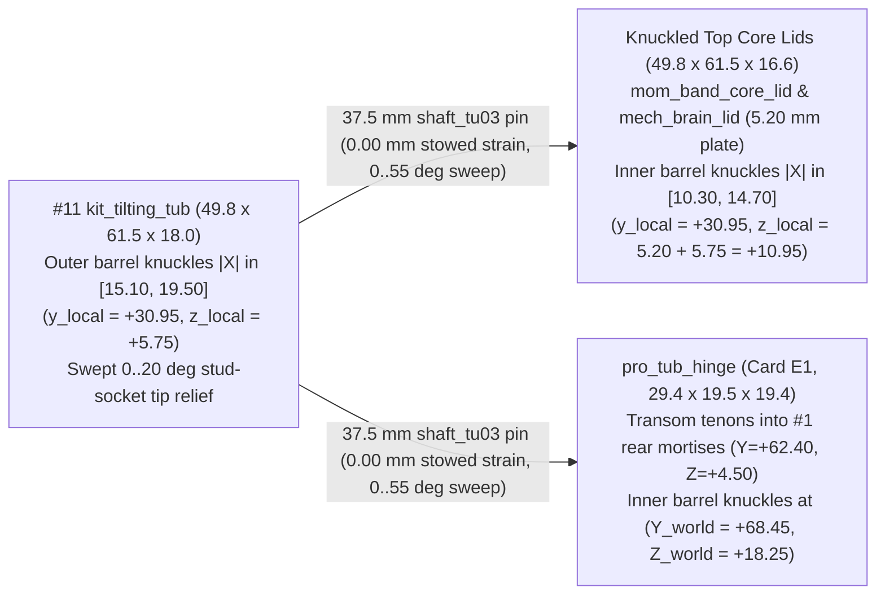
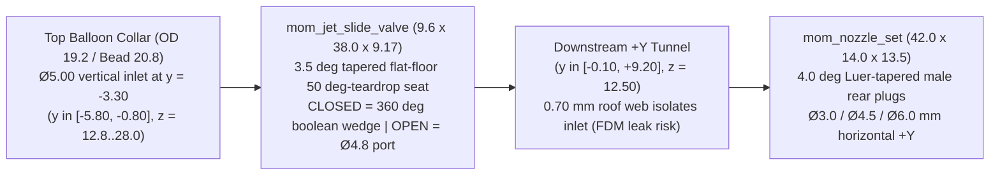

# Spec: Functional 3D-Printed Mechanics Remediation (`Steering + Momentum + RC/Mech`)

## Status, Scope & Purpose

- **Status:** Shipped CAD Engineering Baseline (`W10 = 19`, `W11 = 30`, and `W13 = 11` parts verified in [`parts/partspec/toyventor_kitcard.py`](../../parts/partspec/toyventor_kitcard.py) and [`parts/partspec/catalog.json`](../../parts/partspec/catalog.json), `8/8` kit-card plates packed at `>= 5.00 mm` Chebyshev gap, and **`12/12` `Gate G1`** 3D boolean sweep, axial-lock, barrel-tip, and fluid-topology checks passing; supersedes conflicting pre-CAD geometry and card manifests in [progressive-power-system-spec.md](progressive-power-system-spec.md) per §0.3 while inheriting all un-superseded physics and electrical safety rules).
- **Engineering Target & Current Limitations:** Define the mechanical architecture so **Stage 2 (`Pro` Steering)**, **Stage 3 (`Momentum` Stored-Energy Power)**, and **Stage 4 (`Mech` / `RC` Robotics)** print on a standard consumer `0.4 mm`-nozzle FDM printer (`180 × 180 mm` bed, `0.20 mm` layers, `0` slicer supports) without gravity-dropped pins, unretained racks, jammed flywheels, or printed micro-servo splines. **Honest verification posture:**
  1. Physical workbench gates (`F1_printed_fit`, `F2_breakage`, FDM layer-line pneumatic pressure hold across the `0.70 mm` jet web, and printer-to-printer tolerance on Law M1's `0.05 mm/side` double-D fit) remain **`pending` physical coupon sign-off (§6.2)**; and
  2. **Open Stage-3A Band Core CAD defects (`2026-11-02` audit):** Static `Gate G1` (`12/12` PASS) did not catch kinematic direction or insertion sweeps on the Band Core (§3.1–§3.2) — shipped CAD currently has a **chirally reversed one-way clutch**, non-insertable/non-rotatable `mom_wind_key` twin prongs, unplaced `mom_latch_pawl`, an unbridged `45 mm` bumper-to-tray pushrod gap, and `1.1 mm` `+Z` `shaft_tu03` saddle lift. Those defects and the proposed `Snap -> Motion -> Pro` stage-ladder update are tracked in [`motion-stage-options-spec.md`](motion-stage-options-spec.md).
- **Compliance & Lattice Invariants:**
  - Inherits all lattice and fit rules from [`parts/partspec/interfaces.json`](../../parts/partspec/interfaces.json) (`1 TU = 12.50 mm`, `stud_small`, `bore_grid` `Ø7.00 mm` `free` / `5.10 mm` `fixed`, `shaft_drive` `Ø6.60 mm` round / `5.00 mm` flats; open `c_jaw_tu01` claws on `#1` axles and dump hinges are superseded by closed `360°` `free` bores and barrel knuckles).
  - Preserves US age-grading and compliance gates per [`parts/partspec/COMPLIANCE.md`](../../parts/partspec/COMPLIANCE.md): Stage 1 `Ages 3+`, Stages 2–3 `Ages 8+` ([`interfaces.json:495`](../../parts/partspec/interfaces.json#L495) `pro_min_age = 8`, `16 CFR 1500.19` small-parts + latex balloon/band notices), Stage 4 `Ages 10+` (`PETG` mandatory, `ASTM F963-23` §4.25 tool-locked battery door, `IEC 62133` protected `1S` LiPo, inherited electrical/PPTC/RF rules from `progressive` §4.1). `F1_printed_fit` and `F2_breakage` remain `pending` until physical validation coupons are signed off.

---

## Review Status (Updated 2026-11-02 — Synced to Shipped CAD; Stage-3A Band Core Flagged)

Reviewed against [`interfaces.json`](../../parts/partspec/interfaces.json), [`toyventor_pro.py`](../../parts/partspec/toyventor_pro.py), [`toyventor_kitcard.py`](../../parts/partspec/toyventor_kitcard.py), [`catalog.json`](../../parts/partspec/catalog.json), [`COMPLIANCE.md`](../../parts/partspec/COMPLIANCE.md), and sibling specs.

**Shipped CAD Baseline (`Gate G1` `12/12` PASS; see §3.1 warning for open Band Core kinematic fixes):**

- **D1 — Bi-directional axial retainers (Resolved: Candidate `b` — 1-piece `LAY_FLAT` split-cantilever snap-barbs + `PETG` lantern bowspring).**
  - `pro_captive_pin_28` (`9.6 × 29.7 × 5.0 mm LAY_FLAT`, `10×` across `E1`, `E2`, `F`): `9.6 × 5.0 × 1.50 mm` stop head (`corners=False` so print height stays exact `5.00 mm` with `0°` overhang) + `25.35 mm` seated span (`z_local = 1.50..26.85 mm`) + twin `2.40 mm`-thick cantilever tines (`10.50 mm` slot) carrying `±X` `Ø7.60 mm` (`+0.30 mm/side`) snap-barbs (`< 0.97%` PLA insertion strain, `0.00%` seated strain; **`~20 N` analytical pull-out vs `>= 10 N` Phase D bench pass threshold** providing a `2×` margin for FDM layer anisotropy across `20` pinch/push-out release cycles). Positively locks kingpins (`2×`), tie-rod pins (`2×`), Band Core sear pin (`1×`), bumper mount pin (`1×`), slam stop pin (`1×`), Stage-4 servo clamp pins (`2×`), plus `1×` spare on `Card E2`.
  - `pro_steer_column` (`10.6 × 46.55 × 5.0 mm LAY_FLAT`): `10.6 × 5.0 × 2.00 mm` under-keel head (`Z_world = -2.025 .. -0.025`, zero keel-deck shoulder so `pro_steer_bridge`'s rear `R = 4.40 mm` notch at `Y_world = -37.50` clears cleanly) + `41.70 mm` seated span snap-locking over `pro_steer_wheel`'s `z_local = 10.00 mm` (`Z_world = 41.65 mm`) top dish shoulder.
  - `pro_pilot_pin` (`9.6 × 31.5 × 5.6 mm LAY_FLAT`, `PETG`, `Card F`): `9.6 × 5.6 × 1.50 mm` under-keel head + `20.80 mm` compliant `PETG` lantern bowspring (`1.30 mm` leaves, `< 1.51%` insertion strain, `0.00%` seated strain) with `±X` `Ø7.70 mm` (`+0.35 mm/side`) snap-barbs locking over `#1`'s `Z_world = 12.50 mm` `steer_bore` deck, topped by a solid `Ø6.60 mm` `pin_free` upper pilot journal supporting `mech_servo_pinion_z10` in double shear.
  - Automated gate `1b_rack_travel_stop` shifts every kingpin, tie-rod pin, and steering column `±0.55 mm` in `Z_world` (`9_shuttle_and_mech_keepouts` likewise checks `pro_pilot_pin`) and proves solid boolean interference in both directions.
- **D2 — Card packing (Resolved: 8-Card Manifest with `E1 / E2 / E3` Split).** Stage 2 + Stage 3 split across **`Card E1`** (`17` items, `152.4 × 124.1 mm`), **`Card E2`** (`14` items, `157.2 × 152.1 mm`), and **`Card E3`** (`12` items, `162.4 × 162.8 mm`), alongside updated **`Card B`** (`9` items, `169.4 × 165.6 mm <= 170.0 mm`) and **`Card F`** (`14` items, `163.6 × 154.3 mm <= 164.0 mm`), all verified at `>= 5.00 mm` Chebyshev inter-part clearance (§5).
- **D3 — Pneumatic geometry (Resolved in CAD: Self-Wedging `3.5°` Tapered Plug Valve + `4.0°` Luer Nozzle Plugs; FDM seal pending bench hold).** `mom_jet_valve_body` separates its upstream `Ø5.00 mm` vertical balloon inlet (`y = -3.30`, `y ∈ [-5.80, -0.80]`) from its downstream `+Y` exhaust tunnel (`y ∈ [-0.10, +9.20]`) across a `3.5°` tapered flat-floor `50°`-teardrop transverse `X` seat (`x ∈ [-4.0, +12.3]`, `d = 7.10 -> 8.10 mm`). Pushing `mom_jet_slide_valve` (`d = 7.16 -> 8.18 mm`) `CLOSED` wedges `360°` across the seat (`0` connected boolean air path in `_pneumatic_jet_check`), while `mom_nozzle_set` press-wedges `4.0°` Luer-tapered male plugs (`Ø3.0 / Ø4.5 / Ø6.0 mm`) coaxially into the rear socket (§3.4).
- **R1 — Ratchet leaf geometry (§3.1, Modelled in CAD; Chirality Defect Open).** `mom_band_spool_pawl` carries twin spiral XY cantilever pawls (`t = 1.28 mm`, `w = 4.20 mm`, `112°` spiral from `R = 5.30 -> 9.52 mm`, outer tip `R = 10.16 mm`, arc length `L ≈ 14.5 mm`) engaging an `8`-tooth radial sawtooth pocket (`R_crest = 9.60 mm .. R_valley = 10.35 mm`, `0.75 mm` ramp rise, `0.56 mm` nominal tip bite) inside `mom_pto_gear_z10`: `ε = 0.68% < 1.0%` PLA elastic limit, `F_rad ≈ 0.87 N` curved-arch radial force -> `0.12 N` tire overrun drag. *(Open `P0` defect: sawtooth & pawl curl are mirrored backwards in shipped CAD; see §3.1 and [`motion-stage-options-spec.md`](motion-stage-options-spec.md).)*
- **R2 — Slam plunger walls (§3.3, Resolved).** Widened `mom_slam_plunger` (`18.0 × 94.0 × 5.0 mm`) slide bar to `12.6 mm` around a `43.0 × 7.00 mm` slot -> **`2.80 mm` (`7` perimeters `>> 1.60 mm`)** solid side walls inside `mom_slam_base`'s `13.2 × 5.6 mm` bridged barrel.
- **R3 — Enclosed barrel dump-hinge datum (§1, Shipped CAD).** Replaced open `c_jaw_tu01` cradles with interleaved enclosed cylindrical `_bellows_knuckle` barrel hinges (`rk = 5.65 mm`) pinned by `37.5 mm` `shaft_tu03`: `#11 kit_tilting_tub` (`49.8 × 61.5 × 18.0 mm`) places outer knuckles at `(y_local = +30.95, z_local = +5.75 mm)` with swept `0°..20°` socket tip relief; knuckled top core lids (`mom_band_core_lid`, `mech_brain_lid`, `49.8 × 61.5 × 16.6 mm`) place inner knuckles at `(y_local = +30.95, z_local = +10.95 mm)` (`mech_drive_lid` stays flush `49.8 × 49.8 × 8.0 mm` so `mech_bat_door_screw` clears above it); and transom-tenoned `pro_tub_hinge` (`29.4 × 19.5 × 19.4 mm`) places inner knuckles at `(Y_world = +68.45, Z_world = +18.25 mm)` -> `0.00 mm` stowed strain and `0.000 mm³` collision across `1°..24°` and `55°` (`2_dump_truck_stowed_and_55deg` + `2b_dump_truck_tip_sweep`).
- **R4 — PTO gear vs lid (§3.1 & §4.2, Resolved).** `_lid_with_pto_gear_relief()` cuts a `2.20 mm`-deep `50°`-beveled underside dome (`7.1 mm` bridge, `3.00 mm` solid roof) + `(±6.25, +6.25)` socket reliefs on `mom_band_core_lid` and flush `mech_drive_lid`: with the PTO shaft at `z_tray = 18.75 mm` (`Z_world = 31.25 mm`) and `Ø30.0` `Z10` tooth tips at `z_tray = 33.75 mm` (`Z_world = 46.25 mm`), the lid (seated at `z_tray = 32.30 mm` / `Z_world = 44.80 mm`) raises internal ceiling to **`z_tray = 34.50 mm` (`Z_world = 47.00 mm`)** -> **`+0.75 mm` tip clearance**.
- **R5 — N20 dimension chain (§4.2, Resolved).** `mech_n20_pinion_z10` (`20.0 mm` tall, placed at `X_world = -3.125`) centers its `Z10` teeth at `X_world ∈ [-3.125, +3.125]` over `#1`'s `10.0 × 31.4 mm` PTO slot, clears the N20 nose inside an internal `R = 8.00 mm` bell (`z_local = 0..3.55`), engages `5.03 mm` of the N20 D-shaft (`X_world ∈ [+5.475, +10.50]`) with the `M2.5` set-screw at `X_world = +8.875`, and seats its `Ø6.60 mm` pilot journal (`X_world ∈ [+10.375, +16.875]`) in `mech_drive_tray`'s internal `x_tray ∈ [+11.50, +17.50]` bearing post.
- **R6 — Sibling-spec drift (§0.3, Resolved).** Complete supersession table + explicit inheritance clause in §0.3 below, paired with the reciprocal banner in [progressive-power-system-spec.md](progressive-power-system-spec.md).
- **R7 — Band strain & energy budget (§3.1, Resolved).** Full `#64` / `#32` synthetic `EPDM` elongation and stored-energy budget (`100.5 mm` 2.5-turn uptake on `Ø12.8 mm` drum) in §3.1.

**Notation & Coordinate Datums.**
- **Coordinate frames:** `z_local` = part build frame (`z_local = 0` on the part's base before `print_rotation_deg`); `z_tray` = height above a Power Core tray's underside (`Z_world = z_tray + 12.50 mm` when seated on `#1`, or `z_tray + 50.00 mm` for stacked `mech_brain_tray`); `X_world, Y_world, Z_world` = assembled craft frame centered on `#1 kit_keel_base` (`X_world = Y_world = 0` at keel midpoint, `Z_world = 0` at keel bottom, `Z_world = 12.50 mm` on `#1` deck).
- **Gate names:** `G1..G5`, `P1..P4`, `I1..I7`, `T1..T2`, `S1` in Law M4 are the `preprint_check` / `interfaces.json` part checks (`G5` = fits bed). `12/12 Gate G1` (`G1-Steer`, `G1-Momentum`, `G1-Mech`) are the 3D assembly boolean checks in [`toyventor_kitcard.verify_gate_g1()`](../../parts/partspec/toyventor_kitcard.py#L2645). `G2..G7` in §6.2 Phase D are the physical bench gates of [progressive-power-system-spec.md](progressive-power-system-spec.md) (`G5` there = thermal soak).

---

## 0. Root-Cause Audit Summary, Mechanical Laws & Sibling-Spec Supersession

### 0.1 Audited Pre-Remediation Failure Modes & Shipped CAD Status

| Subsystem | Pre-Remediation CAD Failure | Shipped CAD Resolution (`toyventor_kitcard.py`) & Current Status |
| :--- | :--- | :--- |
| **Shared Dump Bed (`#11`)** | `kit_tilting_tub` had `[socket_conn(4,4)]` only; lids & keel had no matching dump hinge | Interleaved enclosed `_bellows_knuckle` barrel hinges (`rk = 5.65`, `TUB_TRUNNION_Y = +30.95`, `TUB_TRUNNION_Z = +5.75`) pinned by `37.5 mm` `shaft_tu03` on `#11` (`49.8 × 61.5 × 18.0`), `mom_band_core_lid` & `mech_brain_lid` (`z_local = +10.95`), and transom-tenoned `pro_tub_hinge` (`(Y_world = +68.45, Z_world = +18.25)`), plus swept `0°..20°` socket tip relief (`12/12` `Gate G1` PASS). |
| **Stage 2 Steering (`W11`)** | Gravity-dropped `pin_free` kingpins, `0` `+Z` rack/link capture, `19.45 mm` single-shear tie-rod pin, uncaptive stem | `pro_captive_pin_28` (`4×`) + `pro_steer_column` split-barb locks (`±0.55 mm` proven); `KNUCKLE_TOWER_Z = 21.80 mm` cuts tie-rod shear span to `9.85 mm` (**`-49%` bending moment, `-87%` `L³` tip deflection**); `KNUCKLE_FACE_RELIEF = 0.40 mm`; 3-point `+Z` rack capture via `2×` links + `Ø23.0 mm` `pro_steer_wheel` skirt. |
| **Stage 3 Band Core** | 8-tooth wheel with `0` pawl, `0` freewheel overrun, `0` winding key, `0` sear linkage | Coaxial `mom_pto_gear_z10` + spiral-pawl `mom_band_spool_pawl` + `mom_latch_pawl` + `mom_wind_key` + `mom_bumper_trigger` modelled on `Card E2`. **Open `P0` defects in shipped CAD:** clutch sawtooth/pawls are chirally reversed, `mom_wind_key` prongs cannot insert/rotate, `mom_latch_pawl` is unplaced, and bumper lacks a `45 mm` pushrod (tracked in [`motion-stage-options-spec.md`](motion-stage-options-spec.md)). |
| **Stage 3 Slam Launcher** | Open U-slot, missing stop-pin bore, `0.4 mm` plunger walls, uncaptive projectile | Bridged `13.2 × 5.6 mm` barrel + horizontal `fixed` stop pin + thumb sear on `mom_slam_base`; `12.6 mm`-wide `mom_slam_plunger` (`18.0 × 94.0 × 5.0`, `2.80 mm` / `7`-perimeter walls around `43.0 × 7.0` slot) gives permanently captive `36.4 mm` stroke (`F963` §4.9 & loose-object misuse rules in §3.3). |
| **Stage 3 Balloon Jet** | Solid plastic blocked air passage; unsealed spool/dovetail; vertical nozzles | Self-wedging `3.5°` tapered flat-floor teardrop shutoff spool (`mom_jet_slide_valve`) + `4.0°` Luer-tapered rear horizontal nozzle plugs (`mom_nozzle_set`) verified **topologically isolated in `CLOSED` and continuous in `OPEN`** (`_pneumatic_jet_check`); physical FDM layer-line seal (`0.70 mm` roof web) gated on Phase D `15 s` hold (§3.4). |
| **Stage 3 Bellows** | Two unattached flat plates with `0` hinge knuckles | Interleaved `R = 5.65 mm` rear barrel knuckles (`y_local = +38.25`, `z_base = +13.50` / `z_leaf = +5.75`) pinned flush by `37.5 mm` `shaft_tu03` + balloon neck slot + `10°..50°` stops (`#11` snaps directly onto `mom_bellows_leaf` `4×4` studs). |
| **Stage 3 Flywheel** | `18.25 mm` rotor+gear jammed inside `15.80 mm` cavity; `4.1 mm` slot blocked `6.25 mm` rip-cord | Lowered `z_tray = 10.5 mm` step pedestal (`21.8 mm` vertical cavity -> `+2.65 mm` axial clearance under flush `mom_flywheel_lid`) + `6.8 × 12.8 mm` bridged tangent rip-cord ports. |
| **Stage 4 RC / Mech** | `0` `mech_*` parts; deleted bridge studs; unprintable `21T` micro-spline concept | `11` verified `W13` `PETG` SKUs (`14` items on `Card F` including `2× pro_captive_pin_28` + `1× shaft_tu03`) with centered double-shear `mech_n20_pinion_z10`, flush `mech_drive_lid`, `2 TU` lengthwise-LiPo `mech_brain_tray` + `M2.5` tool-locked door, and Row-2 coaxial `mech_servo_mount` (`SG90` lock). |

### 0.2 Four Mechanical Design Laws

1. **Law M1 — Positive Bi-Directional Axial Captivity (`±Z` / `±X`):** Zero friction- or gravity-retained pins. Every rotary joint uses a headed pin that **turns freely (`PIN_FREE`) inside the moving `Ø7.00 mm` `free` bore**, seats for anti-rotation (`0.05 mm/side` nominal clearance; subject to `F1_printed_fit` printer-to-printer coupon verification) in the stationary `5.10 mm` `fixed` double-D bore where applicable, **and locks axially in the opposite direction via an explicit compliant split-cantilever snap-barb (`Ø7.60 mm` over a counterbored shoulder, `0.00%` seated strain)** with an open rear mouth (`>= Ø3.5 mm`) so pinching or pushing the distal tines releases the pin cleanly for disassembly. *(Note: rear solid axles `#3a` run through `#1`'s closed `360°` `free` bores and rely on `5.25 mm` `fixed` wheel-hub grip for lateral retention, verified in Gate `G3`.)*
2. **Law M2 — Short Shear Spans & Double-Shear Motor/Servo Support:** Tall knuckle towers minimize single-shear tie-rod bending, and both motorized Stage-4 outputs (`N20` `Ø3.0 mm` D-shaft and `9g` `SG90` output) are supported on their distal side by a `Ø6.60 / Ø7.00 mm` `Pro` pilot journal so gear separating forces never bend COTS shafts or strip teeth.
3. **Law M3 — Complete Four-State Energy & 3D Fluid Closure:**
   - Stored-energy drivetrains must close all 4 operating states: **(1) Wind/Charge**, **(2) Latch/Hold** (where applicable), **(3) Drive/Release**, and **(4) Overrun/Freewheel Coast** *(shipped Band Core currently violates state sign due to reversed clutch chirality; see §3.1)*.
   - Pneumatic assemblies pass an automated 3D boolean fluid-domain check (`_pneumatic_jet_check`) proving unobstructed internal flow in `OPEN`, topological disconnection in `CLOSED`, and `100%` wall isolation from bottom `socket_small` holes, followed by physical bench leak verification (§6.2).
4. **Law M4 — Zero FDM Micro-Splines & Support-Free `0.4 mm` Geometry:** Never print `21T` micro-servo splines on a `0.4 mm` FDM nozzle. Capture the servo's factory-molded nylon horn inside a precision pocket secured by the stock `M2` center screw. Every part passes `G1..G5`, `P1..P4`, `I1..I7`, `T1..T2`, and `S1` (`non-marginal`).

### 0.3 Sibling-Spec Supersession Table & Inheritance Rule (`R6` — Governs Over `progressive-power-system-spec.md`)

> **Inheritance Rule:** Everything in [`progressive-power-system-spec.md`](progressive-power-system-spec.md) **not listed in the table below remains in full force** — specifically its analytical conservation-of-momentum / impulse bounds (§3.2), `Gate G4` dummy-brick / catamaran float protocol (§2, re-indexed to the `2 TU` brain CG in §6.2 below), and **Stage-4 electrical, battery, thermal, and RF safety requirements (§4.1: `2.50 A` @ `25 °C` / `1.75 A` @ `55 °C` derated resettable PPTC, `0.60 A` H-bridge current chop, `SG90` `0.55 A` stall budget, `>= 3.0C = 1.80 A` `IEC 62133` `1S` LiPo PCM ceiling, strict prohibition of `3.2 V` `LiFePO4` cells on `4.20 V` USB-C chargers, and `12.0 × 10.0 mm` copper-free RF antenna keep-out)**. Where the two documents differ on geometry, packaging, or card layouts, the shipped CAD entries below govern:

| Topic | Superseded Pre-CAD Entry in `progressive-power-system-spec.md` | Authoritative Shipped CAD (`toyventor_kitcard.py`) & Spec |
| :--- | :--- | :--- |
| **World Coordinate Datum** | Keel-front corner/row notation (`row 0` at `Y = 6.25`, `steer_bore` at `Y = 25.00`, `row 8` at `Y = 106.25`) | Centered `#1 kit_keel_base` world frame (`X_world = 0, Y_world = 0` at keel midpoint, `Z_world = 0` bottom, `Z_world = 12.50` deck): `row 0` = `Y_world = -56.25`, `steer_bore` = `(0, -37.50)`, `row 8` = `Y_world = +43.75`, `row 9` = `Y_world = +56.25`, PTO slot = `10.0 × 31.4 mm`. |
| **Dump-Bed Hinge & Flush Drive Lid** | Open `c_jaw_tu01` cradles on `#1` / all `4×4` core lids (`Y = 124.9, Z = 47.0`) | Interleaved enclosed `_bellows_knuckle` barrel hinges (`TUB_TRUNNION_Y = +30.95`, `TUB_TRUNNION_Z = +5.75`, `LID_CRADLE_Z = +10.95`) pinned by `37.5 mm` `shaft_tu03` on `#11` (`49.8 × 61.5 × 18.0`), transom-tenoned `pro_tub_hinge` (`29.4 × 19.5 × 19.4`, world `(+68.45, +18.25)`), `mom_band_core_lid` (`49.8 × 61.5 × 16.6`), and `mech_brain_lid` (`49.8 × 61.5 × 16.6`). **`mech_drive_lid` (`49.8 × 49.8 × 8.0`) has `0` knuckles** so `mech_bat_door_screw` clears above it (§1). |
| **Axle Retention & `pro_axle_keeper` Retirement** | Open under-keel `c_jaw_tu01` axle jaws + snap-on `pro_axle_keeper` (`Card E1`) | `#1 kit_keel_base` uses closed `360°` `50°`-teardrop `free` horizontal axle through-bores (`rows 0, 7, 8`); **`pro_axle_keeper` is retired** (`W11 = 30` parts in `catalog.json`; `Card E1` carries `shaft_tu03` for `pro_tub_hinge`). |
| **Knuckle Cheek Relief & `Gate G2` Lock** | `KNUCKLE_FACE_RELIEF` held at `0`; `G2` table cites `±26.0°` / `56.8 cm` | **`KNUCKLE_FACE_RELIEF = 0.40 mm` active in CAD** (`>= 0.355 mm` keel-nose gap); `_stop_wedge_cs` at `dx = ±5.20 mm` yields **`±33.9°` inner / `±20.8°` outer (`60.6 cm <= 62.0 cm`)** on `#4` `Ø36`, and capped `±25.0°` inner / `±17.2°` outer (`72.0 cm <= 75.0 cm`) on `#5` `Ø50` (§2). |
| **Stage-3 Band Configuration (`#64` / `#32`)** | Doubled `#64` loop (`44.5 mm`) wound `2.5` turns (`§3.2`, `Gate G3`, 9-craft matrix) | **Single `#64` `EPDM` loop (`89 mm`) looped in a V over both front posts at `2.5` turns (`ε_max = 114%`)**, or `2× #32` loops (`ε_max = 132%`). Doubling `#64` hits `ε ≈ 328%` at `2.5` turns and is **capped at `<= 1.25` turns** (§3.1). |
| **Bumper Trigger & Slam Plunger Envelopes** | `mom_bumper_trigger` `48.0 × 32.8 × 12.5`; `mom_slam_plunger` `76.0 × 18.0 × 5.0` (`35 mm` stroke) | `mom_bumper_trigger` **`48.0 × 42.0 × 12.5 mm`** (§3.2); `mom_slam_plunger` **`18.0 × 94.0 × 5.0 mm`** (`12.6 mm` bar, `2.80 mm` walls, `36.4 mm` captive stroke, §3.3). |
| **Stage-4 Steering Servo Mount & `SG90` Lock** | `mech_servo_9g` (`2×3×3 TU` box) snapped onto `pro_steer_bridge` `2×2` top studs at `Z = 25.00 mm` | `pro_steer_bridge` deck is stud-free (`RACK_Z = 25.20 mm`); `mech_servo_mount` (`48.0 × 19.05 × 32.8 mm`) anchors on **`#1` Row-2 studs `(±6.25, -31.25)`** and clamps a forward (`-Y`) shaft-down **nylon-gear `SG90`** (`0.55 A` stall; `MG90S` excluded by `1.75 A` PPTC budget) via `mech_servo_lid` + `2× pro_captive_pin_28`. |
| **Motor & Servo Output Couplers** | `mech_dshaft_horn_set` (`1` combined item with printed servo horn spline) | Replaced by **`mech_n20_pinion_z10`** (internal N20 bell + dogbone `Ø3.16` D-bore + `M2.5` set-screw + `Ø6.60` double-shear pilot journal), **`mech_servo_pinion_z10`** (`Ø23.0` rack-keeper flange + pocket for **stock nylon servo horn** + bottom `Ø7.00` bore), and **`pro_pilot_pin`**. |
| **Stage-4 `2 TU` Brain Z-Stack & Header Profile** | `4×4×3 TU` (`37.5 mm`, `30.30 mm` clear Z) `mech_brain_mcu` with transverse LiPo, socketed MCU & `11.5 mm` vertical connector headroom | **`4×4×2 TU` (`25.0 mm` = `19.8 mm` tray + `5.2 mm` lid; `14.60 mm` clear Z, `z_local = 5.20..19.80 mm`)** `mech_brain_tray` + `mech_brain_lid` (`stacked Drive + Brain = 62.5 mm = 5 TU`, combined `Z_CG ≈ 44 mm`): lengthwise `602535` LiPo (`z_local = 5.5..11.7`), `1.6 mm` carrier PCB on `z_local = 12.8` ledges (`12.8..14.4`), surface-mounted `XIAO` (`14.5..19.0`, **`0.80 mm` lid gap**), **low-profile right-angle/pad headers off the XIAO footprint**, and left `-X` `USB-C` bezel (§4.1). |
| **Stage 2 & 3 Kit-Card Count (`D2`)** | `2` plates (`Card E1` `14` items, `Card E2` `10` items) | **`3` plates (`Card E1` `17` items `152.4 × 124.1`, `Card E2` `14` items `157.2 × 152.1`, `Card E3` `12` items `162.4 × 162.8 mm`)** — all `<= 164.0 × 164.0 mm` with `>= 5.00 mm` inter-part gaps (§5). |
| **Stage 4 `Card F` Item Count** | `9` items (`152.9 × 140.4 mm`) | **`14` physical items (`11` `W13` SKUs + `2× pro_captive_pin_28` + `1× shaft_tu03` tub hinge pin, `163.6 × 154.3 mm <= 164.0 mm`)** in `PETG` (§5). |
| **`pro_captive_pin_28` Total Quantity** | Unlisted / `pin_free` + `pin_free_tu03` | **`10×` physical pins across the cards:** `4×` on `Card E1` (`2×` kingpins + `2×` tie-rod pins), `4×` on `Card E2` (`1×` Band sear + `1×` bumper mount + `1×` slam stop + **`1×` spare**), and `2×` on `Card F` (servo lid clamps). |

---

## 1. Shared Interleaved Barrel Dump-Bed Hinge (`Card B` `#11` + `Cards E1, E2, F`)

1. **`#11 kit_tilting_tub` (`Card B`, verified print BBox `49.8 × 61.5 × 18.0 mm`, `S1 = above_cylinder`):**
   - Twin outer flat-bottomed enclosed cylindrical barrel-hinge knuckles (`_bellows_knuckle`, `rk = 5.65 mm`, **`|X| ∈ [15.10, 19.50]`**, **`TUB_TRUNNION_Y = +30.95 mm`, `TUB_TRUNNION_Z = +5.75 mm`**, `Ø7.00 mm` `free` horizontal `X` bore, `0°` bed overhang) interleave coaxially around a standard **`37.5 mm` `shaft_tu03` pin**.
   - **Swept socket & windscreen tip relief (`Gate G1` `2b_dump_truck_tip_sweep`):** Because the barrel axis sits `5.75 mm` above the `4×4` stud deck, `#11`'s `16` underside `42°` conical sockets are relieved by the `0°..20°` swept stud envelope (`TUB_RELIEF_MAX_DEG = 20.0`, `TUB_RELIEF_BACK = 0.12 mm`), its lower front wall is shaved `0.40 mm` (`TUB_FRONT_SHAVE = 0.40`, `z_local = 0..6.0 mm`) behind `#8 kit_windscreen`, and its `55°` rear lower heel bevel (`y_local = +20.0..+24.8, z_local = 0..6.5 mm`) clears the host deck across the entire **`0°..55°` dump arc (`0.000 mm³` overlap at every `1°` step)**.
2. **Knuckled Top Core Lids vs. Flush Intermediate/Turbine Lids & Clamshell Bellows:**
   - **Knuckled top lids — `mom_band_core_lid` (`Card E2`) and `mech_brain_lid` (`Card F`), verified print BBox `49.8 × 61.5 × 16.6 mm`:** Place twin inner barrel knuckles strictly inside the **stud-free `|X| ∈ [10.30, 14.70]` corridor** (`I3_seats_on_reference = 0.000 mm³`) with bore centers at **`(y_local = +30.95, z_local = 5.20 + 5.75 = +10.95 mm)`** — matching `#11` stowed on the `5.20 mm` lid with **`0.00 mm` vertical/radial strain** (`Z_hinge = 50.00 + 5.75 = +55.75 mm` on a `3 TU` core; `75.00 + 5.75 = +80.75 mm` on stacked Stage-4 `mech_brain_lid`).
   - **Flush knuckle-free lids — `mech_drive_lid` (`Card F`) and `mom_flywheel_lid` (`Card E3`), verified print BBox `49.8 × 49.8 × 8.0 mm`:** Built with `include_knuckles=False` so `mech_bat_door_screw` on `mech_brain_tray` (`Z_world = 50.0..75.0 mm`) clears cleanly above `mech_drive_lid` (`Z_world = 44.8..50.0 mm`).
   - **Clamshell bellows — `mom_bellows_leaf` (`Card E3`, `49.8 × 68.8 × 11.4 mm`):** Uses its `|X| ∈ [10.30, 14.70]` rear cheeks for the `(y_local = +38.25, z_local = +5.75 mm)` bellows hinge to `mom_bellows_base`; `#11` snaps directly onto `mom_bellows_leaf`'s `4×4` top studs so leaf + tub lift together `10°..50°`.
3. **`pro_tub_hinge` (`Card E1`, verified print BBox `29.4 × 19.5 × 19.4 mm`, printed flat on `z_local = 0`):**
   - Placed at world **`(0.0, +62.40, +4.50)`**: twin forward transom tenons (`x = ±12.50, y_local ∈ [-7.80, +0.40], z_local = 0..3.10`) seat into `#1 kit_keel_base`'s support-free rear transom mortise pockets (`y_world ∈ [+54.40, +62.60], z_world = 4.40..7.70`), while its `29.4 mm` rear bar carries a central vertical `Ø7.00 mm` `free` tow/dock `hitch_bore` at `(0.0, +68.65)` and twin inner barrel knuckles (`|X| ∈ [10.30, 14.70]`, `y_local = +6.05, z_local = +13.75`) at **`(Y_world = +68.45, Z_world = +18.25 = 12.50 + 5.75 mm)`**, pinned by `Card E1`'s `shaft_tu03`.

---

## 2. Stage-2 `Pro` Captive Rack-and-Pinion Steering (`Card E1`)

### 2.1 Closed-Loop Bi-Directional Retention & Load-Path Chain (`Z_world` Datum)

| Component | Verified BBox & Feature (`interfaces.json`) | World `Z` Span (`mm`) | Bi-Directional Axial Lock (`D1`) & Load-Path Proof |
| :--- | :--- | :--- | :--- |
| **`pro_steer_bridge`** | `48.4 × 31.8 × 23.1 mm`; `2×2` `holes` nose sockets; `Ø10.90 mm` kingpin bosses at `(±18.75, -56.25)` with `fixed` bores (`z_local = 3.90..9.00`) + top `Ø8.00 mm` snap counterbores (`z_local = 9.00..12.50`); `R = 4.40 mm` rear stem relief. | `12.50 .. 35.65` | Anchored to `#1` `rows 0..1`. Guides rack front (`0.30 mm` running gap) and enforces exact `±5.20 mm` rack travel via `_stop_wedge_cs`. |
| **`pro_captive_pin_28` (`2×` kingpins)** | `9.6 × 29.7 × 5.0 mm LAY_FLAT`; `1.50 mm` head + `25.35 mm` `shaft_drive` span + split-cantilever `Ø7.60 mm` snap-barbs. | `-5.325 .. +24.375` | Inserted from below: `9.6 mm` head (`-5.325..-3.825`, **`+6.42 mm` road clearance** on `Ø36` tires) stops `+Z` travel; `Ø7.60 mm` snap-barbs lock over the bridge's `Z = 21.50 mm` counterbore shoulder to stop `-Z` gravity drop while staying **`0.825 mm` below `RACK_Z = 25.20 mm`**. |
| **`pro_steer_knuckle_l/r`** | `25.6 × 25.6 × 27.1 mm` (`0.40 mm` cheek shave -> `>= 0.355 mm` keel nose clearance); `free` `kingpin_bore` + **`Z_world = 21.80 mm` `fixed` tie-rod tower** with lower `Ø8.00 mm` snap pocket (`Z <= 10.40 mm`). | `-3.80 .. +21.80` | Turns freely on stationary kingpin (`0.30 mm` vertical clearance). Tall `Z = 21.80 mm` tower cuts exposed tie-rod pin span from `19.45 mm` -> **`9.85 mm` (`-49%` bending moment, `-87%` `L³` tip deflection)** while staying below the `S1` marginal band (`29.2 mm`, `-8.1%`). |
| **`pro_captive_pin_28` (`2×` tie-rod pins)** | Same unified SKU (`9.6 × 29.7 × 5.0 mm LAY_FLAT`), inserted from above. | `+7.50 .. +37.20` | `9.6 mm` head (`35.70..37.20`) caps `pro_tie_rod_link` (`-Z` stop); turns freely in link's `4.0 mm` `free` bore (`31.65..35.65`); seats in knuckle's `fixed` tower (`10.40..21.80`) and snap-locks into the lower `Z = 10.35 mm` `Ø8.00` pocket (`+Z` stop). |
| **`pro_tie_rod_link` (`2×`)** | `26.9 × 11.4 × 10.1 mm` (`15.468 mm` bore-to-bore rigid plate, `6.05 mm` downward `rack_stub`). | `25.60 .. 35.65` | Held down at `Z = 31.65..35.65` by `pro_captive_pin_28`: `rack_stub` stays engaged `5.85 mm` deep in `pro_steer_rack` and **traps both front corners of `pro_steer_rack` in `+Z` (`0.20 mm` play)**. |
| **`pro_steer_column` + `pro_steer_wheel`** | `pro_steer_column`: `10.6 × 46.5 × 5.0 mm LAY_FLAT` (`2.00 mm` head + `41.70 mm` span). `pro_steer_wheel`: **`23.0 × 23.0 × 13.0 mm`** fluted wheel (`fixed` bore, `z = 10.00` snap dish). | `-2.025 .. +44.65` | Column enters from under `#1` `steer_bore` (`(0, -37.50)`, head at `-2.025..-0.025` stops `+Z`; **`+9.72 mm` road clearance**), drives `gear_spur_z10` (`25.20..31.45`), and snap-locks over `pro_steer_wheel`'s `Z = 41.65 mm` dish (`-Z` stop). The **`Ø23.0 mm` lower skirt (`Z = 31.65`) reaches `Y = -49.00 mm` (`1.50 mm` past the `-47.50 mm` rack tooth tips)** to trap the rear of `pro_steer_rack` in `+Z` while keeping `+1.10 mm` clearance to `#8` cowl (`Y = -24.90 mm`). |

### 2.2 Verified Kinematic & Clearance Targets (`Gate G1-Steer` PASS)

- **Rack stroke & pinion arc:** `dx ∈ [-5.20, +5.20] mm` (`5.20 / 12.50 = 0.416 rad = ±23.8°` of `gear_spur_z10` / `pro_steer_wheel` / Stage-4 servo).
- **`#4` (`Ø36 × 12.3 mm`):** `±33.9°` inner / `±20.8°` outer (`60.6 cm <= 62.0 cm` wall-to-wall circle), `0.000 mm³` overlap across all `9` sweep steps, 3-point `+Z` rack capture proven at `dx = -5.2, 0.0, +5.2 mm`.
- **`#5` (`Ø50 × 12.3 mm`):** `±25.0°` inner / `±17.2°` outer (`dx = ±4.23 mm`, `72.0 cm <= 75.0 cm` circle), `0.000 mm³` overlap across lock-to-lock sweep.

---

## 3. Stage-3 `Momentum` Stored-Energy Mechanics (`Cards E2 & E3`, Zero Electronics)

> [!WARNING]
> **Open Stage-3A Band Core & Bumper CAD Defects (`2026-11-02` Kinematic Audit — Tracked in [`motion-stage-options-spec.md`](motion-stage-options-spec.md)):**
> Although `Gate G1` (`3b_momentum_packs_and_jet_seal`) passes at a single static clear pose, full rotational and insertion sweeps of the shipped `Card E2` Band Core (`§3.1–§3.2`) found five `P0` defects that block physical operation until remediated:
> 1. **Reversed one-way clutch chirality:** In world coordinates (`+z_local -> +X_world`), forward truck travel (`-Y_world`) spins rear axle `gear_spur_z10` in `+X` and `mom_pto_gear_z10` in `-X`, whereas the modelled pocket sawtooth + `+112°` spiral pawl curl **locks at `ω_spool - ω_pto > 0` and overruns at `< 0`** — so pull-back overruns, forward launch overruns, and forward coast locks.
> 2. **Non-insertable / non-rotatable `mom_wind_key`:** Its central stem hits solid tray wall (`x = 22.9..24.9`) and `shaft_tu03` (`x = 22.3`), and its twin `±7.80 mm` prongs pass through two discrete fixed wall holes that cannot sweep `360°`.
> 3. **Unplaced `mom_latch_pawl` & unbridged `mom_bumper_trigger`:** `mom_latch_pawl` is not placed in the assembled truck, and `mom_bumper_trigger` sits `45 mm` ahead of the tray's front trip window with **zero pushrod SKU** while occupying `pro_steer_bridge`'s nose slot.
> 4. **Twice-per-turn `+Z` shaft lift & thin pawl bite:** `shaft_tu03` (`5.00 mm` flats) loses upward capture inside the tray's `6.00 mm` C-jaw saddle throats for `~18%` of each turn (caught `1.10 mm` higher by the lid dome), nominal pawl bite is `0.56 mm` (`10.16 - 9.60 mm`), and the spool lacks a left-side band-retaining flange next to the pawls.

### 3.1 Band Power Core: Spiral-Pawl Freewheel, Hold Sear, Winding Key & Energy Budget (`Card E2`)

1. **Modelled Coaxial Clutch & Ratchet Geometry (`R1` — Requires Chirality Mirror Per Warning Above):**
   - `mom_pto_gear_z10` (`30.0 × 28.92 × 9.6 mm`, `fixed` bore on `37.5 mm` `shaft_tu03` at `z_tray = 18.75 mm` / `Z_world = 31.25 mm`) molds an internal `8`-tooth radial sawtooth pocket (**`R_crest = 9.60 mm .. R_valley = 10.35 mm`**, `0.75 mm` ramp rise over `43°` of each `45°` sector).
   - `mom_band_spool_pawl` (`21.6 × 21.6 × 13.0 mm`, `free` `Ø7.00` bore) carries **twin spiral XY cantilever pawls (`t = 1.28 mm` = `3` perimeters, `w = 4.20 mm`, `112°` centerline spiral `R = 5.30 -> 9.52 mm`, outer tip `R = 10.16 mm` -> `0.56 mm` nominal radial bite, centerline arc `L ≈ 14.5 mm`)** inside `mom_pto_gear_z10`'s pocket, a `Ø12.8 mm` T-hook elastomer drum, an upper `8`-tooth hold-ratchet flange (`z_local = 10.5..13.0`), and twin `Ø3.8 mm` (`y = ±7.80 mm`) key sockets:
     - **Bending strain at `δ = 0.75 mm` ramp rise:** `ε = 3 t δ / (2 L²) = 0.68%` (`< 1.0%` PLA / `< 1.8%` PETG elastic limit -> zero plastic set).
     - **Curved-arm radial force & overrun drag:** Whereas a flat `L = 14.5 mm` cantilever at `E = 2.8 GPa`, `δ = 0.75 mm` would exert `F_straight = 3 E I δ / L³ ≈ 1.54 N`, the `112°` spiral arch adds combined radial/tangential compliance (`k_eff ≈ 0.56 × k_straight`, effective unfolded lever `L_eff ≈ 17.5 mm`), giving **`F_rad ≈ 0.87 N`** analytical -> `~0.22 N` tangential ramp drag at `R ≈ 9.9 mm` (`~2.1 N·mm` shaft torque = **`0.12 N` tire drag** on `Ø36` wheels; see [`motion-stage-options-spec.md`](motion-stage-options-spec.md) §2 for the `2.0–3.5 m` vs `~0.8–1.2 m` coast sensitivity to be settled by bench coupon).
   - `mom_latch_pawl` (`25.69 × 15.78 × 5.2 mm`) and removable `mom_wind_key` (`28.0 × 30.0 × 5.0 mm LAY_FLAT`) are packed on `Card E2`; see [`motion-stage-options-spec.md`](motion-stage-options-spec.md) for the pending pull-back-only (`Option B`) vs. redesigned key (`Option A`) decision.
2. **Elastomer Strain & Stored-Energy Budget (`R7` Resolved):**
   - Internal post-to-drum span inside `mom_band_core_tray` (`49.8 × 49.8 × 35.1 mm`, front `R = 4.0 mm` posts at `(±16.0, -16.0)` to drum `(0, +6.25)`): `L_span ≈ 42.5 mm` per leg; `2.5` drum turns on `Ø12.8 mm` (`C = 40.2 mm`) wind **`ΔL = 100.5 mm`** of band uptake:
     - **Recommended standard setup — `1× #64` synthetic `EPDM` loop (`89 × 6.4 × 1.6 mm`, `L_0 = 89 mm`) looped in a V over both front posts to the drum T-hook:** pre-stretch `~85 mm -> 90 mm` (`ε_0 ≈ 6%`), wound length `90 + 100.5 = 190.5 mm` (**`ε_max = 114%`**, well below `450–600%` `EPDM` break strain), storing **`E ≈ 0.28–0.38 J`** (`35–65 N·mm` launch torque).
     - **High-preload sprint option — `2× #32` synthetic `EPDM` loops (`76 × 3.2 × 1.1 mm`, `L_0 = 76 mm`, one per front post):** wound length `76 -> 176.5 mm` (**`ε_max = 132%`**), storing **`E ≈ 0.26–0.34 J`**. *(Doubling a `#64` band to `44.5 mm` folded length hits `ε ≈ 328%` at `2.5` turns and is **strictly capped at `<= 1.25` turns** if used.)*
   - **`mom_band_core_lid` (`49.8 × 61.5 × 16.6 mm`, `R4` Resolved):** Bridged `2.20 mm` underside PTO gear dome (`z_tray = 34.50 mm` / `Z_world = 47.00 mm` ceiling vs `z_tray = 33.75 mm` / `Z_world = 46.25 mm` `mom_pto_gear_z10` tooth tips = **`+0.75 mm` clearance**), top sear slot, `4×4` studs, and rear inner barrel-hinge knuckles (`z_local = +10.95 mm`).

### 3.2 Compliant Parallelogram Bumper Trigger (`mom_bumper_trigger`, `Card E2`)

- **Verified Print BBox `48.0 × 42.0 × 12.5 mm` (printed flat on `z_local = 0`, `0` supports):**
  - Stationary anchor block seats over `#1` nose studs (`rows 0..2`) and locks into `(0, -37.50)` `steer_bore` via `pro_captive_pin_28`, joining the `48.0 mm` front impact bar via **twin `1.44 mm`-thick S-curved flexure leaves** (`4.2 mm` aft stroke at `< 1.1%` strain, `>= 1.5 N` threshold) while clearing `#4` `Ø36` tires (`53.4 mm` inner tire gap; incompatible with `#5` `Ø50` tires and `pro_steer_bridge` — see Warning above and [`motion-stage-options-spec.md`](motion-stage-options-spec.md)).

### 3.3 Captive Tabletop Slam Launcher & Foreseeable-Misuse Controls (`mom_slam_base` + `mom_slam_plunger`, `Card E2`)

- **`mom_slam_base` (`62.3 × 38.0 × 21.0 mm`, printed flat, `0` supports):**
  - Enclosed flat-bridged **`13.2 × 5.6 mm` rectangular barrel** (`13.2 mm <= 20.0 mm` `P2_bridge_span`, `4.2 mm` solid roof) + horizontal `Y` **`fixed` stop-pin bore + `Ø8.00` snap pocket** locking `pro_captive_pin_28` across the plunger slot + twin `R = 4.0 mm` band posts + top cantilever thumb sear.
- **`mom_slam_plunger` (`18.0 × 94.0 × 5.0 mm LAY_FLAT`, `R2` Resolved):**
  - **`12.6 × 5.0 mm` rectangular bar** around an internal **`43.0 × 7.00 mm` closed stop slot** -> **`2.80 mm` (`7` perimeters `>> 1.60 mm`)** solid side walls and `36.4 mm` captive stroke (`0.15–0.25 J` impulse, `v_0 ≈ 1.6–2.1 m/s` into `#1`'s rear cross-tie).
- **Projectile & Foreseeable-Misuse Mitigations (`ASTM F963-23` §4.9 Lab Check Pending):**
  1. **Permanently captive plunger:** Once `pro_captive_pin_28` snaps through `mom_slam_base`, the plunger cannot detach as a free projectile.
  2. **Anti-chambering flat nose (`0` cup / `0` barrel extension):** The `18.0 × 5.0 mm` flat vertical impact face sits exposed outside `mom_slam_base` with **zero concave pocket, cradle, or guide tube** ahead of it, so loose marbles/bricks placed in front roll aside rather than being guided down a barrel, and total stored energy stays `< 0.25 J`.
  3. **Mandatory user notice:** Print-page and assembly instructions state: *"Dock slam bumper directly against a vehicle's rear cross-tie on a clear surface; never place loose small objects in front of the plunger."* Applicability of `ASTM F963-23` §4.9 (projectiles / kinetic energy density) remains a required CPSC-lab review item in [`COMPLIANCE.md`](../../parts/partspec/COMPLIANCE.md).

### 3.4 Taper-Wedged Balloon Jet (`Card E3`, `D3` Topology Verified; FDM Layer-Seal Pending Bench Hold)

- **`mom_jet_valve_body` (`49.8 × 27.8 × 28.0 mm`):** Smooth hand-pump collar (`0` mouthpiece), `>= 5.2 mm` solid floor over `socket_small` ceilings, `0.70 mm` upstream-to-downstream roof web (`y_local = -0.80 .. -0.10`) directing airflow through the `3.5°` tapered transverse `X` valve seat (`d = 7.10 -> 8.10 mm`), and rear `4.0°` female Luer teardrop socket (`y_local = +8.5..+14.7 mm`).
- **`mom_jet_slide_valve` (`9.6 × 38.0 × 9.17 mm LAY_FLAT`) & `mom_nozzle_set` (`42.0 × 14.0 × 13.5 mm`):** `_pneumatic_jet_check()` in `Gate G1` proves **3D boolean cavity topology** (`OPEN` = single connected inlet-to-exhaust cavity; `CLOSED` = `0` connected boolean path; `0` bottom-socket breach), **not an airtight FDM print**. Because the `0.70 mm` (`< 2` perimeters) roof web and `0.20 mm` layer lines can seep air, seal acceptance is governed strictly by the physical bench gate (**`<= 15%` inflated balloon diameter loss over a `15 s` `CLOSED` hold**, §6.2; thicken the `0.70 mm` web if seepage exceeds threshold).

### 3.5 Interleaved Clamshell Balloon Bellows (`mom_bellows_base` + `mom_bellows_leaf`, `Card E3`)

- **`mom_bellows_base` (`49.8 × 68.8 × 19.15 mm`) & `mom_bellows_leaf` (`49.8 × 68.8 × 11.4 mm`):**
  - `4` base barrel knuckles (`|X| ∈ [4.20, 9.60] ∪ [15.40, 18.75]`, `(y_local = +38.25, z_local = +13.50)`) interleave with `2` leaf barrel knuckles (`|X| ∈ [10.30, 14.70]`, `(y_local = +38.25, z_local = +5.75)`, `I3 = 0.000 mm³`), pinned flush by a `37.5 mm` **`shaft_tu03`** (`Card E3`) with `0.000 mm³` collision across `10°..50°` lift (`#11` snaps directly onto `mom_bellows_leaf`'s `4×4` top studs).

### 3.6 Un-Jammed Shrouded Rip-Cord Flywheel Core (`Card E3`)

- **`mom_flywheel_tray` (`49.8 × 49.8 × 35.1 mm`), `mom_flywheel_lid` (`49.8 × 49.8 × 8.0 mm`, flush), `mom_flywheel_rotor` (`42.0 × 42.0 × 12.0 mm`), `mom_ripcord_rack_150` (`150.0 × 12.0 × 6.25 mm`), `mom_spindle_shaft` (`6.6 × 78.0 × 5.0 mm LAY_FLAT`):**
  - Lowered `z_tray = 10.5 mm` step bearing pedestal + `z_lo = 21.2 mm` side rim-stud corbels give `21.8 mm` vertical cavity (`+2.65 mm` axial clearance under flush `mom_flywheel_lid`) and `+1.14 mm` radial clearance around `mom_flywheel_rotor` (`0.000 mm³` overlap in `Gate G1`), while `6.8 × 12.8 mm` bridged tangent ports at `y_tray ∈ [-22.3, -9.5], z_tray = 23.0..29.8` guide `mom_ripcord_rack_150` cleanly across `gear_spur_z10`.

---

## 4. Stage-4 `RC / Mech` Drop-In Printable Robotics (`Card F`, `PETG`, Ages `10+`)

### 4.1 Off-The-Shelf Hardware Lock, `2 TU` Brain Z-Stack & Inherited Electrical Safety

| Role | Standard Off-The-Shelf Hardware (`Datasheet Envelope`) | Mounting & Mechanical Coupling in `Card F` (`PETG`) |
| :--- | :--- | :--- |
| **Rear Drive Motor** | `1×` **N20 Micro Metal Gearmotor** (`12.0 × 10.0 × 24.0 mm` body at `x_tray ∈ [-23.5, +0.5]`, `Ø3.0 mm` D-shaft `x_tray ∈ [+0.5, +10.5]`, `6V 200–300 RPM` @ `3.7 V`) | Clamped in `mech_drive_tray` saddle under flush `mech_drive_lid`. Drives centered **`mech_n20_pinion_z10`** (`M2.5` set-screw at `X_world = +8.875`) supported in **double shear** by internal `x_tray ∈ [+11.5, +17.5]` `Ø7.00` bearing post. |
| **Front Steering Servo** | `1×` **Nylon-Gear `9g` `SG90` Micro Servo** (`12.2 × 22.5 × 19.5 mm` lower body, `32.2 mm` ears, `-Y` forward, shaft-down at `(0, -37.50)`, **`~0.55 A` stall**; **metal-gear `MG90S` excluded** by `1.75 A` PPTC budget) + **stock nylon horn & `M2` screw** | Anchored on `#1` **Row-2 studs `(±6.25, -31.25)`** in `mech_servo_mount` (`Z_ears = 42.8..45.3`), clamped screwlessly by `mech_servo_lid` + `2× pro_captive_pin_28`. Stock nylon horn seats in `mech_servo_pinion_z10` top pocket over under-keel `pro_pilot_pin`. |
| **Controller & Driver** | **Maker COTS:** Surface-soldered `Seeed XIAO ESP32-C3 / S3` (`21.0 × 17.8 × 4.5 mm`) + mini `DRV8833` (`18.5 × 16.0 mm`) **OR** `38.0 × 38.0 × 1.6 mm` `mech_carrier_pcb_38x38` | `45°` corbeled side ledges at `z_local = 12.80 mm` inside `2 TU` `mech_brain_tray`, with `-X` `USB-C` bezel, `(-12.5, -12.5)` floor wire chimney into `mech_drive_lid`, and front `(+7.5..+13.5, -24.9)` sill notch into `mech_sill_duct` / `#8`. |
| **Battery & Fasteners** | Protected `1S` `3.7 V` `602535` LiPo (`25.0 × 35.0 × 6.2 mm` lengthwise, `>= 3.0C` `IEC 62133` PCM) + `2× M2.5 × 8 mm` machine screws | Lengthwise rear LiPo drawer (`z_local = 5.4..12.4 mm`, `100%` intact `4×4` sockets) closed by `mech_bat_door_screw` (`ASTM F963-23` §4.25 captive `M2.5` screw into `x_local = +14.8` boss). Second `M2.5` locks `mech_n20_pinion_z10`. |

#### 4.1.1 Verified `2 TU` `mech_brain_tray` Internal Z-Stack, Connector Profile & Electrical Safety (`Gate G1` Check `9`)

When `mech_brain_tray` (`H_tray = 19.80 mm` + `2.80 mm` corner studs) stacks on `mech_drive_lid` at **`Z_world = 50.00 mm`** and is capped by `mech_brain_lid` at **`Z_world = 69.80 mm`** (`z_local = Z_world - 50.00 mm`; usable internal cavity height **`14.60 mm`**, `z_local = 5.20..19.80 mm`):

| Layer (`mech_brain_tray`) | `z_local` (`mm`) | `Z_world` (`mm`) | Envelope & Mandatory Carrier-PCBA / Electrical Rules |
| :--- | :--- | :--- | :--- |
| **Socket Floor** | `0.00 .. 5.20` | `50.00 .. 55.20` | `100%` intact `4×4` `socket_small` tubes (`0` cut sockets) + `5.2 × 5.2 mm` vertical wire chimney at `(-12.50, -12.50)`. |
| **Lengthwise `602535` LiPo Bay** | `5.50 .. 11.70` | `55.50 .. 61.70` | `25.0 × 35.0 × 6.2 mm` protected `1S` pouch inside `26.2 × 36.0 mm` rear U-portal (`1.10 mm` air gap below PCB); closed aft by `mech_bat_door_screw` (`Z_world = 55.5..66.1`). |
| **`mech_carrier_pcb_38x38`** | `12.80 .. 14.40` | `62.80 .. 64.40` | `38.0 × 38.0 × 1.60 mm` (`R = 7.5 mm` corner fillets clearing corner stud bosses) resting on `45°` side ledges (`x_local ∈ [±18.7, ±23.5]`). |
| **Surface-Mounted `XIAO` + Perimeter Connectors** | `14.50 .. 19.00` | `64.50 .. 69.00` | `21.0 × 17.8 × 4.5 mm` XIAO **castellation-soldered directly to PCB pads** (**`0.80 mm` clear below `mech_brain_lid` underside at `z_local = 19.80`**; tall `8.5 mm` female pin sockets will **not** fit). Perimeter PCB outside the XIAO footprint has **`5.40 mm` clear height (`z_local = 14.40..19.80`)**: use **low-profile right-angle `JST-SH` / `PicoBlade` (`<= 4.5 mm` tall) or direct solder/side-entry servo pads**, left-wall `-X` `USB-C` cutout (`y_local ∈ [-13.5, -1.5], z_local = 13.2..19.8`, `Z_world = 63.2..69.8 mm` unobstructed above `Ø50` tire top `31.25 mm`), and **`12.0 × 10.0 mm` copper-free RF antenna keep-out** at top-front. |
| **Inherited Electrical & Thermal Safety (`progressive` §4.1)** | — | — | **`2.50 A` (`25 °C`) resettable PPTC** (`~1.75–1.83 A` derated hold at `55 °C` internal soak) + **`0.60 A` H-bridge current chop** + **`SG90` (`0.55 A`)** + **`0.32 A` Wi-Fi TX** = **`1.47 A` total** (`< 1.75 A` PPTC & `< 1.80 A` `3.0C` `IEC 62133` LiPo PCM); dedicated `500 mA` `3.3 V` LDO + `470 µF` holdup rail; **`3.2 V` `LiFePO4` cells strictly prohibited on `4.20 V` USB-C charge IC**. |

### 4.2 Verified `Card F` Part Breakdown (`11` `W13` SKUs + `2× pro_captive_pin_28` + `1× shaft_tu03` = `14` Items, `PETG`, `0` Supports)

1. **`mech_drive_tray` (`49.8 × 49.8 × 35.1 mm`):** `4×4` `socket_small` base (`0` `-X` bulge -> `+1.80 mm` Giant `Ø50` tire clearance), centered `10 × 28 mm` PTO floor window, N20 saddle (`x_tray ∈ [-23.5, +0.5]`), internal `+X` `Ø7.00` `pto_pilot_bore` post (`x_tray ∈ [+11.5, +17.5]`), and `(-12.5, -12.5)` wire chimney.
2. **`mech_drive_lid` (`49.8 × 49.8 × 8.0 mm`, flush `include_knuckles=False`):** Bridged `2.20 mm` underside PTO gear dome (`R4`), `(-12.5, -12.5)` wire chimney, and `4×4` top studs (`0` rear dump knuckles so `mech_bat_door_screw` clears above it).
3. **`mech_n20_pinion_z10` (`30.0 × 28.92 × 20.0 mm`, `R5`):** `z_local = 0..6.25` `Z10` spur teeth (internal `R = 8.00` N20 nose bell `z_local = 0..3.55` + `44.2°` cone) + `z_local = 8.60..13.85` dogbone-relieved `Ø3.16 / 2.56`-flat N20 D-bore + `z_local = 12.00` radial `M2.5` set-screw hole + `z_local = 13.50..20.00` `Ø6.60` `pin_free` pilot journal.
4. **`mech_brain_tray` (`49.8 × 49.8 × 22.6 mm`):** `2 TU` (`19.8 mm` body + `2.8 mm` corner studs; `+ 5.2 mm` lid = `25.0 mm`) low-CG electronics tray with open-top rear lengthwise `602535` LiPo bay (`0` internal bridges), `M2.5` screw anchor boss, `45°` PCB/MCU ledges (`z_local = 12.80`), `-X` `USB-C` bezel, and floor/front cable ports (§4.1.1).
5. **`mech_brain_lid` (`49.8 × 61.5 × 16.6 mm`):** Finger-safe `2.2 mm` cooling vents, RF-clear front zone, `4×4` top studs, and **rear inner barrel-hinge knuckles (`z_local = +10.95 mm`)** — `#11` sits stowed at `Z_world = 75.00 mm` and tips `55°` around **`(Y_world = +68.45, Z_world = +80.75 mm)`** pinned by `Card F`'s `shaft_tu03` (`tub_pin_f`).
6. **`mech_bat_door_screw` (`33.6 × 10.6 × 5.8 mm` print BBox = `4.20 mm` plate + `1.60 mm` upper plug tab):** Keyed left plug tab + recessed captive `M2.5` screw counterbore (`ASTM F963-23` §4.25) + central `free` Pro accessory bore.
7. **`mech_servo_mount` (`48.0 × 19.05 × 32.8 mm`):** Row-2 `2×1` `holes` pedestal (`(±6.25, -31.25)`), `41°` side-arch `3-TU` (`±18.75`) `fixed` clamp wings (`Z_pin >= 22.4 mm`, clearing `Ø50` tires at `±25°` lock), and `44.2°`-corbeled forward `SG90` cradle (`0` floating islands, `0°` overhang).
8. **`mech_servo_lid` (`48.0 × 12.4 × 6.25 mm`):** Pins down onto `mech_servo_mount` via `2×` upward `pro_captive_pin_28` (`Z_world = 22.425..52.125 mm`), clamping the rear `SG90` ear (`0.000 mm³` overlap with Kip and `mech_sill_duct`).
9. **`mech_servo_pinion_z10` (`30.0 × 28.92 × 8.8 mm`):** `Z10` spur teeth + bottom `Ø7.00` `free` pilot bore (`z_local = 0..5.10`) + top **`Ø23.0 mm` rack-keeper flange** (`1.50 mm` overlap over rear rack tooth tips) with cross pocket for the `SG90`'s factory nylon horn + `M2` center screw.
10. **`pro_pilot_pin` (`9.6 × 31.5 × 5.6 mm LAY_FLAT`), 11. `mech_sill_duct` (`49.8 × 37.3 × 11.6 mm` print BBox), & `1× shaft_tu03` (`6.6 × 37.5 × 5.0 mm LAY_FLAT`, `tub_pin_f`):** Under-keel bowspring double-shear servo pilot pin, open-cockpit `6 × 5 mm` side wire-trough sill frame, and Stage-4 barrel dump-hinge pin.

### 4.3 Reference Browser-to-ESP32 Control Protocol *(Specified Contract — Not Yet Built in Repo)*

> **Implementation Status:** No ESP32 firmware or browser `/ctl` WebSocket client exists in the repository yet; this section defines the target wire contract for Phase D hardware bring-up.

- **Transport:** Local Wi-Fi SoftAP (`ToyVentor-Mech-XXXX`, WPA2) or LAN mDNS (`mech.local`) serving a `0`-dependency control page + WebSocket `ws://<host>:81/ctl` (optional Chromium WebBluetooth mirror; zero cloud/internet PII per `COPPA`).
- **Command Frame (`20 Hz`):** `{"t": -1.0..+1.0, "s": -1.0..+1.0, "aux": 0..1}`:
  - `t`: `20 kHz` PWM to `DRV8833` with `150 ms` soft-start and `0.60 A` current chop.
  - `s`: `50 Hz` `SG90` servo pulse mapped to calibrated rack lock: at standard `SG90` sensitivity (**`~10.0–11.1 µs/°`**), **`±23.8°`** (`dx = ±5.20 mm` on `#4` `Ø36`) is **`1500 µs ± 240..265 µs` nominal (`~1240..1760 µs`)**, and capped `#5` `Ø50` lock (`dx = ±4.23 mm`, `±19.4°` pinion) is **`1500 µs ± 195..215 µs`**, hard-clamped to each build's stored end-stop calibration so the `SG90` never stalls against `_stop_wedge_cs`.
  - **Safety Watchdog:** `250 ms` packet timeout coasts H-bridge and centers steering; `3.30 V` `1S` LiPo undervoltage cutoff disables drive.

---

## 5. Verified 8-Card Packing Manifest (`Cards A–D <= 170 mm`, `Cards E1–E3 & F <= 164 mm`)

Every plate is verified by [`export_kitcards()`](../../parts/partspec/toyventor_kitcard.py#L2405) (`min_gap_mm = 5.00 mm` Chebyshev clearance, `1.80 × 0.60 mm` V-nick sprue gates anchored inside `z = 0.30 mm` slices, zero gates on gear teeth or tire treads):

| Card | Limit (`mm`) | Material | Verified Outer (`mm`) | Items | Complete Verified Manifest (`CARD_LAYOUTS` in `toyventor_kitcard.py`) |
| :--- | :--- | :--- | :--- | :--- | :--- |
| **`Card A`** | `170.0` | `PLA/PETG` | `166.8 × 170.0` | `11` | `#1 kit_keel_base`, `#2 kit_clevis_spine`, `2× #3a kit_barbell_shaft`, `2× #3b kit_spinner_pin` (`3rd` on `B`), `4× #4 kit_wheel_med`, `#15 kit_yoke_hbar` |
| **`Card B`** | `170.0` | `PLA/PETG` | **`169.4 × 165.6`** | `9` | Barrel-knuckled **`#11 kit_tilting_tub` (`61.5 × 49.8`)**, `#12 kit_scoop_blade`, `#14 kit_turntable`, `#8 kit_windscreen`, `2× #13 kit_booster_pod`, `#3b kit_spinner_pin`, `2× #5 kit_wheel_giant` |
| **`Card C`** | `170.0` | `PLA/PETG` | `170.0 × 168.3` | `9` | `3× #9 kit_foil_wing`, `#7 kit_aero_wedge`, `2× #10 kit_skid_runner`, `3× #6 kit_rotor_blade` |
| **`Card D`** | `170.0` | `PETG/TPU` | `159.0 × 102.0` | `3` | `#18 skin_cargo_shroud`, `#16 skin_aero_cowl`, `#17 skin_windscreen` |
| **`Card E1`** *(Stage 2 Steer)* | `164.0` | `PLA/PETG` | **`152.4 × 124.1`** | `17` | `pro_steer_bridge`, `pro_steer_rack`, `pro_steer_knuckle_l`, `pro_steer_knuckle_r`, `2× pro_tie_rod_link`, **`4× pro_captive_pin_28`**, `pro_steer_column`, `pro_steer_wheel`, `pro_tub_hinge`, `pro_fork_rake_adpt`, **`shaft_tu03` (`tub_pin`)**, `2× gear_spur_z10` |
| **`Card E2`** *(Stage 3A Band & Slam)* | `164.0` | `PLA/PETG` | **`157.2 × 152.1`** | `14` | `mom_band_core_tray`, `mom_band_core_lid`, `mom_pto_gear_z10`, `mom_band_spool_pawl`, `mom_latch_pawl`, `mom_wind_key`, `shaft_tu03` (`pto_shaft`), `mom_bumper_trigger`, `mom_slam_base`, `mom_slam_plunger`, **`4× pro_captive_pin_28`** (`3` active + `1` spare) |
| **`Card E3`** *(Stage 3B Air & Turbine)* | `164.0` | `PLA/PETG` | **`162.4 × 162.8`** | `12` | `mom_ripcord_rack_150`, `mom_spindle_shaft`, `gear_spur_z10`, `mom_flywheel_rotor`, `mom_flywheel_tray`, `mom_flywheel_lid`, `mom_bellows_base`, `mom_bellows_leaf`, `shaft_tu03` (`bel_pin`), `mom_jet_valve_body`, `mom_jet_slide_valve`, `mom_nozzle_set` |
| **`Card F`** *(Stage 4 RC/Mech)* | `164.0` | **`PETG`** | **`163.6 × 154.3`** | **`14`** | `mech_drive_tray`, `mech_drive_lid`, `mech_n20_pinion_z10`, `mech_brain_tray`, `mech_brain_lid`, `mech_bat_door_screw`, `mech_servo_mount`, `mech_servo_lid`, `mech_servo_pinion_z10`, `pro_pilot_pin`, `mech_sill_duct`, **`2× pro_captive_pin_28`**, **`shaft_tu03` (`tub_pin_f`)** |

- **`180 × 180 mm` Bed Brim & Skirt / Prime-Line Margins:**
  - **`Cards A, B, C` (`169.4..170.0 mm` max axis):** Leave `5.0..5.3 mm/side` to a `180.0 mm` bed edge — **disable outer skirt / move prime line off the `170.0 mm` axis when using a `5.0 mm` brim** (`170.0 + 2×5.0 = 180.0 mm` exact), or cap outer brim at **`<= 3.0 mm`** (`176.0 mm`) when a slicer skirt loop is enabled (`8.0 mm` brim overflows `180 mm` on `A–C`).
  - **`Cards D, E1, E2, E3, F` (`<= 163.6 mm` max axis):** Accommodate **`3.0 mm` and `5.0 mm` brims** with skirt room (`<= 173.6 mm`), and up to an **`8.0 mm` brim** (`179.6 mm <= 180.0 mm`) with skirt disabled.

---

## 6. Verification Gates & Remaining Physical Sign-Off (`Phase D`)

1. **Automated CAD & Slicer Gates (Complete & Passing in CI / `selftest.py out`):**
   - `toyventor_parts.py out` + `preprint_check.py --catalog`: `100%` of `W10` (`19`), **`W11` (`30`)**, and `W13` (`11`) catalog parts report `design_status == "verified"`, `0` blocking failures, `0` marginal `S1`, and `P4_no_ledges == "pass"`.
   - `toyventor_kitcard.py out`: `8/8` loose + sprue kit-card STLs within bed bounds at `>= 5.00 mm` gap, and **`12/12` `Gate G1`** craft/capture/retention/barrel-tip-sweep (`2b_dump_truck_tip_sweep`)/pneumatic/COTS checks pass at `0.000 mm³` overlap *(note: Stage-3A directional clutch & key-rotation checks remain to be added alongside the CAD fixes in [`motion-stage-options-spec.md`](motion-stage-options-spec.md))*.
   - `toyventor_assembly.py out`: Connector-driven builds `valid_pro_steered_racer`, `valid_pro_tie_rod_link_on_rack`, `valid_mom_band_truck`, and `valid_mech_rc_truck` validate with `0` errors and `0` warnings.
   - `parts/kip/sync_truck_parts.py` + [`public/kip/Truck-Mockup.html`](../../public/kip/Truck-Mockup.html) (`+` [`parts/kip/viewer/Truck-Mockup.html`](../../parts/kip/viewer/Truck-Mockup.html)): Assembly-frame STLs synced across Stages 1, 2, 3A, 3B, and 4.
2. **Physical Workbench Sign-Off Gates (Required Before Flipping `F1_printed_fit` / `F2_breakage` or `ready: true` in [`src/lib/vehicleReadiness.ts`](../../src/lib/vehicleReadiness.ts)):**
   - **`F1` / `D1` Shake, Double-D Fit & Pull-Out Coupon:** Inverted assembled shake test (`< 0.5 mm` axial play), multi-printer check of Law M1's `0.05 mm/side` double-D fit, and measured `pro_captive_pin_28` / `pro_steer_column` / `pro_pilot_pin` retention (**`>= 10 N` minimum pull-out** vs `~20 N` analytical, clean pinch/push-out release across `20` cycles).
   - **`G2` Turning Circle:** Physical `<= 62.0 cm` (`Ø36`, `>= ±25°` inner lock) / `<= 75.0 cm` (`Ø50`, `>= ±20°` inner lock) wall-to-wall circle.
   - **`G3` / `D3` Momentum Endurance & FDM Seal (After Band Core CAD Mirror):** `50` band launches (`0` tooth skip or lateral `#3a` axle walk; settle run-distance & tire-traction coupons per [`motion-stage-options-spec.md`](motion-stage-options-spec.md) §5), **`<= 15%` balloon diameter loss over `15 s` `CLOSED` staging hold** across the printed `0.70 mm` jet web, and `100 g` bellows dump lift to `>= 45°`.
   - **`G4` Matched-CG `5 TU` Stacked Dummy Core & Sponson Float:** Sealed printed `3 TU` Drive + `2 TU` Brain dummy stack weighted with internal sand/steel shot (`0` loose coins) to **`115–125 g`** at the `2 TU`-brain combined CG (**`Z_world ≈ 44 mm` / `31.5 mm` above `#1` deck**): `< 0.5 mm` axle sag, `>= 1.4×` Dump Truck & Tractor static tip-over margins, and Catamaran `<= 55%` draft (`>= 25 mm` freeboard, upright at `20°` heel) on `2× Ø60 × 125 mm` foam-noodle sponsons.
   - **`G5` / `G6` / `G7`:** `15 min` `PETG` locked-rotor + `SG90` stall thermal soak (`< 45 °C` exterior touch, `< 55 °C` motor boss, `0` PPTC nuisance trips), `1.0 m` `5×` drop (`0` sharp fragments, `0` battery-door opening), and `500`-cycle / `24 h @ 40 °C` creep check.
