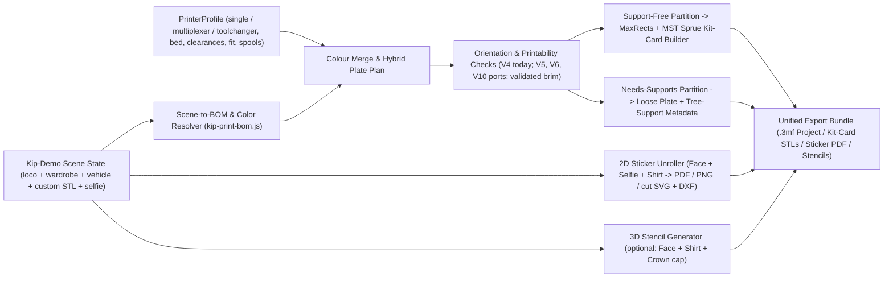

# Spec: Kip "Print What's On Screen" Workflow — Color-Aware 3MF, Flat-Pack Kit Cards, Stickers & 3D Stencils

## Status, Scope & Canonical Authority

- **Status:** Draft 2 for Review (**Pass 1 Engineering Specification**, revised 2026-11-01 after a full review against the working tree and the slicer/regulatory sources; the changes and what is still unverified are in **Appendix A**). No runtime, CAD or catalog files are modified by this document. **Implementation update 2026-11-02:** the software of M1–M6 is now built and gated in the tree — M1–M3 colour plates and pack, M4 kit-tray engine (`kip-print-sprue.js`), M2 sticker sheet (`kip-print-stickers.js`), the M5 base-body CAD plus the M5 heightfield 3D stencils (`kip-print-stencils.js`, `c1af502` + `33a1fe6`; see the M5 rows in 10 and the record in 12.8), and the M6 kit-tray edition (12.8 Gates 1–3). What remains open is **physical**: stencil printed fit and paint-pen behaviour, the break-off and peg/turret coupons (Decision 7 / 12.7 Gate 4), `F1_printed_fit` / `F2_breakage`, and the Bambu Studio + PrusaSlicer GUI imports (M1 gate d). Those stay `pending` below and must not be read as done.
- **Target Surface:** `parts/kip/viewer/Kip-Demo.html` (the side menu's `Print` group, which mounts by default, and the URL query parameters that share a look), building on the Phase 2 baseline landed in commit `aa60423` (`kip-print.js`, `kip-print-view.js`, `kip-menu.js`) and on the uncommitted selfie second pass (`kip-selfie.js`, `kip-selfie-image.js`, `kip-faceplate-shape.js`). Line numbers in this spec drift with those peer edits, so code is cited by symbol; file:line appears only where it was re-checked on 2026-11-01.
- **Evidence labels:** statements about this repo are `[code]` (read in the working tree), statements about slicers or regulations are `[source]` (primary source named in Appendix A) and anything else is a `[design]` choice or an `[assumption]` that a review or a physical print must confirm. Dimensions in the sprue and stencil sections are design targets: **no physical print has been measured** (`F1_printed_fit`, `F2_breakage` stay `pending`).
- **Core Goal:** Turn whatever character, outfit, face expression/selfie, accessory, prop, or vehicle is currently on screen in `Kip-Demo.html` into a complete, deterministic physical build package:
  1. **Printer-aware 3D plates** — one plate per colour (works on every printer), or, for changers and toolchangers, the hybrid plan of 5.1: dominant colours on their own plates, small accent colours batched on a `by-object` plate, and `by-layer` only for toolchangers and in-place two-tone parts.
  2. **Model-kit flat-pack sprue cards ("kit cards")** whenever parts are support-free on the bed, using optimized 2D packing and a JS port of the method in [`parts/partspec/toyventor_kitcard.py`](../../parts/partspec/toyventor_kitcard.py) (perimeter frame plus a minimum spanning tree of connector-safe V-nick gates). Pegs, turrets and gears stay loose.
  3. **Automatic orientation & conditional support isolation** — parts requiring supports are auto-oriented to minimize steep overhangs and isolated outside sprue frames with per-object support metadata in `.3mf`. Nine base parts need supports today; one verified one-line fix in [`parts/kip/kip.scad`](../../parts/kip/kip.scad) clears three of them, and the rest is a separate CAD milestone (7.3).
  4. **1:1 printable stickers (PDF sheet, transparent PNG, vector cut SVG and DXF) for faces, selfies and the shirt, plus optional, prototype-first 3D paint stencils**, with crown-bud accents handled as in 4.2.
- **Lattice, verification & safety alignment:** Inherits canonical `1 TU = 12.50 mm` geometry from [`parts/partspec/interfaces.json`](../../parts/partspec/interfaces.json), calibration offsets from [`shared/calibration.ts`](../../shared/calibration.ts), kit-plate rules from [`parts/partspec/print_profiles/fdm_kitplate_0.4.json`](../../parts/partspec/print_profiles/fdm_kitplate_0.4.json), brand neutrality from [`parts/partspec/BRAND_STYLE.md`](../../parts/partspec/BRAND_STYLE.md), and the print-page warnings and age grading from [`parts/partspec/COMPLIANCE.md`](../../parts/partspec/COMPLIANCE.md) and `interfaces.json` (the regulatory readings are in 9.3). Physical fit (`F1_printed_fit`) and abuse (`F2_breakage`) remain `TARGETS ONLY` until physical validation prints complete.
- **Update 2026-11-01 (draft 2.1):** section 12 adds the optional kit-tray edition and the support-free plan, and corrects three statements of draft 2 (base STL count, the `v_groove_ring` fix already landed, pegs and turrets do have gate anchors). Where an older paragraph disagrees with 12.1, 12.1 wins.

---

## 1. Baseline Audit (`aa60423` v1 Print View) & Critical Gaps Resolved

Commit `aa60423` established a clean pure-JS foundation (`kip-print.js` + `kip-print-view.js` + `kip-selfie.js`), but auditing the live viewer against the full `Kip-Demo.html` wardrobe/vehicle state surfaced **six structural gaps** that this specification resolves:

| # | Baseline Behavior in `aa60423` | Gap / Failure Mode | Spec Resolution |
| :--- | :--- | :--- | :--- |
| **B1** | **Colour-blind inventory and a single-colour `.3mf`** (`inventoryFor`, `to3mf` in `kip-print.js`) | Ignores every on-screen colour. Colour is painted as per-mesh vertex colour inside a closure (`applyBodySkinAndClothing`), so it cannot be read back from the scene, and the print state passes 12 of the fields a BOM needs (4.0). | One pure `resolveBodyColors` shared by the viewer and the BOM, an extended print state, `PrinterProfile`, and a 3MF writer with per-object slots (section 5). |
| **B2** | **Crown buds printed as a loose part, also when a hat hides them** (`inventoryFor`) | `_export_visual_overlays` (`kip_partspec.py`) writes `crown_buds_2x1` as two Ø6.66 mm cylinders with no base: a paint overlay over studs that the catalog heads and the eight hat-ready wigs already mould. It is emitted for any hat and any wig, so the pellets end up under real hats. | Accent rule in 4.2 item 7: only `hat === 'buds'`; a modifier part, a colour change or a stencil; never a standalone part. Wheel rims follow the same rule. |
| **B3** | **Unmapped and wrong parts** (`inventoryFor`) | Reports Pro assemblies, `ears = pro`, all four vehicles, wizard hat, wand and custom STLs as unmapped; omits the skateboard axles and wheels; maps `tail = wag` to `waddle_tail_s` although the screen draws `/kip/stls/tail_acc.stl`; and adds a neck peg/turret on every non-classic head that does not exist on screen. | Section 4: every on-screen option resolves to catalog files with quantities and colours. The seated Snap leg swap is **not on screen** and is not printed (open decision 6). |
| **B4** | **Loose parts only: no sprue, no kit cards** (`buildPlates`) | Every part lies loose on the bed (up to about 36 parts for a Pro Kip, 13 of them pegs of 8 to 9 mm), risking bed detachment and losing the snap-out kit experience. | Section 6: port of the existing `toyventor_kitcard.py` method (frame plus a minimum spanning tree of V-nick gates) for support-free parts that have anchors; pegs, turrets and gears stay in a labelled loose zone. |
| **B5** | **Base `kip.scad` body parts need supports** (the `public/kip/stls` set) | 9 of 30 base STLs fail V4 at their best pose: `torso` 463 mm², `snap_torso` 418, `head_hood` 484 (plus 470 of flat ceiling), `head_shell` 176, the grooved limbs 35 to 52, `tail_acc` 19. Causes are the `v_groove_ring` flank, the torso's pelvis, hip, dock-boss and shoulder features, the hood's interior dome and the head shell's lower flare, **not** the inverted ball sockets. | Loose support plate with per-object flags (7.2); one verified one-line CAD fix and a separate CAD milestone for the rest (7.3). |
| **B6** | **Selfie-only sticker; no expression, shirt or stencil output** (`kip-selfie.js`) | Only the selfie exports (23.2 × 12.2 mm squircle window, 510 × 268 px). Expression art, the shirt chest decal and the paint stencils have no export, and no sticker accounts for the plate's mouth ridge or the real arc length. | Section 8: one sticker pipeline with a per-row/per-column unroll from measured arc lengths, ridge and nose reliefs, and an optional prototype-first stencil set. |

---

## 2. End-to-End Architecture

All geometry, packing, sprue generation, PDF/SVG layout, and `.3mf` serialization remain **100% client-side, deterministic, and pure-JS testable** (zero server round-trips; selfie pixels never leave memory per `kip-selfie.js` privacy invariants).



### Module Split (`parts/kip/viewer/` -> synced to `public/kip/` via `npm run build:kip`)

| Module | Responsibility | DOM / Three.js Free? |
| :--- | :--- | :--- |
| `kip-print.js` | STL I/O, transforms, the `V4` check today (V5, V6, V10 ports and the validated-brim lookup per 7.1), the portfolio `MaxRects` packer, the 3MF writer in both slicer dialects (5.2), `zipStore`, `smallParts`. | **Yes** (pure ES module, Node/Vitest runnable) |
| `kip-print-bom.js` *(new)* | Full scene-to-BOM expansion (body, joints, heads, wigs, hats, Pro assemblies, props, vehicles, custom STLs) with a deterministic per-instance colour and accent resolver, driven by the shared `resolveBodyColors` (4.0). | **Yes** |
| `kip-print-profile.js` *(new)* | `PrinterProfile` schema, presets, validation and clamping, slot assignment, colour-merge planner, per-colour spool budget (grams from mesh volume). No storage access: the view layer persists the profile. | **Yes** |
| `kip-print-sprue.js` *(new)* | 2D slice anchor sampler, connector keep-out filter, Prim's MST of gate bars (the generator's method), V-nick gate mesh builder (dimensions from one constants block, 6.2). Runners and gates are emitted as **overlapping watertight shells** that the slicer unions; no boolean library and no WASM are shipped (`public/kip/vendor` holds only the bundled three.js). `[assumption]` slicers union overlapping shells inside one object at slice time; the sprue milestone gate proves it by slicing a generated card with the PrusaSlicer CLI the repo already uses and checking one connected body per layer stack. `preprint_check.py` `V1_mesh_sound` rejects multi-body files, so a card is gated by its own checks (6.5), not by that script. | **Yes** |
| `kip-print-stickers.js` *(new)* | Per-row/per-column arc-length unroll from the stored decal vertices, die-cut layouts per face insert, shirt and selfie compositor, vector-only cut `SVG` and `DXF`, zero-dependency `1:1 mm` `PDF` writer, transparent `PNG` with a true `pHYs` density. | **Yes** (accepts RGBA buffers or Canvas2D) |
| `kip-print-stencils.js` *(new)* | Heightfield stencil builder (planar outer face, conformal cavity from the decal ray-cast grid), marching-squares aperture tracing, island bridges, and the face, shirt and crown-cap stencils. Optional; prototype first (8.2). | **Yes** |
| `kip-print-view.js` | Three.js multi-plate preview (true colour vs. printability heatmap, sprue preview, plate switcher, validation SHA-256 check, bundle download). It already exists with the tier colours, heatmap, plate switch and three exports; this spec extends it. Profile persistence (`localStorage`) lives here, never in the pure modules. | Browser / Three.js |

**Integration rules every new module must follow** `[code]` (from the Kip demo notes and tests):
1. Add each file to `scripts/build-kip.ts` (copy list) **and** to the brand-scan list in `tests/kip.test.ts`, which also asserts that every relative and `/kip/*.js` import is in the copy list. `npm run build:kip` is only run once the working tree's wardrobe STLs exist and no peer is regenerating (see the Kip demo implementation notes).
2. Pure modules stay DOM-free and Three.js-free so `vitest` and `scripts/kip-plate-check.mjs` run the code the browser runs.
3. **Privacy:** the sticker and stencil modules receive selfie pixels, so they join the selfie privacy tests: no `fetch`, `XMLHttpRequest`, `sendBeacon`, `WebSocket`, `localStorage`, `sessionStorage`, `indexedDB`, `caches`, workers, `FaceDetector`, `api/scan` or URL writes anywhere in the file (the test greps source text, so even a word in a code line counts), and the e2e proves zero image-data requests. `layout.json`, the README and every manifest carry geometry, hashes of STL bytes and the resolved state only, never pixel data or a hash of the photo. The sticker files in the pack are the one place selfie pixels land, as a download the user starts; they never go to a server.
4. The menu has six control kinds today (`action`, `file`, `info`, `range`, `select`, `toggle`; `kip-menu.js`). The Print group in section 9 is specified in those kinds; anything that needs a new kind (swatch chips, thumbnails) is listed as a menu change in milestone M1, not assumed.

---

## 3. Printer & Multi-Material Capability Profile (`PrinterProfile`)

To decide whether to split parts across single-colour plates or combine them on multi-colour plates, and how to pack them safely, the workflow keeps a small `PrinterProfile` in `localStorage` under `toyforge.printerProfile.v1` (built-in presets, so a casual user picks once). **It is a planning input, not a slicer profile:** the user's slicer still applies its own printer preset, so the pack's README tells them to select the matching printer, and plates are centred for the planned bed. A mismatch (a smaller real bed) is the user's to catch, which is why the plate bound stays at 170 mm.

### 3.1 `PrinterProfile` Schema

```ts
export type ChangerType =
  | 'single'        // 1 nozzle, 1 filament; spool swapped by hand between plates
  | 'multiplexer'   // 1 nozzle + filament changer (4 to 16 slots); each colour change flushes filament
  | 'toolchanger';  // several toolheads (2 to 5); no flush between colours

export type MultiColorStrategy =
  | 'auto'          // the hybrid plan of 5.1: dominant colours on their own plates, small accent colours batched
  | 'split-plates'  // one monochrome plate per colour, no colour changes inside a plate (works on every printer)
  | 'by-object'     // one plate, one cluster per colour printed one after another (C - 1 changes; tight clearance rules, see 5.1)
  | 'by-layer';     // one plate, colours interleaved layer by layer (the only mode that supports in-place two-tone parts)

export type FlatPackMode = 'sprue' | 'loose';   // default 'loose' until the sprue milestone ships

export type SlicerFamily = 'orca_bambu' | 'prusa' | 'other';   // picks the 3MF dialect (5.2)

export interface BedExclusionZone { x0: number; y0: number; x1: number; y1: number }

export interface SequentialClearance {   // read from the slicer's printer profile, never invented (values in 3.2)
  radiusMm: number;       // min distance between the convex hulls of two objects printed one after the other
  heightToRodMm: number;  // non-last objects must be lower than this when they overlap in Y with another object
  heightToLidMm: number;  // ... or lower than this when they do not overlap in Y. The LAST printed object is exempt.
}

export interface PrinterProfile {
  presetId: 'compact_180' | 'standard_220' | 'changer_256_4' | 'changer_256_8' | 'toolchanger_5' | 'custom';
  slicer: SlicerFamily;
  changerType: ChangerType;
  maxSlots: number;
  multiColorStrategy: MultiColorStrategy;
  flatPackMode: FlatPackMode;
  bedXmm: number; bedYmm: number; maxZmm: number;
  brimMarginMm: number;              // 5.0, from fdm_kitplate_0.4.json
  exclusionZones: BedExclusionZone[];
  sequential: SequentialClearance | null;     // null: by-object is not offered
  purgeGramsPerChange: number;       // estimate used by 3.4 only: 0 toolchanger, ~0.2 Prusa-type, ~0.54 Bambu-type
  nozzleMm: 0.4 | 0.2;               // 0.4 only in v1: every gate, wall and bridge value assumes it
  material: 'PLA' | 'PETG';
  fitChoice: 'snug' | 'standard' | 'easy';    // shared/calibration.ts; see 5.2 for the per-slicer keys
  loadedSpoolsHex: string[];         // optional; empty means "use the scene colours"
  includeStickers: boolean;          // default true when decals are active
  includeStencils: boolean;          // default false (open decision 4)
}
```

### 3.2 Built-In Presets

Clearances are the values shipped in the slicers' own printer profiles (OrcaSlicer and BambuStudio `resources/profiles`, PrusaSlicer `PrusaResearch.ini`, read 2026-11-01 `[source]`); the preset copies them as **editable defaults** and the user's printer wins. Draft 1's single "36 mm radius, 34 mm height" does not match any of them.

| Preset | `changerType`, slots | Bed (mm) | `sequential` (radius / to rod / to lid, mm) | `purgeGramsPerChange` | Default plan |
| :--- | :--- | :--- | :--- | ---: | :--- |
| Compact 180, one colour | single, 1 | 180 × 180 | none | 0 | `split-plates` |
| Standard 220 to 256, one colour | single, 1 | 220 × 220 (or 256) | none | 0 | `split-plates` |
| 4-slot changer 256 (X1/P1-class, `orca_bambu`) | multiplexer, 4 | 256 × 256, front-left exclusion 18 × 28 | 68 / 34 / 90 | 0.54 | `auto` (hybrid) |
| 4-slot changer, A1-class | multiplexer, 4 | 256 × 256 | 73 / 25 / 256 (A1 mini: 180 bed, lid 180) | 0.54 | `auto` |
| 8-slot (two changers) | multiplexer, 8 | 256 × 256 | as the 4-slot preset | 0.54 | `auto` |
| Prusa-type single nozzle with changer | multiplexer, 5 | 250 × 210 (MK4 class) | 45 / 13 / not applicable | 0.2 | `auto`; by-object needs the wipe tower off, see 5.1 |
| Toolchanger, 5 heads | toolchanger, 5 | 360 × 360 | 67 / 21 / not applicable | 0 | `by-layer` |
| Custom | any | any | optional | any | `auto` |

`purgeGramsPerChange` is an estimate: Bambu publishes about 0.54 g per change on a 4-colour test (153 changes, 83 g at 0.2 mm layers), and PrusaSlicer's default wiping volume of 140 mm³ is about 0.17 g of PLA; see Appendix A. The usable card bound is `min(170, bed − 2 × brim)` in every preset: 170 mm keeps a card rigid and is the only size covered by `fdm_kitplate_0.4.json`.

### 3.3 Color Budget & CIELAB $\Delta E_{00}$ Consolidation

A dressed Kip uses about **4 to 7 distinct filament colours on foot and 9 to 11 with a vehicle, a skateboard or a varsity jacket with jeans** (re-derived by counting each preset's on-screen colour tables, excluding decal textures; not a viewer run: clean Kip 6, boy 7, girl 10, fox 10, scout 4, Snap + car 11):
- **When $C_{\text{scene}} \le \text{maxSlots}$ (and `changerType !== 'single'`):** Every on-screen color gets its own dedicated extruder slot (`1..C`).
- **When $C_{\text{scene}} > \text{maxSlots}$ (e.g., 6 colors on a 4-slot `multiplexer`):** The UI presents two non-destructive choices:
  1. **Keep All Colors (`2` Multi-Color Plates):** Packs the top `maxSlots` colors by part count/volume onto Plate 1 (Slots `1..4`) and spills remaining colors onto Plate 2 (Slots `1..2`).
  2. **Auto-Merge to Fit `N` Slots (1-Click Palette Quantizer):** Computes pairwise perceptual distance $\Delta E_{00}$ in CIELAB space weighted by **role merge affinity**:
     - *High merge affinity (safe defaults, `[design]` weights):* the coral accent parts (back dock studs, neck peg or turret, crown buds, ear pods) merge into the nearest neighbour by $\Delta E_{00}$ when coral is the only reason for an extra slot (cost $\times 0.3$); shoe dark tone -> pants/tyre dark tone (cost $\times 0.6$). Joint pegs and turrets need no rule: on screen they already take the adjacent limb colour (4.1), except on the default clean Kip where all joints are coral.
     - *Protected roles (never auto-merged without explicit user click):* Human skin/faceplate (`face` / `skin`) vs. `hair` or `shirt` when $\Delta E_{00} > 8.0$.
     - Live Three.js preview updates immediately so the user sees the exact 4-color physical result before downloading.

### 3.4 Spool Budget & Colour-Change Estimate

The pack must say how much of each filament to load and what a mode costs in colour changes. Both are computed from the geometry already in the browser.

- **Mass per part:** `m = ρ · (min(V, A·t) + f · max(0, V − A·t))` with ρ = 1.24 g/cm³ and f = 15 % taken from the print profile (`fdm_kitplate_0.4.json`) and `t = 1.4 mm` (three 0.4 mm perimeters plus a skin allowance). `V` and `A` come from the mesh (catalog parts also carry `volume_cm3` in `toyventor_parts.json`; base parts are measured on load). Runners, gates and brim are added from their own geometry. It is shown as a range (`t` 1.0–1.8 mm, `f` 15–20 %) and labelled **estimate**; the offline PrusaSlicer pass (`preprint_check.py` stage 2) records real grams and time and replaces it where available. `[assumption]` ±25 % until compared with real slices; the M2 gate slices three reference builds and records the error.
- **Measured on the current tree** (`[code]`, solid volume from the STLs the print view loads, estimate from the formula above): Pro kid + bob + ballcap 139 g solid → ≈ 94 g (77–108 g); Snap kid + bob 135 g → ≈ 82 g (68–96 g); Pro classic Kip with `spark` face 154 g → ≈ 87 g (73–104 g). A whole character is therefore roughly 80–95 g, not the ~32 g that draft 1 assumed, and that changes the purge arguments in 5.1.
- **Colour changes:** `by-object` prints `C − 1` changes. `split-plates` has none inside a plate (`C − 1` manual spool swaps between plates). `by-layer` is computed, not guessed: a part of height `h` on the bed is present in layers `1 … h / 0.2`, so changes = Σ over layers of `max(0, colours present − 1)` plus one return per such layer. Waste = changes × `purgeGramsPerChange`, a per-preset constant in `PrinterProfile` (3.1) whose defaults are sourced in Appendix A. Shown as "≈ N changes, ≈ X g purge" next to the mode chooser so the saving is visible before the user commits.

---

## 4. Scene-to-BOM & Colour Resolver

`resolveSceneBom(state)` replaces `inventoryFor(s)` (`kip-print.js`). For every physical part on screen it returns `{ id, file, source, qty, role, slot, hex, material, accents[] }`. **Draft 1 of this section was largely wrong** (invented vehicle part ids, invented hexes, a seated-leg swap the viewer never shows); everything below was re-derived from `Kip-Demo.html` and `kip-vehicles-wardrobe.js` on 2026-11-01 `[code]`. Rules: *print what is on screen*; when the viewer and its own intent disagree, the BOM follows the screen and the discrepancy is filed as a viewer bug (4.5).

### 4.0 Prerequisites the review found (M1 work, before any BOM code)

1. **Print state is incomplete.** `printView`'s `getState()` passes only `edition, category, head, faceInsert, expr, hair, hat, back, prop, vehicle, ears, tail`. The BOM also needs `skin, shirt, pants, hairColor, hatColor, vehCovers, racerKit`, the selfie flag, and which custom slot is in use. All but `ears`/`tail` already live on `loco`; `ears`/`tail` come from the module variables `earModes[earIdx]` / `tailModes[tailIdx]`. Extend the adapter; do not read the DOM.
2. **Colour is painted, not named.** Body parts get one solid vertex colour each (`prepVertColoredSlot` + `paintMeshByCoord`), joints use six cloned materials, and `jointMats`, `outfitVertMat`, `bodyMeshes` and `neckMat` are closure-local to `kip-vehicles-wardrobe.js` and not returned. A resolver cannot read colours back from the scene (and linear-vs-sRGB read-back is untested). **Decision:** extract the pure table logic of `applyBodySkinAndClothing` (body-skin override, chest/sleeve/forearm/thigh/shin/shoe hex, `isDefaultCleanKip`, joint colours, neck colour) into one exported `resolveBodyColors({ head, skinId, shirtId, pantsId, edition })` that the viewer calls to paint **and** the BOM calls to print. One source means no drift; an e2e asserts painted vertex colours equal resolved colours on every preset. This touches a peer-edited file, so it is coordinated, not assumed.
3. **Base accents are live.** `#toy=` can overwrite `mats.shell` and `mats.spark`, so the coral/cream defaults are not constants. The adapter exposes `getBaseColors()`; the resolver reads it at call time.
4. **`#toy=` is not a scene serializer** (it carries `col`, `parts`, `stats`, `prints` only; real sharing is the URL query parameters `?head=`, `?skin=` …). The state of record for the manifest is the extended `getState()` object, written into `layout.json`.
5. **Do not derive the BOM from `kip-manifest.json`:** its hair lists are stale (`hatReadyHairs` has 6, the code has 8; `sculptedTopHairs` has 8, the code has 11). Use the exported option tables (`HAIR_OPTIONS`, `HAT_OPTIONS`, `SHIRT_OPTIONS`, `PANTS_OPTIONS`, `VEHICLE_OPTIONS`, `WORKSHOP_PROPS`, `WARDROBE_HEADS`).
6. **Resolve STL files through the catalog/manifest `file` field**, never by building `toyventor_<id>_S.stl` strings: the suffix is `_S` or `_P` per part and the vehicle ids were wrong in draft 1 precisely because they were typed by hand. A test fails when any BOM `file` is missing on disk.

### 4.1 Body, joints and neck

Colour names below are the viewer's own locals (`bodySkinHex`, `chestHex`, `sleeveHex`, `forearmHex`, `thighHex`, `shinHex`, `activeShoeHex`).

| Local | Rule (`applyBodySkinAndClothing`) |
| :--- | :--- |
| `bodySkinHex` | The chosen skin hex. When `skinId === 'vinyl_cream'` the head overrides it: fox `#E86F38`, bear `#B58052`, robot `#DCE3EE`, scout `#4E73A8`, cat `#E5C193`, dragon `#2EB872`, alien `#5CD6A9`, imp `#6E85E6`. `loco.skin` is **not** reset when leaving a human head, so a fox with `skin = warm_peach` really has peach hands and an orange neck; the resolver copies the conditional exactly. |
| `chestHex`, `sleeveHex`, `longSleeve` | From `SHIRT_OPTIONS` (6 shirts: `spark_tee, hoodie, varsity, overalls, stripe_tee, track_top`), else `bodySkinHex`. Varsity: chest `#242B3D`, sleeves `#F4EFE6`, long sleeves. |
| `forearmHex` | `sleeveHex` if `longSleeve`, else `bodySkinHex`. |
| `thighHex` | `PANTS_OPTIONS` leg hex (5 pants: `jeans, cargo_shorts, sport_shorts, joggers, overalls_jeans`; overalls auto-pair `overalls_jeans` when pants are off), else `bodySkinHex`. |
| `shinHex` | `bodySkinHex` for shorts, else `thighHex`. |
| `activeShoeHex` | `pants.shoeHex ‖ shirt.shoeHex ‖ (isDefaultCleanKip ? '#F4EFE6' : '#283044')`. Pants win over shirt. |
| `isDefaultCleanKip` | `head === 'classic'` ∧ skin `vinyl_cream` ∧ shirt off ∧ pants off. |

| Part (id, quantity) | Colour |
| :--- | :--- |
| **Pro:** `torso` 1 | `chestHex` |
| `upper_arm` 2 / `forearm` 2 | `sleeveHex` / `forearmHex` |
| `thigh` 2 / `shin` 2 | `thighHex` / `shinHex` |
| **Snap:** `snap_torso` 1, `snap_arm` 2, `snap_leg` 2 | `chestHex`, `forearmHex`, `thighHex` |
| `hand_l`, `hand_r`, `boot` 2 | `bodySkinHex`, `bodySkinHex`, `activeShoeHex` |
| `back_dock_studs` 1 (absent when `back === 'gears'`) | **always coral `mats.spark`** (`#FF6B4A` unless `#toy=` recoloured it). Draft 1 said `chestHex`. |
| Joints: Pro `spark_peg_big` ×4 + `spark_peg_sml` ×8; Snap `snap_turret_big` ×4 + `snap_turret` ×4 | If `isDefaultCleanKip`: **all** coral. Otherwise by joint: shoulder `sleeveHex`, elbow `forearmHex`, wrist `bodySkinHex`, hip `thighHex`, knee `shinHex`, ankle `activeShoeHex`. |
| Neck, **classic head only**: Pro `spark_peg_big` +1 (the "neck peg"), Snap `snap_turret_big` +1 | coral `mats.spark` |
| Neck, **every other head:** `neck_turret_2x1` ×1 | `neckMat`: the head's own colour (skin hex for human heads, shell hex for the creature heads) except robot `#36405C`, scout `#2A3F66`, custom `#FF6B4A`. `[code]` for the three exceptions; the resolver test confirms the rest |

**Existing bug this fixes:** `inventoryFor` always adds 5 big pegs (Pro) or 5 big turrets (Snap) **and** `neck_turret_2x1` on non-classic heads, so every such character prints one spare joint (the neck peg/turret exists on screen only for the classic head: `syncNeckAndSeatedVisibility`).

**Seated Snap legs are not on screen.** `char_legs_seated` is created and recoloured, but `syncNeckAndSeatedVisibility` sets `kip.exp.snapSeatedLegsGroup.visible = false` and nothing sets it true; in a vehicle a Snap Kip shows the normal `snap_leg` ×2, boots and joints. Draft 1 specified a seated swap that cannot be seen. The BOM prints what is on screen (no swap). The stale statements that say otherwise (the menu's Edition tooltip, `kip-manifest.json` `editions.snap.seatedLowerBody`) are viewer-side fixes, and whether to *show* the seated legs is open decision 6.

### 4.2 Heads, face, wigs, hats, crown buds

1. **Classic head:** `head_shell` `#F4EFE6` (`mats.shell`), `head_hood` **`#CCC1AE`** (`mats.hood`), `visor` **`#1C2338`**, `ear_pod_l/r` **coral**, and the crown: `crown_cap_blank` in `mats.hood` when `hat === 'blank'`, else `crown_buds` coral (a real insert: pill base plus two studs, `kip.scad`). When `expr === 'spark'` three physical snap-in inserts: `face_eyes` **`#B8E8FF`**, `face_glints` `#FFFFFF`, `face_cheeks` `#FF6B4A`. Every other expression is a texture decal on the classic head's own visor plane (a sticker, never filament).
2. **Expressions** (`DECAL_EXPRESSIONS`): `spark, button, happy, wink, cool, starry, surprised, blank`, plus the runtime `selfie` (human heads only, forces the `flat` insert). Draft 1's `chill` and `sleepy` do not exist.
3. **Human heads** (`kid, chibi, tall, jumbo`): `neck_turret_2x1` + head + faceplate, head and faceplate in the skin hex. Faceplate by `faceInsert`: `sculpted → char_faceplate`, `vinyl → char_faceplate_vinyl`, `flat → char_faceplate_flat`.
4. **Animal, alien, robot heads** (`fox, bear, cat, dragon, alien, imp, robot, scout`): shell hexes as in the `bodySkinHex` override above; files `toyventor_char_head_<id>_S` except robot `toyventor_robot_head_visor_S` and scout `toyventor_robot_head_scout_S`; the face is a decal.
5. **Wigs (19, colour from `loco.hairColor`, 6 colours):** `short_swept, bob, swoosh, long_layered, twin_braids, shag, bowl, slick` are **hat-ready** (they mould `top_studs`); `pompadour, top_bun, side_sweep, spiky, pigtails, ponytail, curly, mohawk, pixie, side_pony, low_bun` have sculpted tops with no studs and force the hat back to `buds`/`blank`. Draft 1 listed five wigs that do not exist (`afro_puffs, curly_crop, wavy_lob, buzz_fade, space_buns`) and missed five that do.
6. **Hats** (`HAT_OPTIONS`: `buds` default, `blank`, then): the **7 wearable hats** `ballcap, beanie, cowboy, hardhat, ranger, tophat, pirate` (`hat_<id>`, colour `hatColor`, only on hat-ready hair) and four fixed-colour items that ignore `hatColor`: `hat` = `wobble_hat` `#43D69C`, `ears` = `pointy_ears` `#F8C232`, `horns` = `bumper_horns` `#FFB830`, `wizardHat` = `/kip/custom/toyventor_custom_wizard_hat_S.stl` `#7C4DFF`. Choosing a hat sets that hat's default colour.
7. **Crown buds are an accent overlay, not a part.** `toyventor_crown_buds_2x1.stl` is two Ø6.66 mm cylinders with no base (bbox x ±9.58, z −0.2…2.84 mm) painted over the studs that every catalog head and the eight hat-ready wigs already mould. The viewer shows them when `!classic && (hat !== 'blank' || hasHair)` (head top) or `hasHair && hatReady && hat !== 'blank'` (wig top), but a real hat covers them: **they are exposed only when `hat === 'buds'`**. `inventoryFor` currently emits the file for every hat and for any wig, which prints loose pellets that end up under the hat. Rule: emit the accent only for `hat === 'buds'` on non-classic heads, never as a standalone part, in coral `#FF6B4A` (draft 1 had the trigger inverted and the colour wrong).
   - **`by-layer` multicolour printers:** the overlay becomes a modifier part of the head/wig object assigned to the accent slot, colouring the studs in place.
   - **Single extruder or `by-object`:** omit the mesh and offer either a colour change at the stud base height (only when the studs are the topmost layers in the chosen orientation) or the crown paint cap (8.2).
8. Wheel rims (`veh_wheel_{sport,offroad,moto}_rim`) are the same kind of overlay (visual-only, scaled 1.003 on screen, not in `catalog.json`) and follow the same two rules (4.3).

### 4.3 Pro assemblies, backs, props, vehicles

Part ids resolve through the catalog; quantities and colours are what `Kip-Demo.html` builds.

| Option | Parts and colours |
| :--- | :--- |
| `tail = wag` | `/kip/stls/tail_acc.stl` (kip.scad) coral. `inventoryFor` maps it to `waddle_tail_s`, a different mesh (3250 vs 3792 triangles, different bounding box). |
| `tail = pro` | `beam_str_tu03` ×1 `#36405C`; `shaft_tu03` ×3 `#36405C`; `wheel_tu04` ×1 `#F0B238`; `cross_connector_tu01` ×1 coral; `bushing_half` ×5 (3 coral, 2 `#F0B238`). No `pin_friction`. |
| `ears = pro` (classic head, right side only) | `beam_str_tu03` ×1 `#36405C`; `shaft_tu03` ×1 `#36405C`; `gear_spur_z10` ×1 coral; `bushing_half` ×2 `#F0B238`. |
| `ears = comm` (classic head) | `ear_acc_l`, `ear_acc_r` (kip.scad) `#43D69C`. |
| `back = gears` | `beam_str_tu05` ×1 `#36405C`; `shaft_tu03` ×2 `#36405C`; `gear_spur_z20` ×1 `#F0B238`; `gear_spur_z10` ×1 coral; `pin_friction` ×1 coral; `bushing_half` ×4 (2 `#36405C`, 2 `#F0B238`). |
| `back = explorer / jetpack / wings` | `pack_explorer` `#1FA6A0` / `robot_back_jetpack` `#FF6B4A` / `cloud_wings` `#4EB3FC`. |
| `prop = shaft` | `shaft_tu05` `#36405C`; `gear_spur_z10` **`#4EB3FC`**; `bushing_half` ×**1** coral. |
| `prop = skateboard` | `prop_skateboard_deck` coral; `racer_axle` ×2 `#36405C`; `racer_wheel` ×4 `#20232A`. |
| `prop = wrench / shield` + the 15 `WORKSHOP_PROPS` | wrench `#2E6FDB`, shield `#FFB830`; workshop props take the colour named by their `mat` field. `screwdriver` and `maracas` name `mat: 'spark'`, which `expMats` does not contain, so they render in the default material on screen (inferred from three.js defaults, not run): the BOM prints them coral and the viewer bug is filed (4.5). |
| `wizardHat` / `prop = wand` | `/kip/custom/toyventor_custom_wizard_hat_S.stl` / `toyventor_custom_star_wand_P.stl`, both `#7C4DFF` (`expMats.plum`). The SDK hood-crest example prints `toyventor_custom_hood_crest_S.stl` in `#FFB830`. |

**Vehicles** (`vehCovers` and `racerKit` are the two toggles; scooter and moto share frame, fork and wheels and differ only by the moto cowling):

| Vehicle | Always | `vehCovers` | `racerKit` | Rim overlay |
| :--- | :--- | :--- | :--- | :--- |
| car | `veh_car_chassis` ×1 coral; `veh_steering_wheel` ×1 `#20232A`; `shaft_tu05` ×2 `#36405C`; `veh_wheel_sport` ×4 `#20232A` | `veh_car_hood_cover`, `veh_cab_roof_cover` `#F4EFE6` | `racer_bull_bar` `#FFB830`; `racer_hood_scoop` `#2E6FDB` (hidden with a custom hood); `racer_light_bar` `#FFB830`; `racer_spoiler` `#2E6FDB`; `racer_twin_exhaust` `#F4EFE6` | `veh_wheel_sport_rim` ×4 `#EDF2F8` |
| truck | `veh_truck_chassis` ×1 `#1FA6A0`; steering wheel; `shaft_tu05` ×2; `veh_wheel_offroad` ×4 | car hood and cab covers (shared) `#F4EFE6`; `veh_truck_bed_cover` `#FFB830` | `racer_bull_bar` `#FFB830`; `racer_roof_rack` coral; `pack_explorer` `#2E6FDB` (cargo) | `veh_wheel_offroad_rim` ×4 `#FFD25A` |
| scooter | `veh_scooter_frame` ×1 `#2E6FDB`; `veh_handlebar_fork` ×1 `#20232A`; `racer_axle` ×2 `#36405C`; `veh_wheel_moto` ×2 `#20232A` | `veh_scooter_fairing` `#F4EFE6` | `racer_twin_exhaust` `#F4EFE6` | `veh_wheel_moto_rim` ×2 `#EDF2F8` |
| moto | as scooter | fairing as scooter **plus** `veh_moto_cowling` coral | as scooter | as scooter |

The manifest lists a `glow_capsule` racer add-on for the moto that is loaded but not drawn, so it is not printed. Tyres are `#20232A` (`expMats.tire`).

**Custom STL and photo accessories.**
- *Custom STL:* `loadCustomStlFile` reads the `ArrayBuffer`, parses it to geometry and **drops the bytes**, so nothing printable is retained today (draft 1's `customSlotBuffers` does not exist). M1 adds a memory-only per-slot byte store (same privacy rule as the selfie: never fetched, stored or put in the URL). Slots are `crown, hand, back, head, hood` (`#sel-llm-slot`); `hood` also forces `vehicle = 'car'` and has no `loco` field. Colour comes from `#col-llm-stl` (default `#7C4DFF`). Runs the orientation search of 7.1.
- *Photo accessories:* `loco.hasPhotoAccessory` is one boolean (true on any photo equip, false on any STL upload) and cannot say which slot it is, so state needs the slot. The real presets are `KID_DRAWING_PRESETS` `sword, wings, crest` plus ad-hoc `upload`/`webcam`, in slots `hand, wings, crown, hood`. `toyContract.prints === false` only sets that flag. The viewer builds an extruded relief (`buildPhotoAccessoryMesh`); the **print path never prints that relief**: it goes to the craft cutout on the sticker sheet (8.1 C). The optional backing blanks `craft_wing_mount_S` and `craft_grip_card_P` **do not exist** and are listed as new parts to author, not as BOM entries.

### 4.4 Reference palette (what is on screen)

| Group | Values |
| :--- | :--- |
| `mats` | shell `#F4EFE6`, hood `#CCC1AE`, spark (coral) `#FF6B4A`, visor `#1C2338`, eyes `#B8E8FF`, glints `#FFFFFF`, cheeks `#FF6B4A`, snapSky `#4EB3FC`, snapMint `#43D69C`, snapGold `#F8C232`, proSlate `#36405C`, proGear `#F0B238` |
| `expMats` | cobalt `#2E6FDB`, teal `#1FA6A0`, plum `#7C4DFF`, sun `#FFB830`, tire `#20232A`, rimAlloy `#EDF2F8`, rimGold `#FFD25A` |

Draft 1's `#2FB7B2`, `#232733`, `#4A5168`, `#E84C3D`, `#68C7D4` and `#5B4FCF` occur nowhere in the viewer.

### 4.5 Viewer bugs and stale statements found (filed, not fixed here)

1. `screwdriver`, `maracas`: `mat: 'spark'` is not an `expMats` key (default material on screen).
2. Seated Snap legs: built and recoloured but always hidden; the Edition tooltip and `kip-manifest.json` still describe them as shown.
3. `kip-manifest.json` hair lists stale; the `kip-vehicles-wardrobe.js` header comment says "14 Sculpted Wigs" (19); the manifest `urlParams.hair` says 14 as well.
4. `loco.skin` persists after leaving a human head (visible on animal-head hands and neck).
5. Pants have no on-screen decal (the leg-outfit decals array is empty) although the leg-outfit decal canvas builder exists, so no leg sticker is offered in 8.1 until the viewer shows one.
6. `public/kip/*.js` is a stale copy (no `kip-print.js`); only `npm run build:kip` refreshes it, under the conditions in the integration rules.

---

## 5. Colour Splitting, Plate Planning & the 3MF Package

### 5.1 Plan modes, and why the default is a hybrid

**What a real Kip needs** (`[code]`, measured with the repo's `prepareItem` and `buildPlates` on the STLs the print view loads, footprints including the 5 mm gap): a whole character is **33 parts and about 19,400 mm², i.e. 0.67 of one 170 × 170 mm plate** (Pro kid + bob + ballcap; Snap kid + bob 24 parts, 0.51 plate; Pro classic 36 parts, 0.62 plate). Tallest parts are 48, 34, 27 and 25 mm. In the simplest dressed state (no shirt or pants: skin, hair, hat, shoes, coral accents) the colour groups are **skin 11,100 mm², hat 3,000, hair 2,100, shoes 2,100, coral 1,100**. Real looks have 6 to 11 colours (3.3).

| Mode | How it prints | What the sources and measurements say |
| :--- | :--- | :--- |
| `split-plates` | One monochrome plate per colour (a kit card each in sprue mode). | No colour changes inside a plate, no clearance rules, full 170 mm cards, works on every printer. Costs plates: 5 to 11 plates that are each 10 to 65% full. On a changer the project 3MF pre-assigns each plate its slot, so each job starts with the right spool mapped. |
| `by-object` | One plate, one cluster per colour, printed one after another (`print_sequence = by object`). `C − 1` changes. | **Narrow, and usually infeasible for a full Kip.** The slicer keeps the convex hulls of two objects at least `extruder_clearance_radius` apart: 68 mm on X1/P1-class Bambu machines, 73 (A1), 96 (H2D), 45 (Prusa MK4), 67 (XL). On a 256 mm bed that leaves a 2 × 2 grid of cells of about 94 × 94 mm (8,800 mm²), **and the skin group alone is 11,100 mm²**; 5 or more colour groups do not fit at all. Height: every cluster except the last one printed must be lower than `heightToRod` (34 mm on X1/P1) when it overlaps another in Y, or `heightToLid` (90 mm) when it does not; **the last cluster is exempt**. Orca and Bambu switch the prime tower off in by-object mode; PrusaSlicer refuses multi-material sequential prints with a wipe tower (`The Wipe Tower is currently not supported for multimaterial sequential prints`). |
| `by-layer` | One plate, colours interleaved layer by layer. | The only mode that gives in-place two-tone parts (4.2 item 7). Waste is large on a single nozzle: Bambu's own test (4 colours, 11 g object, 0.2 mm layers) took 153 changes and 83 g of waste, about 0.54 g per change. A hand calculation with the formula of 3.4 for an undressed Kip with a hat gives roughly 430 changes: on the order of 85 g (Prusa default flush, 0.2 g) to 230 g (Bambu rate) of waste for about 85 g of toy. Near zero on a toolchanger. |
| **`auto` (hybrid)** | Colours whose cluster does not fit a `by-object` cell get their own plate (or a card). The remaining small colours are batched on one `by-object` plate when the preset's `sequential` clearance test passes, otherwise they also get their own plates. | By footprint arithmetic for the undressed Kip: 2 plates (skin; then hat + hair + shoes + coral as four clusters of at most about 55 × 55 mm in a 2 × 2 grid) and **3 colour changes (about 1.6 g)**. Not yet run through the planner; the milestone gate does that. |

Planner rules: colours are merged first (3.3); groups are ranked by packed footprint; clearance test uses the preset's `sequential` values and the hull-to-hull rule above; a cluster of height above the limit is placed last or moved to its own plate; the plan states the slot of every plate and the expected changes and waste (3.4) so the choice is visible. Toolchangers always use `by-layer` on one unified plate. In-place two-tone parts (crown buds, wheel rims) are produced only in `by-layer`; in every other mode the accent is omitted and offered as a colour-change height or a paint stencil.

### 5.2 The 3MF package, verified against slicer source

**Nothing here has been opened in a slicer** (none is installed in the review environment). Everything below was read in the slicer source on 2026-11-01 (OrcaSlicer `main`, BambuStudio `master`, PrusaSlicer `version_2.9.6`, saved copies are listed in Appendix A). The first milestone gate is therefore a manual import of each generated file into real Orca, Bambu Studio and PrusaSlicer; the generator starts from a project saved by a real Orca export and replaces only the geometry and the object entries.

```text
kip-print-pack.zip (see 9.2)
├── plates/plate_NN_<colour>_<hex>.3mf     # universal: one plate per file, single-bed coordinates
├── plates/plate_NN_<colour>_<hex>.stl
└── project/kip-project.3mf                # Orca/Bambu multi-plate project (optional)
        ├── [Content_Types].xml, _rels/.rels
        ├── 3D/3dmodel.model               # build items (world coordinates, plate offset included); leaf meshes carry the colour hint
        └── Metadata/
            ├── model_settings.config      # per object: name, extruder (1-based), part subtype; per plate: plater_id, plater_name, print_sequence
            ├── project_settings.config    # non-empty JSON: filament_colour[] (one per slot), print_sequence, nozzle_diameter
            └── Slic3r_PE_model.config     # PrusaSlicer dialect, written only in plates/*.3mf for the `prusa` slicer family
```
(`plate_N.json` from draft 1 is removed: it is the slice-output bounding-box file, not an input.)

1. **Part types (Orca/Bambu `model_settings.config`).** `<part subtype>` accepts `normal_part`, `negative_part`, **`modifier_part`**, `support_enforcer`, `support_blocker`; **any other string silently becomes `normal_part`** (`ModelVolume::type_from_string`). Draft 1 wrote `modifier_mesh`, which would have printed the crown buds as an ordinary overlapping solid. Per-object `<metadata key="extruder" value="N"/>` is 1-based and valid at object and part level; the key `name` and any object config key are allowed.
2. **Plates are assigned by position, not by list.** In Orca, `<plate><model_instance>` entries are only checked ("just test for file correct or not, we will rebuild later"); each instance goes to the plate whose rectangle it intersects. Build-item transforms are world coordinates. Plate k (0-based) has origin `(col × 1.2 × W, −row × 1.2 × D)` with `cols = round(sqrt(N))` rounded up, so one row for N ≤ 2 and a 2-column grid from N = 3. **The generator offsets each plate's build items accordingly.** `plater_name` (not `plate_name`) and `print_sequence` (`by layer` / `by object`) are plate-level keys; the global `print_sequence` lives in `project_settings.config`.
3. **Minimum for correct colours** (no published minimal example was found; this is read from the code, so `[assumption]` until a real import): a non-empty `project_settings.config` whose `filament_colour` has one entry per slot, plus `extruder` metadata per object. Without a project config an unknown-origin file gets default colours. **Never write the string "PrusaSlicer" in `Application`** for a file that carries `model_settings.config`: Orca then loads it through the Prusa path and ignores that file. A Bambu-tagged file of version 2.3.2 or newer with an empty config loads "geometry only".
4. **PrusaSlicer dialect.** `Metadata/Slic3r_PE_model.config` holds `<object id instances_count>` with `<metadata type="object" key="..." value="..."/>`; parts are *triangle ranges* (`<volume firstid lastid>`) inside one mesh with `volume_type` `ModelPart` / `ParameterModifier`; extruder is the `extruder` key; global settings are `; key = value` lines in `Metadata/Slic3r_PE.config` (`; complete_objects = 1` for by-object). `support_material`, `brim_*` and `xy_size_compensation` are valid per-object keys. Orca addresses parts by sub-object id and Prusa by triangle ranges, so one file serving both needs matching component order, which is not verified: **ship one file per dialect** rather than a hybrid.
5. **Colour hints.** `<basematerials>` / `displaycolor` is, per the 3MF core spec, "for rendering purposes only", and objects that contain `<components>` must not carry `pid`/`pindex`. **No slicer reads it**: grep finds zero hits in Orca, Bambu Studio and PrusaSlicer; Cura has no colour parsing at all; the Windows 3D Viewer was retired (no new installs after 2026-07-01) and no native macOS 3MF viewer was found. Draft 1's claim that Preview, Windows 3D Viewer and Cura "open in full colour" is withdrawn. Emit `<basematerials>` on **leaf mesh objects only** as a generic-viewer hint, and an Orca/Bambu `m:colorgroup` fallback (the prefix must be literally `m:`, no `requiredextensions`); the slot colours that count come from `filament_colour` and `extruder`. PrusaSlicer ignores both and reads only `extruder`.
6. **In-place two-tone parts** (crown buds, wheel rims, `by-layer` only): the head or tyre is a `normal_part` in the object's extruder and the accent overlay is a **`modifier_part`** with `extruder` set to the accent slot, in shared local coordinates: no loose pellets. PrusaSlicer: a `ParameterModifier` volume with `extruder`.
7. **Fit compensation.** `shared/calibration.ts` clearances map to a per-surface offset `s = D / 4` with `D = clearance − 0.10 mm` (`CALIBRATION.md` §3): `snug` −0.025, `standard` 0, `easy` +0.04 mm. Orca/Bambu: `xy_contour_compensation = −s` and `xy_hole_compensation = +s`; PrusaSlicer: `xy_size_compensation = −s` (it grows contours and shrinks holes, so one key does both). Write them as **per-object** metadata, not project settings, because preset matching can override project-level keys (`different_settings_to_system`). Orca disables both offsets on objects with painted multi-colour or fuzzy skin; extruder-assigned objects like ours are unaffected. Draft 1 used `D/2` radial values (−0.05, +0.08) written into both dialects; those are only right if holes alone are compensated, and PrusaSlicer has no hole-only key.
8. **Support and brim keys (verified):** Orca/Bambu `enable_support`, `support_type` (`normal(auto)`, `tree(auto)`, `normal(manual)`, `tree(manual)`), `support_on_build_plate_only`, `support_threshold_angle` (Orca 0 to 90 with 0 meaning automatic; **Bambu 1 to 90**); PrusaSlicer `support_material`, `support_material_style` (`grid`, `snug`, `organic`), `support_material_buildplate_only`, `support_material_threshold` (0 to 90, 0 automatic). `brim_type` (`outer_only` …) and `brim_width` exist in all three; write `brim_type` explicitly because Orca profiles may default to `auto_brim`. **Write the support key for every object, off as well as on** (`enable_support` 0, `support_material` 0): a part verified support-free used to carry no support key, so a user profile with supports on (Orca `normal(auto)`, threshold 30) filled every bridged socket ceiling with hard-to-remove support. Measured 2026-11-01 with the Orca CLI and that profile injected: bumper horns, seated legs and the kid head gave 11, 11 and 32 `; FEATURE: Support` blocks without the key and 0 with it; two calibration pieces went from 17 to 0. Gate 5 in `tests/kip-print.test.ts` guards it with a control run.
9. **Multi-plate in other slicers.** PrusaSlicer 2.9.x does support several beds and infers them from object positions, with a legacy layout of bed i at `x = i × bed_width × 1.2` that agrees with Orca for N ≤ 2 and not from N = 3 (how 2.9.x treats Orca-grid positions is unverified). Cura has no multi-plate concept: plates 2 and up land outside the build volume. Hence the pack's universal files are one 3MF or STL per plate, and the multi-plate project is an Orca/Bambu convenience.

---

## 6. Model-Kit Flat-Pack (Sprue / Kit-Card) Engine & Layout

**Scope of v1.** Port what `toyventor_kitcard.py` already does (`export_kitcards`, `_vnick_gate`, `_sample_solid_anchors`: perimeter frame plus a Prim minimum-spanning tree of V-nick gate bars between the frame and each part's contact anchors) to pure JS, so the browser and the Python generator can be compared on the same layout by a golden test. Everything beyond that is marked **new** below and is a parameter, not a promise. Draft 1 listed several features as "harmonized with `toyventor_kitcard.py`" that are not in that file (bottom chamfer, cross-runners, corner tab, 2/3/4 gate rule, nick position and depth).

### 6.1 Eligibility

A part instance joins a kit card only when all of these hold:
1. `flatPackMode === 'sprue'`.
2. Tier is `support-free`, `geometry-checked` or `unverified` (the fourth tier `kip-print.js` already has; it is what every catalog part becomes if `partspec-validation.json` fails to load, so treating it as ineligible would silently drop the whole catalog to loose parts; it keeps its badge). Never `needs-supports`: support material and brims collide with runners.
3. Its footprint fits the usable card area (6.2) and it has at least **2 valid anchors** on the `z = 0.30 mm` contact slice, found after the keep-outs of 6.3. Anchors are taken inside the slice by an inset of 1.6 mm (0.8 mm fallback), exactly as `_sample_solid_anchors` does.
4. Rigid material only (`PLA`/`PETG` parts never share a frame with the 0.80 mm flex skins).

**Parts that cannot take a gate** go to a labelled **loose zone** on the same colour plate, never a card: all pegs and turrets (`spark_peg_big/sml`, `snap_turret_big/turret`: the contact patch is about 4.8 mm and slotted, so no anchor survives the inset; the Python generator would fail on them), and every gear (`gear_spur_*`: teeth all round, and the hub is a `fixed` 5.1 mm double-D bore, so no centre post can capture it). Up to 13 pegs per character land here. A sacrificial hub lug on gears and a pad on pegs are CAD options listed in 7.3, not v1 work. **Update 2026-11-01 (12.1, 12.5): "no anchor survives" does not hold on the current STLs (the sampler finds 2 to 5 on every peg and turret); they are loose by an id rule in `kip-print-sprue.js`, and whether to gate them is a fit question for a coupon.**

**Brim policy.** In sprue mode the frame is the adhesion aid: brim is **off**, and any part that the validation reports say needs a brim (7.1) is moved to the loose zone, where the gap is widened to `2 × brim + 1 mm`. A 3 to 5 mm brim on a 5 mm gap would otherwise fuse parts to runners.

### 6.2 Geometry (one constants block, golden-tested)

| Feature | `toyventor_kitcard.py` today | This spec | Status |
| :--- | :--- | :--- | :--- |
| Card size | `<= 170 × 170` (Cards A-D), `<= 164 × 164` (E1-E2) | `min(170, bed − 2 × 5)`; E-style 164 selectable | same |
| Outer frame | 2.40 × 1.00 mm, outer R 2.0, inner R 1.0 | same | **same** (a 0.30 mm bottom chamfer from draft 1 is dropped: it is not in the generator and would cut the bed contact from 2.4 to 1.8 mm; the slicer's elephant-foot compensation covers it) |
| Frame to part air gap | 0.6 mm (parts start 3.0 mm from the card edge) | **≥ 1.2 mm** (parts start ≥ 3.6 mm in, so the usable area is `cardMax − 7.2`) | changed (three nozzle widths; 0.6 mm is under two) |
| Part to part gap | ≥ 5.0 mm | ≥ 5.0 mm | same |
| Gate width | 1.80 mm | 1.80 mm | same |
| Gate height / neck | 0.60 mm tall with a 45° V from the top; the neck computes to about 0.30 mm | **gate = 4 layers (0.80 mm at 0.20 mm layers), neck = 2 layers (0.40 mm), groove opening at the top ≥ 0.60 mm**, all scaled from layer height | changed, see below |
| Gate overlap into the part | anchor inset 1.6 mm (0.8 fallback) | same; the shell overlap makes the slicer union reliable | same |
| V-nick position | bar midpoint | **0.8 mm outside the part wall**, so a broken gate leaves the shortest stub on the part | changed |
| Gate count | 1 per part | 2 opposed by default, 1 only when a single anchor survives, 3 only above 75 mm of contact perimeter (about 1 per 25 mm) | **new** |
| Cross-runners | none (gate bars run straight between nearest anchors) | none in v1 | draft 1's runner network is dropped |
| Corner tab with embossed ID | none | none; the print sheet carries the plate map | draft 1's tab is dropped |

**Why the gate numbers moved.** At 0.20 mm layers PrusaSlicer slices at the middle of each layer (z = 0.1, 0.3, 0.5), so a V whose vertex sits at 0.30 to 0.32 mm leaves a neck that is solid at z = 0.3 and a slot about 0.36 to 0.40 mm wide at z = 0.5: under one nozzle width. The "V" becomes a one-layer slot, which prints inconsistently and is hard to predict by hand. A neck of two layers with an opening of at least 0.6 mm is something a 0.4 mm nozzle can actually lay down. The module docstring of `toyventor_kitcard.py` still says `1.60 × 0.80` while the code uses `1.80 × 0.60`, which is exactly open question 5 of the Kip demo notes. **This spec recommends 1.80 × 0.80 with a 0.40 mm neck** and requires a physical break-off coupon (gates of 3 sizes, PLA and PETG, flush cutter and hand twist) before the numbers are called locked: nothing here is measured (`F1`/`F2` stay `pending`), and "residual scar under 0.15 mm" from draft 1 is withdrawn until measured. Fewer nubs also help `COMPLIANCE.md`, which lists "sprue gate nicks" under the 16 CFR 1500.48/49 tests as *not tested*; a warning notice does not fix a sharp nub.

### 6.3 Anchors and keep-outs

1. **Build-time anchors.** Extend the `print` object that `kip_partspec.py` already writes for each part in **`kip-partspec-manifest.json`** (today `{ "orientation": ..., "supports": false }`) with `slice_z03` (contour polygons) and 8 to 16 vetted `anchors: [{ x, y, nx, ny }]`. Not `kip-manifest.json`: that file is hand-written and only copied by `build-kip.ts`. Keep-outs against the catalog `connector` entries: ≥ 2.0 mm around stud and tube walls at `z <= 1.0 mm`, ≥ 2.5 mm around bore throats and shaft flats `[design]`; wheel treads and faceplate front rims are excluded; gears and pegs are `sprueEligible: false` (6.1).
2. **Browser fallback** for `kip.scad` parts and custom STLs: slice at `z = 0.30 mm`, inset the contour, place anchors at straight or convex flank midpoints, and reject spans near ball sockets (`r <= 5.5 mm`).
3. **Graph.** Prim's MST over the frame and the parts, then the secondary gates of 6.2. Runners and gates are emitted as overlapping watertight shells (section 2), in the plate's own colour.

### 6.4 Layout optimizer

Upgrade `maxRectsPack` (`kip-print.js`, still deterministic): usable-area bounds of 6.2; the 170 mm bound is the only one covered by `fdm_kitplate_0.4.json`, and `plateBound` already labels larger beds "not covered by the kit-plate profile", so **210/240/290 mm bounds are offered only after a profile is added and validated for them** (draft 1 listed them as ready). Portfolio of 3 scoring rules (best short side fit, bottom-left, best area fit) × 4 sort orders, **rotations 0° and 90° only** (180° and 270° give identical bounding rectangles, so they add cost, not density). Measured on the current packer: one run on 60 random parts of 8 to 48 mm takes about 4.6 ms, dominated by the O(F²) free-rectangle prune, so the 12-combination portfolio costs roughly 55 ms (draft 1's "under 8 ms" was for one run at best). Choose the layout with the fewest plates, then the smallest bounding frame, then the shortest MST. Input plus the same seed give the same layout, which `tests/kip-print.test.ts` keeps asserting.

### 6.5 Verifying a card

`preprint_check.py` `V1_mesh_sound` rejects any multi-body file, so neither a packed plate nor a card can pass it as one STL. A card is verified by its own checks, in this order: (1) bounds and gaps with `checkPlacement`; (2) every gate outside every keep-out; (3) the gate graph has exactly one connected component, and no `needs-supports` part is inside a frame; (4) the golden comparison of frame and gate dimensions against the Python generator on a fixed layout; (5) offline, a generated card is sliced with the PrusaSlicer CLI the repo already uses and the slice stack must show one connected body and no floating islands (this is also what proves the overlapping-shell assumption of section 2).

---

## 7. Printability, Orientation & Support Strategy

### 7.1 Checks the browser runs, and what each one can honestly promise

`supportReport` (`kip-print.js`) is **V4 only**: downward faces steeper than 45° (`nz < −sin 45°`) above `z = 0.7 mm`, with flat ceilings (`nz ≥ −0.98`) skipped and left to the offline gate's V6 and V10. Its tolerance is 10.0 mm², from `fdm_kitplate_0.4.json`; the catalog's own bar is **1.0 mm²** (`fdm_pla_0.4.json`, `interfaces.json` `steep_overhang_max_mm2`). So "geometry-checked" is a ten times looser claim than "support-free (verified)", and the UI must keep saying so. Measured effect: `head_hood` has 470 mm² of flat ceiling that the JS check never sees.

Improvements, in priority order, each a port of the real check rather than a new invention:
1. **V6 bridge span** (blocks above 20 mm, `max_bridge_mm` 20) and **V10 ledges** (`ledge_max_mm2` 4.0, cantilever 1.0 mm): needed before flat ceilings can be judged at all. Draft 1's "short bridges up to 12 mm" carve-out had no basis in the repo and is withdrawn.
2. **V5 floating islands:** the real V5 slices every layer and tracks islands (tolerance `tan 45° × 0.2 + 0.05 = 0.25 mm`). Port that layer slicer (cheap in JS). Draft 1's "vertex local minima above 0.45 mm" is a different, new heuristic and must not carry the V5 name.
3. **Brim and adhesion:** the repo's V9 is info-only (`h / √area`, "about 3 and the slicer often asks for a brim"); the brim itself comes from the slicer stage in steps of 3 and 5 mm (kit-plate profile) or 3, 5, 8 mm. So 4 mm is not a validated step, and draft 1's two rules (contact area under 35 mm², aspect over 3.5) would not even have caught the parts the reports brim (shafts, pins and axles at 5 mm tall, bull bar, horns, fin, glow capsule, waddle tail). **Export each part's validated `brim_width_mm` into `public/kip/partspec-validation.json`** (today it holds only part, sha-256 and verdict) and use a geometric heuristic only for custom STLs. Brim and sprue interact: see 6.1.
4. **Orientation search for non-catalog parts:** unchanged (`bestOrientation` over the 6 axis poses, then, for custom STLs only, the 8 largest convex-hull faces landed flat, minimising `islands × 1000 + overhang + 0.05 × height`). Catalog parts keep their native orientation; the base `kip.scad` parts are exported in rig pose, which matters for only about four of them (`back_dock_studs` 49.2 → 0 mm² at `+y up`, `neck_turret_2x1` 36.9 → 0 at `−z up`, the two `ear_pod`s, `tail_acc` 77.2 → 19.2).

### 7.2 Support policy for `needs-supports` parts

Such a part goes to a **loose support plate** with gaps of at least 6 mm (room for tree trunks) and carries per-object support settings in the 3MF. The keys differ per slicer (see the verified table in 5.2). `support_material_buildplate_only` / `support_on_build_plate_only` **cannot reach enclosed socket roofs**, so the default for body parts with sockets is *everywhere*, not build-plate-only. No support geometry is generated.

### 7.3 Zero-support base body: what the measurements say (replaces draft 1's three fixes)

> **Update 2026-11-01 (12.1, 12.3):** the base set is now 18 STLs (`head_hood` and `head_shell` left it), the `v_groove_ring` fix is in `kip.scad`, and four parts remain: `torso` 426.1, `snap_torso` 418.1, `tail_acc` 19.2, `snap_arm` 15.5 mm². The table below is the original measurement; 12.3 has the current one.

Measured with the repo's own `supportReport`/`bestOrientation` on the current `public/kip/stls`: **9 of 30 base parts fail V4 at their best pose, not "almost all"** (`[code]`, reproduced twice on 2026-11-01).

| Part | Overhang at best pose (mm²) | Dominant cause (measured attribution) |
| :--- | ---: | :--- |
| `torso` | 463.0 | pelvis ring 86.6; hip relief spheres and sockets 103.4; hip-socket cone tilted 12° 38.0; back-dock boss underside 92.8; waist V-groove 37.2; shoulders 75.4; mortise-top bevel at exactly 45° about 29 |
| `snap_torso` | 418.1 | same families |
| `head_hood` | 484.3 (plus 470.4 flat ceiling) | interior dome ceiling about 458, visor arch only about 25 |
| `head_shell` | 176.0 | lower flare easing starts at 47.7° from vertical: about 149 mm² at z 0 to 4 |
| `forearm`, `shin`, `snap_leg`, `snap_arm` | 52.5, 35.2, 46.9, 34.8 | `v_groove_ring` flank |
| `tail_acc` | 19.2 | marginal |

Passing at 0.0 mm²: `upper_arm` and `thigh`, **both of which carry the mirrored (inverted) ball socket**. So the inverted-socket diagnosis of draft 1 is wrong: `ball_socket_cut` already includes a 38° cone ceiling, and mirroring puts that cone on the floor. Real socket overhang exists only on the shoulders (horizontal axes rotated ±78° on the torso, ±84° on the snap torso; 75.4 mm² measured).

1. **The cheap, verified fix.** `v_groove_ring` (`kip.scad:137`) uses `hh = dr * tan(38)`, a flank 38° from horizontal, i.e. 52° from vertical. Every limb with a groove fails and every limb without one passes. A scratch render with `hh = dr / tan(38)` (flank 38° from vertical) measured: forearm 52.5 → 0.0, shin 35.2 → 0.0, snap_leg 46.9 → 0.0, snap_arm 34.8 → 15.5 (still over 10; its groove is not the only cause), torso 463.0 → 426.1. One line, three parts fixed.
2. **Draft 1's three fixes are withdrawn.** Pelvis `dz = 3.2` makes the band worse (86.6 → 129.3 mm², torso total 463 → 505.6, rendered). Flipping `head_hood` crown-down was already tried by `bestOrientation` (`−z up` 581.9 vs `+z up` 484.3); `PRINT_ORIENT` is a boolean at `kip.scad:12`, not an angle, and the hood's problem is its interior dome, which needs a profile change. The teardrop numbers were inconsistent (`atan(4.65 / 1.2)` is 75.5°, not 40°; the teardrop apex is `r / cos 50°`, and `TEARDROP_ROOF_DEG = 50` is measured from horizontal).
3. **What would be needed for a fully support-free body:** the pelvis start ellipse and the loft length (reaching 45° needs `dz >= 6.0` in x or a wider start ellipse, about 12 × 9.2), the hip relief spheres, the dock boss underside, a shoulder socket cone, the `head_shell` flare easing, and a `head_hood` redesign. That is a real CAD project, not "three surgical tweaks".
4. **Acceptance gate** for any of it: `preprint_check.py` on print-oriented exports at the **catalog 1.0 mm² bar** (V4, V5, V6, V10), not the browser's 10.0 mm². `tests/kip-print.test.ts` currently asserts that the torso needs supports and would be updated with the change. Regenerating `public/kip/stls` is coordinated with the peers that own `kip.scad`.

**Recommendation (open decision 1):** do item 1 now; plan the rest as a separate CAD milestone; until then torso, snap_torso, head_hood and head_shell print on the loose support plate, which the BOM already handles. The kit-card experience is unaffected for every catalog part.

---

## 8. 2D Printable Stickers & 3D Paint Stencils

### 8.1 Sticker sheet (`kip-print-stickers.js`)

Outputs, from one layout: a **PDF print sheet** (pure JS, 1:1 millimetres, no library), a **transparent PNG** of the artwork with bleed and a true `pHYs` density (the file a home cutter's print-then-cut flow takes), and a **vector-only cut SVG** (plus a DXF of the same paths for Silhouette Basic, which cannot open SVG). The artwork is deliberately **not** embedded in the SVG: Cricut Design Space rejects SVGs that contain embedded raster images, clipping paths, live text or pattern fills ("unsupported items"). It extends the selfie sticker code that exists today (`stickerSvg`, `setPngDpi`, `stickerPixels`, `exportSticker`, `downloadSticker` in `kip-selfie.js`), which already writes a cut-line SVG path (`id="cut-line"`, `windowPathD()`) and a `pHYs` chunk. The selfie canvas is 510 × 268 px at 22 px/mm, about 559 dpi native; export at that density, or resample once to 600 dpi (1.07× upsample), but declare the density truthfully.

#### A. Which art exists, on which plane

| Art | Plane (mm) and canvas | Notes |
| :--- | :--- | :--- |
| Face expression on `sculpted` / `vinyl` / `flat` plate | decal plane **23.6 × 10.1**, centre y 5.25; canvas 512 × 256 | The canvas is stretched about 17% sideways on that plane (not isotropic). Expressions: `spark, button, happy, wink, cool, starry, surprised, blank`. |
| Selfie | **23.2 × 12.2** squircle window inside the rounded plate (`kip-faceplate-shape.js`: `WINDOW_MM`, `FACEPLATE_DECAL`, `windowPolygon`), canvas 510 × 268 (isotropic) | The selfie forces the `flat` insert and leaving `flat` leaves selfie mode (`Kip-Demo.html`), so the draft's "switch insert" nudge is moot. |
| Classic head expression | its own visor decal plane | Not clipped to the human plate outline. |
| Shirt | chest plane **18.8 × 21.6**, centre y 86.8; canvas 512 × 512 (stretched on that plane) | Six shirts: `spark_tee, hoodie, varsity, overalls, stripe_tee, track_top`. This is the only outfit art on screen. |
| Pants | none | The leg-outfit decals array is empty; the leg texture is built once for `off`. **No leg sticker until the viewer shows one** (draft 1 listed cuff and pocket strips). |
| Vehicle roundels, stripes, grille, gauge | none | No source art exists in the viewer: this is **new artwork**, not an export. |
| Photo accessory (drawing or webcam, `sword`/`wings`/`crest`/`upload`/`webcam`) | the user's own image | Becomes a mirrored fold-tab craft cutout (see C). The extruded relief the viewer builds is never printed. |

#### B. Unrolling a curved surface: the measured numbers

The viewer projects a vertex grid along −Z onto the part (faceplate 57 × 29 vertices, chest 23 × 25; draft 1 said 32 × 16) and stores the hit positions, so the exact arc length is available. **Do not use a single scalar width.** Measured by ray-casting the STLs (0.05 mm steps), arc length against chord:

| Surface | Width | Height |
| :--- | :--- | :--- |
| Flat plate, selfie window 23.2 × 12.2 | mid-row +1.4% (+0.33 mm); rows range +0.1% at the top to +4.7% near the chin | centre column **+5.4%** (+0.66 mm) |
| Flat plate, expression plane 23.6 × 10.1 | +2.2% | +6.9% |
| Sculpted plate | +9.5% to +10.3% | +11.7% |
| Vinyl plate | about +10% on the lens rows | not measured |
| Torso chest 18.8 chord | **+3.6%** (+0.68 mm); snap torso +3.2% | +0.5%; snap +0.3% |

So draft 1's "about 5.5% too narrow" was wrong in both directions: on the flat face the **height** matters more than the width, and the sculpted face is about 10% off. Expected unrolled sizes: selfie 23.5 × 12.9 mm, expression plane 24.1 × 10.8 mm, chest 19.5 × 21.7 mm. Row and column ratios vary too much for one number, so the unroll is a **separable per-row, per-column warp** built from the stored vertex positions (the chest decal shrinks x for missed rays, so use the stored positions, not the planar grid). A 1.0 mm colour bleed outside the cut line stays.

#### C. Die-cut layouts

Every plate carries a **raised mouth ridge** (0.55 mm proud, 5.0 mm chord; the flat plate includes it), so every layout needs a relief for it. A flat sticker laid over a 0.55 mm ridge wrinkles.

| Face insert | Sheet layout |
| :--- | :--- |
| `flat` or selfie | One squircle sticker (`windowPolygon()`, not a stadium), arc-unrolled, with a short relief slit for the mouth ridge; one spare; three bonus expressions (`happy`, `wink`, `surprised`). |
| `sculpted` (`char_faceplate`) | The nose prism is 2.6 mm wide × 7.9 mm tall at 0.1 mm relief (zb 1.9 to 9.8, peak 1.30 mm) on a window that is 12.2 mm tall. A one-piece sticker with a nose slot would leave a bridge of about 2.7 mm at the top and about 1 mm at the chin, which tears. **Emit the split kiss-cut set only:** left eye + brow, right eye + brow, two cheeks, one mouth piece. Draft 1's "3.8 × 3.4 mm keyhole" does not match the geometry. |
| `vinyl` (`char_faceplate_vinyl`) | The lenses are **raised caps** (Ø5.5 mm, 0.50 proud), not recesses (draft 1: Ø5.16 recesses). A flat Ø5 sticker on a surface of radius about 7.8 mm is only about 2% oversize, so plain circular iris stickers need no relief; brows and smile as kiss-cuts. |
| Classic, robot, animal and creature heads | Matched visor or muzzle decal on that head's own plane when decals are on. |
| Shirt (when shirt is not off) | Chest sticker from `createTorsoOutfitDecalCanvas` (`kip-forge-sdk.js`), one spare. |
| Photo accessory | Mirrored left and right artwork with a dashed fold line and glue tab. The backing blanks (`craft_wing_mount_S`, `craft_grip_card_P`) **do not exist** and are new parts, not BOM items. |

#### D. Printing and cutting

- **Actual size.** The PDF carries `/ViewerPreferences << /PrintScaling /None >>` (PDF 1.6, default is application-chosen; one forum report says Acrobat also wants `/Enforce [/PrintScaling]`, unverified) **and** a printed instruction, and a mandatory **50.0 mm scale bar** ("Print at 100% / Actual size, then measure the bar"). Pages are `US Letter` and `A4`; the 190 × 257 mm centred safe zone leaves at least 10 mm at the sides on A4 and 11 mm top and bottom on Letter, which is more than the 3 to 6 mm margins that printer manuals quote. In practice every sticker sits inside a compact region of at most **180 × 240 mm**, so the same sheet also fits Cricut print-then-cut limits (Maker, Explore and Venture on Letter: 9.94 in tall or 7.44 in wide, and the two maxima are not available at once; the older 9.25 × 6.75 in figure is superseded).
- **Cut lines.** One closed, **flat-filled** path per sticker (a stroke-only path is not reliably imported as a cut line), in a layer named `cut`, no clipping paths, no text, no images. Home cutters draw their **own** print-then-cut registration marks (Cricut Design Space offers no way to import marks; Silhouette Studio places its own), so the sheet adds none. `CutContour` is the spot-colour name used by Roland-class vinyl cutters; no home-cutter documentation gives it any meaning (not found in the sources), so it is not used. The selfie's existing `cut-line` path stays as the identifier. A faint dashed scissor guide 1.2 mm outside the path serves hand cutting. Silhouette Studio opens SVG only in Designer Edition and above (hence the DXF); Brother ScanNCut reads SVG through CanvasWorkspace and will not cut raster images inside it.
- **Privacy** (binding on this module, from `kip-selfie.js` and `kip-selfie-image.js`): no `fetch`, XHR, `sendBeacon`, worker (so no Worker for PDF or PNG building), endpoint or face detection; pixels stay in memory and never reach `localStorage`, `sessionStorage`, IndexedDB, the Cache API, a cookie, the URL, `#toy=`, `layout.json`, the manifest or the printer profile; get pixels only through `createDecalExpressionCanvas('selfie')` / `exportSticker`; revoke blob URLs within about 4 s as `kip-print-view.js` does. `scripts/e2e-kip-selfie.mjs` and `tests/kip-selfie*.test.ts` stay green, extended to this file.

### 8.2 3D paint and marker stencils (`kip-print-stencils.js`, optional, prototype first)

For families who prefer paint pens, markers or dabbing to stickers, or want two-tone studs on a single-colour printer. Draft 1 specified a conformal shell printed "front-face-down with no supports". **That is false:** on the flat plate the front surface varies 3.4 mm in depth across the window (1.75 to 5.17 mm), with a maximum tilt of 54.5°, and 68% of the window area is tilted more than 10°; printed outer-face-down, most of a conformal shell hangs in air.

**Design that does print support-free:** build the stencil as a heightfield from the same ray-cast grid the decal uses, with a **planar outer face and a conformal underside cavity**. Printed with the planar face on the bed and the cavity facing up, the apertures are vertical straight holes with nothing to bridge. (Alternative: print it standing on its edge like the plate.) No mesh offsetting is needed.

| Stencil | Parameters (`[design]`, to be proven on a printed prototype) |
| :--- | :--- |
| Face (`stencil_face_<expr>`) | Plate outline is **24.2 × 13.2 mm** (`PLATE_MM`; 17.7 was the flat plate's printed depth including the stem). Cavity clearance **0.05 to 0.08 mm** at the windows (0.15 mm lets a paint pen wick under); skirt 1.2 mm wall indexing on the plate rim. The plate sits 0.3 mm below the skull lip (`FACE_RECESS`), so the stencil is used **with the plate out of the head**. Aperture lip and walls **≥ 0.8 mm** (`min_wall_mm` in `fdm_kitplate_0.4.json`; `interfaces.json` asks 1.2), island bridges **≥ 0.9 mm** (two 0.45 mm beads). Draft 1's 0.60 mm lip is under the profile minimum. Needs the mouth-ridge and nose clearance pocket of 8.1 C. |
| Shirt (`stencil_shirt_<id>`) | Over the 18.8 × 21.6 chest plane with a margin. The art is a raster canvas, so apertures come from **marching-squares tracing**, not "vector tracing". There is no collar feature on the torso to index against (draft 1 assumed one), so the index (side C-arms around the waist, or a chest-stud pair) is a design to prototype. |
| Crown paint cap (`stencil_crown_2x1`) | 27.8 × 15.4 mm over the 2×1 deck (12.5 mm pitch, Ø6.6 mm studs, Ø6.84 mm chamfered holes). The head saddle is 31.4 × 19.2 with corner radius 7.8, so the cap needs **rounded corners derived from it**, not sharp ones. At 4.2 mm tall over 2.8 mm studs, the stud tops sit 1.4 mm down the hole: check the marker tip reaches. |

**Safety.** Individual stencils fit the 31.75 mm small-parts cylinder (`interfaces.json` says 57.1 mm depth, `kip-print.js` 57.15), so in sprue mode they are joined into one **Adult Tool Card** and the pack carries the small-parts warning (9.3). **Recommendation (open decision 4): opt-in, default off,** until a prototype passes.

---

## 9. `Kip-Demo.html` UI/UX Flow & Safety Gates

### 9.1 The Print Group in the Side Menu (`kip-menu.js` + `kip-print-view.js`)

The menu is the only UI (the bottom dock is gone), so print is a group in it, not a new overlay. Today's group has `Plate view` (toggle), `Plate summary` (info), `Plate` (select), `Export 3MF`, `Export STL zip` and `Print sheet (PNG)` (actions) `[code]`. This spec extends that group using only the existing control kinds; the one thing it cannot do with them (swatch chips, a sticker thumbnail) is listed as optional menu work in M1 and has a text fallback.

| Control | Kind | Visible when | What it does | Persisted |
| :--- | :--- | :--- | :--- | :--- |
| `Plate view` | toggle | always | Existing. Opens the plate workbench and hides the posed character. | no |
| `Printer` | select | plate view on | Preset list from 3.2 plus `Custom…`. Choosing `Custom…` reveals the next four controls. | `toyforge.printerProfile.v1` |
| `Bed (mm)`, `Nozzle`, `Colour slots`, `Machine type` | range / select | `Custom…` | Fields of `PrinterProfile` (3.1). Values are clamped by `kip-print-profile.js`, never trusted. | same |
| `Fit` | select | plate view on | `Snug / Standard / Easy`, wired to `shared/calibration.ts`. | same |
| `Layout` | select | plate view on | `Loose parts` (default until the sprue milestone ships) / `Kit card (sprue)`. | same |
| `Colours` | select | `maxSlots > 1` | `Auto (low waste)` / `One plate, by layer` / `One plate per colour`. | same |
| `Too many colours` | select | scene colours `>` `maxSlots` | `Auto-merge to N colours` / `Use extra plates`. The info line names exactly which colours would merge. | no |
| `Include vehicle` | toggle | a vehicle is on screen | Default per open decision 3. | same |
| `Stickers` / `3D stencils` | toggle | decals active / always | Add the sticker sheet and the stencil card to the pack (defaults per open decision 4). | same |
| `Support check` | toggle | plate view on | Off: true filament colours (default, so the plate looks like the kit). On: tier heatmap (existing colours). | no |
| `Plate` | select | more than one plate | Existing, relabelled `Plate 2 of 5: Navy (#242B3D)` so the colour is in the name. | no |
| `Plate summary` | info | plate view on | Existing lines plus: colours and slots, **spool budget** per colour (grams, estimate, see 3.4), colour-change count and waste estimate for the chosen mode, `Not on the plate` list (should be empty after M1), small-parts line. | no |
| `Download print pack` | action | plate view on | Primary. The ZIP in 9.2. | no |
| `3MF (this plate)`, `Sticker sheet (PDF)`, `Stencils (STL)`, `Print sheet (PNG)` | action | plate view on | Single-file downloads; each is disabled with its reason while `summary.errors` is non-empty. | no |

Rules: a changed control re-packs through the same debounced watcher the view already uses (`ctx.getState()` is polled every 250 ms); no control is needed to *start* a print flow other than `Plate view`; export is disabled, never partial, when a part is missing (existing behaviour, kept).

**Optional menu work (M1, not required for the first export):** a `swatch` control kind for the merge chips and a `preview` kind that shows the sticker sheet thumbnail. Until then the merge choice is the `Too many colours` select and the sticker sheet is previewed on the print-sheet PNG. **Done 2026-11-02:** `kip-menu.js` now has both kinds — `mergeSwatches` (`swatch`, chips from `summary.merges`, shown only when a merge happened) and `stickerPreview` (`preview`, shown when decals are active and stickers are included); `kip-print-view.js` exposes `summary.merges` and a 72-dpi `summary.stickerPreviewUrl` thumbnail (`planStickerSheet` + `stickersToPng`, blob URL revoked when replaced; the exported sheet stays full resolution). The text fallbacks remain in the summary lines.

### 9.2 The Print Pack

`Download print pack` produces one ZIP (stored; the existing `zipStore` writes uncompressed). Everything is derived from `ctx.getState()` plus the profile, so the same input gives byte-identical output.

```text
kip-print-pack.zip
├── README.txt                  # how to print, which printer preset to select, what each file is, the `always` and `small_part` warnings (plain text, one screen)
├── plates/
│   ├── plate_01_<colour>_<hex>.3mf     # one plate per file, single-bed coordinates, in the dialect of the chosen slicer family (5.2)
│   └── plate_01_<colour>_<hex>.stl     # same geometry for slicers that do not read 3MF
├── project/kip-project.3mf             # Orca/Bambu multi-plate project (optional; 5.2 item 2)
├── stickers/                           # when decals are active (8.1): sticker-sheet.pdf, stickers.png (transparent), stickers-cut.svg, stickers-cut.dxf
├── stencils/                           # only when stencils are on (8.2)
├── print-sheet.png                     # the existing sheet, extended: plate map, colour swatches, spool budget, warnings in the 1500.19(d) box
└── layout.json                         # `toyventor.kip-plate/2`: resolved state (not #toy=), parts, tiers, STL sha-256s, profile, plan and its estimates
```

Everything in the pack is geometry, text and hashes: no selfie pixel data is ever written into `layout.json` or the README.

### 9.3 Safety, Compliance & the Grown-Up Gate

This is a build specification, **not legal advice**; the regulatory readings below come from the eCFR and secondary sources named in Appendix A and are for the compliance owner to confirm.

1. **Warnings come from the repo's own strings, never retyped.** `parts/partspec/interfaces.json` `print_page_warnings`: `always` ("Printed at home or by a print service. Not tested to toy-safety standards. Adult supervision required. Check for cracks, sharp edges and loose pieces before each use, and stop using anything that has broken.") goes on **every** sheet: `README.txt`, the print sheet, the sticker PDF footer and `layout.json` (draft 1 omitted it). `small_part` ("CHOKING HAZARD - Small parts. Not for children under 3 years.") and `marginal` are added whenever `smallParts(plates)` is non-empty, which it is for pegs, hands, faceplates and Pro pins. The widely quoted 16 CFR 1500.19 wording ends "yrs."; the eCFR carries the mandated statements only as images, so the repo's text is used and the exact wording is a compliance-owner check.
2. **Format.** 16 CFR 1500.19(d) asks for English text blocked together in a rectangle on at least two lines, the signal word "WARNING" and an exclamation triangle at least as tall as that lettering. The one-line footer of the current print sheet does not meet that layout. The PDF/PNG sheet gets the boxed form.
3. **When it is mandatory.** 1500.19(b)(1) covers toys *intended for children at least 3 and under 6* that contain a small part; Snap is graded 3+ and Pro 8+ (`COMPLIANCE.md`), and 16 CFR 1501 (ban for under 3) does not apply to a product intended solely for 3 and up. The statement is required on packaging, advertising and web pages that offer a direct purchase (1500.20(d)). **This app only emits files for home printing, so the notice is voluntary today, and becomes mandatory the day the project sells printed kits or hosts a store page.**
4. **The sprue notice.** Keep the adult-prep notice ("ADULT PREP REQUIRED: snip parts from the runners at the V-notches with flush cutters and smooth any gate nibs before giving parts to a child"). Its citation in draft 1 was wrong: **16 CFR 1500.48 is the sharp-point test for toys for children under 8; 1500.49 covers sharp *metal or glass* edges only**, not printed plastic. `COMPLIANCE.md` lists both against "sprue gate nicks … not tested"; the compliance owner should re-read the 1500.49 row. A notice does not cure a failing nub: the gate design (6.2) and the break-off coupon are the real mitigation.
5. **Who is the manufacturer.** A toy character is a plaything, so the "model kit not primarily of play value" exclusion in ASTM F963 (required through 16 CFR 1250) probably does not cover Kip. Children's products carry a Children's Product Certificate based on third-party testing, owed by whoever manufactures or imports them for sale. No CPSC statement on home 3D printing, or on designers of printable files, was found. A plain reading of the statute is that a family printing for its own child is not distributing in commerce while anyone selling printed toys is a manufacturer. Decision for the compliance owner before any sale or marketplace listing.
6. **The grown-up gate is a host-app dependency, not something this spec can build.** Draft 1 pointed at `docs/specs/parent-time-gate.md`, which is the play-time cap, not a download gate. **Viewer side built 2026-11-02 (`createPrintGate` in `kip-print-view.js`):** standalone (top-level) downloads stay immediate; embedded (`window.self !== window.top`), each download first posts `{ type: 'kip-request-print-gate', kind }` to `window.parent`, sets `summary.gatePending` (menu downloads disabled, "Waiting for a grown-up…" in the summary), and proceeds only when the parent frame answers `{ type: 'kip-print-gate-granted' }`; `{ type: 'kip-print-gate-denied' }` surfaces "A grown-up did not approve this download." and leaving the plate view cancels the request. The viewer accepts answers only from `event.source === window.parent`; the host (which owns the Grown-Ups sheet) still has to implement its half — listen for the request, check `event.origin`, show its gate, post the answer — the same open question as the embedded-camera gate (Kip demo open question 6). Until a host does, embedded downloads wait indefinitely by design; standalone is unaffected.

---

## 10. Milestones & Verification Gates

Ordered so that every milestone is useful on its own and the riskiest, least verified pieces (kit cards, stencils, CAD) come last. Draft 1 named these Phases A to D, which collides with the repo's Cards A to D; they are M1 to M5 here. No effort estimates are given: none could be sourced.

| Milestone | Delivers | Main files | Gate (all must pass) |
| :--- | :--- | :--- | :--- |
| **M1. Honest BOM and colour plates, any printer** | The prerequisites of 4.0 (extended print state, shared `resolveBodyColors`, catalog-resolved files, retained custom STL bytes). `inventoryFor` fixed (neck count, crown-bud rule, `tail_acc`, skateboard, vehicles, Pro assemblies, backs, ears). `PrinterProfile` and presets, `split-plates` with the existing loose layout, spool budget (3.4), per-plate 3MF and STL, Orca/Bambu project 3MF, the print pack and README (9.2), the Print group controls (9.1), the one-line `v_groove_ring` fix (7.3) coordinated with the `kip.scad` owners, and the viewer bugs of 4.5 filed. | `kip-print-bom.js`, `kip-print-profile.js`, `kip-print.js`, `kip-print-view.js`, `kip-menu.js`, `kip-vehicles-wardrobe.js` (colour extraction), `tests/kip-print.test.ts` | (a) An exhaustive sweep of **every value of every menu option** (13 heads, 19 wigs, all hats, backs, props, ears, tails, 4 vehicles with both toggles, both editions, 6 shirts, 5 pants, skins) gives zero unmapped entries except explicit custom and photo items, and every BOM file exists on disk. (b) Resolved colours equal painted colours on every preset (e2e). (c) Peg and turret counts equal the visible slots on all 13 heads in both editions. (d) **Each generated 3MF is opened in real Orca, Bambu Studio and PrusaSlicer** and shows the right objects, slots and (for Orca/Bambu) plates; result recorded. (e) Three reference builds are sliced with the PrusaSlicer CLI and the spool-budget error is recorded. (f) Privacy greps and the build and brand-scan lists are updated and green. |
| **M2. Sticker sheet** | Section 8.1: per-row/per-column unroll, mouth-ridge and nose reliefs, split sculpted set, shirt chest sticker, selfie squircle, cut SVG and DXF, PDF with scale bar, transparent PNG. | `kip-print-stickers.js`, `kip-selfie.js` (shared export), tests, `scripts/e2e-kip-selfie.mjs` | The 50.00 mm bar measures 50.00 ± 0.02 mm in the PDF; unrolled sizes match the measured arc-length ratios within 0.3%; the SVG has no `image`, `clipPath`, `text` or pattern elements (test); selfie privacy tests, extended to the new file, stay green; **one printed plate carries a printed and cut sticker, measured on the real part**. |
| **M3. Multi-colour planning** | The hybrid planner, the by-object clearance test with the preset values and the last-object exemption, `by-layer` with `modifier_part` accents, waste estimates, per-slicer fit keys and support keys. | `kip-print-profile.js`, `kip-print.js`, project 3MF writer | Planner gives the expected plan for the three reference builds and three dressed looks; the clearance test is unit-tested against the Orca rules (hull distance, Y overlap, rod versus lid height, last object exempt); a generated by-object plate loads in Orca without a "too close" error; a generated `modifier_part` colours the stud region in a real slice. |
| **M4. Kit cards** | Section 6 with the golden test against `toyventor_kitcard.py`; anchors in `kip-partspec-manifest.json`; validated brim in `partspec-validation.json`; the open sprue-dimension question settled by a break-off coupon. **Software items done 2026-11-02 (12.9):** `toyventor_parts.evaluate` emits `print.slice_z03` + `print.anchors` (≤ 16, seated frame, kitcard insets) + `print.sprue_eligible`; `kip-print-sprue.js` consumes them sha-gated via `samplePrecomputedAnchors`; `scripts/kip-validation-index.mjs` exports `brim_width_mm` and the view routes brimmed parts loose; the golden test in `tests/kip-print.test.ts` pins the shared frame/gate constants against `toyventor_kitcard.py` source with the 6.2 divergences asserted explicitly. | `kip-print-sprue.js`, `kip_partspec.py`, `build-kip.ts` | The checks of 6.5; the PrusaSlicer CLI slice of a generated card shows one connected body and no floating islands (this also proves the overlapping-shell assumption); coupon printed and snapped in PLA and PETG, result recorded. Default layout stays `loose` until this passes. **Status:** 6.5 checks (1)–(4) run in `tests/kip-print.test.ts` and check (5)'s overlapping-shell proof runs as the live OrcaSlicer CLI gate (12.8 Gate 3; a PrusaSlicer CLI slice is still open, no PrusaSlicer on the build machine). The printed coupon is the only M4 item left, so the default layout stays `loose`. |
| **M5. Stencils prototype, and the base-body CAD milestone (separately scheduled)** | Section 8.2 prototypes, printed and test-fitted. A real CAD pass on the 9 failing base parts from the measured budget of 7.3. **Software done 2026-11-02 (`c1af502`, `33a1fe6`; record in 12.8):** `kip-print-stencils.js` builds the planar-outer-face / conformal-cavity heightfields of 8.2 — `stencil_face_<expr>` (`buildFaceStencilMesh`), `stencil_shirt_<id>` (`buildShirtStencilMesh`, marching-squares apertures + ≥ 0.9 mm island bridges), `stencil_crown_2x1` (`buildCrownStencilMesh`) — joined by `planStencils` in sprue mode into one **Adult Tool Card** (≥ 60 × 34 mm, outside the 31.75 × 57.15 mm small-parts cylinder), exported loose or as a card by `buildStencilPackFiles`, opt-in (`includeStencils` default off, Decision 4). The base-body CAD half is recorded in 12.8 Gate 2 (18 / 18 STLs). | `kip-print-stencils.js`; `parts/kip/kip.scad` | Software/CLI gates **pass in `tests/kip-print-stencils.test.ts`**: every face (flat/sculpted/vinyl) and shirt (pro/snap) stencil is watertight-manifold with V4 overhang < 0.01 mm² and 0 floating islands on the real STLs; the Adult Tool Card exceeds the small-parts cylinder; and a live `OrcaSlicer` CLI gate (skipped when the binary is absent) slices the card 3MF with **0 `; FEATURE: Support` lines**. **Still pending (physical, not software):** printed prototypes fit the plate/torso and a paint-pen test judged by the owner; `F1_printed_fit` / `F2_breakage`. CAD: `preprint_check.py` on print-oriented exports at the catalog **1.0 mm²** bar (V4, V5, V6, V10), and `tests/kip-print.test.ts` updated — done, 12.8 Gate 2. |

| **M6. Kit tray edition** | Section 12: the `Kit tray` label, the computed support-free summary line, the sweep, and the torso, `snap_torso`, `snap_arm` and `tail_acc` CAD from M5; peg and turret coupon. | `kip-menu.js`, `kip-print-view.js`, `kip-print.js`, `kip.scad`, `tests/kip-print.test.ts` | The four gates of 12.7. Needs M4 (engine, built) and the CAD half of M5. |

Cross-cutting: every new module is in the build list and brand-scan list; pure modules stay DOM-free; `npm run build:kip` only runs under the conditions in section 2; `kip.scad`, `kip-vehicles-wardrobe.js` and `toyventor_kitcard.py` are edited by peers, so each change to them is coordinated first (the working-tree notes list who owns what).

---

## 11. Open Decisions for Review

Each row has a recommendation with its evidence, so a reviewer can say "agreed" or overrule it. Decisions 1 to 5 are the original five; 6 to 9 were found in review; 10 to 12 come with the kit-tray plan of section 12.

| # | Decision | Recommendation | Why (evidence) | Unblocks |
| :--- | :--- | :--- | :--- | :--- |
| 1 | Zero-support base body (Phase D of draft 1) | **Do the one-line `v_groove_ring` fix in M1. Do not commit to draft 1's "three surgical tweaks". Schedule the rest as a separate CAD milestone (M5).** | Only 9 of 30 base parts fail V4, not almost all. Two of the three proposed fixes are wrong: the pelvis `dz = 3.2` change makes the band worse (86.6 to 129.3 mm²), and crown-down `head_hood` was already tried by `bestOrientation` (581.9 vs 484.3 mm²). The inverted sockets are not the cause (`upper_arm` and `thigh` have them and pass). The groove fix clears forearm, shin and snap_leg in a scratch render; snap_arm falls 34.8 to 15.5 and the torso 463 to 426. Torso, snap_torso, head_hood and head_shell stay on the loose support plate. | M1 scope |
| 2 | Default multi-colour mode on 4- and 8-slot single-nozzle changers | **Do not make `by-object` the default. Make `auto` the hybrid plan of 5.1; `split-plates` is the universal fallback; `by-layer` is opt-in (two-tone, toolchanger).** | By-object needs hulls at least 68 mm apart on X1/P1-class Bambu machines (73 to 96 on others, 45 to 67 on Prusa): on 256 mm that is a 94 × 94 mm cell, and even an undressed Kip's skin group is 11,100 mm². Real looks have 6 to 11 colours. Orca and Bambu drop the prime tower in by-object mode and PrusaSlicer refuses it with a wipe tower. The waste figures in the question understate the by-layer cost: Bambu measures about 0.54 g per change, so about 430 changes is about 230 g, not about 100 g (and about 85 g at Prusa's 0.2 g). A whole Kip is about 85 g, not 32 g. | M3 design |
| 3 | Vehicle on screen | **Include it by default, on its own plates, with an `Include vehicle` toggle and the added grams shown.** | "Print what is on screen". Every vehicle part is a catalog part that passes validation, so vehicles are the best kit-card candidates: with covers and racer kit on, car 15 parts, about 118 g (chassis 58 × 125 × 25 mm, about 47 g); truck 12 parts, about 140 g (58 × 150 × 29 mm); scooter 78 g; moto 88 g (estimates from 3.4), every part inside the 170 mm bound. Separate plates keep "character only" one tap away. | 4.3, 9.1 |
| 4 | 3D paint stencils | **Opt-in, default off, prototype first.** | The drafted design could not print support-free (3.4 mm of front-surface relief, tilts to 54.5°); the replacement (planar face, conformal cavity) is unproven, and wall and bridge values sit under the profile minimum until revised. Never auto-add filament for an unproven part. | M5 |
| 5 | Sculpted-face sticker: split set and nose keyhole | **Emit the split kiss-cut set only.** The selfie part of the question is moot. | The nose is 2.6 × 7.9 mm on a 12.2 mm window: a one-piece sticker with a nose slot leaves about 2.7 mm at the top and about 1 mm at the chin and tears. A keyhole is therefore two pieces anyway. The selfie forces the flat insert (leaving flat leaves selfie mode), so the "switch insert" nudge never occurs. | 8.1 C |
| 6 | Seated Snap legs | **Print what is on screen (no swap now).** Whether the viewer should show the seated legs is the viewer owner's call. | `char_legs_seated` is built but hard-hidden (`snapSeatedLegsGroup.visible = false`); the Edition tooltip and `kip-manifest.json` still say it is shown. | 4.1 |
| 7 | Sprue dimensions (Kip demo open question 5) | **Gate 1.80 × 0.80 mm with a 0.40 mm neck (2 layers) and a 0.6 mm groove opening; frame 2.4 × 1.0 mm; frame-to-part gap at least 1.2 mm. Confirm with a break-off coupon before locking.** | The generator's neck of about 0.30 mm becomes a one-layer slot of about 0.36 mm at 0.2 mm layers, under a nozzle width. Nothing is measured yet. | M4 |
| 8 | Default layout at first release | **`Loose` until M4 passes; the kit-card layout then becomes the default.** | Sprue is the least verified piece and needs build-time anchors and a physical check. | M1 scope |
| 9 | Colour extraction touches `kip-vehicles-wardrobe.js` | **Agree an owner and a window with the peer sessions before M1 starts.** | The shared `resolveBodyColors` is the only way to keep the BOM from drifting (draft 1's hexes were mostly invented), and the file is edited by others. | M1 |
| 10 | Which bar defines "support-free" for the tray claim | **The 10.0 mm² V4 tolerance the viewer already applies, plus offline V5, V6 and V10; show the catalog 1.0 mm² bar as a report-only column.** | At 1.0 mm² `boot` (3.9 mm²) would fail too, which widens the CAD scope for a part that slicers normally print without supports. A real Orca slice with supports off is the honest tiebreaker for borderline parts. | M6 |
| 11 | Pegs and turrets on the cards | **Keep them loose by default. Allow gating behind a flag only after the peg and turret coupon (12.7 gate 4).** | The sampler finds anchors (12.1), so geometry is not the blocker; the 0.8 mm stub on the seating shoulder is unproven. Today 13 of 33 instances (Pro) stay loose. | M6 |
| 12 | Torso route | **Route A of 12.4: re-model the five features in one CAD pass for both torsos; keep the support plate as the labelled fallback.** | Best tilted pose 390 mm² (axis best 426), no single planar cut clears either torso, and the five overhang bands sum to the whole 426 mm². | M5, M6 |

---

## 12. Optional Kit Tray Edition (support-free plan)

*Added 2026-11-01 as draft 2.1. "Kit tray" is the product word for the kit card of section 6 (same engine, same `Layout` control); this section does not specify a second engine. It answers: what is already built, whether Kip can print with no supports, and what is left to claim "kit tray, zero supports". Measured on the working tree on 2026-11-01 (STLs in `public/kip/stls` are dated 02:06, `kip.scad` 13:42, so these are numbers for the STLs on disk, not for a fresh render). Nothing was printed.*

**Short answer.** Parts on a card are already support-free by construction: the frame and gates are 1.0 mm tall, print flat and never need support, and a part keeps its own orientation on the card. **Only four base parts need supports: `torso` (Pro edition), `snap_torso`, `snap_arm` (Snap edition) and `tail_acc` (when a tail is on). The torso is the real blocker in both editions.** Re-orienting the torso cannot fix it and a single planar split cannot either (12.3), so removing its supports is a CAD job on five named features. Until then the tray edition ships with one honestly-labelled support plate.

### 12.1 What exists, and three corrections to draft 2 [code]

| Item | State on 2026-11-01 |
| :--- | :--- |
| Kit-card engine | **Built and committed (`509e7c2`).** `kip-print-sprue.js` (frame, V-nick gates, MST, anchors, `checkSprueCard`), wired into `planColorPlates`, `kip-print-view.js` (sprue preview, `sprue_prep` notice) and the `Layout` select in `kip-menu.js` (`Loose parts` default / `Kit card (sprue)`). `tests/kip-print.test.ts`: 38 tests pass (14:53), including the sprue geometry and card checks. |
| Real-slicer gate | A live gate runs when `OrcaSlicer.app` exists, and it does on this machine: Orca's CLI slices a generated multi-plate project, the card plate has **zero `; FEATURE: Support` lines**, and the card is one object. This is Orca only (not Bambu Studio, not PrusaSlicer, and a headless slice is not a GUI import), so M1 gate (d) stays open. |
| Still open from M4 | The physical break-off coupon (decision 7), anchors computed in the browser instead of stored in `kip-partspec-manifest.json`, the validated `brim_width_mm` export, and the golden test against `toyventor_kitcard.py` (not checked here). Default layout stays `loose`. **Closed in software 2026-11-02 except the physical coupon — see 12.9.** |

**Corrections to draft 2.**
1. **The base set is 18 STLs, not 30.** Twelve tracked files (`head_hood`, `head_shell`, `visor`, `crown_buds`, `crown_cap_blank`, `ear_pod_l/r`, `ear_acc_l/r`, `face_eyes`, `face_cheeks`, `face_glints`) are deleted in the working tree; heads now come from the catalog. The `head_hood` and `head_shell` rows of 7.3 and decision 1 no longer apply. The catalog index lists 160 files and none fail: 124 `pass`, 8 `pass_with_settings`, 28 `pass_with_warnings` (the sha badge, not this table, says whether a file's bytes still match).
2. **The `v_groove_ring` fix is in `kip.scad`** (`hh = dr / tan(38)`) and `tests/kip-print.test.ts` asserts forearm, shin, `snap_leg` and `neck_turret_2x1` as clean. That M1 item is done in the tree.
3. **6.1 says no anchor survives on pegs and turrets. On the current STLs the sampler finds some:** `spark_peg_big` 4, `spark_peg_sml` 2, `snap_turret_big` 4, `snap_turret` 4, `neck_turret_2x1` 10 (default insets). They are loose because of `INELIGIBLE_ID_RE`, a choice by id, not because they cannot take a gate (12.5).

### 12.2 Definition of "kit tray edition" (testable)

For any menu state in both editions, `planColorPlates` with `flatPackMode: 'sprue'` returns **no plate with `requiresSupports` and no item with tier `needs-supports`**, and every item is either gated on a card or sits in the labelled loose zone by an explicit rule. Today that count is 1 part for the Pro Kip (torso) and 3 for the Snap Kip (`snap_torso`, 2 × `snap_arm`).

### 12.3 Can we avoid supports? Measurements [code]

V4 (`supportReport`, browser tolerance 10.0 mm²) at each part's best pose:

| Part | Edition / when | V4 overhang | Note |
| :--- | :--- | ---: | :--- |
| `torso` | Pro, always | 426.1 mm² | blocker |
| `snap_torso` | Snap, always | 418.1 mm² | blocker |
| `snap_arm` | Snap, two per Kip | 15.5 mm² | all of it in the lowest 6 mm, centre; cause not yet attributed |
| `tail_acc` | tail on | 19.2 mm² | spread over the two lowest 6 mm bands, edges and centre |
| `boot` | all | 3.9 mm² | passes 10.0, would **not** pass the catalog 1.0 bar (decision 10) |
| the other 13 base STLs | all | 0.0 to 0.4 mm² | pass |

**Orientation cannot fix it.** A search over 872 poses per part (up-vector on a sphere, 6° steps) puts the best torso at 390.0 mm² (tilted about 24°), `snap_torso` 389.2, `snap_arm` 15.5 (upright is already best) and `tail_acc` 19.1. **No pose of any of the four is under 10 mm².**

**A single planar split cannot fix it either** `[estimate]`: cutting each torso on x, y or z at 35, 50 and 65 % and laying each half on its cut face (triangle-centroid filter, no cap; the flat cut face is a bed contact that V4 ignores anyway) leaves the larger half at 250 to 353 mm² (x cuts), 287 to 292 mm² (y cuts) and 105 to 118 mm² (z cuts), for both torsos. The only piece under 20 mm² is the outboard slab of an off-centre x cut (15.6 mm², torso), and its partner keeps 324 mm². The overhang is spread over several features, so a kit-style split would still need CAD, and it adds a joint.

**Where the torso overhang is** (flagged area by print height, seated best pose; the torso numbers match the 7.3 attribution to within 1 mm² after the groove fix removed the 37.2 mm² waist V-groove):

| Feature (7.3 name) | Band | `torso` | `snap_torso` |
| :--- | :--- | ---: | ---: |
| Pelvis start ring | z 0 to 6 | 86.6 | 128.3 |
| Hip relief spheres and sockets | z 6 to 12 | 103.5 | 116.8 |
| Hip-socket cone tilt and back-dock boss underside | z 12 to 18 | 131.2 | 55.5 |
| Shoulder sockets (side, ±78° / ±84° axes) | z 36 to 48, \|x\| ≥ 8 | 75.5 | 81.1 |
| Mortise-top bevel (neck top) | z 30 to 48, centre | 29.5 | 36.5 |

The `snap_torso` bands are measured but not attributed to features; they are assumed to be the same families (7.3).

### 12.4 Routes for the torso [design]

| Route | What changes | Verdict |
| :--- | :--- | :--- |
| **A. Re-model the five features, keep one part** | Pelvis start ellipse and loft (reaching 45° needs `dz ≥ 6.0` in x or a wider start ellipse, about 12 × 9.2: 7.3 item 3), hip relief spheres, dock-boss underside, hip-socket cone, shoulder socket cone, neck bevel. Do both torsos in one pass. | **Recommended.** Keeps the product and its strength. Acceptance: `preprint_check.py` on print-oriented exports (7.3 item 4). |
| B. Split the torso (model-kit style) | Two or three pieces joined by pins or snaps | Not recommended: measured above, no single cut clears it; it adds joints to a part that carries both shoulder and hip sockets. Reconsider only if A fails. |
| C. Keep supports, isolate them (today) | Torso on its own plate with socket `support_blocker` parts (`blockerTri`) | The fallback, already built and tested. The edition must say "1 part needs supports" instead of claiming zero. |

`snap_arm` and `tail_acc` are small: attribute the 15.5 and 19.2 mm², fix in the same CAD pass, and re-run the sweep.

### 12.5 Pegs, turrets and gears: the loose half of the tray [code, design]

One reference build (the state of the M4 test: Pro, kid head, sculpted face, short-swept hair, ranger hat, explorer back, wrench) plans to **33 instances on 7 plates in kit-card mode: 19 gated on cards (58 %), 13 loose (39 %), 1 on the support plate**. The Snap edition of the same look plans to 25 instances on 8 plates: 13 gated, 9 loose, 3 on support plates. Every loose item is a peg or turret. A tray where two fifths of the parts still lie loose is not the kit experience, so this half matters as much as the torso.

Why they might still stay loose is a **fit** question, not a geometry one `[design]`: 6.2 puts the V-nick 0.8 mm outside the part wall, so a snapped gate leaves a stub on the part's base wall, which is the shoulder a peg seats against. Whether a 0.8 mm stub stops a peg seating flush, and whether a flush-cutter and file removes it cleanly, needs the coupon below. Gears (teeth all round) were not re-sampled and stay loose.

### 12.6 UI [design]

No new control. (1) The `Layout` option label `Kit card (sprue)` becomes **`Kit tray`** in the menu; the stored value stays `sprue`. (2) The print summary gets one line computed from the plan: `All parts print without supports` or `N parts need supports: torso`. (3) A part that needs supports stays out of the tray and goes to the support plate with its reason; the README and `layout.json` carry the same line. (4) The adult-prep notice (`sprue_prep`, 9.3) is unchanged.

### 12.7 Milestone and gates

**M6. Kit tray edition** (depends on M4 and on the CAD half of M5). Delivers 12.6 and the torso route of 12.4. Gates, all required:
1. **Sweep:** every state of the M1 gate (a) list, both editions, `flatPackMode: 'sprue'`: count of `needs-supports` items and `requiresSupports` plates, recorded. The tray claim is only made when it is 0; the label of 12.6 is computed from the same plan.
2. **CAD:** `torso`, `snap_torso`, `snap_arm`, `tail_acc` pass `preprint_check.py` on print-oriented exports (V4, V5, V6, V10); `tests/kip-print.test.ts` line 465 (`torso.tier === "needs-supports"`) and the blocker test at line 756 are updated in the same change.
3. **Slice:** the live Orca gate extended to a whole Kip in `sprue` mode: zero `; FEATURE: Support` lines on every plate; the same project opened once in Bambu Studio and PrusaSlicer (M1 gate d).
4. **Physical (nothing here is measured):** the break-off coupon of decision 7; a peg and turret coupon (gate at three positions, snap, fit into a printed socket); one printed support-free torso. `F1_printed_fit` and `F2_breakage` stay `pending` until these are recorded.

**Not verified in this pass:** that the STLs on disk match the current `kip.scad` (peers edited it at 13:42); anything beyond V4 for the pose and split numbers; whether a printed torso with these features holds up; gear anchors.

### 12.8 M5 CAD + M6 Kit Tray Verification Record (2026-11-01) [code]

Route A (12.4) and the UI/summary items (12.6) are now implemented in `parts/kip/kip.scad`, `public/kip/stls/*.stl`, `kip-menu.js`, `kip-print.js`, `kip-print-sprue.js`, and `kip-print-view.js`:

| Gate | Measured result (2026-11-01) |
| :--- | :--- |
| **Gate 1 (Sweep)** | Exhaustive sweep across every M1 gate (a) option in **both `pro` and `snap` editions** with `flatPackMode: 'sprue'` (`tests/kip-print.test.ts`): **0 `needs-supports` items**, **0 `requiresSupports` plates**, and `plan.supportSummary === "All parts print without supports"`. Reference Leo Explorer look: Pro = 33 instances across 6 plates (**20 gated on kit trays**, 13 loose pegs/turrets, 0 support plates); Snap = 25 instances across 6 plates (**16 gated on kit trays**, 9 loose turrets, 0 support plates). Decision 11 flag `allowPegsAndTurrets` defaults to `false` and gates pegs/turrets cleanly when enabled. |
| **Gate 2 (CAD, 18 / 18 base STLs)** | All **18** print-oriented exports from `parts/kip/kip.scad` pass full `preprint_check.py` (`fdm_pla_0.4.json` **1.0 mm²** catalog bar, V1–V10 including V8 ray-cast): **`torso` (`V4 = 0.00`, `V10 = 0.00`, `V5 = 0`), `snap_torso` (`V4 = 0.00`, `V10 = 0.00`, `V5 = 0`), `snap_arm` (`V4 = 0.00`, `V10 = 0.00`, `V5 = 0`), `tail_acc` (`V4 = 0.00`, `V10 = 0.00`, `V5 = 0`), `boot` (`V4 = 0.00`, `V10 = 0.00`, `V5 = 0`), `neck_turret_2x1` (`V4 = 0.00`, `V10 = 0.00`, `V5 = 0`, upright `+z up`), `hand_l` / `hand_r` (`V4 = 0.00`, `V10 = 0.00`, `V5 = 0`), and all remaining 10 base STLs (`V4 = 0.00`, `V10 = 0.00`, `V5 = 0`) — 0 fails across all 18 parts**. All 18 regenerated `public/kip/stls/*.stl` seat on `z = 0` with `< 1.0 mm²` overhang in `tests/kip-print.test.ts`; chest arc ratios on `torso` and `snap_torso` still match `UNROLL_PROFILES.shirt_pro` / `shirt_snap` within `0.3%` (`tests/kip-print-stickers.test.ts`); socket `support_blocker` and computed `"N parts need supports: ..."` fallback remain covered on overhanging custom/test meshes. |
| **Gate 3 (Slice)** | Live `OrcaSlicer --slice 0` CLI gate extended to slice a **whole Leo Explorer Kip** in `Kit tray` (`sprue`) mode (`tests/kip-print.test.ts` and `scripts/kip-plate-check.mjs --sprue --slice`): **zero `; FEATURE: Support` lines on every generated `.gcode` plate**, and layer-1 kit-tray union verified on every tray plate. Bambu Studio and PrusaSlicer GUI imports (M1 gate d) remain open. |
| **Gate 4 (Physical coupons)** | Watertight, zero-support coupon generators `buildBreakoffCouponMesh` (`0.30 / 0.40 / 0.60 mm` V-nick necks, Decision 7) and `buildPegTurretFitCouponMesh` (`0° / 45° / 90°` gated Ø9.0 mm ball-peg & Ø8.0 mm turret + mating socket gauge cups) added in `kip-print-sprue.js` and verified manifold in `tests/kip-print.test.ts`. Physical coupon prints, `F1_printed_fit`, and `F2_breakage` remain **`pending`**. |
| **M5 stencils (software, 2026-11-02)** | `kip-print-stencils.js` (`c1af502`, viewer wiring `33a1fe6`) implements 8.2 as designed: `buildHeightfieldStencilTri` (planar outer face on the bed, conformal underside cavity from the decal ray-cast grid, vertical aperture walls), `marchingSquaresContours` aperture tracing, `bridgeEnclosedSolidIslands` (≥ 0.9 mm bridges), `buildFaceStencilMesh` → `stencil_face_<expr>`, `buildShirtStencilMesh` → `stencil_shirt_<id>`, `buildCrownStencilMesh` → `stencil_crown_2x1`; `planStencils` joins them in sprue mode into the **Adult Tool Card** via `buildSprueCard` (frame ≥ 60 × 34 mm) and `buildStencilPackFiles` emits per-stencil STLs plus the card STL/3MF; `describeStencilSet` feeds the menu summary. Gates in `tests/kip-print-stencils.test.ts`: watertight manifold (0 unmatched/duplicate half-edges, 0 degenerate), V4 overhang < 0.01 mm² and 0 floating islands for flat/sculpted/vinyl faces and pro/snap shirts on the real STLs, crown bore Ø6.84 mm within 0.15 mm, Adult Tool Card outside the 31.75 × 57.15 mm cylinder even for a 1-tool character, and a live `OrcaSlicer --slice 0` gate over the card 3MF with **zero `; FEATURE: Support` lines** (skipped where the binary is absent). **Completed here: software + CLI slice only. Pending physical:** a printed stencil fitting its plate/torso, paint-pen wicking at the 8.2 cavity clearance, marker reach down the crown holes, and owner judgement of the result; stencils stay opt-in default-off (Decision 4) until then. |

### 12.9 M4 leftovers + print UI polish (2026-11-02) [code]

The software items 12.1 listed as still open from M4, plus the optional 9.1 menu work and the viewer half of the 9.3 grown-up gate:

| Item | Record |
| :--- | :--- |
| **Manifest sprue anchors (6.3 item 1)** | `toyventor_parts.evaluate` now emits `print.slice_z03` (outer/hole polygons), `print.anchors` (≤ 16 × `{ax, ay, wx, wy, nx, ny, insetMm}` in the seated frame — the JS sampler's own shape, so the 6.3 `{x, y, nx, ny}` wall-vs-interior ambiguity does not arise) and `print.sprue_eligible` (≥ 2 anchors); schema in `part_manifest.schema.json`. Anchors are eroded-slice vertices at the kitcard insets (1.60 → 0.80 → 0.35 mm). All 70 catalog parts carry 4–16 anchors. `kip-print.js` / `kip-print-sprue.js` consume them through `samplePrecomputedAnchors` only for sha-verified bytes, re-running the sampler's keep-out filters against the stored contours; everything else (base `kip.scad`, custom, unverified) keeps the live sampler. Measured over the 70 catalog STLs: first-sample 207 ms live vs 17 ms precomputed, with identical ≥ 2-anchor eligibility on all 70. The full `toyventor_parts.json` catalog gains the same fields on its next stage-1 regeneration (only the Kip manifest was regenerated here). |
| **Validated brim export (7.1 item 3)** | `scripts/kip-validation-index.mjs` writes `brim_width_mm` per served file (159/159 sha-matched); `kip-print-view.js` passes it through `prepareItem`, and `isSprueEligiblePart` already routed `brimWidthMm > 0` to the loose zone — that check is no longer dead. **Caveat:** the 2026-11-02 regeneration ran `preprint_check` stage 1 only (no PrusaSlicer installed), so every current value is 0; the four previously brimmed parts (shafts, racer axle) get real verdicts again on the next stage-2 run. Until then their sprue eligibility rests on the geometry checks alone, exactly as before this export existed. |
| **Golden test (6.5 check 4)** | `tests/kip-print.test.ts` parses `toyventor_kitcard.py` source (`_vnick_gate` defaults, frame extrude/radii, `_sample_solid_anchors` slice + insets, the 5.00 mm gap rule, midpoint nick) and asserts `SPRUE_SPEC` equality on the shared constants and inequality on the documented 6.2 divergences (gate 0.80 vs 0.60, neck 0.40, nick 0.8 mm outside the wall, frame gap 1.20, 2–3 gates). Literal numeric parity stays impossible until the Decision 7 coupon settles which side moves; the test is the record that must be updated with the 6.2 table. |
| **Menu polish (9.1) + gate (9.3 item 6)** | `swatch` merge chips and `preview` sticker thumbnail in `kip-menu.js`, fed by `summary.merges` / `summary.stickerPreviewUrl` (72-dpi render, blob revoked on replace). Viewer-side grown-up gate `createPrintGate`: standalone immediate; embedded posts `kip-request-print-gate` and waits for the parent frame's `kip-print-gate-granted` / `kip-print-gate-denied`. The host half remains unbuilt (no host in this repo). |

**Still physical / external after 12.9:** break-off and peg/turret coupons (Decision 7, 12.7 Gate 4), stencil printed fit (12.8), `F1_printed_fit` / `F2_breakage`, Bambu Studio + PrusaSlicer GUI imports (M1 gate d), a PrusaSlicer CLI slice (6.5 check 5 as written), preprint stage-2 brim values, and the host half of the grown-up gate.

### 12.10 Plates: split by colour is a choice (2026-11-03)

Dan: "print plates only has 1 part per plate: by default put all on one plate, and split by colour as an option." The planner (`planColorPlates`) buckets parts by character or vehicle, colour and support tier, and a single-extruder printer is forced to one plate per colour (you swap filament between plates). That is right for the Kip, whose colours are real choices (skin, shirt, hair), and wrong for the Truck, whose every part has its own display colour: the Truck's powered build gave one part per plate.

| Item | Record |
| :--- | :--- |
| **Option** | `planColorPlates(items, profile, { splitByColour })`. `false` treats every item as one colour (`#F4EFE6`, named "All parts"), so plates are grouped only by character/vehicle and by needing supports, and filled to the bed; the plates are labelled "Plate 1 of 2: All parts" with no placeholder hex. Absent or `true` is the old behaviour, unchanged. The items passed in are not modified. |
| **Per source, not per printer** | It is a setting of the print view (`splitByColour()`, `setSplitByColour(v)`, which repacks if the plate view is open), not of the shared printer profile, so choosing it for one bench does not change the other. Since Workshop stage 4c the Workshop has ONE print view shared by every bench, so the choice is remembered per print *source* (`source.splitByColour` is its default; the id names it). The Kip starts split by colour (default unchanged); the Truck starts packed together. |
| **UI** | The Print group of the one menu (Kip and Truck both): "Plates" (Split by colour / All together; the existing "Colours" strategy stays for multi-slot printers). The Truck's own plate panel and its "Colours" button were replaced by that group in Workshop stage 4c, and the Kip driver now prints with the truck (`docs/specs/workshop-spec.md`, 4c record). |
| **Result** | Pro-stage truck (parts only, before the driver was added to its print in 4c): 24 parts on **2 plates** together (20 + 4) against 8 plates split by colour; powered truck: 32 parts on **2 plates** against 8. With the driver, Pro stage is 55 parts on 2 plates together and 10 plates split by colour. Every part on exactly one plate, inside the bed, clear by the plan's gap, in both modes (`tests/print-plate-grouping.test.ts`, `npm run e2e:truck-print`). |
| **Bug found on the way** | The Truck's part provider counts visible meshes, and entering the plate view hides the truck, so any repack from inside the plate view found zero parts. The provider now ignores its own root's visibility flag. Nothing repacked before, so it never showed. |
| **Not done** | A genuinely multi-colour single plate (per-object filament assignment in the 3MF) for multi-slot printers: together-mode collapses to one colour, so on a multi-slot printer the Truck prints in one filament unless split by colour is chosen. |

---

## Appendix A. Review Log, Verification Status & Sources

### A.1 What changed from draft 1 (reviewed 2026-11-01)

| Area | Draft 1 | Now |
| :--- | :--- | :--- |
| BOM (4) | Vehicle table, Pro assemblies, most hexes and the seated-leg swap invented or wrong; crown-bud trigger inverted | Rebuilt from the viewer; prerequisites, palette and viewer bugs listed |
| 3MF (5.2) | `modifier_mesh`, `plate_N.json`, colour fallback in viewers, PrusaSlicer "ignores multi-plate", hole offsets in both dialects | Verified against Orca, Bambu and Prusa source; each item corrected |
| By-object (5.1) | 36 mm clearance, 34 mm height, clusters of 170 mm, "about 32 g" toy | 45 to 96 mm clearances from the slicer profiles; clusters at most about 94 mm; hybrid default; measured 85 g toy |
| Sprue (6) | Several features claimed as already in `toyventor_kitcard.py` | Existing method ported; additions marked new; neck and gap redesigned; pegs and gears excluded |
| Checks and CAD (7) | V5, V9, bridge rule invented or mislabelled; three CAD fixes | Real V4/V5/V6/V9/V10 meanings; measured 9-part table; one verified fix |
| Stickers and stencils (8) | 5.5% width unroll; 3.8 × 3.4 keyhole; 17.7 mm plate; face-down stencil; `CutContour`; embedded-art SVG | Measured arc ratios; split set; 24.2 × 13.2 mm; planar-face stencil; cutter-compatible files |
| Compliance (9.3) | `1500.48/49` as sprue rule, no `always` warning, wrong gate reference | Repo warning strings, 1500.48 only, host-app gate dependency |
| Naming | Gaps G1 to G6, Phases A to D, Strategies A to C | B1 to B6, M1 to M5, mode names; no clash with the repo's G, V, P, S, Card A to D |

### A.2 Still unverified (nobody could check these in the review environment)

- Every 3MF file as opened by a real slicer: the first gate of M1. *(2026-11-01: `OrcaSlicer.app` is installed here and a headless Orca CLI slice of a generated project passes, 12.1; Bambu Studio, PrusaSlicer and any GUI import are still unchecked.)*
- Physical results: gate break-off, fit, sticker size on a real plate, stencil fit, `F1_printed_fit`, `F2_breakage`.
- The spool-budget formula (±25 % assumed), purge per change on Prusa MMU3, XL and H2D (Bambu 0.54 g and Prusa 0.17 g defaults are sourced, the rest is not).
- How PrusaSlicer 2.9.x treats objects at Orca's multi-plate positions; whether one 3MF file can serve both dialects.
- The exact 16 CFR 1500.19 statement text (eCFR holds it as images), whether Cricut imports stroke-only paths, Windows 3D Viewer and macOS Quick Look colour behaviour, CPSC treatment of home 3D printing.
- The `by-layer` change count of 3.4 against a real slice (the 430 figure is a hand calculation).

### A.3 Sources (read 2026-11-01)

- OrcaSlicer: `src/libslic3r/Model.cpp` (`type_from_string`), `Format/bbs_3mf.cpp`, `slic3r/GUI/PartPlate.cpp` and `PartPlate.hpp`, `Print.cpp` (`sequential_print_clearance_valid`), `PrintConfig.cpp`, `PrintObjectSlice.cpp`, `resources/profiles/BBL/machine/*.json` (https://github.com/SoftFever/OrcaSlicer).
- BambuStudio: `Format/bbs_3mf.cpp`, `PrintConfig.cpp`, `slic3r/GUI/Plater.cpp`, profiles; sequential printing wiki https://wiki.bambulab.com/en/software/bambu-studio/sequent-print; flushing https://wiki.bambulab.com/en/software/bambu-studio/reduce-wasting-during-filament-change.
- PrusaSlicer `version_2.9.6`: `Format/3mf.cpp`, `PrintConfig.cpp`, `Print.cpp`, `MultipleBeds.cpp`, `resources/profiles/PrusaResearch.ini` (https://github.com/prusa3d/PrusaSlicer); Arachne help https://help.prusa3d.com/article/arachne-perimeter-generator_352769.
- 3MF core specification, chapter 5 (https://github.com/3MFConsortium/spec_core); Cura `ThreeMFReader.py` (https://github.com/Ultimaker/Cura).
- eCFR 16 CFR 1500.19, 1500.20, 1500.48, 1500.49, 1500.50 to .53, 1501, 1200.2, 1250 (https://www.ecfr.gov); 15 U.S.C. 1278 and 2052 (https://www.law.cornell.edu); CPSC toy safety https://www.cpsc.gov/toysafety; warning wording quoted in https://www.compliancegate.com/small-parts-regulations-warnings-united-states/.
- Cricut: Print Then Cut limits https://help.cricut.com/hc/en-us/articles/360009429814 and SVG import https://help.cricut.com/hc/en-us/articles/360009553213; Silhouette import and print-and-cut limits (silhouetteamerica.freshdesk.com articles 35000276938 and 35000208988); Adobe actual-size printing https://helpx.adobe.com/acrobat/kb/scale-or-resize-printed-pages.html.
- Sprue practice (informal, not standards): https://www.3dprint-uk.co.uk/spruing-tutorial/, https://www.robmiles.com/journal/2018/1/8/snapoff. Stencil practice: https://all3dp.com/2/3d-printed-stencil-diy/ (search excerpt only).
- In this repo: `kip-print.js`, `kip-print-view.js`, `kip-menu.js`, `kip-selfie.js`, `kip-faceplate-shape.js`, `kip-vehicles-wardrobe.js`, `Kip-Demo.html`, `kip-forge-sdk.js`, `kip.scad`, `kip_partspec.py`, `toyventor_kitcard.py`, `toyventor_parts.py`, `preprint_check.py`, `PREPRINT_VALIDATION.md`, `COMPLIANCE.md`, `CALIBRATION.md`, `interfaces.json`, `fdm_kitplate_0.4.json`, `fdm_pla_0.4.json`, `shared/calibration.ts`, `docs/specs/kip-demo-implementation.md`.
