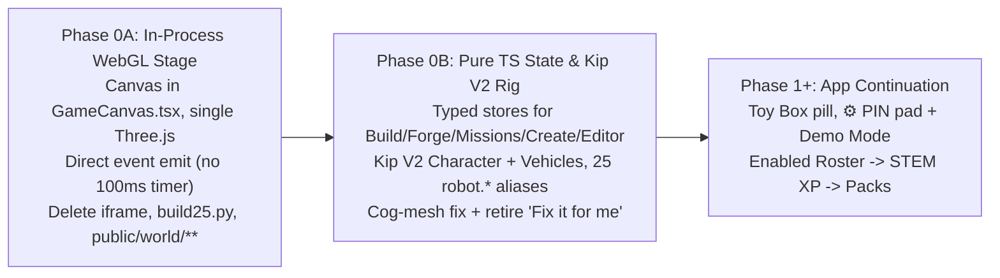

# Spec: Native ToyVentor World Port (Phase 0)

Companion to [app-continuation-spec.md](app-continuation-spec.md) and
[stage-simplification-and-kip-spec.md](stage-simplification-and-kip-spec.md).
Slots in as **Phase 0** ahead of Phases 1-5 so the stage runs natively inside
the Vite/React bundle instead of a scraped same-origin `<iframe>`.

## 1. Problem & Goal

Before Phase 0A, [`GameCanvas.tsx`](../../src/features/game/world/GameCanvas.tsx) mounted
`<iframe src="/world/ToyVentor-World.html">` compiled by `game/build25.py` from
`game/engine25.js` (now ported to [`src/features/game/world/runtime/world.ts`](../../src/features/game/world/runtime/world.ts), `1,152` lines), while
[`engine.ts`](../../src/features/game/world/engine.ts) polls hidden iframe DOM
sheets (`#sheet`, `#mp`, `#cr`, `#ed`) every `100 ms` and forwards actions via
synthetic `.click()` calls.

That split causes five concrete costs:

1. **Full iframe reload on toy switch:** `setToy(contract)` calls
   `location.reload()`, tearing down the WebGL context and flashing the stage.
2. **Duplicate Three.js payload & Python build step:** `public/world/three/**`
   vendors a separate Three.js `0.160.0` tree alongside `node_modules/three`
   (`0.183.2`, already bundled for `@google/model-viewer`).
3. **Competing HUD chrome:** `.bar1`, `.bar2` (`#home`, `#build`), and `#title`
   inside the iframe duplicate React's top dock.
4. **Kip stage isolation:** Kip's real `public/kip/partspec/*.stl` meshes and
   wardrobe rig live outside the iframe, leaving the stage `Character` on
   legacy primitive spheres/boxes.
5. **Engine freeze bottleneck:** Brain-dump §§6-8 (cog-mesh fix, `Demo Mode`
   world-strip control, `Character = Latest Kip` + `Vehicle` unification, and
   retiring `#fix`) were blocked by the scrape-and-click boundary.

**Goal:** Port the 2.5D Three.js runtime into `src/features/game/world/runtime/`
behind the existing [`EngineHandle`](../../src/features/game/world/engine.ts)
interface in two sequential sub-phases (**Phase 0A** -> **Phase 0B**), then
delete the `<iframe>`, `game/build25.py`, `public/world/ToyVentor-World.html`,
`public/world/three/**`, and `three-v160`.

---

## 2. Two-Step Architecture (`Phase 0A` -> `Phase 0B`)

All React overlays (`GameCanvas.tsx`, `ToyCustomizer.tsx`, `MissionPanel.tsx`,
`CreatePanel.tsx`, `EditorPanel.tsx`, `SleepCurtain.tsx`) continue talking
exclusively to `EngineHandle`; no React overlay rewrite is required.

---

## 3. Phase 0A — In-Process WebGL Stage & Iframe Removal

### 3.1 Single Three.js Dependency

- Promote `three` (`^0.183.2`, already resolved in `node_modules/three` via
  `@google/model-viewer`) and `@types/three` as direct dependencies in
  [`package.json`](../../package.json); remove the `three-v160` alias.
- Import `THREE` and the six postprocessing passes directly through Vite ES
  modules (`EffectComposer`, `RenderPass`, `ShaderPass`, `UnrealBloomPass`,
  `OutputPass`, `FXAAShader` from `three/examples/jsm/...`).

### 3.2 Native Stage Host & Scoped Lifecycle

- Replace `<iframe ref={frameRef}>` in `GameCanvas.tsx` with a dedicated stage
  host `
`.
- `createEngine(hostEl, events, initial)` instantiates an isolated runtime
  instance with **zero module-level mutable singletons** so React 19
  `StrictMode` mount -> unmount -> remount is deterministic and leak-free:
  - `AbortController` owns every `pointer*`, `wheel`, `keydown`, `keyup`, and
    `resize` / `ResizeObserver` listener.
  - `dispose()` cancels `requestAnimationFrame`, disposes `EffectComposer`
    render targets, geometries, materials, textures, and `WebGLRenderer`,
    closes any active `AudioContext`, and clears the host container (`<= 1`
    live WebGL context at all times).

### 3.3 Event-Driven Sync & Instant Toy Switching

- Remove `POLL_MS = 100` `window.setInterval` from `engine.ts`.
- The runtime invokes a microtask-batched `notify()` hook on every state
  transition (`save()`, world switch, zoom change, part/paint select, mission
  open/step/complete, Create turn, Editor action, toast).
- `setToy(contract)` applies `contract` (`type`, `parts`, `col`, `name`)
  in-memory and rebuilds only the player rig (`< 1 ms`, zero stage reload,
  camera and world position preserved).

### 3.4 Stage Chrome Ownership (`Demo Mode` Ready)

- Only the `<canvas>`, diegetic world intro banner (`#intro`), floating part
  pickup card (`#pcard`), speech/hint bubble (`#bub`), tool belt (`#beltb` /
  `#belt`), and ability move tray (`#tray`) render in the stage layer.
- Legacy duplicate iframe bars (`#home`, `#build`, `#title` button stack) are
  not rendered onto the stage.
- World/lab switching is owned by React:
  - **`Demo Mode: Off` (default):** compact `Worlds` selector in React plus
    auto-boot straight onto the active world stage.
  - **`Demo Mode: On` (toggled inside `⚙️`):** full 12-world / `Lab 1-6`
    quick-jump bar, `Level Editor`, `Kip 3D Rig` viewer, and `Seed Demo Save`.

### 3.5 Share URL Backwards Compatibility (`#toy=`)

- Update [`WORLD_PATH`](../../shared/toycontract.ts) / `toyWorldUrl(contract)`
  to target `/#toy=<encoded>` on the single-stage app root (`/`), read on boot
  by the app shell without an extra navigation.
- Add a lightweight redirect in [`worker/index.ts`](../../worker/index.ts) (and
  Vite dev middleware) mapping `GET /world/ToyVentor-World.html` -> `302 /`
  (client-side `#toy=` fragment is preserved across HTTP `302` redirects by
  browsers) so existing shared links continue to open the exact build.

### 3.6 Files Deleted & Preflight Updates at End of Phase 0A

- **Delete:** `game/build25.py`, `public/world/ToyVentor-World.html`, and
  `public/world/three/**`. Remove `"build:world"` from `package.json`.
- **Update [`scripts/preflight-deploy.ts`](../../scripts/preflight-deploy.ts):**
  replace check `#5` (`ToyVentor-World.html` byte-freshness against Python)
  with a check verifying `public/world/` contains no stale standalone bundle
  and `src/features/game/world/runtime/` typechecks cleanly.

---

## 4. Phase 0B — Pure TypeScript Modules, Kip V2 Stage Rig & §§6/8 Unification

Once the runtime runs in-process (Phase 0A), decompose `game/engine25.js` into
typed modules under `src/features/game/world/runtime/` and delete `game/` plus
any remaining offscreen DOM shims:

| Module | Responsibility |
| --- | --- |
| `catalog.ts` | Canonical `70`-part stage table, world hiding spots (`30` total), stats (`speed`, `spin`, `glow`, `torque`), and the `25`-key `robot.*` -> Kip alias map. |
| `worldScene.ts` | Renderer, postprocessing, camera/zoom, 6 biomes + custom recipe builder, **matched-module background gears**, and stepped-Z backdrop hooks. |
| `playerRig.ts` | Playable 3D hero rig for **`Character` (Latest Kip V2)** and **`Vehicle`** using cached `STLLoader` geometries from `public/kip/` + procedural fallbacks. |
| `customizerState.ts` | Pure typed `CustomizerSnapshot` + Forge state (`open`, `types`, `slots`, `options`, `paints`, `forgeItems`) with **`checkBad` / `#fix` removed**. |
| `missionsState.ts` | Pure typed `MissionPanelSnapshot` state and action handlers for world junk/bridge puzzles and `Lab 1-6` STEM labs, emitting attempt/clean-solve events for Phase 3 XP. |
| `createEditorState.ts` | Pure typed `CreateSnapshot` (`/api/muse/spark` + offline parser) and `EditorSnapshot` (`toyventor.level/1` recipe undo/redo/checks/import/export). |
| `audio.ts` | WebAudio procedural SFX + mute integration with `SleepCurtain` and `LivePlayPanel`. |

### 4.1 Background Cogs Fix (§6) in `worldScene.ts`

- Fix `gear(radius, teeth, thickness, mat)` so tooth count scales proportionally
  with pitch radius (`module m = 2 * radius / teeth`).
- Factory / Junkyard meshing pairs use matched module (`Z1 = 12` at `r1 = 0.90`
  meshing with `Z2 = 8` at `r2 = 0.60`, center distance `r1 + r2 = 1.50`),
  angular velocity `w2 = -w1 * (Z1 / Z2)` (`-1.5 * w1`), and initial phase
  offset `pi / Z2` so teeth interlock cleanly without clipping.
- Keep backdrop layers grouped at explicit `Z` planes (`z = -4, -9, -16, -24`)
  so post-freeze 2.5D illustrated parallax planes drop in without touching
  gameplay coordinates.

### 4.2 Two UI Archetypes (`Character = Latest Kip` + `Vehicle`) & `robot.*` Alias Table (§8)

- Top-level `Build` (`ToyCustomizer.tsx` / `customizerState.ts`) exposes **two
  archetypes only**:
  1. **`Character`** — rendered on the live stage and in the Factory turntable
     using the latest Kip V2 rig (`public/kip/kip-vehicles-wardrobe.js` +
     `public/kip/partspec/*.stl`: `Kip Classic`, `Human`, `Fox`, `Bear`, and
     `Bolt Robot` heads, emotion faceplate, 8 clip-on hairs, hats/crowns, back
     packs/gears/wings/jetpack, and hand props).
  2. **`Vehicle`** — modular chassis, wheels, cab/shell, front, and rear docks.
- [`toyTypeForKind("other")`](../../shared/toycontract.ts) maps to
  `"character"` instead of `"robot"`.
- **Wire & Collectible Compatibility Guarantee:** All `25` `robot.*` keys
  remain valid in `PART`, `ToyContract` (`type: "robot"` accepted on decode and
  normalized onto `Character`), saved `tvMyWorlds` / `edValid`, `/api/muse/spark`
  recipes, and all **`11` of `30` hidden world spots** (`robot.head.cams` &
  `robot.top.gearcrown` in `sky`; `robot.torso.barrel`, `robot.arms.tools` &
  `robot.legs.wheels` in `junk`; `robot.arms.propellers` & `robot.top.radar` in
  `beach`; `robot.torso.core` & `robot.legs.springs` in `snow`; `robot.head.tv`
  & `robot.top.bulb` in `room`).

| Legacy `robot.*` Key Group (`25` keys) | Kip `Character` Slot & Visual Target |
| --- | --- |
| `robot.head.{box,dome,cams,tv,visor}` (`5`) | `head` -> Kip `Bolt Robot` / `Visor` head variants (`robotHeadVisor` + sensor/TV faceplate variants) |
| `robot.top.{antenna,siren,gearcrown,radar,bulb}` (`5`) | `hat` (Crown 2x1 dock) -> `Spark Buds`, `Gear Crown`, radar/bulb crown toppers |
| `robot.torso.{box,tank,barrel,core,jet}` (`5`) | `back` (Back 2x2 dock) -> `Bolt Jetpack`, `Explorer Pack`, `Core` / `Barrel` back rigs |
| `robot.arms.{claws,hands,tools,magnets,propellers}` (`5`) | `prop` (Hand Ø6.6 mm shaft dock (5.0 mm flats)) -> `Motion Wrench`, `Motion Spinner`, magnet/claw/propeller tools |
| `robot.legs.{walkers,treads,wheels,springs,hover}` (`5`) | `stance` / `boots` -> Kip spring/hover/tread foot mounts |

### 4.3 Always Auto-Fix & Retiring `"Fix it for me"` (§8)

- Remove `checkBad()`, `S.fixed`, and the `"Fix it for me"` button/banner from
  both `ToyCustomizer.tsx` and `customizerState.ts`.
- Never silently swap a child's chosen part for a different part:
  - Every part surfaced in `Build` and `PrintDrawer` is support-free (`<= 45 deg`
    overhangs, flat bed face) and pre-filtered by `fits-toy` (`shared/checks.ts`).
  - Freehand drops on `Stud Grid` automatically clamp into bed/board bounds,
    snap to the `12.5 mm` (`0.5 TU`) pitch (`snapMm`), and resolve to the
    nearest non-overlapping cell (`findPlacement`).

---

## 5. Verification & Acceptance Gates

1. **Zero `<iframe>` & Zero Duplicate Three.js:** `document.querySelector("iframe")`
   is `null` on the stage; Vite build bundles a single `three` instance;
   `public/world/` and `game/build25.py` are gone.
2. **React 19 `StrictMode` Leak Check:** Double-mounting `<GameCanvas />` leaves
   exact count of `1` active WebGL context, `0` orphaned `requestAnimationFrame`
   loops, and `0` `setInterval` pollers.
3. **Instant Toy Switch:** Switching between `Kip`, `Red Racer`, and a scanned
   toy in `Toy Box` updates the stage hero in-place without resetting world or
   camera state.
4. **Full Gameplay Parity:**
   - All `30` hidden world collectibles (including all `11` `robot.*` world
     spots) can be found, picked up, and equipped on Kip (`Character`) or
     `Vehicle`.
   - All `6` world missions + `Lab 1-6` STEM puzzles open, accept controls, run
     tests, and record completion.
   - `Create` (`/api/muse/spark` + offline parser) and `Level Editor`
     (place/inspect/undo/redo/test/import/export) pass unit + `390x844`
     Playwright E2E checks.
   - Legacy `#toy=` contracts (including `type: "robot"`) and
     `/world/ToyVentor-World.html#toy=...` URLs load cleanly on `/`.
5. **Release Gates Green:** `npm run validate`, `npm run typecheck`, `npm test`,
   `npm run build`, and `npm run preflight` all pass with zero warnings.
