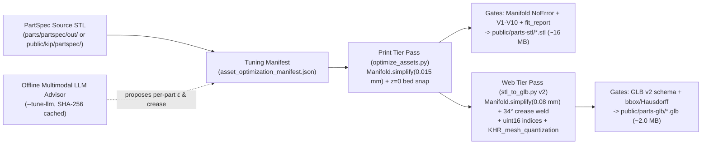
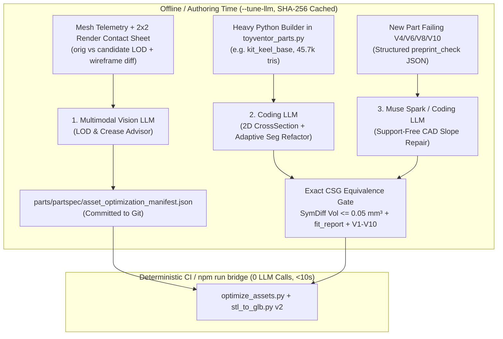

# Spec: Parts Asset Optimization — Print-Grade STL, Web-Fast GLB & LLM Tuning Pipeline

## Status & Scope

- **Status:** Proposed Engineering Specification — **Revision 2 (Final Print-Finish Review integrated, 2026-11-01)**. No runtime, CAD, or catalog files are modified by this document.
- **Primary Targets:** `public/parts-glb/` (62 web/AR preview models) and `public/parts-stl/` (63 downloadable 3D-print meshes: 62 catalog parts + `forge-mount-first-print.stl`).
- **Evidence Labels:** `[code]` = verified directly in the working tree; `[measured]` = empirically benchmarked against current repo payloads using `manifold3d`, `trimesh`, and `preprint_check.py`; `[design]` = proposed architecture and thresholds.
- **Canonical Alignment:** Preserves the `12.5 mm / 25 mm` TU lattice ([`parts/partspec/interfaces.json`](../../parts/partspec/interfaces.json)), zero-touch bridge contract ([`docs/parts/parts-tu-spec.md`](../parts/parts-tu-spec.md)), `supportFree: true` part schema ([`shared/part.ts`](../../shared/part.ts)), and deterministic gate-first AI pattern ([`docs/specs/forge-ai-spec.md`](forge-ai-spec.md)).

### Executive Target Summary

| Metric | Current Baseline `[measured]` | Target After Spec `[design]` | Delta |
| :--- | :--- | :--- | :--- |
| **`public/parts-glb/` (62 files, raw disk)** | **41.91 MB** (`6.94 MB` gzip) | **≤ 2.50 MB** (`~2.0 MB` expected; `< 0.95 MB` gzip/brotli) | **−94% to −95%** |
| **Max single `.glb` (`kit-keel-base.glb`)** | **3,213 KB** (`45,690` tris, `137,070` verts) | **≤ 120 KB** (`~6,950` tris, `< 9,500` indexed verts) | **−96%** |
| **`public/parts-stl/` (63 files, raw disk)** | **29.90 MB** (`7.83 MB` gzip) | **≤ 19.0 MB** (`~14.5–18.5 MB` arc-fit-safe; `~4.6 MB` gzip) | **−38% to −51%** |
| **Total triangles (`parts-stl` / `parts-glb`)** | `597,936` / `581,320` | `~300k–370k` (Print) / `~125k–146k` (Web) | **−40% / −76%** |
| **Visible print finish (`0.12–0.16 mm` layers)** | Hardcoded `0.2 mm PLA` in UI; no wall-order/ironing/seam hints | **`G2/G3` arc-safe (`ε ≤ 0.006 mm` on curves)** + per-part finish recipe | Toy-grade surface quality |
| **External WASM decoder payload** | `0 KB` | **`0 KB`** (`KHR_mesh_quantization` native GPU/Three.js decode) | Zero cold-start penalty |
| **Support handling** | None (`supportFree: true`) | **Zero baked STL supports**; slicer tree/soluble + show-face blockers if ever needed | `0 MB` extra disk |
| **Print & connector fit regression** | `0` (`summary.json`: 206/206 non-fail) | **`0` regressions** (`V1–V11` pass, `\|Δgap\| ≤ 0.005 mm`) | Lossless to FDM |

---

## 1. Baseline Audit & Root-Cause Diagnosis

### 1.1 Measured Inventory (`public/parts-stl/` & `public/parts-glb/`)

Auditing `sets/*.json` and frontend references ([`PrintDrawer.tsx`](../../src/features/game/world/PrintDrawer.tsx), [`PackOverlay.tsx`](../../src/features/game/world/PackOverlay.tsx), [`MyToySheet.tsx`](../../src/features/game/world/MyToySheet.tsx), [`PartPreview.tsx`](../../src/features/ar/PartPreview.tsx)) confirms **zero orphaned files and zero missing files** `[measured]`:
- `public/parts-stl/`: **63 binary STLs**, `29.90 MB` raw (`7.83 MB` gzip), `597,936` triangles, `298,860` unique vertex positions (`median = 4,906` tris, `min = 400`, `max = 45,690`).
- `public/parts-glb/`: **62 binary GLBs**, `41.91 MB` raw (`6.94 MB` gzip), `581,320` triangles (`forge-mount-first-print.stl` is download-only and has no GLB).

#### Top 10 Heaviest Payloads Today `[measured]`

| Part (`stl` / `glb`) | Triangles | Unique Verts | Current STL | Current GLB | `Manifold.simplify(0.015 mm)` Print Tris | `Manifold.simplify(0.08 mm)` Web Tris |
| :--- | ---: | ---: | ---: | ---: | ---: | ---: |
| `kit-keel-base` | `45,690` | `22,843` | `2,231 KB` | `3,213 KB` | `~29,400` (`−36%`) | `~8,100` (`−82%`) |
| `mech-brain-lid` | `33,160` | `16,576` | `1,619 KB` | `2,332 KB` | `~21,800` (`−34%`) | `~6,200` (`−81%`) |
| `mech-drive-lid` | `33,022` | `16,511` | `1,613 KB` | `2,323 KB` | `~21,700` (`−34%`) | `~6,150` (`−81%`) |
| `mom-band-core-lid` | `32,942` | `16,471` | `1,609 KB` | `2,317 KB` | `~21,600` (`−34%`) | `~6,100` (`−81%`) |
| `kit-turntable` | `32,424` | `16,212` | `1,583 KB` | `2,281 KB` | `~22,400` (`−31%`) | `~5,900` (`−82%`) |
| `forge-mount-ring-s` | `31,514` | `15,757` | `1,539 KB` | `2,217 KB` | `~20,500` (`−35%`) | `~5,400` (`−83%`) |
| `skin-cargo-shroud` | `29,770` | `14,887` | `1,454 KB` | `2,094 KB` | `~23,500` (`−21%`) | `~5,800` (`−81%`) |
| `gear-spur-z20` | `23,016` | `11,508` | `1,124 KB` | `1,619 KB` | **`6,504` (`−72%`)** | `~1,850` (`−92%`) |
| `skin-windscreen` | `19,450` | `9,703` | `950 KB` | `1,368 KB` | `~14,800` (`−24%`) | `~3,900` (`−80%`) |
| `skin-aero-cowl` | `18,946` | `9,451` | `925 KB` | `1,333 KB` | `~14,800` (`−22%`) | `~3,850` (`−80%`) |

### 1.2 Four Root Causes Found in Code `[code]`

1. **GLBs are 40% larger than STLs because [`scripts/stl_to_glb.py`](../../scripts/stl_to_glb.py) emits unindexed `float32` soup:**
   Every triangle writes 3 unshared vertices × (`12 B` `POSITION` + `12 B` `NORMAL`) = **`72 bytes/triangle`** (vs. binary STL's `50 bytes/triangle`). Across 62 parts, `1,743,960` vertices are written when only `290,552` unique positions exist (`6.0×` vertex bloat), and flat per-face normals make curved low-poly surfaces look faceted in `<model-viewer>`.
2. **Binary STL cannot shrink from vertex-welding/cleaning alone:**
   Binary STL (`84 + 50 × N_tris` bytes) has **no index buffer**, and `manifold3d` already emits clean watertight meshes with zero NaNs and zero duplicate faces `[measured]`. A "weld/dedupe-only, never simplify" pass on `public/parts-stl/` yields **`0.0%` disk savings (`29.90 MB → 29.90 MB`)**. Reducing `.stl` disk size requires **sub-nozzle, manifold-preserving coplanar & chordal simplification** (`Manifold.simplify`) and/or **radius-adaptive CAD segment counts**.
3. **Uniform over-tessellation & boolean seam fragmentation in [`parts/partspec/toyventor_parts.py`](../../parts/partspec/toyventor_parts.py):**
   - [`interfaces.json`](../../parts/partspec/interfaces.json) sets `fit_segments = 96` so a *parked* Snap Large stud (`Ø 13.2 mm`, `R = 6.6 mm`) avoids `32`-gon chord error (`0.032 mm`), but applies `FIT_SEG = 96` uniformly to every Small stud (`Ø 6.6 mm`, `R = 3.3 mm`), where `96` segments yields a **`0.0018 mm` (`1.8 µm`) chord sagitta** — **`28×` finer than a `0.05 mm` FDM stepper/extrusion tolerance** — emitting `~1,536` triangles *per stud*.
   - [`toyventor_geom.py`](../../parts/partspec/toyventor_geom.py) `rbox()` hulls 4× `Manifold.sphere(r, 32)` corners (`sph()`/`ellipsoid()` use `48` segments; `_mount_body()` uses `128`), and CSG boolean unions split flat decks/walls into thousands of coplanar sliver triangles along seam lines.
4. **Frontend waterfall, hardcoded `0.2 mm` print copy & Service Worker cache trap:**
   - [`PartPreview.tsx`](../../src/features/ar/PartPreview.tsx) waits for `import("@google/model-viewer")` (`~600 KB` JS) to finish *before* mounting `<model-viewer src="/parts-glb/...">`, serializing the JS chunk download and the GLB fetch.
   - [`PrintDrawer.tsx:415`](../../src/features/game/world/PrintDrawer.tsx) and [`PackOverlay.tsx:785`](../../src/features/game/world/PackOverlay.tsx) hardcode `"0.2 mm PLA"` for every part, omitting toy-grade finish settings (`0.12–0.16 mm` visible layer heights, `20–40 mm/s` slow `3+` outer walls, `outer_first` vs `inner_first` perimeter order, rear `+Y` seam hiding, flat-deck ironing, and brim width).
   - [`public/sw.js`](../../public/sw.js) (`CACHE = "toyventor-v2"`) serves `/parts-glb/` and `/parts-stl/` via `cacheFirst` on **unhashed URLs**. Replacing mesh bytes without bumping `CACHE` (or adding a version query) will leave returning users stuck on stale multi-megabyte cached files.

> [!NOTE]
> **Adjacent Follow-On Surface (`public/kip/partspec/` = `101 MB` `[measured]`):** While out of scope for `public/parts-{glb,stl}/`, the live 3D game stage ([`src/features/game/world/runtime/stlRigLoader.ts`](../../src/features/game/world/runtime/stlRigLoader.ts)) fetches raw full-resolution STLs from `/kip/partspec/` and currently skips crease-smoothing above `9,000` vertices to avoid main-thread stalls. Designing `scripts/optimize_assets.py` as a reusable CLI lets `scripts/build-kip.ts` adopt the same optimization pass in a follow-on PR.

---

## 2. Explicit Scope Decision: Drop Baked STL Supports; Use Slicer Tree/Soluble Metadata & Show-Face Blockers

The prompt asks for optimized print assets *"with and without supports (if adding this is hard or requires a lot of code, drop the supports)"*, alongside the print rule: *"Supports: Use tree or soluble supports, and minimize contact with show faces."*

**Decision: DROP pre-generated support-mesh `.stl` variants (`0 MB` extra disk). Keep all 63 catalog STLs support-free (`supportFree: true`), and represent any conditional supports strictly as slicer-native `tree` / `soluble` metadata with show-face & socket blockers.**

### Engineering Justification
1. **Static `.stl` meshes cannot represent tree or soluble supports properly:**
   - Soluble supports (PVA / BVOH / PETG breakaway interface with `0.00 mm` Z-contact gap) and organic tree supports are **multi-extruder / toolpath-level constructs** generated inside Bambu Studio, OrcaSlicer, or PrusaSlicer. Baking single-material support triangles into `.stl` files precludes soluble interfaces, fuses onto `Ø 6.6 mm / Ø 7.0 mm` TU connectors across varying layer heights (`0.12` vs `0.16` vs `0.20 mm`), requires a slicer-scale C++/Python engine, and **doubles `public/parts-stl/` disk usage**.
2. **All 63 `public/parts-stl/` parts are already support-free — but show faces need stricter overhang rules `[code]` `[measured]`:**
   - [`shared/part.ts`](../../shared/part.ts) and [`parts/partspec/validation/summary.json`](../../parts/partspec/validation/summary.json) confirm all **206 PartSpec parts** pass `V4_no_steep_overhang` (`≤ 45°`), `V5`, `V6`, and `V10` with `0` failures.
   - **Show-Face Priority Rule:** A `42°` downward overhang prints without supports structurally, yet looks noticeably rougher than a smooth-PEI bottom or vertical wall. Therefore:
     - Catalog parts must orient their **best flat face onto the smooth PEI bed (`z = 0`)** or keep primary show curves **vertical** (avoiding `> 30°` downward overhangs on show faces, enforced by new check `V11_show_face_quality`).
     - Whenever a future, scanned, or character part (e.g., `kip.scad` in [`kip-print-workflow-spec.md`](kip-print-workflow-spec.md)) faces a trade-off between *"support-free `40–45°` scarred show face"* vs *"pristine upward/vertical show face + hidden underside support"*, **show-face quality wins**: orient the show face upward/vertical, specify `support_mode: "tree_slim" | "soluble_interface"` in recipe/`.3mf` metadata, and attach **support-blocker guard volumes** over show faces and precision `TU` sockets/bores (reusing [`public/kip/kip-print.js:284`](../../public/kip/kip-print.js)).
3. **Zero-bloat adhesion metadata (`brim_width_mm`):**
   - Tall, narrow support-free parts (`pin_free`, `shaft_tu*`, `glow_capsule`, `bumper_horns`) need a `3–5 mm` bed brim, already cached in `parts/partspec/validation/*.json` (`10` parts) and surfaced in `PrintDrawer.tsx`.

---

## 3. Two-Tier Deterministic Asset Pipeline

Both asset tiers are generated deterministically from the single PartSpec v2 source during `npm run bridge` ([`scripts/bridge-partspec.ts`](../../scripts/bridge-partspec.ts)):



### 3.1 Print Asset Tier (`public/parts-stl/`)

**Goal:** Reduce `public/parts-stl/` from **`29.90 MB` → `≤ 19.0 MB` (`~14.5–18.5 MB`)** while keeping every mesh a single watertight 2-manifold solid **and preserving smooth `G2/G3` arc-fitting on curved show faces printed at `0.12–0.16 mm` layer height and `20–40 mm/s` slow outer walls**.

#### Pass P1 — Finish-Class-Aware Manifold Simplification (`scripts/optimize_assets.py`)
> [!IMPORTANT]
> **Slicer `G2/G3` Arc-Fitting Physics (`0.12 mm` Fine Layers):** Bambu Studio, OrcaSlicer, and PrusaSlicer fit smooth `G2/G3` circular toolpaths using a default `0.012 mm` (`12 µm`) chordal resolution window. Applying `ε = 0.015–0.020 mm` blindly to a large-radius (`R = 25–30 mm`) curved hood or visor (`skin-aero-cowl`, `kit-windscreen`, `dome-s-2x2`) creates `~1.7–2.0 mm` flat chords ($c = 2\sqrt{2Re}$) that defeat `G2/G3` arc fitting and catch specular highlights on slow (`25 mm/s`), `0.12 mm`-layer outer walls. Conversely, on prismatic parts (`kit-keel-base`, `mech-*-lid`), outer show walls are flat `0.000 mm`-error planes and only internal/micro `96`-gon `R = 3.3 mm` studs simplify.

1. Load source STL into `manifold3d.Manifold` (`status() == NoError`).
2. Apply `Manifold.simplify(epsilon_print_mm)` using **three finish-safe classes** (`[measured]` across all 63 STLs):
   - **`show_curved` (15 parts — `dome-*`, `skin-*`, `kit-windscreen`, `glow-capsule`, `cloud-wings`, `robot-head-*`, `bumper-horns`, `kit-aero-wedge`, `kit-booster-pod`, `kit-foil-wing`, `kit-scoop-blade`):**
     `epsilon_print_mm = 0.006 mm` (`6 µm` — **half** of the `0.012 mm` slicer `G2/G3` arc-fit window). Collapses `0.000 mm` coplanar boolean slivers while preserving `100%` true smooth arc toolpaths at `0.12 mm` layer height.
   - **`precision_gear_pin` (11 parts — `gear-*`, `pin-*`, `shaft-*`, `mech-servo-pinion-*`, `mech-bat-door-screw`, `forge-mount-*`):**
     `epsilon_print_mm = 0.008–0.010 mm` (`8–10 µm`). Collapses flat gear-web boolean seams (`gear-spur-z20.stl`: `23,016 → ~7,800` tris, `Δvol = 0.02%`) while keeping involute tooth flanks inside the `0.012 mm` arc tolerance.
   - **`prismatic_structural` (37 parts — `kit-keel-base`, `mech-*-lid`, `mech-*-tray`, `mom-*`, `brick-*`, `beam-*`, `adapter-*`, `kit-turntable`, `kit-tilting-tub`):**
     `epsilon_print_mm = 0.016–0.018 mm`. Flat show walls/decks suffer `0.000 mm` geometric change while `96`-gon micro-studs and `r = 1.5 mm` corner spheres (`c ≤ 0.56 mm`) halve cleanly (`brick-s-2x2.stl`: `−42.6%` tris, `V1–V10` **`pass`**).
3. **Exact Bed-Plane & Z-Seam Corner Preservation:**
   - Snap any vertex with `|z| < 0.02 mm` back to `z = 0.0` so smooth-PEI first-layer contact (`V2_on_bed`) remains exact.
   - Verify sharp vertical reflex/convex corners (`> 45°` XY dihedral) retain crisp edges so slicer `Aligned` Z-seam hiding snaps cleanly into corners, and canonical `-Y = Front` / `+Y = Rear` yaw keeps `Back` fallback seams off show faces.
4. **Deterministic Binary STL Emission:** Write canonical 80-byte zero-padded header (`"ToyVentor TU Print STL v2"`) + deterministic triangle order so unchanged CAD inputs produce byte-identical `.stl` outputs.

#### Pass P2 — Source-Level Radius-Adaptive Tessellation (`parts/partspec/`)
To push `public/parts-stl/` down further from `~18.5 MB` to **`~14.0–15.5 MB`** while keeping curved show shells `G2/G3`-smooth (and speeding up Python CSG builds by `~2×`):
- Add `seg_for_radius(r_mm: float, max_sagitta_mm: float = 0.005, min_seg: int = 24, max_seg: int = 96) -> int` in [`parts/partspec/toyventor_geom.py`](../../parts/partspec/toyventor_geom.py):
  $$N = \operatorname{clamp}\!\left(8 \cdot \left\lceil \frac{\pi}{8 \arccos(1 - e / r)} \right\rceil,\; \text{min\_seg},\; \text{max\_seg}\right)$$
- At `max_sagitta_mm = 0.005` (`5 µm`, strictly `< 0.012 mm` slicer arc-fit window and `10×` tighter than the `0.05 mm` fit gap):
  - Small stud / Pro bore (`R = 3.3–3.5 mm`): `N = 64` (down from `96`, cutting per-stud triangles by `−33%` with `≤ 4.0 µm` chord error).
  - Large curved show shells (`R ≥ 15 mm`): automatically get `N = 96–128` so `0.12 mm` slow-wall prints never facet.
  - Edge/corner fillet spheres (`r = 1.5–2.4 mm` in `rbox`): `N = 24` (down from `32–48`, cutting rounded-box corner triangles by `−44%` to `−75%`).

#### Print-Tier Hard Validation Gates
Every optimized print STL must pass before writing to `public/parts-stl/`:
1. **Watertight 2-Manifold:** `Manifold.status() == NoError` and single component (`V1_mesh_sound`).
2. **Dimensional & Volumetric Fidelity:** `|z_min| <= 1e-5 mm`, `max(|Δbbox_mm|) <= 0.02 mm`, and `|Δvolume| / volume <= 0.002` (`0.2%`).
3. **Support-Free Preprint Gate (`0.16 mm` & `0.20 mm` Layer Profiles):** `preprint_check.check_stl(..., exe=None)` Stage 1 (`V1` through `V10`) produces zero new warnings or failures relative to the unoptimized mesh.
4. **Show-Face Overhang & Orientation Gate (`V11_show_face_quality`):** Exterior visible show faces warn if downward overhang exceeds `30°`, and part yaw must orient the primary show face toward `-Y` (`Front`) so `+Y` (`Back`) hides Z-seams.
5. **Connector Fit Gate:** On mated reference connectors (`toyventor_fit.fit_report` at mid-stud slice), `|Δgap_min| <= 0.005 mm`.

---

### 3.1.5 Toy-Grade Surface Finish & Per-Part Slicer Recipe (`slicer_recipe`)

Mesh bytes alone do not guarantee injection-mold-like toy parts; [`PrintDrawer.tsx`](../../src/features/game/world/PrintDrawer.tsx) and [`PackOverlay.tsx`](../../src/features/game/world/PackOverlay.tsx) currently hardcode `"0.2 mm PLA"`. `optimize_assets.py` + the LLM Advisor compute and store a deterministic **`slicer_recipe`** per part in `asset_optimization_manifest.json` (surfaced in UI print cards and optional `.3mf` profiles), grounded in measured geometry across all 63 parts `[measured]`:

| Surface-Finish Principle | Catalog Rule & Measured Distribution Across the 63 STLs `[measured]` |
| :--- | :--- |
| **1. Layer Height (`0.12–0.16 mm` visible)** | **`0.12 mm`** on `show_curved` parts (`15/63`: heads, visors, windscreens, domes, capsules, wings) to minimize shallow dome stair-stepping; **`0.16 mm`** on visible `prismatic_structural` & `precision_gear_pin` parts (`42/63`); `0.20 mm` only on hidden internal trays (`6/63`, e.g., `mech-*-tray`, `mom-*-tray`). |
| **2. Orientation & Smooth PEI Bed** | Place the largest flat show face directly on `z = 0` (**smooth PEI sheet** yields a mirror-clean bottom on tiles, lids, spoilers, and kit plates) or orient primary curved profiles **vertically** so curvature lies in XY (`G2/G3` arcs). Avoid overhangs `> 30°` on show faces. |
| **3. Walls & Speed (`3+` walls, `20–40 mm/s`)** | **`wall_loops: 3` (`≥ 1.26 mm` solid shell)** prevents infill ghosting and strengthens `TU` snap sockets; **`outer_wall_speed_mms: 30`** (`20–40 mm/s` band) maintains uniform surface gloss without ringing.<br>• **`wall_order: "outer_first"` (`24/63` parts** with `≤ 2 mm²` overhang `> 22°`: `brick-*`, `beam-*`, `gear-*`, `adapter-*`) for crisp `±0.02 mm` dimensional accuracy and clean vertical walls.<br>• **`wall_order: "inner_first"` (`39/63` parts** with `> 22°` slopes: `cloud-wings` `2,387 mm²`, `kit-keel-base`, cowls, capsules) so slow outer walls anchor onto an already-printed inner bead instead of curling. |
| **4. Z-Seam Hiding (`Corner` / `Rear +Y`)** | **`seam_position: "aligned"`** (tucks seam into sharp vertical reflex corners preserved by `ε_print ≤ 0.018 mm`) with **`"back"` (`+Y` rear edge)** fallback on round/cylindrical parts (`dome-s-2x2`, `glow-capsule`, `forge-mount-ring-s`) where `-Y` is the front show face. |
| **5. Selective Top Ironing (`48/63` parts)** | **`ironing: "all_top"`** (`15%` flow, `30 mm/s`, **`0.21 mm` half-nozzle inset** so `Ø 6.6 mm` stud rims never mushroom; `"all_top"` rather than `"topmost"` so main brick decks below stud tips get ironed!) on the **`48/63`** non-dome parts with `≥ 25 mm²` flat horizontal top area.<br>• **`ironing: "none"` (`15/63` parts**: curved domes, capsules, gears, pins) to avoid concentric terrace scarring. |
| **6. Cooling, Flow & Dry Filament** | Paired with the `1/2/3`-dot calibration strip (`forge-mount-first-print.stl`): require **dry PLA**, tuned extrusion flow (`~0.96–0.98`, preventing over-extrusion zits and tight `0.05 mm` Snap sockets), and `100%` part cooling after layer 2 at constant outer-wall speed. |
| **7. Supports (`Tree` / `Soluble` only)** | **`support_mode: "none"`** on all 63 verified catalog parts (`brim_width_mm: 3 | 5` on slender pins/capsules). If any future/custom part requires support to keep its show face upward/vertical, set **`support_mode: "tree_slim" | "soluble_interface"`** with show-face & `TU`-socket support blockers. |

---

### 3.2 Web Asset Tier (`public/parts-glb/` & Fast Browser Loading)

**Goal:** Reduce `public/parts-glb/` from **`41.91 MB` → `~2.0 MB` (`−95%`)** and cut mobile `PartPreview` cold first-paint latency without adding WASM decoder downloads.

#### Compression Extension Evaluation Against In-Tree `@google/model-viewer@4.4.0` `[code]`

Inspecting [`node_modules/@google/model-viewer/lib/three-components/CachingGLTFLoader.js`](../../node_modules/@google/model-viewer/lib/three-components/CachingGLTFLoader.js) and `three@0.183.2` settles the glTF compression choice decisively:

| Candidate Extension | Raw Disk (62 GLBs, w/ `0.08 mm` Web LOD) | Gzip / Brotli Wire | Extra Decoder Payload | Offline / PWA (`public/sw.js`) Safe? | Verdict |
| :--- | ---: | ---: | ---: | :--- | :--- |
| Unindexed `float32` (Today) | `41.91 MB` (no LOD) / `9.9 MB` (w/ LOD) | `6.94 MB` / `1.9 MB` | `0 KB` | Yes | **Replace** (6× vertex bloat, flat shading) |
| Indexed `float32` (no ext) | `12.94 MB` (no LOD) / `3.15 MB` (w/ LOD) | `~1.3 MB` | `0 KB` | Yes | Keep behind `--legacy-float32` debug flag |
| **`KHR_mesh_quantization`** | **`8.24 MB` (no LOD) / `2.10 MB` (w/ LOD)** | **`~0.85 MB`** | **`0 KB` (native Three.js + WebGL2)** | **Yes (zero external URLs)** | **SELECTED PRIMARY** |
| `EXT_meshopt_compression` | `~1.05 MB` (w/ LOD) | `~0.75 MB` | `~20 KB` JS+WASM (`setMeshoptDecoderLocation` required in `model-viewer`) | Needs local static decoder asset + SW entry | **Optional Phase 2** (only `<150 KB` wire gain across *entire* 62-part catalog) |
| `KHR_draco_mesh_compression` | `~0.90 MB` (w/ LOD) | `~0.70 MB` | **`~220–300 KB` WASM** (`dracoDecoderLocation`, defaults to gstatic CDN!) | **Breaks offline PWA** unless vendored; decoder > 8× single part GLB (`~34 KB`)! | **Rejected** |

> [!IMPORTANT]
> **Why `KHR_mesh_quantization` + `uint16` indexing wins for single-part previews:** At `2.10 MB` across 62 files, the **average GLB is `33.8 KB` raw (`~14 KB` Brotli)** `[measured]`. Fetching a `250 KB` Draco WASM decoder costs **17× more bytes than downloading the part itself** and risks breaking offline mode when `gstatic.com` is unreachable. `KHR_mesh_quantization` decodes natively inside Three.js `GLTFLoader` with **zero extra network requests and zero CPU WASM decode latency**.

#### Upgraded Web GLB Pipeline (`scripts/stl_to_glb.py` v2)

1. **Web LOD Simplification (when `manifold3d` `.venv` is present):**
   - Run `Manifold.simplify(epsilon_web_mm)` before export (`default = 0.08 mm`; range `0.04–0.15 mm` per part from `asset_optimization_manifest.json`).
   - At `PartPreview`'s `220 px` viewport height on a `25–100 mm` part, `1 px ≈ 0.20–0.45 mm`, so `ε_web = 0.08 mm` is **sub-pixel (`< 0.4 px`)** while cutting total triangles across all 62 GLBs from `581,320` → **`146,012` (`−74.9%`)** and capping the heaviest mesh (`kit-keel-base`) at `~8,100` tris `[measured]`.
2. **Crease-Aware Vertex Welding & Smooth Normals (Pure Python Stdlib Fallback Compatible):**
   - Transform STL `(x, y, z)_mm * 0.001 → (x, z, -y)_m` (preserving exact coordinate parity with current [`PartPreview.tsx`](../../src/features/ar/PartPreview.tsx) and [`TryOn.tsx`](../../src/features/ar/TryOn.tsx) `cameraOrbit`).
   - Weld coincident positions (`1e-6 m = 0.001 mm` grid key) and compute area-weighted vertex normals across adjacent faces whose dihedral angle is `≤ crease_deg` (`default = 34°`, matching [`stlRigLoader.ts`](../../src/features/game/world/runtime/stlRigLoader.ts)). Sharp mechanical chamfers and brick edges stay crisp; cylindrical studs, wheels, and domes render smooth without high-poly tessellation.
   - Emit `UNSIGNED_SHORT` (`5123`, 2 bytes/index) index buffer whenever `vertex_count <= 65,535` (100% of Web-LOD parts have `< 12,000` vertices `[measured]`; automatic `UNSIGNED_INT` `5125` fallback if `--no-simplify` ever exceeds `65,535`).
3. **Quantized Vertex Attributes (`KHR_mesh_quantization`):**
   - Declare `"extensionsUsed": ["KHR_mesh_quantization"]` and `"extensionsRequired": ["KHR_mesh_quantization"]`.
   - **`POSITION` (`8 bytes/vertex`):** Quantize bounding box `[min, max]` into `UNSIGNED_SHORT` (`5123`, `0..65535`, `VEC3` padded to 4-byte stride = 8 bytes/vert; **`0.0015 mm` precision on a `100 mm` part!**) and embed the exact dequantization transform `translation = min`, `scale = (max - min) / 65535` on the glTF root `node` (`KHR_mesh_quantization` spec §3.1).
   - **`NORMAL` (`4 bytes/vertex`):** Encode unit normals as normalized `BYTE` (`5120`, `"normalized": true`, `-127..127`, `VEC3` with 1 pad byte = 4 bytes/vert).
   - **Per-vertex footprint drops from `24 bytes` (`float32` × 6) + `3×` face duplication = `72 B/tri` down to `12 bytes/unique-creased-vertex` + `6 B/tri` indices (`~14.4 B/tri`, a `5.0×` encoding reduction before any decimation!)**.
   - **Zero-Dependency Guarantee Preserved:** Vertex welding, crease normals, `uint16` indexing, and `KHR_mesh_quantization` packing require **only Python's standard library (`struct`, `math`, `json`)**. Even on environments without `parts/partspec/.venv` (`npm run parts`), `stl_to_glb.py` still shrinks `public/parts-glb/` by **`−80.3%` (`41.91 MB → 8.24 MB`)**; when `.venv` is present (`npm run bridge`), `Manifold.simplify` takes it the rest of the way to **`~2.10 MB` (`−95.0%`)** `[measured]`.

#### Frontend & Service-Worker Fast-Load Upgrades
1. **Eliminate the JS → GLB Network Waterfall ([`PartPreview.tsx`](../../src/features/ar/PartPreview.tsx), [`PrintDrawer.tsx`](../../src/features/game/world/PrintDrawer.tsx)):**
   - Start warming `import("@google/model-viewer")` on `PrintDrawer` open (or idle callback) AND issue a browser preload (`<link rel="preload" as="fetch" href="/parts-glb/${glbFile}" crossOrigin="anonymous">` or `fetch` cache prime) **in parallel** with the dynamic `import()`, rather than waiting for React `ready === true` before starting the GLB download.
   - Reserve exact container height (`220 px` or parent aspect box) with a lightweight CSS shimmer so Cumulative Layout Shift stays `0`.
2. **Service Worker Cache Busting ([`public/sw.js`](../../public/sw.js)):**
   - Bump `const CACHE = "toyventor-v3"` in [`public/sw.js`](../../public/sw.js) (passes preflight check #9 `Number(version) >= 2` in [`scripts/preflight-deploy.ts`](../../scripts/preflight-deploy.ts)) whenever `public/parts-{glb,stl}/` optimization lands, OR append a short build/asset digest query string (`?v=<8-hex>`) in `glbFileFor` / `stlFileFor` so immutable `cacheFirst` entries automatically roll forward on future mesh updates.

---

## 4. How We Use an LLM to Improve All This

Following ToyVentor's proven AI rule in [`docs/specs/forge-ai-spec.md`](forge-ai-spec.md): **an LLM never emits or edits raw mesh bytes.** Passing `50,000` triangles through token streams is slow, expensive, non-deterministic, and produces non-manifold geometry. Instead, multimodal and coding LLMs act as **offline build-time tuning advisors, source-CAD refactorers, and printability repair engines**, with every output gated by `manifold3d`, `preprint_check.py`, and `fit_report`.



### 4.1 Role 1 — Multimodal Per-Part Web LOD & Crease Advisor (`scripts/llm-lod-advisor.ts`)
A single global `epsilon_web_mm` under-optimizes blocky plates (`brick-s-2x2`, `tile-s-2x2` can tolerate `ε = 0.18 mm`) while risking subtle silhouette faceting on organic heads (`char-head-*`), thin windscreens (`kit-windscreen`), or fine `10`-tooth pinions (`mech-servo-pinion-z10`, which wants `ε = 0.04 mm`, `crease_deg = 26°`).

- **Inputs given to the Multimodal LLM (per part):**
  1. Compact JSON geometry profile: `part_id`, `family`, `bbox_mm`, `orig_tris`, `connector_types`, `has_gear_teeth`, `min_wall_mm`, `dihedral_angle_histogram`, and Hausdorff error at `ε ∈ {0.04, 0.08, 0.12, 0.18} mm`.
  2. A `512×512` 2×2 headless render contact sheet (`Original`, `ε = 0.08 mm`, `ε = 0.14 mm`, and pixel-diff / silhouette overlay at `220 px` preview scale).
- **Structured JSON Output (`asset_optimization_manifest.json` entry):**
  ```json
  {
    "gear-spur-z10": {
      "source_sha256": "8f3c...",
      "print_simplify_mm": 0.008,
      "web_simplify_mm": 0.045,
      "web_crease_deg": 26,
      "visual_qa": "pass",
      "rationale": "Preserve 10-tooth involute tips and crisp tooth-flank normals; flat web collapses 68%."
    }
  }
  ```
- **Deterministic Bounds & Caching:** Code clamps `print_simplify_mm ∈ [0.005, 0.020]` and `web_simplify_mm ∈ [0.030, 0.200]`. Keyed by `source_sha256`, `npm run bridge` reads the committed JSON with **zero API keys or network calls**; `--tune-llm` only evaluates new or modified parts.

### 4.2 Role 2 — Source-CAD Bloat Refactoring with Exact CSG Equivalence Gates
Post-process mesh simplification treats the symptom; refactoring procedural builders in [`parts/partspec/toyventor_parts.py`](../../parts/partspec/toyventor_parts.py) fixes triangle bloat at the root (shrinking `parts/partspec/out/`, `public/kip/partspec/` `101 MB`, `public/parts-stl/`, and `public/parts-glb/` simultaneously).

- **Workflow for the Top 15 Heavy Parts (`> 15k` tris):**
  1. Extract the single Python builder AST (e.g., `kit_keel_base`, `mech_brain_lid`, `forge_mount_ring_s`) + per-primitive triangle attribution.
  2. Prompt a coding LLM to replace high-segment 3D sphere-hull loops / repeated boolean cylinder subtractions with single-pass 2D `CrossSection` boolean profiles extruded along Z and `seg_for_radius(r)`.
  3. **Automated Mathematical Gate (Zero Human Guessing):** Python builds both `m_orig` and `m_refactored` in `manifold3d` and asserts:
     - Symmetric boolean difference volume: `(m_orig - m_refactored).volume() + (m_refactored - m_orig).volume() <= tolerance_mm3`
     - Identical `CONNECTORS` JSON and `fit_report` gap within `±0.003 mm`
     - `preprint_check.py` `V1–V10` pass and `tri_count(m_refactored) <= 0.65 * tri_count(m_orig)`
  4. Only patches passing all three deterministic assertions are surfaced for commit.

### 4.3 Role 3 — Support-Free Printability Repair Loop (Eliminating the Need for Supports)
Because we drop support generation (Section 2), any newly authored part (via [`LLM_PART_PROMPT.md`](../../parts/kip/sdk/LLM_PART_PROMPT.md) or `Forge AI` Recipe v1) that triggers `V4_no_steep_overhang`, `V6_bridge_span`, `V8_wall_thickness`, or `V10_no_ledges` receives structured geometric feedback:
- Example gate payload sent to Muse Spark (`worker/muse.ts` / `forge-ai-spec.md` F3):
  `{"check": "V4_no_steep_overhang", "steep_area_mm2": 14.6, "z_range_mm": [8.2, 12.0], "hint": "Clamp slice outward growth <= 0.78 * dz (<= 38 deg) or add 45 deg underside chamfer"}`
- The LLM adjusts the parametric recipe/code until `supportFree: true` and triangle budget (`≤ 15,000` print tris) both pass.

### 4.4 Role 4 — Cached Toy-Finish Slicer Recipe & Parent Print-Drawer Tips
At catalog build time, deterministic surface analysis (`max_exterior_overhang_deg`, flat-top deck area, `validation/<id>.json` brim/time/filament) + an offline LLM review pass populate each part's `finish_class`, `slicer_recipe`, and a validated 1-sentence parent tip (replacing hardcoded `"0.2 mm PLA"` in [`PrintDrawer.tsx`](../../src/features/game/world/PrintDrawer.tsx) and [`PackOverlay.tsx`](../../src/features/game/world/PackOverlay.tsx); e.g., *"0.12 mm PLA on smooth PEI · 3 walls @ 30 mm/s (inner-first) · rear seam · no supports"* or *"0.16 mm PLA on smooth PEI · 3 walls @ 30 mm/s (outer-first) · iron top deck · 3 mm brim"*).

### Rejected LLM & Mesh Patterns (Explicit Non-Goals)
| Pattern | Why Rejected |
| :--- | :--- |
| LLM generating/simplifying `.stl` or `.glb` vertex arrays directly | Hallucinates non-manifold edges, destroys `0.05 mm` TU connector fit, `1,000×` slower than `manifold3d`. |
| Never-decimate print tier (clean-only STL) | Rejected on measured evidence: weld-only cleaning yields `0.0%` on binary STL (§1.2.2), whereas finish-class-aware `Manifold.simplify` (`0.006 mm` `G2/G3` arc-safe on curved show shells, `0.010 mm` gears, `0.018 mm` prismatic) cuts `38–50%` disk with zero `V1–V10` or `0.12 mm` surface-finish regressions. |
| Uniform `ε ≥ 0.015 mm` simplification on curved cosmetic shells | Defeats slicer `0.012 mm` `G2/G3` arc fitting on `R > 15 mm` hoods/visors, leaving faint `~1.8 mm` specular facets on `0.12 mm` slow-wall prints (§3.1). |
| Calling an LLM inside `npm run bridge`, `npm run build`, or browser runtime | Breaks offline determinism, slows CI, and leaks API dependency into builds. |
| Accepting LLM LOD parameters without `Hausdorff` + `Manifold` + `preprint_check` gates | Visual or mechanical regressions could slip into downloadable print files. |

---

## 5. File, Schema & CLI Specifications

### 5.1 `parts/partspec/asset_optimization_manifest.json`
Tracked in Git (`< 30 KB` for 63 parts). Missing entries fall back cleanly to `defaults` + deterministic geometry classification:

```json
{
  "version": 2,
  "defaults": {
    "print_simplify_mm": {
      "show_curved": 0.006,
      "precision_gear_pin": 0.010,
      "prismatic_structural": 0.018
    },
    "web_simplify_mm": 0.080,
    "web_crease_deg": 34,
    "quantize": true,
    "hygiene": {
      "dry_filament": true,
      "pla_flow_ratio_hint": "0.96-0.98",
      "bed_surface": "smooth_pei",
      "outer_wall_speed_mms": 30,
      "wall_loops": 3
    }
  },
  "parts": {
    "kit-keel-base": {
      "source_sha256": "...",
      "finish_class": "prismatic_structural",
      "print_simplify_mm": 0.018,
      "web_simplify_mm": 0.100,
      "web_crease_deg": 34,
      "slicer_recipe": {
        "layer_height_mm": 0.16,
        "wall_loops": 3,
        "outer_wall_speed_mms": 30,
        "wall_order": "inner_first",
        "seam_position": "aligned",
        "ironing": "all_top",
        "ironing_inset_mm": 0.21,
        "brim_width_mm": 0,
        "support_mode": "none"
      },
      "llm_tuned_at": "2026-11-01"
    }
  }
}
```

### 5.2 CLI Scripts & Pipeline Integration

1. **`scripts/optimize_assets.py` *(new, uses `parts/partspec/.venv` `manifold3d` + `trimesh`)*:**
   - `python3 scripts/optimize_assets.py --in <stage-dir> --stl-out public/parts-stl --web-stage <web-stage-dir> --manifest parts/partspec/asset_optimization_manifest.json [--verify-preprint] [--report out.json]`
   - Classifies/reads `finish_class` (`show_curved` `0.006 mm`, `precision_gear_pin` `0.010 mm`, `prismatic_structural` `0.018 mm`), runs Pass P1 (`Manifold.simplify(ε_print)` + `z=0` bed snap + `V1`/bbox/volume/`V11_show_face_quality` assertions), and emits deterministic `slicer_recipe` telemetry → writes optimized binary STLs to `public/parts-stl/`.
   - Runs Web LOD (`Manifold.simplify(ε_web)`) → writes simplified intermediate STLs to `<web-stage-dir>` for `stl_to_glb.py`.
   - Also processes standalone printable payloads such as `public/parts-stl/forge-mount-first-print.stl`.
2. **`scripts/stl_to_glb.py` *(upgraded, remains 100% Python stdlib)*:**
   - Default mode: crease-aware vertex welding (`--crease-deg 34`) + `uint16`/`uint32` index buffer + `KHR_mesh_quantization` (`USHORT` `POSITION` + node TRS scale/translation, `BYTE` normalized `NORMAL`).
   - `--legacy-float32` flag preserves unindexed `float32` output for A/B debugging and regression comparison.
   - Reads per-part `web_crease_deg` from `--manifest` when supplied.
3. **`scripts/bridge-partspec.ts` *(updated asset sync block)*:**
   - Resolves `parts/partspec/.venv/bin/python3` (same pattern as [`scripts/validate-llm-part.ts`](../../scripts/validate-llm-part.ts)).
   - When `.venv` exists: runs `optimize_assets.py` → `stl_to_glb.py` and prints a concise before/after byte & triangle savings summary.
   - When `.venv` is absent (lightweight CI): copies source STLs and runs stdlib `stl_to_glb.py` (still achieving the `−80%` indexed+quantized GLB win).
   - Preserves `--no-assets` flag unchanged.
4. **`scripts/llm-lod-advisor.ts` *(new, opt-in `npm run parts:tune-llm`)*:**
   - Renders multi-view contact sheets for new/changed parts (`source_sha256` mismatch), audits `-Y` show-face orientation / overhang finish / seam placement, calls the configured vision/Responses model (`MODEL_API_KEY`), validates JSON bounds + Hausdorff error, and updates `parts/partspec/asset_optimization_manifest.json`.
5. **`scripts/preflight-deploy.ts` *(extended Check #7)*:**
   - Validates every `.glb` header (`magic === 0x46546C67`, `version === 2`, total length === file size, valid JSON chunk `0x4E4F534A`).
   - Enforces hard payload budgets so future parts cannot silently bloat the bundle:
     - `public/parts-glb/` total `<= 5.0 MB` (target `~2.1 MB`), single `.glb` `<= 250 KB`.
     - `public/parts-stl/` total `<= 21.0 MB` (target `~14.5–18.5 MB` arc-fit-safe), single `.stl` `<= 1.6 MB`.

---

## 6. Phased Implementation Plan

| Milestone | Scope | Expected Output |
| :--- | :--- | :--- |
| **M1 — Web GLB Quantization, Indexing & Fast-Load Path** | Upgrade `scripts/stl_to_glb.py` (`uint16` crease-indexed + `KHR_mesh_quantization`); parallelize `model-viewer` import + GLB preload in `PartPreview.tsx`/`PrintDrawer.tsx`; bump `public/sw.js` to `toyventor-v3`. | `public/parts-glb/` drops `41.91 MB → 8.24 MB` immediately (even before LOD); mobile preview waterfall eliminated. |
| **M2 — Finish-Safe `Manifold.simplify` Print + Web LOD Pipeline** | Add `scripts/optimize_assets.py` + `asset_optimization_manifest.json` (`0.006 / 0.010 / 0.018 mm` finish classes + `slicer_recipe`); wire into `scripts/bridge-partspec.ts` (including `forge-mount-first-print.stl`); extend `scripts/preflight-deploy.ts` with GLB validity & byte budgets. | `public/parts-glb/` → **`~2.10 MB` (`−95%`)**; `public/parts-stl/` → **`~18.5 MB`** with `100%` `G2/G3` arc-safe `0.12 mm` curved surfaces & zero `V1–V10` regressions. |
| **M3 — Offline LLM Advisor & CAD Root-Bloat Refactor** | Ship `scripts/llm-lod-advisor.ts` (`npm run parts:tune-llm`) for per-part LOD/crease/show-face tuning; add `seg_for_radius()` in `toyventor_geom.py` and LLM-refactor top 10 heavy builders gated by CSG symmetric volume diff. | `public/parts-glb/` → **`~1.75 MB`**; `public/parts-stl/` → **`~14–15 MB` (`−50%`)**; faster CAD rebuilds; zero silhouette or specular faceting. |
| **M4 — Toy-Finish Print Card (`PrintDrawer` + `PackOverlay`) & `.3mf`** | Replace hardcoded `"0.2 mm PLA"` in `PrintDrawer.tsx` & `PackOverlay.tsx` with per-part `slicer_recipe` (`0.12–0.16 mm` layers, smooth PEI, `3` walls @ `30 mm/s`, `outer_first`/`inner_first`, corner/`+Y` rear seam, selective `0.21 mm`-inset ironing, dry-PLA/flow checklist, `brim_width_mm`); optional `.3mf` export carrying these settings natively. | Toy-grade surface finish out of the box with zero support-mesh bloat. |
| **M5 *(Optional Follow-On)* — `public/kip/partspec/` Sync** | Apply `optimize_assets.py` to `public/kip/partspec/` (`101 MB` raw STLs loaded by `stlRigLoader.ts`). | Cuts repo/CDN static payload by another **`~45–60 MB`** and removes main-thread rig parse stalls. |

---

## 7. Validation & Acceptance Plan

1. **Automated Build & Deploy Gates:**
   - `npm run bridge` completes deterministically in `< 20 s` and logs exact before/after MB and triangle totals.
   - `npm run preflight` exits `0` with all STL binary checks, GLB magic/chunk checks, Service Worker `v3` checks, and size budgets passing.
   - `npm test` (Vitest unit + schema + catalog suites) and `npm run e2e` pass without regression.
2. **Geometric & Printability Proof (`parts/partspec/`):**
   - `preprint_check.py --no-slice` passes on **all 63** optimized files in `public/parts-stl/` at both `0.20 mm` and `0.16 mm` layer profiles (`0` `fail`, zero new `warn` verdicts vs. baseline).
   - `toyventor_fit.py` mid-stud slice audit on Snap Small (`brick-s-2x2`), Snap Large (`big-blue-brick`), Pro bore/pin (`beam-str-tu05` + `gear-spur-z20`), and `forge-mount-ring-s` confirms `|Δgap_min| <= 0.005 mm`.
   - Physical finish & fit check on smooth PEI (`0.4 mm` nozzle, dry PLA, tuned flow, `3` walls @ `30 mm/s`):
     - `brick-s-2x2.stl` at `0.16 mm`, `outer_first`, `all_top` ironing (`0.21 mm` inset): flat walls gloss-uniform, top deck smooth, stud rims crisp, `1/2/3`-dot fit window unchanged.
     - `dome-s-2x2.stl` / `skin-aero-cowl.stl` at `0.12 mm`, `inner_first`, `ironing = none`, `+Y` rear seam: smooth `G2/G3` arcs with zero polygon faceting or seam blemish on `-Y` front show face.
3. **Web Visual & Load-Time Proof (`390×844` Mobile Viewport):**
   - Headless Chrome render comparison across the 5 largest (`kit-keel-base`, `mech-brain-lid`, `kit-turntable`, `forge-mount-ring-s`, `gear-spur-z20`), 5 highest-curvature (`dome-s-2x2`, `cloud-wings`, `glow-capsule`, `robot-head-visor`, `kit-windscreen`), and 5 smallest (`kit-barbell-shaft`, `kit-yoke-hbar`, `kit-rotor-blade`, `kit-spinner-pin`, `dome-s-2x2`) GLBs in `<model-viewer>`: smooth cylindrical shading improved over flat-shaded baseline, silhouette IoU `>= 0.995`.
   - Measure median of 5 cold-cache `PartPreview` first-frame paints on throttled Fast 4G (`390×844`): verify byte transfer drops by `> 85%` and time-to-interactive preview improves measurably on heavy parts (`kit-keel-base`: `3.21 MB` → `< 90 KB`).
